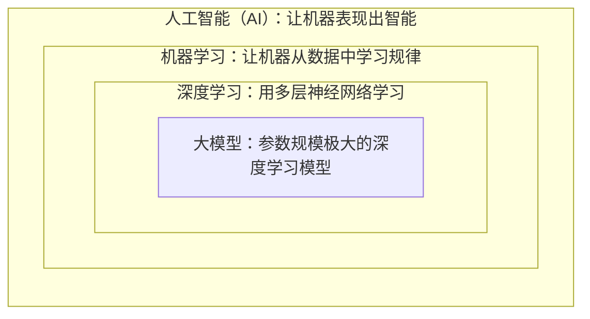
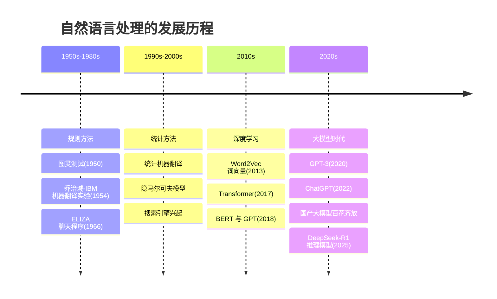
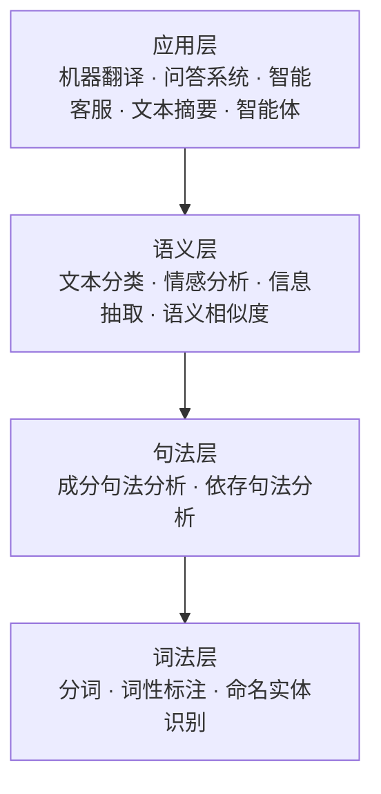
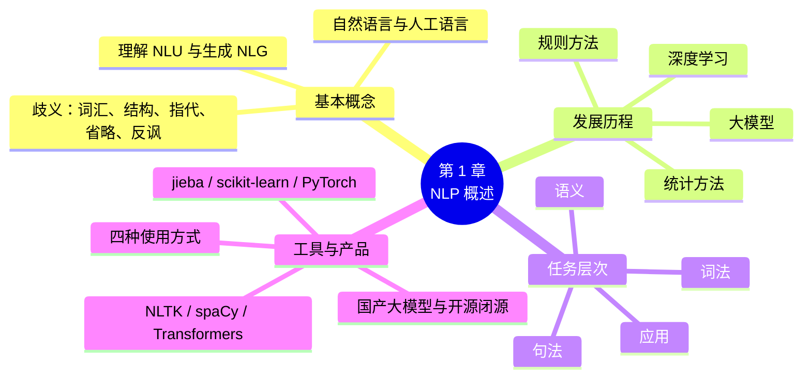

# 第 1 章 自然语言处理概述

!!! abstract "本章学时"
    理论 4 学时 · 实验 1 学时（本章共 3 个实验，教师可任选）

## 学习目标

学完本章，你应该能够：

1. **说出**自然语言处理的定义，列举至少 5 个身边的 NLP 应用；
2. **描述** NLP 从规则方法到大模型的四个发展阶段，以及每个阶段的代表技术；
3. **区分** NLP 的主要任务类型（词法、句法、语义、应用）；
4. **解释**中文处理比英文处理多出的几个难点；
5. **列举**国内外主流大模型产品，并说出开源模型与闭源模型的区别；
6. **完成** Python 实验环境的搭建，并用 NLTK、spaCy、Transformers 运行第一个 NLP 程序。
7. **了解**本书的结构和实验安排，制订适合自己的学习计划。

## 情景导入

早上 7 点，小李的手机闹钟响了。他迷迷糊糊地说了句“小爱同学，再睡 10 分钟”，闹钟乖乖地推迟了。

上班路上，他用输入法打字，刚打出“jt”，候选框里就跳出了“今天”；领导发来一段英文邮件，他用翻译软件一键翻成了中文；中午点外卖，他看了看评论区上方的“好评关键词：分量足、送餐快”；下午，他让 AI 助手帮他把一份 30 页的会议纪要压缩成 5 条要点，再写一封给客户的回复邮件……

这一天里，小李至少和十几个“懂人话”的程序打了交道。语音助手听懂他的指令、输入法猜出他想说的词、翻译软件在两种语言之间转换、评论区自动提炼关键词、AI 助手能读、能总结、还能写——它们背后都是同一门技术：**自然语言处理**。

这门课，我们就来揭开这些程序“懂人话”的秘密。

## 1.1 什么是自然语言处理

### 1.1.1 自然语言与人工语言

**自然语言**（Natural Language）是人类在日常生活中自然形成、用来交流的语言，比如汉语、英语、日语。与之相对的是**人工语言**，例如 Python、Java 这样的编程语言，或者数学公式。

两者最大的区别在于：

| 对比项 | 自然语言 | 人工语言（如 Python） |
|---|---|---|
| 形成方式 | 在长期使用中自然演化 | 由人专门设计 |
| 规则 | 规则多、例外更多 | 规则严格、没有例外 |
| 歧义 | 普遍存在 | 几乎没有 |
| 变化 | 不断出现新词新用法（如“内卷”“躺平”） | 只在版本升级时变化 |

计算机天生“擅长”人工语言：Python 代码写错一个冒号，解释器立刻报错。可自然语言就不一样了，同一句话可以有好几种理解，还经常省略、倒装、用比喻。这正是让计算机理解自然语言很难的原因。

### 1.1.2 自然语言处理的定义

**自然语言处理**（Natural Language Processing，简称 **NLP**）是人工智能的一个分支，研究如何让计算机**理解、处理和生成**人类的自然语言。

通俗地说，NLP 要解决两类问题：

- **自然语言理解**（NLU）：让计算机“读懂”。比如判断一条评论是好评还是差评，从新闻里找出人名和地名。
- **自然语言生成**（NLG）：让计算机“会写”。比如自动写摘要、翻译、回答问题、写文案。

!!! tip "一句话记住"
    NLP = 让计算机 **听懂人话** + **说出人话**。

理解和生成常常是配合使用的。以智能客服为例：用户问“我昨天买的耳机怎么还没发货”，系统先要**理解**——识别出用户的意图是“查询物流”，关键信息是“昨天”“耳机”；然后查询订单系统；最后**生成**一句通顺的回复：“您好，您昨天下单的蓝牙耳机已于今天上午发出，预计后天送达。”

| 类别 | 输入 | 输出 | 例子 |
|---|---|---|---|
| 理解 | 一段文本 | 一个标签或结构化信息 | 评论 → 差评；简历 → 姓名、电话、学历 |
| 生成 | 一段文本或一个要求 | 一段新文本 | 中文 → 英文；长文章 → 摘要；“写一则请假条” → 请假条 |
| 理解 + 生成 | 一个问题 | 一个回答 | 智能客服、AI 助手 |

### 1.1.3 NLP 就在身边

| 应用 | 你见过的产品 | 背后的 NLP 技术 |
|---|---|---|
| 智能输入法 | 搜狗输入法、微信输入法 | 语言模型、联想预测 |
| 搜索引擎 | 百度、必应 | 查询理解、文本匹配、排序 |
| 机器翻译 | 有道翻译、百度翻译、DeepL | 神经机器翻译、大模型翻译 |
| 智能客服 | 电商、银行、运营商客服机器人 | 意图识别、问答系统 |
| 舆情分析 | 政务舆情监测、品牌口碑分析 | 情感分析、文本分类 |
| 语音助手 | 小爱同学、小度、Siri | 语音识别 + 语义理解 |
| 信息抽取 | 简历自动解析、合同要素提取 | 命名实体识别、关系抽取 |
| AI 助手 | DeepSeek、豆包、Kimi、文心一言、通义千问 | 大语言模型 |

### 1.1.4 NLP 与人工智能、机器学习、深度学习的关系

学习 NLP 时，经常会同时听到“人工智能”“机器学习”“深度学习”“大模型”这几个词，它们是什么关系呢？可以用一组“套娃”来理解：



- **人工智能**是最大的概念，泛指让机器完成需要人类智能的任务，比如看、听、说、想、动。
- **机器学习**是实现人工智能的主要方法：不再一条条告诉机器怎么做，而是给它大量例子，让它自己总结规律。
- **深度学习**是机器学习中的一类方法，使用多层神经网络，特别擅长处理图像、语音和文本。
- **大模型**是参数规模极大（通常数十亿以上）、在海量数据上训练出来的深度学习模型。

那 NLP 在哪里？NLP 是按**研究对象**划分的：它研究的是“语言”，就像计算机视觉研究“图像”、语音识别研究“声音”一样。NLP 可以用规则方法，也可以用机器学习、深度学习和大模型方法。所以 NLP 和上面的“套娃”是交叉关系，而不是包含关系。

| 人工智能的方向 | 处理的对象 | 典型应用 |
|---|---|---|
| 自然语言处理 | 文字 | 翻译、问答、写作 |
| 计算机视觉 | 图片、视频 | 人脸识别、自动驾驶 |
| 语音技术 | 声音 | 语音识别、语音合成 |
| 多模态 | 文字 + 图片 + 声音 | 看图说话、AI 视频生成 |

### 1.1.5 让计算机理解语言为什么这么难

人说话时，有很多“言外之意”是靠常识和语境补全的，计算机却没有这些背景知识。归纳起来，难点主要来自**歧义**，而歧义有好几种：

**1. 词汇歧义：一个词有多个意思。**

> 我买了一斤**苹果**。　/　我买了一台**苹果**。

人一看就知道前一个是水果、后一个是手机，计算机要靠“一斤”“一台”这样的上下文来判断。

**2. 结构歧义：同样的词，组合方式不同。**

> **咬死了猎人的狗**

可以理解为“（一只）咬死了猎人的狗”（狗把猎人咬死了），也可以理解为“咬死了（猎人的狗）”（有东西把猎人的狗咬死了）。

**3. 指代歧义：代词指的是谁？**

> 小王给小李打电话，**他**没接。

“他”通常是小李，因为没接电话的应该是被打电话的人。这个判断依赖的是生活常识。

**4. 省略与语境依赖。**

> A：你吃了吗？　B：吃了。

B 省略了主语和宾语。在多轮对话中，计算机必须记住上文，才知道“吃了”是“我吃饭了”。

**5. 言外之意与反讽。**

> 你可真是个“天才”，又把钥匙锁屋里了。

字面是夸奖，实际是批评。判断这类句子的情感，对传统方法来说非常困难，对大模型来说也不是百分之百可靠。

!!! note "想一想"
    人为什么很少被这些歧义困扰？因为我们有**常识**、知道**语境**、了解**说话人**。NLP 七十多年的发展，很大程度上就是在想办法让计算机获得这些知识。大模型之所以强大，正是因为它从海量文本中“读”到了大量常识。

## 1.2 NLP 的发展历程

NLP 已经走过了 70 多年。我们可以把它粗略分为四个阶段，每个阶段解决问题的“思路”都不一样。



### 1.2.1 规则方法时代：让专家写规则

最早的思路很朴素：**语言学家把语法规则一条条写下来，交给计算机执行**。

1966 年诞生的聊天程序 ELIZA 就是典型代表。它扮演心理咨询师，靠的是“关键词 + 模板”：用户说“我很难过”，它找到关键词“难过”，套用模板回答“你为什么觉得难过？”。看起来像在聊天，其实它一点也不“懂”。

我们用几行 Python 代码就能模拟 ELIZA 的思路：

```python
rules = {"难过": "你为什么觉得难过？",
         "工作": "能说说你的工作吗？",
         "妈妈": "你和妈妈的关系怎么样？"}

def eliza(text):
    for keyword, reply in rules.items():
        if keyword in text:          # 发现关键词，就套用对应的模板
            return reply
    return "请继续说。"               # 一个关键词都没找到时的万能回复

print(eliza("最近工作压力很大"))      # 输出：能说说你的工作吗？
print(eliza("我一点也不难过"))        # 输出：你为什么觉得难过？
```

第二句暴露了规则方法的典型问题：用户明明说“**不**难过”，程序只认关键词，照样问“你为什么觉得难过”。要处理否定，就要再加规则；加了否定规则，又要处理“我不是不难过”这种双重否定……

规则方法的问题很明显：语言的例外太多，规则写不完；规则越写越多，还会互相打架。不过它也有优点：**结果可控、可解释、不需要训练数据**。直到今天，手机号、身份证号、日期这类格式固定的信息，仍然常用规则（正则表达式）来提取，我们在第 2 章会学到。

### 1.2.2 统计方法时代：让数据说话

20 世纪 90 年代起，计算机变快了，互联网带来了大量文本。研究者换了个思路：**不再手写规则，而是从大量真实文本中统计规律**。

比如要判断“苹果”指水果还是公司，统计方法会看它周围出现的词：旁边是“手机”“发布会”，多半是公司；旁边是“削皮”“好吃”，多半是水果。

统计方法中最重要的概念之一是**语言模型**：计算一句话“像不像人话”的概率，或者根据前面的词预测下一个词。你每天都在用的输入法就是例子：

> 输入“今天天气很”，候选词依次是：好、热、冷、不错……

输入法之所以把“好”排在第一位，是因为在它统计过的海量文本里，“今天天气很”后面最常跟的就是“好”。这种根据前面几个词预测下一个词的方法叫 **N 元语法**（N-gram）模型。请记住“预测下一个词”这个思路，后面你会发现，今天的大模型本质上也在做同一件事，只是做得好得多。

这个阶段，统计机器翻译、基于统计的分词和词性标注、搜索引擎都得到了广泛应用。统计方法的局限在于：需要人工设计“看哪些特征”（例如“看前后各两个词”），而且只能看到很短的上下文。

### 1.2.3 深度学习时代：让神经网络自己学特征

2010 年以后，深度学习在图像识别上大获成功，也很快进入了 NLP 领域：

- **2013 年，Word2Vec** 让每个词都有了一个“坐标”（词向量），意思相近的词坐标也相近；
- **循环神经网络（RNN）和 LSTM** 能够按顺序“阅读”句子；
- **2017 年，Transformer** 模型提出，它的“注意力机制”能让模型同时关注句子中所有相关的词，成为此后几乎所有大模型的基础；
- **2018 年，BERT 和 GPT** 相继出现，“先在海量文本上预训练，再针对具体任务微调”成为主流做法。

深度学习带来的最大变化是**不再需要人工设计特征**。以垃圾短信识别为例：

| 做法 | 统计机器学习 | 深度学习 |
|---|---|---|
| 人要做什么 | 先想好看哪些特征：有没有“中奖”“点击链接”，有多少个感叹号，号码是不是 106 开头…… | 只需准备大量标注好“是/否垃圾短信”的样本 |
| 机器做什么 | 根据人设计的特征学习权重 | 自己从原始文本中学出有用的特征 |
| 特点 | 依赖专家经验，特征设计费时费力 | 数据越多效果越好，但需要更多算力，结果较难解释 |

“预训练 + 微调”的思路则更像人类的学习过程：先上九年义务教育打好基础（预训练，学通用语言知识），再去职业学校学一门专业（微调，学具体任务）。这样，一个新任务只需要几千条标注数据就能取得不错的效果。

### 1.2.4 大模型时代：一个模型做所有事

2020 年 GPT-3 发布，人们发现：**当模型足够大、训练数据足够多时，它会“涌现”出很多新能力**，只要用自然语言描述任务，它就能直接完成，不用专门训练。

大模型和以前的模型相比，有三个明显的变化：

1. **通用**：以前一个模型只会一件事（会分类就不会翻译），大模型一个模型能做翻译、写作、问答、编程等几乎所有语言任务；
2. **会听指令**：不用写代码训练，用一句自然语言（称为**提示词**，Prompt）就能告诉它做什么；
3. **能举一反三**：给它看一两个例子，它就能照着做（称为**少样本学习**）。

2022 年 11 月 ChatGPT 上线，两个月用户破亿，NLP 正式进入**大语言模型**（Large Language Model，LLM）时代。此后国内的文心一言、通义千问、智谱 GLM、Kimi、豆包、DeepSeek 等大模型陆续发布；2025 年初，DeepSeek 发布的开源推理模型 DeepSeek-R1 以较低的训练成本达到了国际一流水平，引起全球关注。

### 1.2.5 中文信息处理的发展

中文有自己的一条发展线索。计算机最早是为英文设计的，要让计算机处理中文，首先得解决“汉字怎么进计算机”的问题：

- **汉字编码**：1980 年我国发布了《信息交换用汉字编码字符集 基本集》（GB 2312），收录了 6763 个常用汉字，让计算机第一次能统一地存储和显示汉字。后来又有了收字更多的 GBK、GB 18030 和国际通用的 Unicode（UTF-8 是它最常用的存储方式）。直到今天，处理中文文本时遇到的“乱码”，大多还是编码不一致造成的，第 2 章会教你如何解决。
- **汉字输入与排版**：五笔、拼音等输入法让汉字能快速录入，王选院士主持研制的汉字激光照排系统让中文印刷告别了“铅与火”。
- **中文分词与语料库**：20 世纪 80 年代起，国内高校和科研机构开始研究中文自动分词，并建设了大规模的人工标注语料库，为统计方法打下了数据基础。
- **大模型时代**：2023 年起，国内厂商密集发布大模型，中文能力迅速追上并在许多方面达到国际先进水平，开源模型在全球开发者社区中也有很大影响力。

可以说，中文 NLP 走过了“让计算机**存得下**中文 → **切得开**中文 → **读得懂**中文 → **写得好**中文”的道路。

!!! note "四个阶段的思路对比"
    - 规则方法：**人**告诉计算机规则
    - 统计方法：计算机从**数据**中统计规律，但特征仍由人设计
    - 深度学习：计算机从数据中**自己学习特征**，但每个任务要单独训练一个模型
    - 大模型：**一个通用模型**，用自然语言下指令就能完成各种任务

需要强调的是，新方法并没有让旧方法完全消失。在数据少、要求速度快、成本低或者结果必须可解释的场景下，规则和统计方法依然很常用。本书会把经典方法和大模型方法放在一起讲，让你知道什么场合用什么工具。

## 1.3 NLP 的主要任务

NLP 的任务可以按“由浅入深”分为几个层次，就像我们学语文：先认字词，再分析句子，再理解意思，最后读写文章。



| 层次 | 主要任务 | 举例 | 本书章节 |
|---|---|---|---|
| 预处理 | 清洗、规范化文本 | 去掉评论里的表情和链接 | 第 2 章 |
| 词法 | 分词、词性标注 | “我爱北京” → 我/代词 爱/动词 北京/地名 | 第 3 章 |
| 句法 | 分析句子结构 | 找出句子的主语、谓语、宾语 | 第 4 章 |
| 语义 | 文本表示、相似度 | “手机”和“电话”意思相近 | 第 5 章 |
| 应用 | 分类与情感分析 | 判断评论是好评还是差评 | 第 6 章 |
| 应用 | 信息抽取 | 从简历中提取姓名、学校、电话 | 第 7 章 |
| 应用 | 机器翻译与文本生成 | 中英互译、自动写摘要 | 第 10 章 |
| 应用 | 问答与智能体 | 智能客服、知识库问答 | 第 11 章 |

下面用一句话把这几个层次串起来。假设输入是：“**张经理昨天在杭州签下了一笔大订单，团队都很兴奋。**”

1. **词法层**先把句子切成词并标出词性：张/人名 经理/名词 昨天/时间 在/介词 杭州/地名 签下/动词 了/助词 一笔/数量词 大/形容词 订单/名词……同时识别出实体：“张经理”是人，“杭州”是地点，“昨天”是时间。
2. **句法层**分析句子结构：主语是“张经理”，谓语是“签下”，宾语是“订单”；“在杭州”说明地点，“昨天”说明时间。
3. **语义层**理解整体含义：这是一条“签约”事件，情感是积极的（“兴奋”）。
4. **应用层**利用这些分析结果：新闻系统把它归入“商业”类；企业知识库自动生成一条记录“时间：昨天，地点：杭州，人物：张经理，事件：签订大订单”；问答系统被问到“谁签下了订单？”时能回答“张经理”。

在大模型出现之前，一个应用系统通常要把这些模块像流水线一样串起来，前一步出错，后一步跟着出错。大模型则把这些步骤“融合”在模型内部，直接从输入得到输出。但词法、句法、语义这些概念仍然是理解和评估大模型的基础，比如我们说“大模型把这个实体识别错了”，就要先知道什么是实体。

### 1.3.1 一个 NLP 项目是怎样做出来的

不管用哪种方法，一个 NLP 项目一般都要经过下面几个步骤。我们以“给电商平台做一个评论情感分析系统”为例：


| 步骤 | 要做的事 | 电商评论情感分析的例子 | 本书章节 |
|---|---|---|---|
| 需求分析 | 明确输入、输出和效果要求 | 输入一条评论，输出“好评/中评/差评”，准确率要达到 90% | 第 1 章 |
| 数据采集 | 收集训练和测试用的文本 | 从后台导出 10 万条历史评论 | 第 2 章 |
| 预处理与标注 | 清洗数据，人工标注标准答案 | 去掉表情和广告，请标注员给 1 万条评论打标签 | 第 2、3、7 章 |
| 选择方法 | 规则、机器学习、深度学习还是大模型？ | 先用 TF-IDF + 朴素贝叶斯做基线，再试 BERT 和大模型 | 第 5、6、9 章 |
| 训练与调优 | 训练模型，调整参数 | 比较不同模型和参数的效果 | 第 6、8、9 章 |
| 效果评估 | 用测试集计算指标，分析错误 | 计算准确率、F1，查看判断错误的评论 | 第 6 章 |
| 部署上线 | 把模型做成服务供业务调用 | 做成接口，新评论一提交就自动打标签 | 第 6、11 章 |
| 运行维护 | 监控效果，持续改进 | 发现新出现的网络用语判断不准，补充数据重新训练 | 第 11、12 章 |

!!! tip "数据比模型更重要"
    业内有句话叫“垃圾进，垃圾出”（Garbage in, garbage out）。在实际项目中，数据采集、清洗和标注往往要占到一半以上的工作量。这也是“AI 训练师”成为热门岗位的原因。

## 1.4 中文处理的特点与难点

中文 NLP 有一些英文没有的“专属难题”。

**1. 词与词之间没有空格。** 英文句子 "I love Beijing" 天然用空格分好了词，而中文“我爱北京”需要先**分词**才能处理。

**2. 切分歧义多。** 经典例子：

- “**乒乓球拍卖完了**” → “乒乓球 / 拍卖 / 完了” 还是 “乒乓球拍 / 卖 / 完了”？
- “**南京市长江大桥**” → “南京市 / 长江大桥” 还是 “南京 / 市长 / 江大桥”？

我们用 jieba 分词工具实际试一试（实测结果）：

```text
乒乓球拍卖完了  →  乒乓球/拍卖/完/了
南京市长江大桥  →  南京市/长江大桥
```

第二句切对了，第一句却切成了“拍卖”。而人在日常生活中，更可能想说的是“乒乓球拍 / 卖完了”。分词工具靠的是词典和统计规律，并不真正理解语境，第 3 章我们会深入学习分词的原理。

**3. 新词层出不穷。** 网络用语（“绝绝子”“栓Q”）、新产品名、新人名，词典里都没有。

**4. 一词多义、表达灵活。** “意思”一词在“你这是什么意思”“一点小意思”“他对你有意思”里含义完全不同；“我差点没摔倒”和“我差点摔倒”说的竟是同一件事。

**5. 汉字和标点的多种写法。** 同一个字有简体和繁体（“发”与“發”“髮”），数字有全角半角（“１２３”与“123”），网上还有大量谐音字、拼音缩写（“yyds”“xswl”）和表情符号。这些都需要在预处理阶段统一。

**6. 语言资源相对少。** 高质量的中文标注数据比英文少，不过随着国产大模型的发展，这个差距正在快速缩小。

## 1.5 主流工具库

本书实验主要使用下面这些 Python 工具库，它们都是免费、开源的：

| 工具库 | 特点 | 本书主要用途 |
|---|---|---|
| **NLTK** | 历史最久的 NLP 教学工具包，功能全，附带大量语料 | 英文预处理、文法与句法分析、BLEU 评价 |
| **spaCy** | 工业级、速度快，支持中文等多种语言 | 词性标注、依存句法、实体识别 |
| **Transformers** | Hugging Face 出品，可调用数十万个预训练模型 | BERT、翻译模型、嵌入模型、大模型 |
| **jieba** | 最流行的中文分词库，简单易用 | 中文分词、关键词提取 |
| **scikit-learn** | 经典机器学习库 | TF-IDF、文本分类、模型评价 |
| **PyTorch** | 主流深度学习框架 | 神经网络、LSTM、模型微调 |

这么多工具，初学者该怎么选？可以记住下面的原则：

- 处理**英文**、学习 NLP 基本概念：NLTK；
- 处理**中文分词**：jieba；
- 需要一次完成分词、词性、句法、实体等**多项分析**，且讲究速度：spaCy；
- 需要**效果最好**、愿意用更多算力：Transformers 调用预训练模型；
- 需要**通用能力**、不想训练模型：直接调用大模型 API。

此外，从第 9 章起我们还会用到**模型社区**：国外的 Hugging Face（huggingface.co）和国内阿里巴巴的魔搭社区（modelscope.cn），它们就像“模型的应用商店”，可以免费下载各种预训练模型。

## 1.6 前沿视窗：大模型产品格局与 NLP 岗位

### 1.6.1 国内外主流大模型

| 厂商 | 大模型 / 产品 | 特点 |
|---|---|---|
| 深度求索 | DeepSeek | 开源，推理能力强，API 价格低 |
| 阿里巴巴 | 通义千问（Qwen）| 开源模型系列丰富，从小参数到大参数都有 |
| 百度 | 文心一言 / 文心大模型 | 中文知识丰富，与百度搜索生态结合 |
| 字节跳动 | 豆包 | 用户量大，多模态能力强 |
| 月之暗面 | Kimi | 擅长长文本阅读 |
| 智谱 AI | 智谱清言（GLM）| 学术背景深厚，部分模型开源 |
| OpenAI | ChatGPT（GPT 系列）| 大模型浪潮的开创者 |
| Anthropic | Claude | 擅长写作、编程与长文档分析 |
| Google | Gemini | 多模态能力强，与谷歌生态结合 |

!!! info "开源模型和闭源模型"
    - **开源模型**（如 DeepSeek、Qwen 的开源系列）：公开模型参数，任何人都可以下载、在自己的服务器上部署，甚至二次训练。适合对数据保密要求高的企业。
    - **闭源模型**（如 GPT、Claude）：只能通过官方网页或 API 付费使用，模型参数不公开。

    大模型更新非常快，版本号几个月就会变一次。学习时不必死记版本，重点是理解它们**能做什么、不能做什么、怎么用好**。

### 1.6.2 使用大模型的四种方式

| 方式 | 说明 | 适合谁 | 本书章节 |
|---|---|---|---|
| 网页 / App 对话 | 在官网或手机 App 里直接聊天 | 所有人，日常办公 | 第 1 章 |
| API 调用 | 用程序把文本发给大模型服务，按用量（Token）付费 | 开发者，把大模型集成到业务系统 | 第 3、11 章 |
| 本地部署 | 把开源模型下载到自己的电脑或服务器上运行，例如使用 Ollama 工具 | 数据不能出公司的企业、想离线使用的个人 | 第 10 章 |
| 智能体平台 | 在 Dify、扣子（Coze）等平台上，用“拖拽 + 配置”的方式零代码搭建应用 | 业务人员、快速做原型 | 第 11 章 |

### 1.6.3 大模型的新趋势

- **推理模型**：回答前先“想一想”，把思考过程一步步写出来再给出答案，数学、编程和逻辑题的能力大幅提升，DeepSeek-R1 就是代表。
- **多模态**：不仅能处理文字，还能看图片、听语音、理解视频，例如拍一张题目照片让它讲解。
- **智能体（Agent）**：不只是聊天，还能调用搜索、计算器、数据库等工具，自己规划步骤完成任务，比如“帮我查一下明天去上海的高铁并整理成表格”。
- **开源与低成本**：越来越多高水平模型选择开源，小参数模型在普通电脑上也能运行，大模型的使用门槛不断降低。

这些新技术都建立在本书讲的 NLP 基础之上。学好分词、文本表示、Transformer 等基础知识，才能真正理解大模型为什么能做到这些、又为什么会出错。

!!! example "案例：大模型时代的 NLP 工作是什么样的"
    某电商公司的客服部门要上线一个“售后智能助手”。项目组里有：

    - **AI 训练师小张**：从历史客服记录中整理出 500 个常见问题和标准答案，制定标注规范，组织人员给 2 万条对话标注意图；
    - **提示词工程师小王**：为大模型编写系统提示词，规定它“只回答售后问题、语气礼貌、不确定时转人工”，并反复测试修改；
    - **应用开发工程师小刘**：把商品说明书和售后政策导入知识库（RAG），通过 API 把大模型接入客服系统；
    - **运维人员小陈**：每天查看对话日志，统计“答错”和“转人工”的案例，反馈给小张和小王继续优化。

    你会发现，这四个岗位都不需要从零训练大模型，但都需要懂 NLP 的基础知识：知道什么是意图识别、怎么评估效果、为什么模型会“胡说”、如何保护用户隐私。这正是本书要教给你的。

### 1.6.4 NLP 相关岗位

| 岗位 | 主要工作 | 对应本书内容 |
|---|---|---|
| AI 训练师 / 数据标注师 | 标注语料、编写标注规范、评估模型输出 | 第 2、3、7 章 |
| 提示词工程师 | 设计和优化提示词，让大模型稳定完成业务任务 | 第 11 章 |
| 大模型应用开发 | 搭建 RAG 知识库、智能体、智能客服 | 第 5、11 章 |
| 智能客服运维 | 维护知识库、分析对话日志、优化问答效果 | 第 6、11 章 |
| 数据分析（文本方向）| 舆情分析、评论挖掘、报告撰写 | 第 5、6 章 |

## 1.7 怎样学好这门课

### 1.7.1 本书的结构

本书共 12 章，可以分为四个部分，前后内容环环相扣：

| 部分 | 章节 | 主要内容 | 学完能做什么 |
|---|---|---|---|
| 基础篇 | 第 1~3 章 | NLP 概述、文本预处理、词法分析 | 搭好环境，把“脏”文本洗干净、切成词 |
| 分析篇 | 第 4~7 章 | 句法与语义分析、文本表示、文本分类与情感分析、信息抽取 | 用传统方法完成分类、抽取等常见任务 |
| 模型篇 | 第 8~9 章 | 神经网络与 RNN/LSTM、注意力机制、Transformer 与预训练大模型 | 理解大模型背后的原理，会调用和微调预训练模型 |
| 应用篇 | 第 10~12 章 | 机器翻译与文本生成，问答系统、RAG 与智能体，NLP 的伦理、安全与法律 | 完成翻译、摘要、知识库问答等应用，安全合规地使用 AI |

每一章都包含“情景导入、知识讲解、前沿视窗、实验、本章小结、课后练习”几个部分。**前沿视窗**介绍与本章内容相关的最新技术和产品，帮助大家把基础知识和今天的大模型联系起来。

### 1.7.2 关于实验

全书共有 36 个实验，每章 3 个。标有 ★ 的是**基础实验**，建议每位同学都完成；标有 ☆ 的是**拓展实验**，供有兴趣、有条件的同学选做。课程安排的实验学时有限，老师会从每章中挑选一个在课内完成，其余的可以课后自己做。

书中的运行结果都是编者实际运行得到的。有些实验需要下载预训练模型或调用大模型 API，编者的编写环境无法联网完成，这些内容在书中标为“**待实测**”，没有给出结果，而是附了一张记录表，请同学们自己运行后填写。大模型每次的回答都可能不同，你得到的结果和同学不一样是正常的，这本身就是值得讨论的现象。

### 1.7.3 给同学们的学习建议

1. **先跑通，再弄懂**。每个实验先照着书上的代码运行一遍，看到结果后，再回头逐行理解代码在做什么。看不懂的地方，可以把代码复制给大模型，请它逐行解释；
2. **动手改一改**。把例句换成自己工作中的文本，把参数调大调小，观察结果的变化。很多知识点，改一次代码比读三遍书记得更牢；
3. **重视错误信息**。程序报错是学习的一部分。先读懂报错信息的最后一行，再查附录 A 的“常见错误速查”，最后再求助同学、老师或大模型；
4. **联系自己的工作**。成人教育的同学大多有工作经验，这是很大的优势。学每一章时都可以想一想：我所在的单位有哪些文本？能不能用这一章的方法处理？课后练习中的实践题，也尽量用自己熟悉的业务数据来做；
5. **按计划、分散学习**。工作和学习兼顾不容易，与其考前突击，不如每周固定两三个时间段，每次学一小节、做一个小实验，积少成多；
6. **保持对新技术的关注**。NLP 领域发展极快，书中介绍的产品和模型很快就会有新版本。掌握了基本原理，就能看懂新产品背后的门道，这正是本书希望带给大家的能力。

## 本章实验

!!! abstract "实验总览"
    | 实验 | 类型 | 建议时长 | 内容 |
    |---|---|---|---|
    | 实验 1-1 | ★ 基础 | 45 分钟 | 搭建 NLP 实验环境 |
    | 实验 1-2 | ★ 基础 | 45 分钟 | NLTK、spaCy、Transformers 初体验 |
    | 实验 1-3 | ☆ 拓展 | 课后 | 国产大模型横向测评 |

    实验代码见配套资源 `labs/ch01/` 目录。

### 实验 1-1 ★ 搭建 NLP 实验环境

**实验目的**

1. 安装 Python 与 Jupyter Notebook，学会创建和使用虚拟环境；
2. 配置国内镜像源，安装本课程需要的工具库；
3. 运行环境检查脚本，确认环境可用。

**实验环境**

本实验提供两种方案，任选其一：

- **方案 A：本地电脑**（推荐，Windows / macOS 均可，内存 8GB 以上）
- **方案 B：在线平台**（电脑配置较低时选用）：魔搭社区 Notebook（modelscope.cn）或百度 AI Studio（aistudio.baidu.com），注册后可免费使用带 Python 环境的在线 Notebook，跳过下面的步骤 1、2。

| 对比 | 方案 A：本地电脑 | 方案 B：在线平台 |
|---|---|---|
| 优点 | 不依赖网络，文件保存在自己电脑上，可长期使用 | 免安装，平台通常预装了常用库，部分平台提供免费 GPU 时长 |
| 缺点 | 安装步骤较多，对电脑配置有一定要求 | 需要联网，免费资源有时长限制，长时间不操作会自动断开 |
| 建议 | 有自己的电脑、准备长期学习的同学 | 用单位电脑、电脑配置较低或安装反复失败的同学 |

!!! info "方案 B 操作要点"
    以魔搭社区为例：注册并登录后，进入“我的 Notebook”，选择 CPU 环境并启动，等待一两分钟后点击“查看 Notebook”即可进入 Jupyter 页面。新建 Notebook 后，在单元格中执行 `!pip install jieba spacy nltk`（命令前面加感叹号表示在 Notebook 中运行命令行指令），然后直接跳到步骤 5。在线平台的实例关闭后，自己安装的库可能会被清空，下次使用时需要重新安装，但保存在工作目录中的文件会保留。

**实验步骤**

**步骤 1：安装 Anaconda。**
访问 Anaconda 官网或清华大学开源软件镜像站（mirrors.tuna.tsinghua.edu.cn）下载 Anaconda 安装包，按默认选项安装。Windows 用户安装完成后，在开始菜单中打开“Anaconda Prompt”；macOS 用户打开“终端”。

**步骤 2：创建本课程专用的虚拟环境。**
虚拟环境就像给每门课单独准备一个“文件柜”，不同课程安装的库互不干扰。

```bash
conda create -n nlp python=3.11 -y   # 创建名为 nlp 的环境，Python 版本 3.11
conda activate nlp                    # 进入该环境（命令行前面会出现 (nlp) 字样）
```

**步骤 3：配置国内镜像源。**
默认的软件源在国外，下载很慢。执行下面这条命令，把 pip 的下载地址换成清华镜像：

```bash
pip config set global.index-url https://pypi.tuna.tsinghua.edu.cn/simple
```

**步骤 4：安装工具库。**

```bash
pip install jupyter nltk jieba spacy scikit-learn transformers torch
```

!!! warning "安装 PyTorch 较慢"
    `torch` 安装包有几百 MB，请耐心等待。本课程的实验都可以在 CPU 上完成，不需要独立显卡。

**步骤 5：下载语言模型和数据包。**

```bash
# spaCy 的中文、英文小模型
python -m spacy download zh_core_web_sm
python -m spacy download en_core_web_sm
# NLTK 的数据包
python -c "import nltk; [nltk.download(p) for p in ['punkt_tab','averaged_perceptron_tagger_eng','vader_lexicon','stopwords','wordnet']]"
```

**步骤 6：配置 Hugging Face 国内镜像。**
后续实验要从 Hugging Face 下载预训练模型，国内直接访问可能失败，可以设置镜像地址：

```bash
# Windows（Anaconda Prompt）
set HF_ENDPOINT=https://hf-mirror.com
# macOS / Linux
export HF_ENDPOINT=https://hf-mirror.com
```

这种设置只在当前窗口有效。想长期生效，Windows 用户可以在“系统属性 → 环境变量”里新建变量 `HF_ENDPOINT`，macOS 用户可以把 export 这一行写进 `~/.zshrc` 文件。

**步骤 7：启动 Jupyter，运行环境检查脚本。**

Jupyter Notebook 是一种在浏览器里写代码的工具。它把代码分成一个个“单元格”，每个单元格可以单独运行，结果直接显示在下方，还能在代码之间写文字说明，非常适合做实验和记笔记。常用快捷键：`Shift + Enter` 运行当前单元格并跳到下一个；`Esc` 后按 `A` / `B` 在上方 / 下方插入单元格；`Esc` 后按 `M` 把单元格变成文字说明。

```bash
jupyter notebook
```

浏览器会自动打开 Jupyter 页面。新建一个 Notebook，把下面的代码粘贴进单元格，按 `Shift + Enter` 运行：

```python
"""实验 1-1：检查 NLP 实验环境是否安装成功"""
import sys
import importlib

print("Python 版本：", sys.version.split()[0])
if sys.version_info < (3, 9):
    print("⚠ 建议使用 Python 3.10 或 3.11")

packages = ["nltk", "jieba", "spacy", "sklearn", "transformers", "torch"]
ok = True
for name in packages:
    try:
        module = importlib.import_module(name)
        print(f"✔ {name:<13} 版本 {getattr(module, '__version__', '未知')}")
    except ImportError:
        ok = False
        print(f"✘ {name:<13} 未安装，请执行：pip install {'scikit-learn' if name == 'sklearn' else name}")

# 检查 spaCy 语言模型
try:
    import spacy
    for model in ["zh_core_web_sm", "en_core_web_sm"]:
        spacy.load(model)
        print(f"✔ spaCy 模型 {model} 可用")
except Exception as e:
    ok = False
    print("✘ spaCy 模型未安装：", e)

# 检查 NLTK 数据包
try:
    import nltk
    nltk.word_tokenize("Hello world.")
    print("✔ NLTK 数据包 punkt_tab 可用")
except LookupError:
    ok = False
    print("✘ NLTK 数据包缺失，请运行：nltk.download('punkt_tab')")

print("\n环境检查通过，可以开始学习了！" if ok else "\n请根据上面的提示补装缺少的组件。")
```

**预期结果**

（版本号可能与你的电脑不同，只要每一行都是 ✔ 即可。）

```text
Python 版本： 3.11.17
✔ nltk          版本 3.10.4
✔ jieba         版本 0.42.1
✔ spacy         版本 3.8.16
✔ sklearn       版本 1.9.1
✔ transformers  版本 5.20.2
✔ torch         版本 2.14.1
✔ spaCy 模型 zh_core_web_sm 可用
✔ spaCy 模型 en_core_web_sm 可用
✔ NLTK 数据包 punkt_tab 可用

环境检查通过，可以开始学习了！
```

**常见问题排查**

| 现象 | 原因与解决办法 |
|---|---|
| `conda` 不是内部或外部命令 | 没有在“Anaconda Prompt”里运行，或安装时没有加入环境变量。请从开始菜单打开 Anaconda Prompt |
| pip 安装时报 `Read timed out` | 网络慢，确认已执行步骤 3 的换源命令，然后重试 |
| `spacy download` 失败 | 模型从 GitHub 下载，网络不稳定时可多试几次；或由教师提前下载 `.whl` 安装包，用 `pip install 文件名.whl` 安装 |
| `nltk.download` 失败 | 同样是网络原因，可由教师把 `nltk_data` 文件夹拷贝到用户目录下 |
| Jupyter 里提示找不到某个库 | Jupyter 没有运行在 nlp 环境中。先 `conda activate nlp`，再启动 `jupyter notebook` |

**实验报告要求**

提交一份实验报告，包含：① 环境检查脚本的运行结果截图；② 安装过程中遇到的问题及解决办法（如果一切顺利，写出你认为最容易出错的一步）；③ 下面思考题的答案。

**思考与练习**

1. 为什么要为每门课程创建单独的虚拟环境？如果所有库都装在一起，可能会出现什么问题？
2. 执行 `conda env list` 和 `pip list`，截图记录你的环境和已安装的库。

### 实验 1-2 ★ 三大工具库初体验

**实验目的**

1. 分别用 NLTK、spaCy、Transformers 完成分词、词性标注、实体识别和情感分析；
2. 体会“传统工具库”和“预训练模型”在使用方式上的不同。

**实验环境**：实验 1-1 搭建好的环境；第 3 部分首次运行时需联网下载约 400MB 的模型。

**实验步骤与代码**

新建 Notebook，按顺序在三个单元格中输入并运行下面的代码。

**第 1 部分：NLTK 处理英文**

```python
import nltk
sentence = "Natural language processing makes computers understand human language."
words = nltk.word_tokenize(sentence)          # 分词
print("NLTK 分词：", words)
print("NLTK 词性：", nltk.pos_tag(words))      # 词性标注

from nltk.sentiment import SentimentIntensityAnalyzer
sia = SentimentIntensityAnalyzer()            # 基于情感词典的英文情感分析器
print("NLTK 情感：", sia.polarity_scores("I really love this course!"))
```

运行结果：

```text
NLTK 分词： ['Natural', 'language', 'processing', 'makes', 'computers', 'understand', 'human', 'language', '.']
NLTK 词性： [('Natural', 'JJ'), ('language', 'NN'), ('processing', 'NN'), ('makes', 'VBZ'), ('computers', 'NNS'), ('understand', 'JJ'), ('human', 'JJ'), ('language', 'NN'), ('.', '.')]
NLTK 情感： {'neg': 0.0, 'neu': 0.385, 'pos': 0.615, 'compound': 0.6989}
```

结果解读：

- 词性标签中，`NN` 表示名词，`JJ` 表示形容词，`VBZ` 表示动词第三人称单数。
- 细心的同学会发现，`understand` 被标成了形容词 `JJ`，这是错的，它应该是动词。可见**工具也会出错**，学会检查结果和工具本身同样重要。
- 情感分析中，`pos` 是积极程度，`compound` 是综合得分（-1 到 1），0.6989 说明这句话明显是积极的。

**第 2 部分：spaCy 处理中文**

```python
import spacy
nlp = spacy.load("zh_core_web_sm")            # 加载中文小模型
doc = nlp("国家统计局今天在北京发布了最新的经济数据。")
for token in doc:
    print(f"{token.text}\t{token.pos_}")      # 每个词及其词性
print("spaCy 实体：", [(ent.text, ent.label_) for ent in doc.ents])
```

运行结果：

```text
国家	NOUN
统计局	NOUN
今天	NOUN
在	ADP
北京	PROPN
发布	VERB
了	PART
最新	ADJ
的	PART
经济	NOUN
数据	NOUN
。	PUNCT
spaCy 实体： [('国家统计局', 'ORG'), ('今天', 'DATE'), ('北京', 'GPE')]
```

结果解读：spaCy 一次性完成了**分词、词性标注和实体识别**。`NOUN` 是名词，`VERB` 是动词，`PROPN` 是专有名词；实体中 `ORG` 是机构，`DATE` 是日期，`GPE` 是地理政治实体（国家、城市等）。

**第 3 部分：Transformers 中文情感分析**

```python
from transformers import pipeline
classifier = pipeline("sentiment-analysis",
                      model="uer/roberta-base-finetuned-jd-binary-chinese")
reviews = ["这款手机拍照效果太棒了，电池也很耐用！",
           "物流太慢了，包装还破了，非常失望。"]
for r in reviews:
    print(r, "→", classifier(r))
```

代码解读：

- `pipeline("sentiment-analysis", model=...)`：创建一个“情感分析流水线”。第一个参数是任务名称，`model` 参数指定使用哪个模型；
- 这里用的模型 `uer/roberta-base-finetuned-jd-binary-chinese` 是在京东商品评论上训练过的中文情感分类模型，名字中的 `roberta-base` 是模型结构（BERT 的改进版，第 9 章介绍），`finetuned-jd` 表示用京东数据微调过，`binary` 表示二分类（正面 / 负面）；
- `classifier(r)`：把一条评论交给流水线，得到预测结果。

`pipeline` 会自动完成“下载模型 → 处理文本 → 预测 → 输出结果”的全部流程，只需要一行代码。

!!! warning "待实测"
    第 3 部分的运行结果将在编写环境开放模型下载后实测补充。输出格式为 `[{'label': ..., 'score': ...}]`，其中 `label` 是情感类别，`score` 是模型的置信度（0~1）。

**第 4 部分（选做）：jieba 中文分词**

spaCy 能处理中文，但国内用得最多的中文分词工具是 jieba（“结巴”）。试试下面的代码，它会在第 3 章详细介绍：

```python
import jieba
for s in ["乒乓球拍卖完了", "南京市长江大桥", "我来到北京清华大学"]:
    print(s, "→", "/".join(jieba.cut(s)))
print("全模式：", "/".join(jieba.cut("我来到北京清华大学", cut_all=True)))
```

运行结果（首次运行会先打印几行加载词典的提示，可以忽略）：

```text
乒乓球拍卖完了 → 乒乓球/拍卖/完/了
南京市长江大桥 → 南京市/长江大桥
我来到北京清华大学 → 我/来到/北京/清华大学
全模式： 我/来到/北京/清华/清华大学/华大/大学
```

“全模式”会把句子里所有可能的词都列出来，所以出现了“清华”“华大”“大学”等重叠的词。

**常见问题排查**

| 现象 | 原因与解决办法 |
|---|---|
| `LookupError: Resource punkt_tab not found` | NLTK 数据包未下载，运行 `nltk.download('punkt_tab')` |
| `OSError: Can't load ... zh_core_web_sm` | spaCy 中文模型未安装，见实验 1-1 步骤 5 |
| 第 3 部分卡住或报网络错误 | 未设置 Hugging Face 镜像，见实验 1-1 步骤 6 |

**思考与练习**

1. 把第 1 部分的英文句子换成 "Time flies like an arrow."，观察 NLTK 的词性标注结果，你觉得对吗？查一查这句话为什么是语言学上的著名歧义句。
2. 用 spaCy 分析一句包含你所在城市和学校名称的句子，它能识别出来吗？
3. 对比 spaCy（第 2 部分）和 jieba（第 4 部分）对同一个句子的分词结果，它们一样吗？
4. 自己写 5 条带“反话”的评论（例如“这服务真是‘好’得没话说”），用第 3 部分的模型测试，记录它判断错了几条。

**实验报告要求**

提交运行完成的 Notebook 文件（.ipynb），在每部分代码下方用文字单元格写出你对结果的解读，并回答思考题。

### 实验 1-3 ☆ 国产大模型横向测评

**实验目的**

1. 体验至少 3 款国产大模型产品；
2. 用同一组 NLP 任务对它们进行对比，学会用**评价标准**而不是凭感觉评判 AI 产品；
3. 认识大模型的能力和局限，为后续章节做准备。

**实验环境**：浏览器或手机 App，从 DeepSeek、通义千问、文心一言、Kimi、豆包、智谱清言中任选 3 款（均有免费网页版）。

**实验步骤**

**步骤 1：准备测试题。** 将下面 6 道题依次输入到每个大模型中（每题新开一个对话，避免上下文干扰）：

| 编号 | 任务类型 | 测试题 |
|---|---|---|
| T1 | 中文分词 | 请对这句话进行分词，用“/”隔开：乒乓球拍卖完了 |
| T2 | 情感分析 | 判断这条评论的情感是正面还是负面，并说明理由：“快递倒是挺快的，就是东西跟图片一点都不一样。” |
| T3 | 信息抽取 | 从下面这句话中找出人名、地名、机构名，用表格输出：“2024 年，张伟从浙江大学毕业后加入了位于杭州的阿里巴巴。” |
| T4 | 翻译 | 把“他这个人很有意思，就是有时候不太够意思。”翻译成英文，并解释两个“意思”的区别 |
| T5 | 摘要 | （教师提供一篇 800 字左右的新闻）用 3 句话概括这篇新闻 |
| T6 | 事实核查 | 请推荐 3 篇 2023 年以后发表的、研究电商评论情感分析的中文期刊论文，给出作者、论文题目、期刊名和期号 |

!!! tip "做测评的三个注意事项"
    1. **控制变量**：每个模型都使用完全相同的题目文字，最好复制粘贴，不要临时改写；
    2. **独立对话**：每道题新开一个对话，避免前面的问题影响后面的回答；
    3. **记录条件**：记下测试日期、模型名称和是否开启了“联网搜索”“深度思考”等功能，因为这些开关会明显影响结果。

    这三条也是企业里评测模型的基本规范。AI 训练师的日常工作之一，就是按照这样的规范批量测试模型，并给出评分。

**步骤 2：按评价标准打分。** 每题满分 5 分，填写下表：

| 评价维度 | 说明 |
|---|---|
| 准确性 | 结果是否正确 |
| 完整性 | 是否完成了题目的全部要求 |
| 格式规范 | 是否按要求的格式输出 |
| 可信度 | 是否存在编造内容（特别关注 T6） |

| 题号 | 模型 A：____ | 模型 B：____ | 模型 C：____ |
|---|---|---|---|
| T1 | | | |
| T2 | | | |
| T3 | | | |
| T4 | | | |
| T5 | | | |
| T6 | | | |
| 合计 | | | |

评分时要有统一的尺度，否则不同的人打出的分数没法比较。以 T3（信息抽取）为例，可以参考下面的评分细则：

| 得分 | 标准 |
|---|---|
| 5 分 | 人名（张伟）、地名（浙江、杭州）、机构名（浙江大学、阿里巴巴）全部正确，并按要求用表格输出 |
| 4 分 | 实体全部找到，但格式不符合要求，或多找了一个不是实体的词 |
| 3 分 | 漏掉或分错 1 个实体 |
| 2 分 | 漏掉或分错 2~3 个实体 |
| 1 分 | 基本没有完成任务 |

其他题目可以参照这个思路，由小组讨论后自行制定评分细则，并在报告中写明。

**步骤 3：撰写测评小结（300 字左右）。** 回答：哪款模型综合表现最好？哪道题各模型差异最大？有没有模型在 T6 中“一本正经地胡说八道”？

!!! tip "关于 T6"
    T6 是一道“陷阱题”。请到中国知网（cnki.net）或万方数据逐篇核对大模型给出的论文。如果没有开启联网搜索，大模型很可能编造出看起来很像真的、实际上并不存在的论文，这种现象叫做**幻觉**（Hallucination）。我们将在第 11 章详细讨论幻觉及其应对方法。

**实验报告要求**

提交填写完整的测评表和测评小结，并附上每个模型回答 T3、T6 的截图。

**思考与练习**

1. 如果你是一家电商公司的技术负责人，要选一款大模型做客服，除了回答质量，你还会考虑哪些因素？（提示：价格、速度、数据安全、能否私有化部署……）
2. 同一道题问同一个模型两次，答案完全一样吗？这说明大模型的输出有什么特点？

## 本章小结

- **自然语言处理**是让计算机理解、处理和生成人类语言的技术，包括**自然语言理解**和**自然语言生成**两大方向。
- NLP 经历了**规则方法 → 统计方法 → 深度学习 → 大模型**四个阶段，核心变化是：从人写规则，到数据统计，到模型自学特征，再到一个通用模型完成多种任务。
- NLP 任务可分为**词法、句法、语义、应用**四个层次。
- 中文处理的特殊难点：没有空格需要分词、切分歧义、新词多、一词多义。
- 常用工具库：**NLTK、spaCy、Transformers**、jieba、scikit-learn、PyTorch。
- 大模型产品更新很快，国产大模型以 DeepSeek、通义千问、文心、豆包、Kimi、智谱 GLM 为代表，分为**开源**和**闭源**两类。
- 本书分为基础、分析、模型、应用四个部分，共 36 个实验；★ 为基础实验，☆ 为拓展实验，标有“待实测”的内容需要同学们自己运行并记录结果。学习时要先跑通、再弄懂，多动手修改，并联系自己的工作实际。



**拓展阅读**

- 吴军，《数学之美》（第三版），人民邮电出版社：用通俗的语言讲述了统计语言模型、中文分词等 NLP 技术背后的故事，非常适合入门阅读。
- 关注 Hugging Face（huggingface.co）和魔搭社区（modelscope.cn）的模型排行榜，了解最新的开源模型。

## 课后练习

**一、选择题**

1. 下列哪一项**不属于**自然语言处理的应用？（　　）
   A. 机器翻译　B. 人脸识别　C. 智能客服　D. 垃圾邮件过滤

2. 2017 年提出、成为后来大模型基础的模型结构是（　　）。
   A. RNN　B. Word2Vec　C. Transformer　D. ELIZA

3. “从大量真实文本中统计规律，而不是手写规则”描述的是哪个阶段的思路？（　　）
   A. 规则方法　B. 统计方法　C. 深度学习　D. 大模型

4. 中文 NLP 比英文多出的一个基础步骤是（　　）。
   A. 分词　B. 翻译　C. 词性标注　D. 情感分析

5. 下列关于开源大模型的说法，正确的是（　　）。
   A. 只能通过官方网页使用
   B. 可以下载模型参数在自己的服务器上部署
   C. 一定比闭源模型效果差
   D. 不能用于商业用途

6. spaCy 实体识别结果中的 `ORG` 表示（　　）。
   A. 人名　B. 地名　C. 机构名　D. 日期

**二、判断题**（正确的打“√”，错误的打“×”）

1. 自然语言处理只能使用深度学习方法。（　　）
2. 大模型的本质思路之一是根据前文预测下一个词。（　　）
3. 规则方法已经完全被淘汰，在实际工作中不再使用。（　　）
4. 同一个问题问大模型两次，得到的回答一定完全相同。（　　）
5. 在 NLP 项目中，数据的采集、清洗和标注通常占很大比例的工作量。（　　）

**三、填空题**

1. NLP 的两大方向是自然语言________和自然语言________。
2. NLP 的发展经历了规则方法、________、深度学习和________四个阶段。
3. 根据前面几个词来预测下一个词的统计模型叫做________模型。
4. 大模型编造不存在的内容的现象称为________。

**四、简答题**

1. 用自己的话解释什么是自然语言理解、什么是自然语言生成，并各举一个例子。
2. 举例说明中文切分歧义，并说说人是怎么判断出正确切分的。
3. 大模型出现之后，传统的 NLP 方法还有用吗？请说明理由。
4. 结合你自己的工作或生活，举出一个可以用 NLP 技术解决的实际问题，说明它属于哪个层次的任务（词法、句法、语义、应用），可以在本书的哪几章找到相关方法。

**五、实践题**

观察你手机上常用的 3 个 App，找出其中用到 NLP 技术的功能，说明它属于本章介绍的哪类 NLP 任务。

??? success "参考答案"
    **选择题：** 1. B　2. C　3. B　4. A　5. B　6. C

    **判断题：** 1. ×　2. √　3. ×　4. ×　5. √

    **填空题：** 1. 理解；生成　2. 统计方法；大模型　3. N 元语法（N-gram）　4. 幻觉

    **简答题第 4 题提示：** 答案不唯一。例如：单位每天收到大量客户投诉邮件，需要自动分派到不同部门，这属于语义层的文本分类任务，可参考第 2 章（清洗邮件文本）、第 3 章（分词）、第 5 章（文本表示）和第 6 章（文本分类）；如果还要自动提取客户姓名、订单号，则需要第 7 章的信息抽取。
