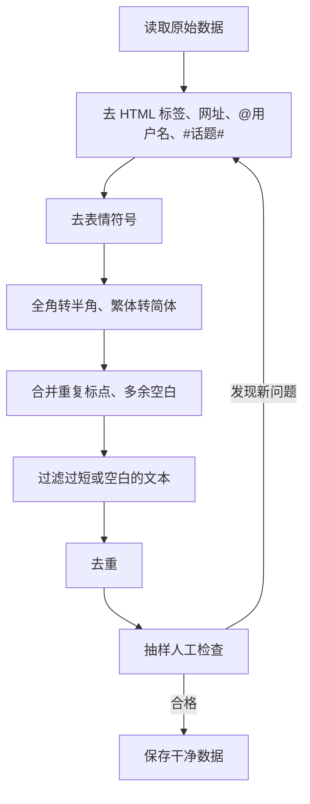
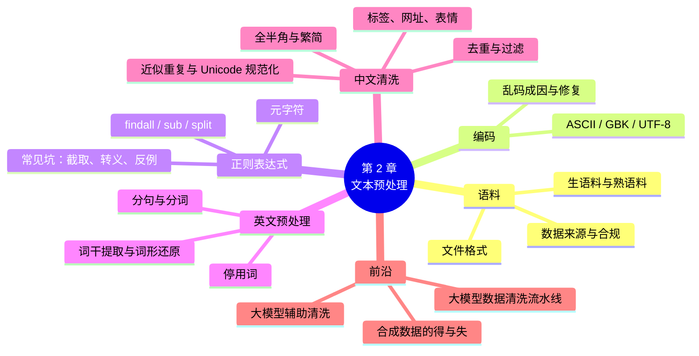

# 第 2 章 文本预处理

!!! abstract "本章学时"
    理论 4 学时 · 实验 1 学时（本章共 3 个实验，教师可任选）

## 学习目标

学完本章，你应该能够：

1. **说出**语料、语料库的含义，列举常见的中文语料来源和开放数据平台；
2. **解释** UTF-8 与 GBK 编码的区别，判断并修复常见的中文乱码；
3. **使用**正则表达式从文本中提取手机号、邮箱、网址、日期等信息；
4. **完成**英文文本的分句、分词、去停用词、词干提取和词形还原；
5. **设计**一套中文评论数据的清洗流程，并用 Python 实现；
6. **描述**大模型训练数据的清洗步骤，知道如何用大模型辅助数据清洗。

!!! info "先修要求"
    学习本章前，你需要掌握：

    - Python 的变量、字符串、列表和 `for` 循环（[附录 A.1 字符串](../../appendix/a-python.md#a1)、[A.3 函数、条件与循环](../../appendix/a-python.md#a3)）；
    - 能在 Jupyter 或命令行中运行 Python 程序（实验 1-1 已搭好环境）；
    - 知道 NLP 要处理的对象是“语料”，以及中文有哪些特殊难点（[1.4 中文处理的特点与难点](../01-intro/index.md#14)）。

??? abstract "本章概念清单（13 个，点击查看定义和例子）"
    1. [文本预处理](../../appendix/e-glossary.md#g-文本预处理)
    2. [字符编码](../../appendix/e-glossary.md#g-字符编码)
    3. [正则表达式](../../appendix/e-glossary.md#g-正则表达式)
    4. [分句](../../appendix/e-glossary.md#g-分句)
    5. [词元化 / 分词](../../appendix/e-glossary.md#g-词元化-分词)
    6. [停用词](../../appendix/e-glossary.md#g-停用词)
    7. [词干提取](../../appendix/e-glossary.md#g-词干提取)
    8. [词形还原](../../appendix/e-glossary.md#g-词形还原)
    9. [繁简转换](../../appendix/e-glossary.md#g-繁简转换)
    10. [数据清洗](../../appendix/e-glossary.md#g-数据清洗)
    11. [Unicode 规范化](../../appendix/e-glossary.md#g-Unicode-规范化)
    12. [近似重复](../../appendix/e-glossary.md#g-近似重复)
    13. [合成数据](../../appendix/e-glossary.md#g-合成数据)

## 情景导入

小王刚入职一家餐饮外卖平台，做 AI 训练师。上班第一天，主管给了他一份从后台导出的 1 万条用户评论，让他整理一下，准备用来训练一个“好评差评自动识别”模型。

小王打开文件，第一眼就傻了：有的评论是一堆“鍙戠敓”这样看不懂的怪字；有的夹着“<p>”“<br/>”这样的网页代码；有的满屏“😂😂😂”；有的写着“詳情見 http://t.cn/…”；还有不少评论一模一样，显然是同一个人复制粘贴发了好几次……

主管说：“模型只能从数据里学东西。数据脏，模型就学歪。先把数据洗干净，这是最重要的一步。”

这一章，我们就来学习怎样把“脏”文本变成“干净”的文本，这个过程叫做[**文本预处理**](../../appendix/e-glossary.md#g-文本预处理 "在分析或建模前对原始文本进行清洗、规范化、切分等处理的过程"){ .term }。

## 2.1 语料与语料库

### 2.1.1 什么是语料

**语料**（Corpus 的单个样本，也常泛指文本数据）就是 NLP 要处理的语言材料，可以是一句话、一条评论、一篇新闻、一本书，也可以是一段对话记录。把大量语料按一定规则收集、整理、存储起来，就形成了**语料库**（Corpus）。

语料库可以按不同的标准分类：

| 分类标准 | 类型 | 说明与例子 |
|---|---|---|
| 是否加工 | 生语料 | 只有原始文本，没有任何标注，如网上爬取的新闻 |
| | 熟语料（标注语料） | 人工加上了分词、词性、情感、实体等标注，如“这家店很好吃 → 好评” |
| 语言数量 | 单语语料 | 只有一种语言 |
| | 双语 / 平行语料 | 两种语言一一对应，如中英对照的句子，用于训练翻译模型 |
| 覆盖范围 | 通用语料 | 新闻、百科、小说等各领域都有 |
| | 领域语料 | 只来自某个行业，如医疗病历、法律文书、电商评论 |

!!! tip "生语料和熟语料哪个更值钱？"
    生语料容易获得，网上到处都是；熟语料要靠人工一条条标注，成本很高，所以更“值钱”。大模型的**预训练**主要用海量生语料，而**微调**和**评测**则离不开高质量的熟语料。AI 训练师的一项核心工作，就是生产高质量的熟语料。

### 2.1.2 语料从哪里来

| 来源 | 说明 | 举例 |
|---|---|---|
| 公开数据集 | 高校、企业、开源社区发布的数据集，可免费下载用于学习和研究 | 中文情感分析数据集 ChnSentiCorp、外卖评论数据集 waimai_10k |
| 开放数据平台 | 集中提供各类数据集下载的网站 | Hugging Face Datasets、魔搭社区数据集、阿里云天池、Kaggle |
| 业务数据 | 企业自己系统中积累的文本 | 客服聊天记录、用户评论、工单、合同 |
| 网络采集 | 用爬虫程序从网页上抓取 | 新闻网站、论坛帖子 |
| 人工编写 / 大模型生成 | 数据不够时，由人或大模型按要求编写 | 让标注员模拟用户提问；用大模型生成训练用的问答对 |

!!! warning "采集数据要合法合规"
    网络采集并不是“想爬就爬”。要遵守网站的 robots 协议和用户协议，不能绕过登录和反爬措施，不能采集个人隐私信息<sup class="cite">[[4]](#ref2-4)</sup>，不能对网站造成过大访问压力。商业使用公开数据集前，还要看清楚它的许可协议（License）是否允许商用。相关法律问题在第 12 章详细讨论。

本书的实验主要使用公开的中文评论数据集，例如外卖平台评论数据集 waimai_10k（约 1.2 万条，标注了好评 / 差评）和网购评论数据集 online_shopping_10_cats（约 6 万条，涵盖书籍、手机、水果、酒店等 10 个类别）。这些数据已放在配套资源的 `labs/data/` 目录中。

### 2.1.3 数据集说明文档

拿到一个数据集，首先要读它的**说明文档**（在 Hugging Face 上叫 Dataset Card，即“数据集卡片”）。一份好的说明文档会回答下列问题：

| 问题 | 以 waimai_10k 为例 |
|---|---|
| 数据从哪里来？ | 某外卖平台的用户评论 |
| 有多少条？有哪些字段？ | 约 1.2 万条；`label`（1 好评，0 差评）、`review`（评论内容） |
| 标签是怎么来的？ | 根据用户评分或人工标注 |
| 适合做什么任务？ | 中文情感分析（二分类） |
| 能不能商用？有什么限制？ | 请查看发布方的许可说明，本书仅用于教学 |

在企业中，自己整理的数据集也应该写这样一份说明文档，方便同事使用和日后追溯。这也是 AI 训练师的一项规范化工作。

### 2.1.4 文本数据的常见格式

| 格式 | 特点 | Python 读取方式 |
|---|---|---|
| TXT 纯文本 | 最简单，一行一条或整篇文章 | `open(文件名, encoding="utf-8").read()` |
| CSV 表格 | 用逗号分隔的表格，可用 Excel 打开，最常用 | `pandas.read_csv(文件名)` |
| JSON / JSONL | 结构化数据，JSONL 是每行一个 JSON，大模型训练数据常用 | `json.loads(一行文本)` |
| Excel | 业务部门最常给的格式 | `pandas.read_excel(文件名)` |
| HTML 网页 | 带有大量标签，需要先提取正文 | 正则表达式或 BeautifulSoup 库 |

### 2.1.5 数据处理要“留痕”

在企业里，一份数据往往要经过多个人、多道工序的处理：采集、清洗、标注、抽检、划分训练集和测试集……如果没有记录，几个月后模型出了问题，谁也说不清训练数据是怎么来的。所以，规范的数据工作要做到**留痕**：

- **保留原始数据**：清洗后另存为新文件，原始文件永远不要直接修改。一旦发现清洗规则有错，还能从头再来；
- **用程序而不是手工处理**：在 Excel 里手工删改几百行，过程无法重复，也无法检查；用 Python 程序清洗，程序本身就是一份“操作记录”，换一批新数据还能直接复用；
- **记录版本和变化**：每次处理后，记下“处理日期、使用的程序、处理前后各有多少条、删掉了哪些类型的数据”。以实验 2-3 为例，可以记为“2026-11-06，lab2_3_clean_reviews.py，原始 306 条，删除过短评论 2 条、重复评论 2 条，剩余 302 条”；
- **固定随机种子**：划分训练集和测试集时设置 `random_state`，保证每次划分的结果相同，别人才能复现你的实验。

这些习惯看似琐碎，却是区分“随便做做”和“专业工作”的关键，也是 AI 训练师职业技能标准中强调的内容。

## 2.2 字符编码：乱码从哪里来

### 2.2.1 计算机怎样存储文字

计算机只认识 0 和 1。要存储文字，就得给每个字符规定一个编号，再把编号转换成二进制。这套“字符 ↔ 编号 ↔ 二进制”的对应规则，就叫[**字符编码**](../../appendix/e-glossary.md#g-字符编码 "把字符映射为计算机中二进制数据的规则，如 UTF-8、GBK"){ .term }。

| 编码 | 出现时间 | 特点 |
|---|---|---|
| ASCII | 1960 年代 | 只有 128 个字符（英文字母、数字、标点），每个字符 1 个字节，不能表示汉字 |
| GB2312 | 1980 年 | 我国第一个汉字编码国家标准，收录 6763 个常用汉字，每个汉字 2 个字节 |
| GBK / GB18030 | 1990 年代起 | GB2312 的扩展，收录更多汉字（包括繁体字），Windows 中文系统长期默认使用 |
| Unicode / UTF-8 | 1990 年代起 | 全世界通用的“万国码”，给地球上几乎所有文字都分配了编号；UTF-8 是最常用的存储方式，一个汉字通常占 3 个字节，是当今互联网和 Python 的默认编码 |

### 2.2.2 乱码是怎么产生的

**乱码**的本质是：**存的时候用 A 编码，读的时候用 B 编码**。好比一份用密码本 A 加密的电报，对方却拿着密码本 B 去解，结果自然是一堆莫名其妙的字。

用 Python 演示一下（实测结果）：

```python
text = "自然语言处理"
print(text.encode("utf-8"))   # b'\xe8\x87\xaa\xe7\x84\xb6...' 共 18 个字节
print(text.encode("gbk"))     # b'\xd7\xd4\xc8\xbb\xd3\xef...' 共 12 个字节
print(text.encode("utf-8").decode("gbk", errors="replace"))   # 鑷�鐒惰��瑷�澶勭悊
```

同样 6 个汉字，UTF-8 用 18 个字节，GBK 用 12 个字节，它们的二进制完全不同。把 UTF-8 的字节当成 GBK 去解读，就得到了“鑷�鐒惰”这样的乱码。

!!! tip "常见乱码的“长相”"
    - 出现“鍙戠敓”“锟斤拷”“烫烫烫”一类生僻字：多半是 UTF-8 和 GBK 搞混了；
    - 出现“中”一类带音调的拉丁字母：多半是 UTF-8 被当成了西欧编码（Latin-1）；
    - 用 Excel 打开 UTF-8 的 CSV 文件出现乱码：保存时选择“UTF-8 with BOM”（Python 中 `encoding="utf-8-sig"`），Excel 就能正确识别。

### 2.2.3 怎样避免和处理乱码

1. **统一使用 UTF-8**：读写文件时明确写上 `encoding="utf-8"`，不要依赖系统默认值（Windows 默认可能是 GBK）。
2. **不知道编码时逐个尝试**：先用 UTF-8 读，失败了再用 GBK 读（实验 2-1 会演示）。也可以使用 `chardet` 等库自动猜测编码。
3. **读取时容错**：`open(文件, encoding="utf-8", errors="ignore")` 会跳过无法解码的字节，但会丢失信息，只在万不得已时使用。

### 2.2.4 看起来一样，其实不一样：Unicode 规范化

编码统一成 UTF-8 之后，还有一类更隐蔽的问题：**两段文字看起来一模一样，计算机却认为不同**。常见的情况有：

- **全角和半角**：“ＡＢＣ１２３”和“ABC123”、“，”和“,”；
- **特殊形式的字符**：带圈数字“①②③”、单位符号“㎏”、英文连字“fi”，它们都有各自独立的编码；
- **看不见的字符**：例如**零宽空格**（编码 U+200B），它不占任何宽度，肉眼完全看不出来。从网页或聊天软件中复制的文本里经常夹带这类字符。

编者用 Python 实测：`"你好" == "你​好"` 的结果是 `False`，前者长度为 2，后者长度为 3，尽管屏幕上显示的都是“你好”。在实际数据中，这种问题会导致去重失败、关键词匹配不上、分词结果异常等莫名其妙的错误。

Python 标准库中的 `unicodedata.normalize("NFKC", 文本)` 可以把很多“写法不同、意思相同”的字符统一起来，这叫做 [**Unicode 规范化**](../../appendix/e-glossary.md#g-Unicode-规范化 "把写法不同、意思相同的字符统一为同一种编码形式"){ .term }。<sup class="cite">[[2]](#ref2-2)</sup><sup class="cite">[[3]](#ref2-3)</sup>实测结果如下：

| 原文 | NFKC 规范化后 |
|---|---|
| ＡＢＣ１２３ | ABC123 |
| 好吃！！ | 好吃!! |
| ①②③ | 123 |
| ㎏ | kg |
| fi | fi |
| 你（零宽空格）好 | 不变，仍然含有零宽空格 |
| 喜歡 | 不变，仍然是繁体 |

可以看到，NFKC 能一次完成全角转半角等多种统一，但它**不会**删除零宽空格，也**不会**做[繁简转换](../../appendix/e-glossary.md#g-繁简转换 "在繁体中文与简体中文之间转换"){ .term }，这两项要分别用正则表达式（如 `re.sub(r"[​-‏]", "", 文本)`）和 OpenCC 处理。另外，NFKC 同样会把中文标点“！”“，”转成英文标点，是否使用要结合 2.6.2 节的提醒来考虑。

## 2.3 Python 字符串处理基础

文本预处理离不开 Python 的字符串操作。下面是最常用的几种，供大家复习：

| 操作 | 代码示例 | 结果 |
|---|---|---|
| 去掉首尾空白 | `"  你好 \n".strip()` | `"你好"` |
| 替换 | `"好吃好吃".replace("好吃", "美味")` | `"美味美味"` |
| 按分隔符切分 | `"苹果,香蕉,梨".split(",")` | `["苹果", "香蕉", "梨"]` |
| 拼接 | `"/".join(["我", "爱", "北京"])` | `"我/爱/北京"` |
| 转小写 | `"Hello NLP".lower()` | `"hello nlp"` |
| 判断是否包含 | `"差评" in "给个差评吧"` | `True` |
| 长度 | `len("自然语言")` | `4` |
| 判断是否全是字母 | `"abc".isalpha()` | `True` |
| 格式化输出 | `f"共{3}条"` | `"共3条"` |

这些方法能处理简单、固定的情况。但如果要“找出文本中所有的手机号”，手机号每条都不同，`replace` 和 `in` 就无能为力了，这时需要[**正则表达式**](../../appendix/e-glossary.md#g-正则表达式 "用特定语法描述字符串模式，用于查找、替换和校验文本"){ .term }。

## 2.4 正则表达式

### 2.4.1 什么是正则表达式

**正则表达式**（Regular Expression，简称 regex）是一种描述“文本模式”的小语言。<sup class="cite">[[1]](#ref2-1)</sup><sup class="cite">[[5]](#ref2-5)</sup>它不写具体的字，而是写“规则”，比如“1 开头、第二位是 3 到 9、后面跟 9 个数字”，这正是中国大陆手机号的规则。

用正则表达式写出来就是：`1[3-9]\d{9}`。

### 2.4.2 常用元字符

| 符号 | 含义 | 例子 | 能匹配 |
|---|---|---|---|
| `\d` | 一个数字 | `\d\d` | `12`、`99` |
| `\w` | 一个字母、数字、下划线或汉字 | `\w+` | `abc`、`nlp_2026`、`你好` |
| `\s` | 一个空白字符（空格、换行、制表符） | `a\sb` | `a b` |
| `.` | 任意一个字符（换行除外） | `a.c` | `abc`、`a1c` |
| `[]` | 方括号里的任意一个 | `[3-9]` | `3` 到 `9` 中任意一个 |
| `[^]` | 不在方括号里的任意一个 | `[^，。]` | 除逗号、句号外的字符 |
| `*` | 前一个出现 0 次或多次 | `ab*` | `a`、`ab`、`abbb` |
| `+` | 前一个出现 1 次或多次 | `\d+` | `1`、`2026` |
| `?` | 前一个出现 0 次或 1 次 | `https?` | `http`、`https` |
| `{n}` / `{m,n}` | 前一个出现 n 次 / m 到 n 次 | `\d{4}` | `2026` |
| `()` | 分组，可以在替换时引用 | `(\d{3})\d{4}` | 第 1 组是前 3 位 |
| `\|` | 或 | `好评\|差评` | `好评` 或 `差评` |
| `^` / `$` | 开头 / 结尾 | `^你好` | 以“你好”开头的文本 |

### 2.4.3 Python 中的 re 模块

| 函数 | 作用 | 示例 |
|---|---|---|
| `re.findall(模式, 文本)` | 找出所有匹配的内容，返回列表 | 提取全部手机号 |
| `re.search(模式, 文本)` | 找第一个匹配，返回匹配对象 | 判断文本里有没有网址 |
| `re.sub(模式, 替换为, 文本)` | 把匹配的内容替换掉 | 删除 HTML 标签、给手机号打码 |
| `re.split(模式, 文本)` | 按模式切分文本 | 按多种标点切分句子 |

一个小例子：

```python
import re
text = "订单号 A20261106，金额 128.50 元，客服电话 13812345678"
print(re.findall(r"\d+\.\d+", text))          # ['128.50']  提取小数金额
print(re.sub(r"<[^>]+>", "", "<b>好吃</b>"))   # 好吃         删除 HTML 标签
print(re.split(r"[，。！？]", "好吃！下次还来。"))  # ['好吃', '下次还来', '']
```

### 2.4.4 贪婪匹配与非贪婪匹配

正则表达式默认是“**贪婪**”的：`*` 和 `+` 会尽可能多地匹配。看一个实测例子：

```python
s = "<b>好吃</b>和<i>便宜</i>"
re.findall(r"<.+>", s)    # ['<b>好吃</b>和<i>便宜</i>']   贪婪：从第一个 < 一直吃到最后一个 >
re.findall(r"<.+?>", s)   # ['<b>', '</b>', '<i>', '</i>']  非贪婪：遇到第一个 > 就停
```

在 `+` 或 `*` 后面加一个 `?`，就变成了“**非贪婪**”模式，尽可能少地匹配。删除 HTML 标签时，如果用了贪婪模式 `<.+>`，会把标签之间的“好吃”“便宜”也一起删掉。本书使用的 `<[^>]+>` 写法（“不是 > 的字符”）也能达到非贪婪的效果。

### 2.4.5 常用正则模板

| 用途 | 正则表达式 | 说明 |
|---|---|---|
| 中国大陆手机号 | `1[3-9]\d{9}` | 11 位，第 2 位为 3~9 |
| 18 位身份证号 | `\d{17}[\dXx]` | 前 17 位数字，最后一位数字或 X（不校验真伪） |
| 邮箱 | `[\w.]+@[\w-]+(?:\.[\w-]+)+` | 用户名@域名 |
| 网址 | `https?://\S+` | http 或 https 开头 |
| 汉字 | `[\u4e00-\u9fff]` | 常用汉字的 Unicode 范围 |
| 连续空白 | `\s+` | 用于合并多余空白 |
| HTML 标签 | `<[^>]+>` | 用于删除网页标签 |

!!! tip "写正则的小技巧"
    1. 模式字符串前加 `r`（如 `r"\d+"`），避免反斜杠被 Python 误解；
    2. 先写最简单的版本，再用几条真实数据测试、逐步改进；
    3. 不会写时，可以让大模型帮你写，例如“写一个匹配中国大陆 18 位身份证号的正则表达式并解释”，但一定要用真实数据测试，大模型写的正则也会出错。

### 2.4.6 正则表达式的常见“坑”

正则表达式写起来简单，用错的情况却很多。下面是编者实测的几个典型问题：

**坑 1：从更长的数字中“截”出了结果。** 用 `1[3-9]\d{9}` 在“订单号 202611138123456789 电话13812345678”中查找手机号，结果是两个“13812345678”：一个是真正的电话，另一个是从 18 位订单号中间截出来的。解决办法是加上“前后不能是数字”的限制：`(?<!\d)1[3-9]\d{9}(?!\d)`，其中 `(?<!\d)` 表示“前面不是数字”，`(?!\d)` 表示“后面不是数字”，修改后只找到了真正的电话。第 12 章做个人信息脱敏时，这一点非常重要。

**坑 2：忘记转义特殊符号。** 想提取“128.50”这样的小数，写成 `\d+.\d+`，结果在“金额128.50元，日期2026-11”中，把“2026-11”也匹配了出来。原因是 `.` 在正则中表示“任意字符”，“-”也算。要匹配真正的小数点，必须写成 `\.`，修改后只匹配到“128.50”。同样需要转义的还有 `? * + ( ) [ ] { } | ^ $` 等。

**坑 3：只用正例测试。** 写好正则后，人们往往只用“应该匹配”的例子测试，看到能匹配就以为对了。更重要的是准备**反例**：“不应该匹配”的文本，比如订单号、银行卡号、日期之类长得像手机号的数字串。一个好习惯是把正例和反例都写进一个小测试程序，每次修改正则后都运行一遍。

**坑 4：过分追求“完美”的正则。** 想用一个正则覆盖所有情况，往往会写出一长串谁也看不懂的表达式。更好的做法是：正则只负责“找出候选”，再用 Python 代码做进一步检查（例如身份证号用校验码验证，见第 12 章）。

## 2.5 英文文本预处理

英文单词之间有空格，看起来分词很容易，但实际处理时仍有不少讲究。一个典型的英文预处理流水线如下：


### 2.5.1 分句与分词

[**分句**](../../appendix/e-glossary.md#g-分句 "把一段文本切分为句子"){ .term }（Sentence Segmentation）就是把文章切成一个个句子。不能简单地按句号切，因为“Dr. Smith”里的点不是句号，“3.14”里的点也不是。NLTK 的 `sent_tokenize` 使用了训练好的模型，能正确处理这些情况。

[**分词**](../../appendix/e-glossary.md#g-词元化-分词 "把文本切分为词、子词或字等基本单位（词元）"){ .term }（Tokenization）就是把句子切成一个个**词元**（Token）。英文分词也不只是按空格切：“NLP!”要切成“NLP”和“!”，“They're”要切成“They”和“'re”。NLTK 的 `word_tokenize` 会处理这些细节。

### 2.5.2 大小写与标点

“Apple”和“apple”在多数任务中应视为同一个词，所以通常统一**转为小写**。标点符号对很多任务（如主题分类）用处不大，可以删除；但在情感分析中，“!”可能表示强烈情绪，是否删除要看任务。

### 2.5.3 停用词

[**停用词**](../../appendix/e-glossary.md#g-停用词 "出现频率高但对任务贡献小的词，如“的”“了”“the”"){ .term }（Stop Words）是指出现频率很高、但本身意义不大的词，例如英文的 the、is、and、of，中文的“的”“了”“是”“在”。去掉停用词可以减少数据量，让模型关注真正有意义的词。

!!! warning "停用词不能乱删"
    停用词表是通用的，但任务是具体的。例如英文停用词表里通常包含 not、no，而在情感分析中，“not good”去掉 not 后就变成了“good”，意思完全相反。所以要根据任务调整停用词表。

### 2.5.4 词干提取与词形还原

英文单词有很多变形：study、studies、studying、studied 本质上是同一个词。把它们统一起来，有两种方法：

| 方法 | 做法 | 例子 | 特点 |
|---|---|---|---|
| [**词干提取**](../../appendix/e-glossary.md#g-词干提取 "用规则去掉英文单词的词缀，得到词干"){ .term }（Stemming） | 按规则砍掉词尾 | studying → studi，was → wa | 速度快，但结果可能不是真正的单词 |
| [**词形还原**](../../appendix/e-glossary.md#g-词形还原 "借助词典把英文单词还原为原形"){ .term }（Lemmatization） | 查词典，还原成词典里的原形 | studying → study，was → be，better（形容词）→ good | 结果准确，但速度较慢，而且需要知道词性 |

形象地说，词干提取像“剪头发”，不管三七二十一剪掉一截；词形还原像“查户口”，找到这个词的“本名”。<sup class="cite">[[6]](#ref2-6)</sup><sup class="cite">[[7]](#ref2-7)</sup>

!!! note "中文需要词干提取吗？"
    中文没有英文那样的词形变化（没有复数、时态变化），所以一般不需要词干提取和词形还原。但中文有自己的问题：需要分词（第 3 章）、需要处理繁简体和全半角。

### 2.5.5 大模型时代还需要这些步骤吗？

去停用词、词干提取、词形还原，都是为了让词袋、TF-IDF 这类**传统方法**（第 5、6 章）少处理一些“无关紧要”的变化。对于 BERT、大模型这类预训练模型来说，情况就不同了：它们在训练时见过各种各样的原始文本，本身就能理解“studies”和“study”的关系，也需要“not”“the”这些词来理解句子的结构和意思。如果把预处理后的“stud good”这样残缺的文本交给大模型，效果反而会变差。

所以，**预处理要和后续使用的方法相匹配**：

| 后续方法 | 推荐的预处理 |
|---|---|
| 词袋、TF-IDF、传统分类器 | 分词、转小写、去停用词、词干提取或词形还原 |
| BERT 等预训练模型 | 只做基本清洗（去 HTML、乱码、多余空白），保留原文的词形和停用词，分词交给模型自带的分词器 |
| 大模型提示词 | 基本清洗即可，保留完整、通顺的句子 |

不过，无论用哪种方法，编码处理、去除网页标签、去重、隐私信息脱敏这些**基础清洗**都是必不可少的。

## 2.6 中文文本清洗

### 2.6.1 中文清洗要处理哪些“脏东西”

| 问题 | 例子 | 处理方法 |
|---|---|---|
| HTML 标签 | `<p>挺好的</p><br/>` | 正则删除 `<[^>]+>` |
| 网址、链接 | `详情见 http://t.cn/xxx` | 正则删除 |
| @用户名、#话题# | `@外卖小哥`、`#吃货日常#` | 正则删除 |
| 表情符号 | 😂😂😂 | 按 Unicode 编码范围删除，或转成文字（如“[笑哭]”） |
| 全角字符 | `ｈａｏ`、`１２３` | 全角转半角 |
| 繁体字 | 這個東西 | 用 OpenCC 繁体转简体 |
| 重复标点 | `好吃！！！！！` | 正则把连续重复的标点合并为一个 |
| 多余空白 | 首尾空格、换行、制表符 | `strip()` 和正则合并空白 |
| 重复数据 | 同一条评论出现多次 | pandas 的 `drop_duplicates()` |
| 无效数据 | 空评论、只有表情的评论 | 按清洗后的长度过滤 |

### 2.6.2 全角与半角

**全角字符**占两个英文字符的宽度，如“ＡＢＣ１２３”；**半角字符**就是普通英文字符“ABC123”。用中文输入法打字时，很容易不小心打出全角字母和数字。对计算机来说，“１２３”和“123”是完全不同的字符，所以需要统一。

全角字符的编码恰好比对应的半角字符大一个固定值 65248（十六进制 0xFEE0），利用这个规律就能完成转换，实验 2-3 中有完整代码。

!!! warning "注意：中文标点也是全角字符"
    中文的逗号“，”、感叹号“！”也在全角范围内，全部转换会把它们变成英文标点“,”“!”。如果后续任务需要保留中文标点，就只转换字母和数字。到底怎么做，取决于你的任务，这正是[数据清洗](../../appendix/e-glossary.md#g-数据清洗 "去除噪声、重复、无效数据，提高数据质量的过程"){ .term }中需要“想清楚再动手”的地方。

### 2.6.3 繁简转换

港澳台地区的用户、部分网络用户会使用繁体字。“這個東西”和“这个东西”对模型来说是完全不同的字符串，所以通常要统一成简体。常用工具是开源的 **OpenCC**（Open Chinese Convert），它不是简单地逐字替换，还能处理“一简对多繁”的情况，如“发”对应“發”（出发）和“髮”（头发）。<sup class="cite">[[8]](#ref2-8)</sup>

### 2.6.4 中文分句

英文分句可以交给 NLTK，中文分句则通常需要自己用正则表达式完成。很多任务需要先把中文段落切成句子，例如第 10 章的摘要要以句子为单位挑选内容，第 11 章的知识库要按句子或段落切块。最简单的做法是按“。！？”切分，但遇到引号和省略号就会出问题。编者实测，对“他说：“今天的菜太咸了！”下次不点了……价格还行。真的吗？”，用 `re.split(r"[。！？]", 文本)` 切分，结果是“他说：“今天的菜太咸了”“”下次不点了……价格还行”“真的吗”和一个空字符串：后引号被切到了下一句开头，省略号也没有被当作句子结尾。改用 `re.findall(r"[^。！？…]+(?:[。！？]+|…+)?[”’]?", 文本)`，让句末标点和紧跟的后引号留在本句，就得到了正确的四句话：“他说：“今天的菜太咸了！””“下次不点了……”“价格还行。”“真的吗？”。实际文本中还会遇到英文句号、数字中的小数点、网址中的点等情况，同样需要用正例和反例反复测试。

### 2.6.5 清洗流程设计

清洗的顺序很重要。例如应该先删除 HTML 标签，再处理标点，否则标签里的符号会干扰后面的步骤；应该先清洗，再去重，因为两条评论可能只差一个表情，清洗后才是重复的。一个推荐的中文评论清洗流程：



最后一步“**抽样人工检查**”千万不能省。清洗规则总有考虑不到的情况，随机抽查 50 到 100 条，能发现很多意想不到的问题。

### 2.6.6 中文停用词与文本规范化

中文同样有停用词，如“的”“了”“是”“在”“和”“就”“都”，以及“啊”“呢”“吧”等语气词。常用的中文停用词表有哈工大停用词表、百度停用词表、四川大学停用词表等，配套资源中提供了一份综合整理的中文停用词表 `cn_stopwords.txt`（746 个词）。中文的停用词要在**分词之后**才能去除，我们在第 3 章实验中使用。

除了停用词，还有一些常见的**规范化**处理，目的是让“意思相同、写法不同”的文本变成统一的写法：

| 规范化对象 | 例子 | 规范化结果 | 是否需要，取决于任务 |
|---|---|---|---|
| 数字 | “一百二十八元”“128元”“¥128” | 统一为“128元” | 做金额抽取时需要 |
| 日期 | “2026年11月6日”“2026/11/6”“26.11.6” | 统一为“2026-11-06” | 做日程提取时需要 |
| 同义表达 | “好评”“五星好评”“给个好评” | 根据任务决定是否合并 | 做统计分析时可能需要 |
| 英文大小写 | “iPhone”“IPHONE”“iphone” | 统一为小写 | 多数任务需要 |
| 拼音缩写、网络用语 | “yyds”“xswl” | 转成规范说法或保留 | 情感分析中可能保留更好 |

!!! note "清洗不是越干净越好"
    清洗的目标是**让数据更适合当前任务**，而不是把数据变得“越干净越好”。例如：做情感分析时，“！！！”和“😡”都带有强烈的情绪，删掉反而丢失了信息；做大模型对话训练时，表情和口语化表达本身就是要学习的内容。所以，动手清洗前，一定先问自己：**我的任务需要什么？**

### 2.6.7 近似重复：只差一点点的“重复”

`drop_duplicates()` 只能删除**完全相同**的文本。但真实数据中更常见的是“[近似重复](../../appendix/e-glossary.md#g-近似重复 "内容几乎相同、只差个别字词或标点的文本"){ .term }”：同一个人把评论改了一两个字又发了一次，或者不同的人转载同一段话时改了标点。如果不处理，模型会对这些内容“多学几遍”，测试集和训练集中出现几乎相同的样本时，评价成绩也会虚高。

发现近似重复的一个简单方法是：把每条文本拆成相邻两个字的组合（如“送餐太慢”拆成“送餐”“餐太”“太慢”），再计算两条文本的 **Jaccard 相似度**（第 5 章），即共同的组合数除以全部不同组合的总数。相似度超过某个值（如 0.7）的，就认为是近似重复。编者在去掉完全重复后的外卖评论中查找，找到了这样几对（实测）：

| 相似度 | 评论 A | 评论 B |
|---|---|---|
| 0.81 | 第一天迟到了20分钟第二天迟到了45分钟 | 第一天迟到了20分钟第二天迟到了40分钟 |
| 0.80 | 价格实惠，值得购买了 | 价格实惠，值得购买。 |
| 0.75 | 比别人先定还比别人后到是什么原因？ | 比别人先定的还比别人后到是什么原因 |
| 0.71 | 送餐太慢了，等了一个半小时 | 送餐太慢了,等了一个半小时 |

最后一对只差一个逗号：一个是中文逗号，一个是英文逗号。如果先做 2.2.4 节的 Unicode 规范化，它们就会变成完全相同的文本，直接被去重。这再次说明了**清洗顺序**的重要性：先统一写法，再去重。

两两比较的计算量随数据量的平方增长：1 万条数据要比较约 5000 万次，1 亿条数据就完全不可能了。大模型的数据清洗使用 **MinHash** 等算法，先把每篇文本压缩成一个简短的“指纹”，指纹相近的才进一步比较，从而在海量数据中高效地找出近似重复。<sup class="cite">[[9]](#ref2-9)</sup>这就是 2.8.1 节表格中“去重”一步所用的方法。

## 2.7 数据探索：清洗之前先“看一看”

拿到数据后，不要急着清洗，先花几分钟做一次**数据探索**（Exploratory Data Analysis，EDA），了解数据的“家底”。下面用 pandas 对外卖评论数据集 waimai_10k 做一次简单的探索（实测结果）：

```python
import pandas as pd
df = pd.read_csv("waimai_10k.csv")
print(df.shape)                              # 数据有几行几列
print(df["label"].value_counts())            # 好评、差评各有多少
df["length"] = df["review"].str.len()        # 新增一列：评论长度
print(df["length"].describe().round(1))      # 长度的统计信息
print("重复评论：", df.duplicated(subset="review").sum())
print(df.groupby("label")["length"].mean().round(1))   # 好评、差评的平均长度
```

```text
(11987, 2)
label
0    7987
1    4000
Name: count, dtype: int64
count    11987.0
mean        25.0
std         24.7
min          5.0
25%         11.0
50%         17.0
75%         30.0
max        463.0
Name: length, dtype: float64
重复评论： 7
label
0    28.9
1    17.4
Name: length, dtype: float64
```

从这几行输出中，我们能读出很多有用的信息：

1. **数据规模**：共 11987 条评论，2 列（标签和评论）。
2. **类别不平衡**：差评（0）有 7987 条，好评（1）只有 4000 条，差评是好评的两倍。这种情况叫**类别不平衡**，训练模型时需要注意（第 6 章会讨论），否则模型可能偏向于“什么都猜差评”。
3. **长度分布**：评论平均 25 个字，一半评论不超过 17 个字（中位数），最长的有 463 个字。说明大多数评论都很短，个别评论特别长。
4. **少量重复**：有 7 条评论与其他评论完全相同，需要去重。
5. **一个有趣的发现**：差评平均 28.9 个字，好评平均只有 17.4 个字。不满意的顾客往往会写得更详细，这与生活经验一致。

!!! tip "数据探索要回答的五个问题"
    1. 有多少数据？有哪些字段？
    2. 标签（类别）分布均衡吗？
    3. 文本长度大概多少？有没有异常长或异常短的？
    4. 有没有重复、空值、乱码？
    5. 随机抽 20 条看一看，有什么共同的“脏”特征？

    回答完这五个问题，再动手设计清洗流程，就能做到心中有数。

**一个实用技巧：统计“非汉字字符”。** 对中文评论来说，汉字和中文标点是“正常”的内容，其他字符则往往暗藏噪声。编者把实验 2-3 使用的 `reviews_raw.csv`（306 条）中除汉字和中文标点以外的所有字符统计了一遍，出现最多的是：英文逗号“,”（106 次）、空格（86 次）、“/”（54 次）、😂（39 次）、“<”和“>”（各 36 次）、字母 p（34 次）、“#”（24 次）、制表符和换行符（各 17 次）、“@”（16 次）……

只看这张清单，就能推测出数据中的问题：“<”“>”“/”和字母 p、b 成批出现，说明有 HTML 标签（如 `<p>`、`<br/>`）；“/”“:”和字母 t、c 一起出现，说明有网址（如 `http://t.cn/`）；“@”和“#”说明有@用户名和#话题#；英文逗号多，说明有半角标点混在中文里；制表符和换行符说明有多余的空白。再进一步检查，306 条评论中含“<”的有 12 条，含“http”的有 10 条，含“@”的有 16 条。这样，清洗规则就有了明确的目标，而不是凭感觉去猜。

## 2.8 前沿视窗：大模型的数据是怎样清洗的

### 2.8.1 大模型的数据清洗流水线

大模型的能力来自数据，而大模型的训练数据量是以万亿个词元（Token）计的，主要来自网页、书籍、百科、论文、代码等。网页数据中有大量广告、乱码、重复内容和低质量文本，所以大模型公司都会建设一条规模庞大的数据清洗流水线。其主要步骤与本章所学一脉相承，只是规模大得多：

| 步骤 | 做法 | 与本章的联系 |
|---|---|---|
| 正文提取 | 从网页 HTML 中提取正文，去掉导航栏、广告 | 去 HTML 标签 |
| 语言识别 | 判断每篇文本是什么语言，分别处理 | — |
| 规则过滤 | 删除过短、符号太多、重复字太多的文本 | 长度过滤、重复标点 |
| 去重 | 不仅删除完全相同的文本，还用 MinHash 等算法删除“高度相似”的文本 | 去重 |
| 质量过滤 | 训练一个小模型给文本质量打分，只保留高质量文本 | 第 6 章文本分类 |
| 安全过滤 | 删除色情、暴力、违法内容，删除或遮盖手机号、身份证号等个人信息 | 正则提取、第 12 章脱敏 |

业内有一个共识：**数据质量比数据数量更重要**。<sup class="cite">[[10]](#ref2-10)</sup>研究者发现，用经过精心筛选的较少数据训练出的模型，效果可以超过用更多但未经筛选的数据训练出的模型。因此，各大模型团队都把数据清洗看作核心竞争力之一。

### 2.8.2 大模型时代的数据工作新变化

| 变化 | 过去 | 现在 |
|---|---|---|
| 数据来源 | 主要靠人工收集和标注 | 人工数据 + 大模型生成的[**合成数据**](../../appendix/e-glossary.md#g-合成数据 "由大模型等程序按要求生成、而非真实采集的数据"){ .term } |
| 清洗方式 | 规则为主 | 规则 + 质量打分模型 + 大模型辅助 |
| 数据格式 | 一条文本配一个标签 | 大量“指令—回答”对话格式的数据（常用 JSONL 保存），用于训练模型听懂指令 |
| 人的角色 | 逐条标注 | 制定规范、审核大模型的标注结果、处理疑难样本 |

例如，训练一个客服大模型所用的指令数据，常常是下面这种 JSONL 格式，每行一条：

```json
{"instruction": "判断下面评论的情感", "input": "菜都凉了，差评", "output": "负面"}
{"instruction": "把下面的句子翻译成英文", "input": "送餐很快", "output": "The delivery was fast."}
```

!!! info "用大模型清洗数据"
    一个新的趋势是**用大模型来清洗和标注数据**：让大模型判断一段文本的质量高不高、把网络用语改写成规范表达、给评论打上情感标签。这样做比人工快得多、比规则更“聪明”，但也有成本（按调用量收费）和风险（可能改错、可能泄露数据）。实际工作中通常是“**规则先行、大模型处理疑难样本、人工抽检把关**”三者结合。实验 2-3 将体验这种做法。

### 2.8.3 合成数据：用大模型“造”数据的得与失

当真实数据不够时，用大模型生成**合成数据**已经成为常见的做法。比如要训练一个识别“催单”意图的分类器，可以让大模型一口气写出 200 种催单的说法。但合成数据也有明显的问题，使用时要特别注意：

| 问题 | 表现 | 应对方法 |
|---|---|---|
| **千篇一律** | 大模型写出的句子往往句式相似、用词规范，和真实用户“错字连篇、口语随意”的说法差别很大 | 在提示词中要求多样化，提供真实样本做参考，并混合真实数据使用 |
| **事实错误** | 生成的问答对中可能有编造的信息 | 人工抽检，与可靠资料核对 |
| **偏见放大** | 大模型自身的偏见会被复制到数据中 | 检查数据在性别、地域等方面的分布（第 12 章） |
| **评价失真** | 如果测试集也是合成的，模型在测试集上成绩很好，到了真实用户那里却表现很差 | **测试集一定要用真实数据** |

最后一条尤为重要。合成数据可以用来“补充训练”，但衡量模型好坏的“考卷”必须来自真实场景。此外，用某个大模型的输出来训练其他模型之前，还要查看该模型服务的用户协议，确认是否允许这样使用。

## 本章实验

!!! abstract "实验总览"
    | 实验 | 类型 | 建议时长 | 内容 |
    |---|---|---|---|
    | 实验 2-1 | ★ 基础 | 45 分钟 | 正则表达式与编码处理 |
    | 实验 2-2 | ★ 基础 | 45 分钟 | NLTK 英文预处理流水线 |
    | 实验 2-3 | ☆ 拓展 | 60 分钟 | 中文评论数据清洗（规则 + 大模型辅助） |

    实验代码见配套资源 `labs/ch02/` 目录。

### 实验 2-1 ★ 正则表达式与编码处理

**实验目的**

1. 观察同一段文字在 UTF-8 和 GBK 编码下的区别，理解乱码的成因；
2. 学会用正确的编码读取文件；
3. 用正则表达式从一段通知中提取手机号、固定电话、邮箱、网址、日期和时间，并给手机号打码。

**实验环境**：实验 1-1 搭建的环境，只需要 Python 自带的 `re` 模块。

**实验步骤与代码**

**第 1 部分：编码与乱码**

```python
import re

text = "自然语言处理"
utf8_bytes = text.encode("utf-8")       # 按 UTF-8 编码成字节
gbk_bytes = text.encode("gbk")          # 按 GBK 编码成字节
print("UTF-8 字节数：", len(utf8_bytes), utf8_bytes)
print("GBK   字节数：", len(gbk_bytes), gbk_bytes)

# 用错误的编码去解码，就会出现乱码
wrong = utf8_bytes.decode("gbk", errors="replace")
print("UTF-8 字节按 GBK 解码：", wrong)
# 修复：对原始字节换用正确的 UTF-8 解码
print("修复后：", utf8_bytes.decode("utf-8"))

# 模拟一个 GBK 编码的文件，并用不同编码读取
with open("gbk_demo.txt", "w", encoding="gbk") as f:
    f.write("这是一份用 GBK 编码保存的旧文件。")
for enc in ["utf-8", "gbk"]:
    try:
        with open("gbk_demo.txt", encoding=enc) as f:
            print(f"用 {enc} 读取成功：", f.read())
    except UnicodeDecodeError as e:
        print(f"用 {enc} 读取失败：", e.reason)
```

运行结果：

```text
UTF-8 字节数： 18 b'\xe8\x87\xaa\xe7\x84\xb6\xe8\xaf\xad\xe8\xa8\x80\xe5\xa4\x84\xe7\x90\x86'
GBK   字节数： 12 b'\xd7\xd4\xc8\xbb\xd3\xef\xd1\xd4\xb4\xa6\xc0\xed'
UTF-8 字节按 GBK 解码： 鑷�鐒惰��瑷�澶勭悊
修复后： 自然语言处理
用 utf-8 读取失败： invalid continuation byte
用 gbk 读取成功： 这是一份用 GBK 编码保存的旧文件。
```

结果解读：`b'...'` 表示字节串，`\xe8` 是一个字节的十六进制写法。可以看到 UTF-8 中一个汉字占 3 个字节，GBK 中占 2 个字节。用 UTF-8 去读 GBK 文件时，Python 发现字节不符合 UTF-8 规则，报错 `invalid continuation byte`；换用 GBK 就读取成功了。`try ... except` 结构让程序在出错时不会中断，而是继续尝试下一种编码。

**第 2 部分：正则表达式提取信息**

```python
msg = """【会议通知】各位同学：本周五（2026-11-06）下午 14:30 在 3 号楼 205 召开课程说明会。
联系人：王老师，电话 13812345678，备用电话 021-55667788；
邮箱 wang.teacher@example.edu.cn。资料下载：https://www.example.edu.cn/nlp/2026。
如有疑问也可联系助教 15900001111 或 ta_li@example.com。"""

patterns = {
    "手机号": r"1[3-9]\d{9}",
    "固定电话": r"0\d{2,3}-\d{7,8}",
    "邮箱": r"[\w.]+@[\w-]+(?:\.[\w-]+)+",
    "网址": r"https?://[^\s，。；]+",
    "日期": r"\d{4}-\d{1,2}-\d{1,2}",
    "时间": r"\d{1,2}:\d{2}",
}
for name, p in patterns.items():
    print(f"{name}：{re.findall(p, msg)}")

# 用 re.sub 给手机号打码：保留前 3 位和后 4 位
masked = re.sub(r"(1[3-9]\d)\d{4}(\d{4})", r"\1****\2", msg)
print(masked.splitlines()[1])
```

运行结果：

```text
手机号：['13812345678', '15900001111']
固定电话：['021-55667788']
邮箱：['wang.teacher@example.edu.cn', 'ta_li@example.com']
网址：['https://www.example.edu.cn/nlp/2026']
日期：['2026-11-06']
时间：['14:30']
联系人：王老师，电话 138****5678，备用电话 021-55667788；
```

结果解读：

- 固定电话的模式 `0\d{2,3}-\d{7,8}` 表示“0 开头，接 2~3 位数字（区号其余部分），一个短横线，再接 7~8 位数字”；
- 网址的模式 `[^\s，。；]+` 表示“一串不是空白、不是中文逗号句号分号的字符”，这样网址后面紧跟的中文句号“。”就不会被当成网址的一部分；
- 打码时用圆括号把“前 3 位”和“后 4 位”分成第 1 组和第 2 组，替换字符串中的 `\1`、`\2` 就代表这两组内容。

**常见问题排查**

| 现象 | 原因与解决办法 |
|---|---|
| 正则什么都没匹配到 | 检查是否用了中文标点（如中文冒号“：”和英文冒号“:”不同）；检查模式字符串前是否加了 `r` |
| 网址把后面的中文也匹配进去了 | 在字符集中排除中文标点，或改用 `[\w./:?=&%-]+` 只允许网址中常见的字符 |
| 手机号匹配到了更长数字串的一部分 | 在模式两边加 `(?<!\d)` 和 `(?!\d)`，表示前后不能紧挨着数字 |

**思考与练习**

1. 把通知中的日期改成“2026年11月6日”的写法，原来的日期模式还能匹配吗？请修改模式，让两种写法都能匹配。
2. 写一个正则表达式，匹配 18 位身份证号（最后一位可能是 X）。
3. 在模式中加入 `(?<!\d)` 和 `(?!\d)`，测试“订单号 2013812345678901”中是否还会误匹配出手机号。

**实验报告要求**

提交代码和运行截图，回答思考题，并写出你自己设计的身份证号正则表达式及测试用例（至少 3 个能匹配、2 个不能匹配）。

### 实验 2-2 ★ NLTK 英文预处理流水线

**实验目的**

1. 用 NLTK 完成英文文本的分句、分词、转小写、去标点、去停用词；
2. 对比词干提取和词形还原的效果，理解两者的区别；
3. 把多个步骤封装成可复用的函数。

**实验环境**：实验 1-1 的环境，需要已下载 NLTK 数据包 `punkt_tab`、`stopwords`、`wordnet`。

**实验步骤与代码**

```python
import string
import nltk
from nltk.corpus import stopwords
from nltk.stem import PorterStemmer, WordNetLemmatizer

text = ("Dr. Smith loves teaching NLP! His students were studying the newest "
        "language models in 2026. They're running experiments and the results "
        "are surprisingly better than last year's.")

# 步骤 1：分句
sentences = nltk.sent_tokenize(text)
print("① 分句：")
for i, s in enumerate(sentences, 1):
    print(f"   {i}. {s}")

# 步骤 2：分词
tokens = nltk.word_tokenize(text)
print("② 分词：", tokens)

# 步骤 3：转小写并去掉标点
tokens = [t.lower() for t in tokens if t not in string.punctuation]
print("③ 小写、去标点：", tokens)

# 步骤 4：去停用词
stop_words = set(stopwords.words("english"))
tokens = [t for t in tokens if t not in stop_words]
print("④ 去停用词：", tokens)

# 步骤 5：词干提取 vs 词形还原
stemmer = PorterStemmer()
lemmatizer = WordNetLemmatizer()
print("⑤ 词干提取与词形还原对比：")
print(f"   {'原词':<12}{'词干提取':<12}{'词形还原'}")
for w in ["studying", "students", "running", "experiments", "surprisingly",
          "better", "models", "was"]:
    print(f"   {w:<14}{stemmer.stem(w):<14}{lemmatizer.lemmatize(w, pos='v')}")

# 词形还原需要知道词性：better 作形容词时还原为 good
print("   better 作形容词还原：", lemmatizer.lemmatize("better", pos="a"))

# 步骤 6：把上面的步骤封装成一个函数，方便复用
def preprocess(doc):
    words = nltk.word_tokenize(doc.lower())
    words = [w for w in words if w.isalpha() and w not in stop_words]
    return [lemmatizer.lemmatize(w) for w in words]

print("⑥ 封装后的结果：", preprocess("The cats are sitting on the mats."))
```

运行结果：

```text
① 分句：
   1. Dr. Smith loves teaching NLP!
   2. His students were studying the newest language models in 2026.
   3. They're running experiments and the results are surprisingly better than last year's.
② 分词： ['Dr.', 'Smith', 'loves', 'teaching', 'NLP', '!', 'His', 'students', 'were', 'studying', 'the', 'newest', 'language', 'models', 'in', '2026', '.', 'They', "'re", 'running', 'experiments', 'and', 'the', 'results', 'are', 'surprisingly', 'better', 'than', 'last', 'year', "'s", '.']
③ 小写、去标点： ['dr.', 'smith', 'loves', 'teaching', 'nlp', 'his', 'students', 'were', 'studying', 'the', 'newest', 'language', 'models', 'in', '2026', 'they', "'re", 'running', 'experiments', 'and', 'the', 'results', 'are', 'surprisingly', 'better', 'than', 'last', 'year', "'s"]
④ 去停用词： ['dr.', 'smith', 'loves', 'teaching', 'nlp', 'students', 'studying', 'newest', 'language', 'models', '2026', "'re", 'running', 'experiments', 'results', 'surprisingly', 'better', 'last', 'year', "'s"]
⑤ 词干提取与词形还原对比：
   原词          词干提取        词形还原
   studying      studi         study
   students      student       students
   running       run           run
   experiments   experi        experiment
   surprisingly  surprisingli  surprisingly
   better        better        better
   models        model         model
   was           wa            be
   better 作形容词还原： good
⑥ 封装后的结果： ['cat', 'sitting', 'mat']
```

结果解读：

- **分句**正确识别出“Dr.”不是句子结尾，全文切成 3 句；
- **分词**把“They're”切成了“They”和“'re”，把“year's”切成了“year”和“'s”；
- **去标点**之后仍留下了“dr.”“'re”“'s”，因为 `string.punctuation` 只能判断单个标点字符，而这些词元是“字母 + 标点”的组合。步骤 6 中改用 `w.isalpha()`（只保留纯字母的词）就解决了这个问题；
- **词干提取**的结果“studi”“experi”“wa”都不是真正的单词，体现了“剪头发”的特点；
- **词形还原**时我们统一指定了 `pos='v'`（按动词处理），所以 students、surprisingly 没有变化；而 better 只有按形容词（`pos='a'`）处理时才会还原为 good。这说明**词形还原依赖词性**，第 3 章学习词性标注后，就可以先标注词性再还原。

**第 2 部分（选做）：用 spaCy 一步完成**

上面的流水线需要我们自己指定词性。spaCy 会先自动标注词性，再做词形还原，还自带停用词判断。在同一个 Notebook 中继续运行：

```python
import spacy
nlp = spacy.load("en_core_web_sm")
doc = nlp("They're running experiments and the results are surprisingly better than last year's.")
for t in doc:
    print(f"{t.text:<14}{t.lemma_:<14}{t.pos_:<7}{'停用词' if t.is_stop else ''}")
```

运行结果：

```text
They          they          PRON   停用词
're           be            AUX    停用词
running       run           VERB   
experiments   experiment    NOUN   
and           and           CCONJ  停用词
the           the           DET    停用词
results       result        NOUN   
are           be            AUX    停用词
surprisingly  surprisingly  ADV    
better        well          ADJ    
than          than          ADP    停用词
last          last          ADJ    停用词
year          year          NOUN   
's            's            PART   停用词
.             .             PUNCT  
```

spaCy 自动判断出 're 是助动词并还原为 be，experiments 是名词并还原为 experiment，比 NLTK 手动指定词性方便得多。但它把 better 还原成了 well（副词 well 的比较级也是 better），在这个句子里并不准确。**再好的工具也要检查结果**，这一点会贯穿全书。

**常见问题排查**

| 现象 | 原因与解决办法 |
|---|---|
| `LookupError: Resource stopwords not found` | 运行 `nltk.download('stopwords')` |
| `LookupError: Resource wordnet not found` | 运行 `nltk.download('wordnet')` |
| 下载 NLTK 数据很慢或失败 | 由教师统一提供 `nltk_data` 文件夹，放到用户主目录下 |

**思考与练习**

1. 停用词表中包含 not 吗？用 `"not" in stop_words` 检查。如果要做情感分析，你会怎样修改停用词表？
2. 修改步骤 6 的 `preprocess` 函数，在去停用词时保留 not、no。
3. 对比 `preprocess("The cats are sitting on the mats.")` 的结果，sitting 为什么没有还原成 sit？怎样修改才能还原？

**实验报告要求**

提交运行完成的 Notebook，回答思考题，并用你自己找的一段英文新闻（不少于 100 词）测试 `preprocess` 函数，记录处理前后的词数变化。

### 实验 2-3 ☆ 中文评论数据清洗（规则 + 大模型辅助）

**实验目的**

1. 针对一份真实的“脏”评论数据，设计并实现完整的中文清洗流程；
2. 学会使用 pandas 批量处理数据、去重和保存结果；
3. 体验用大模型 API 处理规则搞不定的疑难样本，比较规则方法与大模型方法的特点。

**实验数据**：`reviews_raw.csv`，共 306 条外卖评论，由公开数据集 waimai_10k 抽样后加入了 HTML 标签、网址、表情、全角字符、繁体字、重复评论等“噪声”，模拟真实导出的业务数据。字段说明：`id` 编号，`label` 标签（1 为好评，0 为差评），`review` 评论内容。

**实验环境**：实验 1-1 的环境，另需安装 `pip install pandas opencc openai`。第 2 部分需要一个大模型 API Key（见附录 D）。

**第 1 部分：规则清洗**

```python
import re
import pandas as pd
from opencc import OpenCC

df = pd.read_csv("reviews_raw.csv")
print("原始数据：", df.shape[0], "条")

cc = OpenCC("t2s")                                   # 繁体转简体
EMOJI = re.compile("[\U0001F300-\U0001FAFF☀-➿]")  # 常见表情符号的编码范围

def to_halfwidth(s):
    """全角字符转半角：全角字符的编码比半角大 0xFEE0，全角空格单独处理"""
    out = []
    for ch in s:
        code = ord(ch)
        if code == 0x3000:
            code = 0x20
        elif 0xFF01 <= code <= 0xFF5E:
            code -= 0xFEE0
        out.append(chr(code))
    return "".join(out)

def clean(text):
    text = str(text)
    text = re.sub(r"<[^>]+>", "", text)              # ① 去 HTML 标签
    text = re.sub(r"https?://\S+", "", text)          # ② 去网址
    text = re.sub(r"@\S+\s?", "", text)               # ③ 去 @用户名
    text = re.sub(r"#[^#]+#", "", text)               # ④ 去 #话题#
    text = EMOJI.sub("", text)                        # ⑤ 去表情符号
    text = to_halfwidth(text)                         # ⑥ 全角转半角
    text = cc.convert(text)                           # ⑦ 繁体转简体
    text = re.sub(r"([，。！？!?,.])\1+", r"\1", text)  # ⑧ 连续重复标点只留一个
    text = re.sub(r"\s+", " ", text).strip()          # ⑨ 合并多余空白
    return text

df["clean"] = df["review"].apply(clean)

# 对比几条清洗前后的效果
for i in [0, 3, 6, 9, 5]:
    print(f"\n[{df.id[i]}] 清洗前：{df.review[i]!r}\n     清洗后：{df.clean[i]!r}")

# ⑩ 删除清洗后过短的评论（少于 2 个字）
before = len(df)
df = df[df["clean"].str.len() >= 2]
print(f"\n删除过短评论：{before - len(df)} 条")

# ⑪ 去重
before = len(df)
df = df.drop_duplicates(subset="clean")
print(f"删除重复评论：{before - len(df)} 条")

df[["id", "label", "clean"]].to_csv("reviews_clean.csv", index=False, encoding="utf-8")
print("清洗完成，剩余", len(df), "条，已保存到 reviews_clean.csv")

# 规则处理不了的“疑难样本”：网络用语、语义重复
print("\n规则处理不了的样本：")
for t in df["clean"].tail(2):
    print("  ", t)
```

运行结果：

```text
原始数据： 306 条

[1] 清洗前：'@外卖小哥 十一点五十才送到,完了好久啊,味道一般,而且现在的并好小啊,大分的和以前中分的一個量'
     清洗后：'十一点五十才送到,完了好久啊,味道一般,而且现在的并好小啊,大分的和以前中分的一个量'

[4] 清洗前：'整体不错，只是速度慢了一些，土豆卷略清淡 😂😂😂'
     清洗后：'整体不错,只是速度慢了一些,土豆卷略清淡'

[7] 清洗前：'两个小时后送来的，鱼早冷了，简直腥哭 详情见 http://t.cn/A6abcXyZ'
     清洗后：'两个小时后送来的,鱼早冷了,简直腥哭 详情见'

[10] 清洗前：'<p>挺快的，真的挺不错。</p><br/>'
     清洗后：'挺快的,真的挺不错。'

[6] 清洗前：'要的微辣，但是涼麵超辣'
     清洗后：'要的微辣,但是凉面超辣'

删除过短评论：2 条
删除重复评论：2 条
清洗完成，剩余 302 条，已保存到 reviews_clean.csv

规则处理不了的样本：
   yyds!绝绝子,下次还点
   送餐太慢了,菜都凉透了,差评差评差评差评
```

结果解读：

- 去掉了 @用户名、表情、网址、HTML 标签，繁体的“一個”“涼麵”变成了简体；
- 只剩表情或空白的 2 条评论被过滤，内容重复的 2 条被删除；
- **问题 1**：全角转半角把中文逗号“，”也变成了英文逗号“,”（见 2.6.2 节的提醒）；
- **问题 2**：网址删掉了，但前面的“详情见”还留着，变成了一句不完整的话；
- **问题 3**：“yyds”“绝绝子”这样的网络用语、“差评差评差评差评”这样的语义重复，规则很难处理。

这正是真实数据清洗的常态：**规则能解决大部分问题，但总有剩下的“疑难样本”**。

**第 2 部分：大模型辅助处理疑难样本**（需要 API Key，没有条件的同学可以把提示词和样本粘贴到大模型网页版中手动完成）

```python
import os
from openai import OpenAI

client = OpenAI(api_key=os.environ["DEEPSEEK_API_KEY"],
                base_url=os.environ.get("LLM_BASE_URL", "https://api.deepseek.com"))
MODEL = os.environ.get("LLM_MODEL", "deepseek-chat")

PROMPT = """你是一名数据清洗员。请把下面这条外卖评论改写成规范的书面中文：
1. 网络用语、拼音缩写改成普通说法；
2. 删除无意义的重复词语；
3. 不要改变原意，不要添加原文没有的信息；
4. 只输出改写后的评论，不要输出其他内容。
评论：{review}"""

hard_samples = ["yyds!绝绝子,下次还点",
                "送餐太慢了,菜都凉透了,差评差评差评差评",
                "两个小时后送来的,鱼早冷了,简直腥哭 详情见"]

for review in hard_samples:
    resp = client.chat.completions.create(
        model=MODEL,
        messages=[{"role": "user", "content": PROMPT.format(review=review)}],
        temperature=0,          # 温度设为 0，让输出尽量稳定
    )
    print(f"原文：{review}\n改写：{resp.choices[0].message.content.strip()}\n")
```

代码解读：

- 国产大模型大多提供与 OpenAI 相同格式的接口，所以统一使用 `openai` 这个 Python 库，只需修改 `base_url`（服务地址）和 `model`（模型名称）就能切换不同厂商；
- API Key 相当于“账号密码”，**不要直接写在代码里**，而是放在环境变量 `DEEPSEEK_API_KEY` 中，防止代码分享时泄露；
- 提示词中写清了任务、规则和输出格式，第 11 章会系统学习提示词的写法；
- `temperature`（温度）控制输出的随机程度，数据清洗这类任务要求结果稳定，所以设为 0，第 10 章会详细介绍。

!!! warning "待实测"
    第 2 部分的运行结果将在编写环境开放大模型 API 访问后实测补充。

**第 3 部分：检查清洗效果**

清洗完成后，要用数据说话：各类噪声是否真的清除了？再随机抽几条，用眼睛看一看。

```python
import pandas as pd

raw = pd.read_csv("reviews_raw.csv")
clean = pd.read_csv("reviews_clean.csv")

# 用正则统计清洗前后各类“噪声”还剩多少条
checks = {"含HTML标签": r"<[^>]+>",
          "含网址": r"https?://",
          "含表情": "[\U0001F300-\U0001FAFF]",
          "含繁体(示例字)": "[這說個時沒還發麼覺東]",
          "含全角数字字母": "[０-９ａ-ｚＡ-Ｚ]"}
print(f"{'检查项':<10}{'清洗前':>6}{'清洗后':>6}")
for name, p in checks.items():
    print(f"{name:<10}{raw['review'].str.contains(p).sum():>6}"
          f"{clean['clean'].str.contains(p).sum():>6}")
print("平均长度：", round(raw["review"].str.len().mean(), 1), "→",
      round(clean["clean"].str.len().mean(), 1))

# 随机抽 5 条人工检查（random_state 固定随机数，保证每次抽到同样的样本）
for t in clean.sample(5, random_state=7)["clean"]:
    print("  ·", t)
```

运行结果：

```text
检查项          清洗前   清洗后
含HTML标签       12     0
含网址           10     0
含表情           14     0
含繁体(示例字)      26     0
含全角数字字母        6     0
平均长度： 25.8 → 23.4
  · 我现在修改一下。就在下午6点8分,我接到了小鱼府客服的电话,她通知我因为今天已经下过一次单了,所以无法再次享受减免活动。在我做出取消订单的决定之后,她说了一句,好,那你今天别吃饭了。我几乎很少给差评。但是这件事不好意思,接下来我要向百度投诉。请小鱼府注意查收
  · 现在每次都不是准时送达
  · 咖啡星冰乐分明点的是瓶装的,但是送来是塑料装的
  · 东西挺hao好吃,就是送的太慢
  · 挺好哒。米饭很足。很容易饱。
```

结果解读：统计表显示五类噪声全部清零，看起来“完美”。但人工抽查的第 4 条“东西挺hao好吃”暴露了一个问题：原文的全角“ｈａｏ”被转换成了半角“hao”，但这个多余的拼音并没有被删除。**统计指标只能检查你想到的问题，人工抽查才能发现你没想到的问题。**两者结合，才是可靠的质量检查。

**常见问题排查**

| 现象 | 原因与解决办法 |
|---|---|
| `ModuleNotFoundError: No module named 'opencc'` | 执行 `pip install opencc`；若安装失败，可改装 `pip install opencc-python-reimplemented` |
| 读取 CSV 出现乱码 | 确认 `read_csv` 的编码，必要时加 `encoding="gbk"` 尝试 |
| `KeyError: 'DEEPSEEK_API_KEY'` | 没有设置环境变量，设置方法同实验 1-1 的步骤 6 |
| API 返回 401 错误 | API Key 错误或余额不足，到对应平台检查 |

**思考与练习**

1. 修改 `to_halfwidth` 函数，只转换全角字母和数字，保留中文标点。
2. 修改网址的清洗规则，把“详情见”“链接：”“戳这里”这类引导词连同网址一起删除。
3. 大模型改写后的评论，可能会出现什么问题？（提示：是否改变了原意、是否把差评改得“温和”了。）如果要清洗 100 万条评论，全部交给大模型处理合适吗？请从成本、速度、数据安全三个角度分析。

**实验报告要求**

提交改进后的清洗代码和清洗结果文件 `reviews_clean.csv`，随机抽查 30 条清洗结果，统计仍有问题的条数并分类说明；完成第 2 部分的同学还需提交大模型改写结果，并评价改写质量。

## 本章小结

- **语料**是 NLP 处理的语言材料，**语料库**是大量语料的集合，分为生语料和熟语料、单语和双语、通用和领域语料。
- 语料来源包括公开数据集、开放数据平台、业务数据、网络采集和人工 / 大模型生成，采集时必须合法合规。
- **乱码**的本质是编码和解码使用了不同的字符编码，处理中文时应统一使用 **UTF-8**；看起来相同的字符可能编码不同，可用 **NFKC 规范化**统一全半角等写法，零宽字符要另外删除。
- 数据处理要**留痕**：保留原始数据、用程序处理、记录每一步的变化、固定随机种子。
- **正则表达式**用“规则”描述文本模式，是提取格式化信息和清洗文本的利器，常用 `findall`、`search`、`sub`、`split` 四个函数；要防止从长数字中截取、注意转义，并用正例和反例一起测试。
- 英文预处理流水线：**分句 → 分词 → 转小写去标点 → 去停用词 → 词干提取或词形还原**。
- 中文清洗要处理 HTML 标签、网址、表情、全角、繁体、重复标点、重复数据等问题，清洗顺序很重要，最后要**抽样人工检查**。除了完全重复，还要用 Jaccard 相似度等方法发现**近似重复**；统计非汉字字符能快速发现噪声类型。
- 大模型的训练数据清洗包括正文提取、语言识别、规则过滤、去重、质量过滤和安全过滤；实际工作中常用“**规则先行、大模型处理疑难、人工抽检把关**”的组合。**合成数据**可以补充训练，但测试集必须来自真实数据。



**下一章预告**

文本洗干净之后，下一步就是把它切成一个个“词”。英文有空格帮忙，中文却要靠算法来切：“乒乓球拍卖完了”到底怎么切？第 3 章将学习中文分词、词性标注，以及大模型使用的“子词”分词器，看看计算机是怎样认识一个个词的。

## 参考文献

正文中的上标编号（如<sup class="cite">[[1]](#ref2-1)</sup>）对应下面的文献。带链接的可以直接打开；书籍可在图书馆或电子书平台查阅。

<div class="refs" markdown>

**官方文档与标准**

- <span id="ref2-1"></span>[1] Python 官方文档. re：正则表达式操作[EB/OL]. <https://docs.python.org/zh-cn/3/library/re.html>
    <span class="ref-note">正则表达式语法和 `re` 模块的权威说明，有中文版，遇到不会写的模式时随手查，对应 2.4 节。</span>
- <span id="ref2-2"></span>[2] Python 官方文档. Unicode 指南（Unicode HOWTO）[EB/OL]. <https://docs.python.org/zh-cn/3/howto/unicode.html>
    <span class="ref-note">讲清楚了字符、编码、字节之间的关系，以及 Python 中怎样读写不同编码的文件，对应 2.2 节乱码问题。</span>
- <span id="ref2-3"></span>[3] Unicode Consortium. Unicode Standard Annex #15: Unicode Normalization Forms[EB/OL]. <https://unicode.org/reports/tr15/>
    <span class="ref-note">NFC、NFKC 等规范化形式的官方定义，想弄清 2.2.4 节“为什么看起来一样的字符计算机认为不同”可以读它。</span>
- <span id="ref2-4"></span>[4] 全国人民代表大会常务委员会. 中华人民共和国个人信息保护法[Z]. 2021.
    <span class="ref-note">采集和处理文本数据时必须遵守的法律，规定了处理个人信息的合法性基础和告知同意规则，对应 2.1.2 节“采集数据要合法合规”，第 12 章会详细讲。</span>

**教材与专著**

- <span id="ref2-5"></span>[5] Friedl J E F. 精通正则表达式（第 3 版）[M]. 余晟，译. 北京：电子工业出版社，2007.
    <span class="ref-note">正则表达式领域最经典的书，深入讲解了贪婪与非贪婪匹配、回溯等原理，适合想把 2.4 节学透的同学。</span>
- <span id="ref2-6"></span>[6] Bird S, Klein E, Loper E. Natural Language Processing with Python, Chapter 3: Processing Raw Text[EB/OL]. <https://www.nltk.org/book/ch03.html>
    <span class="ref-note">NLTK 教材中专讲原始文本处理的一章：读取网页、编码、正则表达式、分词、词干提取，和实验 2-2 内容一一对应。</span>

**经典论文与工具**

- <span id="ref2-7"></span>[7] Porter M F. An Algorithm for Suffix Stripping[J]. Program, 1980, 14(3): 130-137.
    <span class="ref-note">英文词干提取最经典的 Porter 算法，NLTK 的 `PorterStemmer` 就是它的实现，对应 2.5.4 节。</span>
- <span id="ref2-8"></span>[8] BYVoid. OpenCC：开放中文转换[EB/OL]. <https://github.com/BYVoid/OpenCC>
    <span class="ref-note">开源的繁简转换工具，能处理“一简对多繁”和地区用词差异，对应 2.6.3 节。</span>
- <span id="ref2-9"></span>[9] Broder A Z. On the Resemblance and Containment of Documents[C]//Proceedings of Compression and Complexity of Sequences 1997: 21-29.
    <span class="ref-note">提出 MinHash 的论文，是海量文本近似去重的基础方法，对应 2.6.7 节和 2.8.1 节。</span>
- <span id="ref2-10"></span>[10] Penedo G, Kydlíček H, Ben Allal L, et al. The FineWeb Datasets: Decanting the Web for the Finest Text Data at Scale[EB/OL]. 2024. <https://arxiv.org/abs/2406.17557>
    <span class="ref-note">Hugging Face 公开的大模型预训练数据清洗全过程：正文提取、语言识别、规则过滤、MinHash 去重、质量打分，是 2.8.1 节流水线的真实案例。</span>

</div>

## 课后练习

选择题和判断题可以直接点击选项作答，系统会马上告诉你对错，并展开答案与解析；填空、简答和实践题请先自己作答，再点开“答案与解析”核对。每道题的解析下方都有“回看”链接，做错了可以直接跳回正文复习。

**一、选择题**

<div class="quiz" data-answer="B" markdown>

**1.** 人工标注了情感标签的评论数据属于（　　）。

- A. 生语料
- B. 熟语料
- C. 平行语料
- D. 通用语料

</div>

??? tip "答案与解析"
    **答案：B**

    人工加上了标注（这里是情感标签）的语料叫熟语料，也叫标注语料；生语料只有原始文本。平行语料是两种语言一一对应的语料；通用语料指覆盖各领域的语料，与是否标注无关。

    考查：生语料与熟语料 · 认知层次：记忆 · [回看 2.1.1](#211)
    { .quiz-meta }

<div class="quiz" data-answer="D" markdown>

**2.** 当今互联网和 Python 3 默认使用的字符编码是（　　）。

- A. ASCII
- B. GB2312
- C. GBK
- D. UTF-8

</div>

??? tip "答案与解析"
    **答案：D**

    UTF-8 能表示全世界几乎所有文字，是当今互联网和 Python 3 的默认编码。ASCII 只有英文字符；GB2312、GBK 是中文编码，遇到其他语言就无能为力。

    考查：字符编码 · 认知层次：记忆 · [回看 2.2.1](#221)
    { .quiz-meta }

<div class="quiz" data-answer="B" markdown>

**3.** 正则表达式 `\d{4}` 能匹配下列哪一项？（　　）

- A. abcd
- B. 2026
- C. 20-6
- D. 二〇二六

</div>

??? tip "答案与解析"
    **答案：B**

    `\d` 匹配一个数字，`{4}` 表示恰好重复 4 次，所以 `\d{4}` 匹配连续 4 个阿拉伯数字，“2026”符合。“20-6”中间有横线；“二〇二六”是汉字，不是 `\d` 能匹配的数字。

    考查：正则表达式元字符 · 认知层次：应用 · [回看 2.4.2](#242)
    { .quiz-meta }

<div class="quiz" data-answer="D" markdown>

**4.** 将 was 还原为 be 的处理属于（　　）。

- A. 分词
- B. 去停用词
- C. 词干提取
- D. 词形还原

</div>

??? tip "答案与解析"
    **答案：D**

    was 和 be 字形完全不同，按规则砍词尾做不到，只能查词典找到原形，这是词形还原。词干提取会把 was 砍成 wa。

    考查：词干提取与词形还原 · 认知层次：理解 · [回看 2.5.4](#254)
    { .quiz-meta }

<div class="quiz" data-answer="C" markdown>

**5.** 下列关于停用词的说法，错误的是（　　）。

- A. 停用词是出现频率高但意义不大的词
- B. “的”“了”是常见的中文停用词
- C. 任何任务都应该删除所有停用词
- D. 情感分析中通常应保留否定词

</div>

??? tip "答案与解析"
    **答案：C**

    停用词要根据任务决定是否删除。例如情感分析中，“不”“没”等否定词一删，“不好吃”就变成了“好吃”，意思完全相反；用 BERT、大模型时一般也不删停用词。

    考查：停用词 · 认知层次：理解 · [回看 2.5.3](#253)
    { .quiz-meta }

<div class="quiz" data-answer="B" markdown>

**6.** 清洗评论数据时，下列顺序更合理的是（　　）。

- A. 先去重，再删除表情
- B. 先删除表情等噪声，再去重
- C. 先保存数据，再清洗
- D. 顺序无所谓

</div>

??? tip "答案与解析"
    **答案：B**

    两条评论可能只差一个表情，删掉表情后才变成完全相同的文本。先清洗、再去重，才能把这类重复删干净。

    考查：清洗流程设计 · 认知层次：应用 · [回看 2.6.5](#265)
    { .quiz-meta }

<div class="quiz" data-answer="C" markdown>

**7.** 要删除文本 `<b>好吃</b>和<i>便宜</i>` 中的 HTML 标签而保留“好吃”“便宜”，下列正则表达式可行的是（　　）。

- A. `<.+>`
- B. `<.*>`
- C. `<.+?>`
- D. `<+>`

</div>

??? tip "答案与解析"
    **答案：C**

    `+` 和 `*` 默认是贪婪的，`<.+>`、`<.*>` 会从第一个 `<` 一直匹配到最后一个 `>`，把“好吃”“便宜”一起删掉。加上 `?` 变成非贪婪模式 `<.+?>`，遇到第一个 `>` 就停，正好只匹配一个标签。本书常用的 `<[^>]+>` 也能达到同样效果。

    考查：贪婪与非贪婪匹配 · 认知层次：应用 · [回看 2.4.4](#244)
    { .quiz-meta }

<div class="quiz" data-answer="D" markdown>

**8.** 准备用 BERT 做评论情感分类，下列预处理方案最合适的是（　　）。

- A. 分词、去停用词、词干提取
- B. 删除所有标点和否定词
- C. 把文本全部转成拼音
- D. 只做基本清洗（去 HTML、乱码、多余空白），保留原文

</div>

??? tip "答案与解析"
    **答案：D**

    BERT 等预训练模型在预训练时见过完整的原始文本，需要停用词和标点来理解句子，分词也交给模型自带的分词器。所以只做基本清洗即可。分词、去停用词、词干提取是为词袋、TF-IDF 等传统方法准备的。

    考查：预处理与后续方法相匹配 · 认知层次：应用 · [回看 2.5.5](#255)
    { .quiz-meta }

<div class="quiz" data-answer="A" markdown>

**9.** 下列关于用大模型生成“合成数据”的做法，错误的是（　　）。

- A. 测试集也全部用大模型生成，省时省力
- B. 在提示词中要求句式多样化
- C. 人工抽检生成的数据
- D. 检查数据在性别、地域等方面的分布

</div>

??? tip "答案与解析"
    **答案：A**

    如果测试集也是合成的，模型在测试集上成绩很好，到了真实用户那里却可能表现很差。合成数据可以用来补充训练，但衡量模型好坏的“考卷”一定要用真实数据。

    考查：合成数据 · 认知层次：分析 · [回看 2.8.3](#283)
    { .quiz-meta }

<div class="quiz" data-answer="B" markdown>

**10.** 对中文评论做“全角转半角”时，最需要注意的是（　　）。

- A. 会把汉字变成拼音
- B. 中文逗号、感叹号等标点也会变成英文标点
- C. 会把繁体字变成简体字
- D. 会删除所有数字

</div>

??? tip "答案与解析"
    **答案：B**

    中文标点也在全角字符范围内，全部转换会把“，”“！”变成“,”“!”。如果后续任务需要保留中文标点，就只转换字母和数字。全角转半角不涉及汉字、繁简体和删除数字。

    考查：全角与半角 · 认知层次：理解 · [回看 2.6.2](#262)
    { .quiz-meta }

**二、判断题**

<div class="quiz quiz-judge" data-answer="×" markdown>

**1.** 用 GBK 编码保存的文件，用 UTF-8 读取一定能成功。

- √ 正确
- × 错误

</div>

??? tip "答案与解析"
    **答案：×**

    GBK 和 UTF-8 是两种不同的编码，用 UTF-8 读取 GBK 文件，通常会报 `UnicodeDecodeError` 或出现乱码。要用保存时的编码读取，或先转换编码。

    考查：乱码的产生 · 认知层次：理解 · [回看 2.2.2](#222)
    { .quiz-meta }

<div class="quiz quiz-judge" data-answer="×" markdown>

**2.** 词干提取的结果一定是一个真正的英文单词。

- √ 正确
- × 错误

</div>

??? tip "答案与解析"
    **答案：×**

    词干提取只是按规则砍掉词尾，结果可能不是真正的单词，例如 studying → studi，was → wa。查词典的词形还原，结果才是真正的单词。

    考查：词干提取 · 认知层次：理解 · [回看 2.5.4](#254)
    { .quiz-meta }

<div class="quiz quiz-judge" data-answer="√" markdown>

**3.** 中文一般不需要做词干提取。

- √ 正确
- × 错误

</div>

??? tip "答案与解析"
    **答案：√**

    中文没有复数、时态等词形变化，所以一般不需要词干提取和词形还原。中文要处理的是分词、繁简体和全半角。

    考查：中英文预处理的差异 · 认知层次：记忆 · [回看 2.5.4](#254)
    { .quiz-meta }

<div class="quiz quiz-judge" data-answer="×" markdown>

**4.** 网络上公开的数据都可以随意采集和商用。

- √ 正确
- × 错误

</div>

??? tip "答案与解析"
    **答案：×**

    采集数据要遵守网站的 robots 协议和用户协议，不能绕过登录和反爬措施，不能采集个人隐私信息；商业使用公开数据集前，还要看清它的许可协议是否允许。

    考查：数据采集的合法合规 · 认知层次：理解 · [回看 2.1.2](#212)
    { .quiz-meta }

<div class="quiz quiz-judge" data-answer="√" markdown>

**5.** 大模型的训练数据也需要经过去重和质量过滤。

- √ 正确
- × 错误

</div>

??? tip "答案与解析"
    **答案：√**

    大模型的训练数据同样要经过正文提取、规则过滤、去重（包括 MinHash 近似去重）、质量过滤和安全过滤。业内共识是数据质量比数量更重要。

    考查：大模型的数据清洗 · 认知层次：记忆 · [回看 2.8.1](#281)
    { .quiz-meta }

**三、填空题**

**1.** 乱码的本质是保存和读取时使用了不同的________。

??? tip "答案与解析"
    **答案：字符编码**

    保存时用一种编码把文字变成字节，读取时用另一种编码把字节还原成文字，结果就对不上，出现乱码。

    考查：乱码的本质 · 认知层次：记忆 · [回看 2.2.2](#222)
    { .quiz-meta }

**2.** 正则表达式中，`+` 表示前一个字符出现________次或多次。

??? tip "答案与解析"
    **答案：1**

    `+` 表示前一个字符出现 1 次或多次，`*` 表示 0 次或多次，`?` 表示 0 次或 1 次。

    考查：正则表达式元字符 · 认知层次：记忆 · [回看 2.4.2](#242)
    { .quiz-meta }

**3.** Python 中替换正则匹配内容的函数是 `re.________`。

??? tip "答案与解析"
    **答案：sub**

    `re.sub(模式, 替换内容, 文本)` 把匹配到的内容替换掉，替换成空字符串就相当于删除。查找用 `re.findall`、`re.search`。

    考查：Python 的 re 模块 · 认知层次：记忆 · [回看 2.4.3](#243-python-re)
    { .quiz-meta }

**4.** 常用的开源繁简转换工具是________。

??? tip "答案与解析"
    **答案：OpenCC**

    OpenCC 是开源的繁简转换工具，可以把“這個東西”转成“这个东西”。Unicode 规范化（NFKC）不做繁简转换。

    考查：繁简转换 · 认知层次：记忆 · [回看 2.6.3](#263)
    { .quiz-meta }

**5.** Python 中能把全角字母、带圈数字等统一为普通写法的 Unicode 规范化方式是________（填英文缩写）。

??? tip "答案与解析"
    **答案：NFKC**

    `unicodedata.normalize("NFKC", 文本)` 能把全角字母数字、带圈数字、单位符号等统一为普通写法，但不会删除零宽空格，也不会做繁简转换。

    考查：Unicode 规范化 · 认知层次：记忆 · [回看 2.2.4](#224-unicode)
    { .quiz-meta }

**四、简答题**

**1.** 举例说明生语料和熟语料的区别，并说明为什么熟语料成本更高。

??? tip "答案与解析"
    **参考答案：** 生语料只有原始文本，例如从网上爬取的新闻；熟语料是人工加上了标注的语料，例如每条评论都标好“好评 / 差评”。熟语料要靠人一条条标注，费时费钱，所以成本更高、更“值钱”。

    **解析：** 答出“有没有标注”这个区别并各举一例即可。可以补充：大模型预训练主要用海量生语料，微调和评测则离不开熟语料。

    考查：生语料与熟语料 · 认知层次：理解 · [回看 2.1.1](#211)
    { .quiz-meta }

**2.** 比较词干提取和词形还原的异同。

??? tip "答案与解析"
    **参考答案：**

    - **相同点**：都是把英文单词的各种变形统一起来，例如 studying、studied 统一成一个形式，减少词表大小。
    - **不同点**：词干提取按规则砍掉词尾，速度快，但结果可能不是真正的单词（studying → studi）；词形还原查词典还原成原形，结果准确（was → be），但速度较慢，而且需要知道词性。

    **解析：** 可以用书中的比喻：词干提取像“剪头发”，词形还原像“查户口”。两者主要用于词袋、TF-IDF 等传统方法；中文一般不需要。

    考查：词干提取与词形还原 · 认知层次：理解 · [回看 2.5.4](#254)
    { .quiz-meta }

**3.** 设计一个清洗“微博评论”的流程，说明每一步要处理什么问题。

??? tip "答案与解析"
    **参考答案：**

    1. 去掉 HTML 标签、网址、@用户名和 #话题#；
    2. 去掉或转换表情符号；
    3. Unicode 规范化（全角转半角），繁体转简体；
    4. 合并重复标点和多余空白；
    5. 过滤清洗后为空或过短的评论；
    6. 去重（包括近似重复）；
    7. 随机抽查 50~100 条，发现新问题就回到前面的步骤。

    **解析：** 顺序要合理：先去标签再处理标点，先清洗再去重。最后的抽样人工检查不能省。还要提醒：如果做情感分析，“！！！”和表情可能带有情绪信息，不一定要删。

    考查：清洗流程设计 · 认知层次：应用 · [回看 2.6.5](#265) · [回看 2.6.1](#261)
    { .quiz-meta }

**4.** 用 `1[3-9]\d{9}` 在一段包含订单号的文本中查找手机号，可能出现什么问题？应该怎样修改？

??? tip "答案与解析"
    **参考答案：** 可能从更长的数字（如 18 位订单号）中截出 11 位，误认为手机号。应加上前后不能是数字的限制：`(?<!\d)1[3-9]\d{9}(?!\d)`。

    **解析：** `(?<!\d)` 表示前面不能是数字，`(?!\d)` 表示后面不能是数字。这是正则表达式常见的“坑”之一：只写出了“要匹配什么”，却没限制“边界在哪里”。

    考查：正则表达式的常见坑 · 认知层次：分析 · [回看 2.4.6](#246)
    { .quiz-meta }

**5.** 为什么“送餐太慢了，等了一个半小时”和“送餐太慢了,等了一个半小时”没有被 `drop_duplicates()` 删除？怎样调整清洗流程才能删除它？

??? tip "答案与解析"
    **参考答案：** 两条评论一个用中文逗号、一个用英文逗号，字符串并不完全相同，而 `drop_duplicates()` 只删除完全相同的文本。应先做全角转半角或 NFKC 规范化，统一写法后再去重。

    **解析：** 这个例子在 2.6.7 节的近似重复表中出现过，相似度 0.71。它说明了清洗顺序的重要性：先规范化，再去重。

    考查：近似重复与清洗顺序 · 认知层次：分析 · [回看 2.6.7](#267)
    { .quiz-meta }

**6.** 用 BERT 做情感分类时，是否应该先去掉停用词？说明理由。

??? tip "答案与解析"
    **参考答案：** 一般不应该。BERT 在预训练时见过完整的原始文本，需要“不”“没”等词来理解句子的意思，去掉后可能把“不好吃”变成“好吃”，效果反而变差；只需做基本清洗。

    **解析：** 关键是“预处理要和后续方法相匹配”：去停用词是为词袋、TF-IDF 准备的，对预训练模型往往有害。

    考查：预处理与后续方法相匹配 · 认知层次：分析 · [回看 2.5.5](#255)
    { .quiz-meta }

**五、实践题**

从配套资源的 `online_shopping_10_cats.csv` 中任选一个类别的 500 条评论，按本章方法完成清洗，统计每一步删除或修改了多少条数据，写一份 500 字的清洗报告。

??? tip "评分要点"
    1. **流程**：清洗步骤与顺序合理（参考 2.6.5 节），代码能运行；
    2. **统计**：用表格列出每一步删除或修改了多少条，例如“去 HTML：修改 12 条；过滤空评论：删除 5 条；去重：删除 18 条”；
    3. **抽查**：随机抽查清洗后的数据，举出 2~3 个清洗规则没处理好的例子并说明怎样改进；
    4. **报告**：500 字左右，写清数据来源、清洗步骤、结果和体会。

    考查：中文文本清洗 · 认知层次：应用 · [回看 2.6](#26) · [回看 实验 2-3](#2-3)
    { .quiz-meta }
