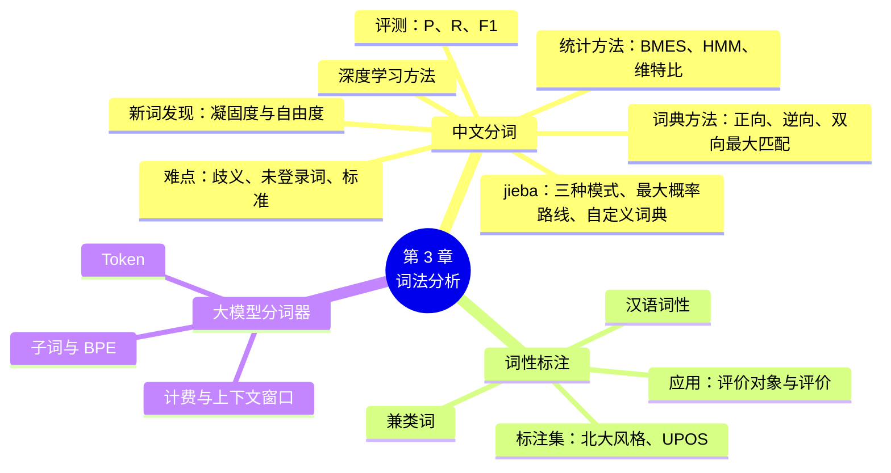

# 第 3 章 词法分析：分词、词性与大模型分词器

!!! abstract "本章学时"
    理论 5 学时 · 实验 1 学时（本章共 3 个实验，教师可任选）

## 学习目标

学完本章，你应该能够：

1. **解释**中文为什么需要分词，举例说明切分歧义和未登录词；
2. **描述**最大匹配法的步骤，并能手工完成一个句子的正向和逆向最大匹配；
3. **说明**基于统计的分词方法（字标注、HMM）的基本思路；
4. **计算**分词结果的精确率、召回率和 F1 值；
5. **使用** jieba 和 spaCy 完成分词、自定义词典和词性标注，并做词频统计与词云；
6. **解释**大模型的子词分词（BPE）和 Token 的含义，能估算大模型 API 的调用费用。

## 情景导入

某电商平台的搜索框里，顾客输入了“和服”，想买一件日本传统服装。结果搜索结果第一条竟然是一篇客服培训文章，标题是“我们**和服**务员一起成长”。

问题出在哪里？搜索引擎在建立索引时，需要先把文章切成一个个词。如果它把“我们和服务员”切成了“我们 / 和服 / 务员”，那么搜“和服”时就会搜到这篇文章。正确的切法应该是“我们 / 和 / 服务员”。

一个看似简单的“切词”问题，直接影响了搜索的准确性。中文不像英文那样在词与词之间加空格，计算机要先学会“断词”，才能做后面的一切工作。这一章，我们就来学习 NLP 的第一项基本功：**词法分析**。

## 3.1 什么是词法分析

### 3.1.1 词是语言的基本单位

**词**是能够独立运用的最小语言单位。“我爱北京”由“我”“爱”“北京”三个词组成；“北”和“京”单独拿出来虽然也是汉字，但在这句话里它们合在一起才表达“北京”这个意思。

计算机处理文本时，通常也以词（或者更小的单位，见 3.6 节）为基本单位。因为只有切出了词，才能统计哪些词出现得多（关键词提取），才能把词转换成数字（文本表示，第 5 章），才能判断词与词之间的关系（句法分析，第 4 章）。

### 3.1.2 词法分析的主要任务

**词法分析**（Lexical Analysis）就是对文本中的“词”进行分析，主要包括三项任务：

| 任务 | 做什么 | 例子 |
|---|---|---|
| **分词** | 把句子切分成词 | 我爱北京天安门 → 我 / 爱 / 北京 / 天安门 |
| **词性标注** | 标出每个词是名词、动词还是形容词等 | 我/代词 爱/动词 北京/地名 天安门/地名 |
| **命名实体识别** | 找出人名、地名、机构名等专有名词 | 北京、天安门 → 地名 |

本章重点学习分词和词性标注，命名实体识别将在第 7 章专门介绍。

## 3.2 中文分词

### 3.2.1 为什么要分词

英文的书写习惯是用空格把单词隔开，所以英文分词相对简单（第 2 章已经学过 NLTK 的分词，主要是处理标点和缩写）。中文是连续书写的，句子里只有字，没有显式的词边界。人读中文时，大脑会自动完成“断词”，而计算机必须专门学习这项技能。

分词是中文 NLP 的第一步，后续几乎所有任务都建立在分词结果之上。分词错了，后面就会“一错到底”，比如情景导入中的搜索错误。

### 3.2.2 分词的三大难点

**难点 1：切分歧义**

同一串汉字，可以有不止一种切法。切分歧义主要有两种类型：

| 类型 | 说明 | 例子 |
|---|---|---|
| **交集型歧义** | 相邻两个词共用中间的字，AB 和 BC 都是词 | “研究生命” → 研究生 / 命 还是 研究 / 生命？（“生”字被两个词争抢） |
| **组合型歧义** | 一个词 AB 拆开后，A 和 B 也各自成词 | “他将来北京” → 他 / 将 / 来 / 北京；“将来的事” → 将来 / 的 / 事 |

还有一类歧义，单看句子本身根本无法判断，需要更大的上下文。例如“乒乓球拍卖完了”，在体育用品店里多半是“乒乓球拍 / 卖完了”，在拍卖会上则可能是“乒乓球 / 拍卖 / 完了”。

**难点 2：未登录词**

**未登录词**是指词典里没有收录的词，也叫**新词**或 **OOV**（Out Of Vocabulary）。主要包括：

- 人名：“张一鸣”“李华”；
- 地名、机构名：“前海深港现代服务业合作区”“某某科技有限公司”；
- 新产品、新概念：“大模型”“智能体”“具身智能”；
- 网络用语：“绝绝子”“城会玩”“栓 Q”；
- 专业术语：医学、法律等领域的专有名词。

研究表明，在实际文本中，未登录词造成的分词错误比切分歧义造成的错误更多。因为语言每天都在产生新词，任何词典都不可能收全。

**难点 3：分词标准不统一**

“北京大学”应该切成一个词，还是“北京 / 大学”两个词？“吃饭”是一个词，还是“吃 / 饭”？不同的语料库、不同的分词工具有不同的规范，没有唯一正确的答案。实际工作中，要**根据任务选择合适的粒度**：做搜索时，切得细一些可以搜到更多结果；做实体识别时，“北京大学”作为一个整体更合适。

### 3.2.3 其他语言的词法分析

分词是中文的“特色难题”，但并不是中文独有。日文、泰文、越南文等语言同样存在词边界问题：日文和中文一样连续书写，泰文的词与词之间也没有空格，越南文虽然有空格，但空格隔开的是音节，一个词往往由两三个音节组成。因此，这些语言都需要专门的分词工具。

英文等使用空格的语言，词法分析的重点则在**词形变化**上。同一个词有多种形式：动词有 run、runs、running、ran，名词有单复数 city、cities，形容词有比较级 good、better、best。第 2 章学过的**词干提取**和**词形还原**，就是把这些不同形式归并到同一个词上，这同样属于词法分析的任务。还有一些语言，如德文、芬兰文、土耳其文，一个“词”可以由多个部分粘合而成，长得像一个句子，处理起来比英文更复杂。

了解这些差别，有助于理解为什么大模型最终选择了 BPE 这种“不依赖任何语言规则”的子词方法：它对所有语言一视同仁，直接从数据中学习怎样切分（3.6 节）。

## 3.3 分词方法

中文分词方法可以分为三大类：基于词典的方法、基于统计的方法和基于深度学习的方法。

### 3.3.1 基于词典的方法：最大匹配法

**基本思想**：准备一部词典，拿句子去词典里“查”，能查到的就切成一个词。查的时候遵循“**长词优先**”的原则，因为长词通常包含更多信息，例如优先切出“长江大桥”，而不是“长江”和“大桥”。

**正向最大匹配法**（Forward Maximum Matching，FMM）的步骤：

1. 设词典中最长的词有 `MAX_LEN` 个字；
2. 从句子**左边**开始，取 `MAX_LEN` 个字，到词典里查；
3. 查到了，就切出这个词；查不到，就去掉**最后一个字**，再查；
4. 一直减到只剩一个字时，这个字单独成词；
5. 从切出的词后面继续，重复步骤 2~4，直到句子结束。

以“研究生命的起源”为例，假设词典中最长词为 4 个字，词典中有“研究、研究生、生命、的、起源”等词：

| 轮次 | 剩余句子 | 尝试查找（从长到短） | 切出的词 |
|---|---|---|---|
| 1 | 研究生命的起源 | 研究生命 ✗ → 研究生 ✓ | 研究生 |
| 2 | 命的起源 | 命的起源 ✗ → 命的起 ✗ → 命的 ✗ → 命 ✓（单字） | 命 |
| 3 | 的起源 | 的起源 ✗ → 的起 ✗ → 的 ✓ | 的 |
| 4 | 起源 | 起源 ✓ | 起源 |

结果是“研究生 / 命 / 的 / 起源”，显然切错了。

**逆向最大匹配法**（Backward Maximum Matching，BMM）则从句子**右边**开始，每次查不到就去掉**最前面一个字**。对同一个句子：

| 轮次 | 剩余句子 | 尝试查找（从长到短） | 切出的词 |
|---|---|---|---|
| 1 | 研究生命的起源 | 命的起源 ✗ → 的起源 ✗ → 起源 ✓ | 起源 |
| 2 | 研究生命的 | 生命的 ✗ → 命的 ✗ → 的 ✓ | 的 |
| 3 | 研究生命 | 研究生命 ✗ → 究生命 ✗ → 生命 ✓ | 生命 |
| 4 | 研究 | 研究 ✓ | 研究 |

结果是“研究 / 生命 / 的 / 起源”，切对了。

!!! note "为什么逆向往往更准？"
    统计表明，中文里逆向最大匹配的错误率通常比正向更低。一个直观的解释是：汉语的中心词（最重要的词）往往在后面，比如“研究生命”里“生命”是研究的对象。但这只是经验规律，并非总是如此。

**双向最大匹配法**：正向、逆向各切一遍，如果结果不同，就按规则选一个，常用规则是“**词数少的优先**；词数一样时，**单字少的优先**”。实验 3-1 会用代码实现这三种方法。

**词典方法的优缺点**：

- 优点：简单、速度快、容易理解，可以通过往词典里加词来快速修正错误；
- 缺点：完全依赖词典，**无法识别未登录词**；遇到歧义时，只能靠简单规则，不能真正理解上下文。

### 3.3.2 基于统计的方法：字标注与隐马尔可夫模型

统计方法换了一个思路：**不把分词看成“查词典”，而是看成“给每个字贴标签”**。

每个字在词中的位置只有四种可能，用四个字母表示：

| 标签 | 含义 | 例子 |
|---|---|---|
| **B**（Begin） | 词的第一个字 | “北京”的“北” |
| **M**（Middle） | 词中间的字 | “天安门”的“安” |
| **E**（End） | 词的最后一个字 | “北京”的“京” |
| **S**（Single） | 单字成词 | “我”“爱” |

于是，“我爱北京天安门”的分词结果可以表示为：

```text
我  爱  北  京  天  安  门
S   S   B   E   B   M   E
```

只要能给每个字贴对标签，分词就完成了：遇到 E 或 S 就在后面切一刀。这种把问题转化为“给序列中每个元素贴标签”的方法叫做**序列标注**，它是 NLP 中非常重要的一类方法，第 7 章的命名实体识别也会用到。

那么，怎样给每个字贴标签呢？经典方法是**隐马尔可夫模型**（Hidden Markov Model，HMM）。我们不推导公式，只理解它的直观思路。HMM 从大量已经分好词的语料中统计两类概率：

1. **转移概率**：一个标签后面跟另一个标签的可能性。比如 B 后面只能跟 M 或 E，不可能跟 S；E 后面只能跟 B 或 S。
2. **发射概率**：某个标签下出现某个字的可能性。比如“的”字绝大多数时候是 S（单字成词），“京”字经常是 E。

给定一个新句子，HMM 会综合考虑这两类概率，找出**整体可能性最大**的一串标签。寻找这串最优标签用的是**维特比算法**（Viterbi Algorithm），它像导航软件找最短路线一样，能高效地从所有可能的组合中找出最优的那一个。

为什么需要专门的算法？“我爱北京天安门”有 7 个字，每个字有 4 种可能的标签，所有组合一共有 4 的 7 次方，即 16384 种；一句 30 个字的话，组合数会是一个 19 位数，逐一计算根本不可能。维特比算法的聪明之处在于：从左往右逐字推进，对每个字的每种标签，只保留“走到这里得分最高的那条路线”，其余的路线直接舍弃。这样，每个字只需要比较 4 × 4 = 16 种前后搭配，7 个字的句子大约只需计算一百多次，计算量随句子长度线性增长。这种“每一步只保留局部最优、最后回溯得到全局最优”的思想叫**动态规划**，jieba 选择最大概率路线时用的也是这种思想。

!!! tip "统计方法的最大优点：能认识新词"
    因为统计方法是给“字”贴标签，而不是查“词”，所以即使一个词从没在词典里出现过，只要它的字的组合方式符合统计规律，也可能被正确切出来。例如人名“张一鸣”，HMM 学到过“张”常常是 B，后面跟的字可以是 M、E，就有机会把它识别为一个词。

### 3.3.3 jieba 的分词原理

jieba 是目前最流行的中文分词工具，它结合了词典方法和统计方法：

1. **基于词典构建所有可能的切分**：用一部约 35 万词的词典，找出句子中所有可能成词的组合，形成一张“有向无环图”（可以理解为所有可能切法的路线图）；
2. **用动态规划找最大概率的切法**：每个词在词典中都有一个词频，jieba 选择“所有词的概率乘积最大”的那条路线；
3. **用 HMM 识别未登录词**：对词典中查不到、被切成连续单字的部分，再用 HMM 模型判断能否组成新词。

**动手推演：jieba 怎样切“我们和服务员一起成长”？** 回到情景导入中的句子。jieba 先查词典，列出每个位置开始可能成词的所有片段，例如从“和”字开始，既可以是单字“和”，也可以是“和服”；从“服”字开始，可以是“服”“服务”或“服务员”。把这些可能性连起来，就得到所有可能切法的路线图。接着，jieba 根据词典中的词频计算每条路线的得分。词典中所有词的总词频约为 6010 万，每个词的概率等于它的词频除以总词频。为了避免很多很小的概率相乘后变得过小，jieba 实际计算的是概率的**对数**，把乘法变成加法。“和服务员”这一段的几种切法得分如下（编者用 jieba 0.42.1 的词典实测）：

| 切法 | 各词的词频 | 各词的对数概率 | 合计 |
|---|---|---|---|
| 和 / 服务员 | 555815、321 | −4.68、−12.14 | **−16.82** |
| 和 / 服务 / 员 | 555815、13036、5970 | −4.68、−8.44、−9.22 | −22.34 |
| 和服 / 务 / 员 | 81、1342、5970 | −13.52、−10.71、−9.22 | −33.44 |

对数概率越接近 0，可能性越大。“和 / 服务员”得分最高，所以精确模式的结果是“我们 / 和 / 服务员 / 一起 / 成长”，切对了。可以看到，“和服”这个词在词典中的词频只有 81，远低于“和”的 55 万多，而且切出“和服”之后剩下的“务”“员”只能单独成词，又要再扣很多分。这就是“概率最大的路线”帮助消除歧义的原理。

但如果使用**全模式**，结果是“我们 / 和服 / 服务 / 服务员 / 一起 / 成长”，所有可能的词都被列了出来，“和服”赫然在列。如果搜索引擎用全模式建立索引，就会出现情景导入中的问题。实际的搜索引擎一般使用**搜索引擎模式**，它的结果是“我们 / 和 / 服务 / 服务员 / 一起 / 成长”：在精确模式的基础上，把长词“服务员”中的“服务”再切出来，这样搜“服务”也能找到这篇文章，又不会错误地出现“和服”。

**再看几个难点句子的实测结果**（jieba 默认设置）：

| 句子 | jieba 的结果 | 评价 |
|---|---|---|
| 研究生命的起源 | 研究 / 生命 / 的 / 起源 | 正确，没有像正向最大匹配那样切出“研究生” |
| 他将来北京 | 他 / 将来 / 北京 | 错误，应为“他 / 将 / 来 / 北京”，组合型歧义没有处理好 |
| 乒乓球拍卖完了 | 乒乓球 / 拍卖 / 完 / 了 | 选择了“拍卖”的理解，单看句子无法判断对错 |
| 小明硕士毕业于中国科学院计算所 | 小明 / 硕士 / 毕业 / 于 / 中国科学院 / 计算所 | 正确，人名“小明”被识别出来 |

最后一句很有意思：如果关闭 jieba 的 HMM 功能（`jieba.lcut(句子, HMM=False)`），结果会变成“小 / 明 / 硕士……”，人名被拆成了两个单字。这说明“小明”不在 jieba 的词典里，是 HMM 根据字的组合规律把它识别成了一个词，正好印证了 3.3.2 节所说的统计方法能“认识新词”。

jieba 提供三种分词模式：

| 模式 | 特点 | 适用场景 |
|---|---|---|
| **精确模式**（默认） | 把句子最精确地切开，没有冗余 | 文本分析、分类、情感分析 |
| **全模式** | 把句子中所有可能的词都扫描出来，有重叠 | 需要尽可能多的候选词时 |
| **搜索引擎模式** | 在精确模式基础上，对长词再次切分 | 搜索引擎建立索引，提高召回 |

### 3.3.4 基于深度学习的方法

2015 年以后，深度学习方法逐渐成为分词研究的主流。它同样采用字标注（BMES）的思路，但不再依赖人工统计的概率，而是用神经网络（如 BiLSTM-CRF、BERT 等，原理见第 8、9 章）自动从语料中学习每个字该贴什么标签。深度学习方法准确率更高，对新词和歧义的处理能力更强，但需要更多计算资源。

| 方法 | 代表 | 优点 | 缺点 |
|---|---|---|---|
| 基于词典 | 最大匹配法 | 简单、快速、可控 | 不能识别新词，歧义处理弱 |
| 基于统计 | HMM、CRF | 能识别部分新词 | 需要标注语料，只看局部上下文 |
| 词典 + 统计 | jieba | 速度快、效果好、易用 | 专业领域需要补充词典 |
| 深度学习 | BiLSTM-CRF、BERT | 准确率最高 | 速度较慢，需要更多算力 |

!!! info "工业界怎么选？"
    在实际工作中，jieba 这类“词典 + 统计”工具因为速度快、易于定制，仍然被大量使用。对准确率要求高的场景（如法律、医疗文本），会采用深度学习分词工具，例如北京大学开源的 pkuseg、哈工大的 LTP、HanLP 等。无论哪种工具，遇到专业领域时，**添加领域词典**都是最简单有效的改进办法。

### 3.3.5 新词发现：让计算机自己找出词典里没有的词

无论用哪种分词方法，专业领域和网络文本中的新词都是最大的麻烦。一个自然的想法是：能不能让计算机从大量文本中**自动找出**可能是新词的片段，再由人确认后加入词典？这项技术叫做**新词发现**。它的依据是一个朴素的观察：一个字串要成为“词”，需要满足两个条件。

**条件一：内部要“粘得紧”**，称为**凝固度**。“卷饼”中的“卷”和“饼”经常一起出现，它们一起出现的次数远远超过“碰巧挨在一起”应有的次数。数学上可以用两部分各自出现的概率和整体出现的概率来比较：整体出现的概率越是大于两部分概率的乘积，凝固度越高。反过来，“的饼”虽然也出现过，但“的”字到处都有，“的饼”一起出现只是碰巧，凝固度就很低。

**条件二：外部要“用得活”**，称为**自由度**。一个真正的词，左边和右边可以接各种各样的字：“卷饼”前面可以是“鸡肉”“这个”“的”，后面可以是“很”“不错”“好吃”。如果一个字串左边总是同一个字，比如“务员”的左边几乎总是“服”，那它很可能只是某个更长的词（“服务员”）的一部分，而不是一个独立的词。自由度用左（右）邻字的**信息熵**来衡量，邻字越丰富多样，熵越大，自由度越高。

编者用配套资源中的 `labs/ch03/new_words.py`，在约 1.2 万条外卖评论中做了新词发现。程序统计所有 2~3 个字的片段，保留出现至少 20 次、不在 jieba 词典中、凝固度大于 4、左右自由度都大于 1.5 的片段，按出现次数排序，前 20 个结果如下：

| 类别 | 候选词（出现次数） |
|---|---|
| **真正的新词**（菜品、行业用语） | 卷饼（353）、拌饭（118）、配送员（116）、快递员（75）、催单（73）、南瓜粥（68）、肘子卷（47）、烤肠（31）、微辣（28）、拿铁（28） |
| **网络用语** | 坑爹（38） |
| **常见搭配，但不是词** | 员态度（92）、每次都（65）、在店里（64）、告诉我（44）、俩小时（39）、找不到（38）、袋子里（36）、去店里（34）、这家店（33） |

结果中一半左右是真正有用的新词，特别是“卷饼”“拌饭”“催单”这些外卖领域的高频词，jieba 的通用词典里都没有收录。另一半是“每次都”“在店里”这样的常见搭配，以及“员态度”这样的残片。“员态度”能通过筛选，是因为它来自“送餐员态度”“配送员态度”“服务员态度”“快递员态度”等多种说法，左边的字各不相同，自由度反而不低；可它跨越了“员”和“态度”两个词的边界，显然不是一个词。这说明：**新词发现只能提供候选，最后必须由人来筛选**。把筛选后的词加入用户词典，jieba 对这类文本的分词效果就会明显改善。在企业中，这项工作常常由数据标注或运营人员定期完成，以跟上业务中不断出现的新说法。

## 3.4 分词效果的评测

怎么判断一个分词工具好不好？需要准备一份人工标注的“标准答案”，再把工具的结果和标准答案对比，计算三个指标。

以句子“研究生命的起源”为例：

- 标准答案：研究 / 生命 / 的 / 起源（4 个词）
- 正向最大匹配结果：研究生 / 命 / 的 / 起源（4 个词）

比较时，看每个词在句子中的**位置**是否完全一致。两个结果中切得一模一样的词是“的”和“起源”，共 2 个。

| 指标 | 含义 | 计算公式 | 本例 |
|---|---|---|---|
| **精确率**（Precision，P） | 工具切出的词中，切对了多少 | 切对的词数 ÷ 工具切出的词数 | 2 ÷ 4 = 50% |
| **召回率**（Recall，R） | 标准答案中的词，找回了多少 | 切对的词数 ÷ 标准答案的词数 | 2 ÷ 4 = 50% |
| **F1 值** | P 和 R 的综合（调和平均） | 2 × P × R ÷ (P + R) | 50% |

!!! tip "用生活例子理解精确率和召回率"
    假设一个池塘里有 10 条鱼，你撒网捞上来 8 个东西，其中 6 条是鱼、2 个是破鞋。

    - 精确率 = 捞上来的东西里有多少是鱼 = 6 ÷ 8 = 75%（**捞得准不准**）
    - 召回率 = 池塘里的鱼被捞上来多少 = 6 ÷ 10 = 60%（**捞得全不全**）

    这两个指标在第 6 章文本分类中还会反复用到。

在公开的中文分词评测中，现代分词工具在新闻类文本上的 F1 值一般能达到 95% 以上，但在网络文本、专业领域文本上会明显下降。

**公开评测数据集。** 为了公平比较不同的分词方法，研究者需要使用相同的测试数据。中文分词领域最著名的评测是国际中文分词评测（SIGHAN Bakeoff），其中 2005 年那一届提供的四个数据集至今仍被广泛使用：北京大学（PKU）和微软亚洲研究院（MSR）提供的简体中文数据，以及香港城市大学（CITYU）和台湾“中研院”（AS）提供的繁体中文数据。有趣的是，这四个数据集的分词标准各不相同，例如对人名、数字、机构名是否切开的规定不一样。所以，一个在 PKU 数据上训练的分词模型拿到 MSR 数据上测试，成绩会明显下降，这并不是因为它“不会分词”，而是因为“标准答案”变了。这再次印证了 3.2.2 节所说的：分词没有唯一的标准，评价时必须明确使用的是哪一套规范。

在实际项目中，我们一般不会去追求公开数据集上的高分，而是从自己的业务数据中抽取几百个句子，按照自己需要的粒度人工标注，作为“内部测试集”。每次修改词典或更换工具后，都在这份测试集上算一遍 F1 值，用数字判断改进是否有效。

## 3.5 词性标注

### 3.5.1 什么是词性标注

**词性**（Part of Speech，POS）是词的语法类别，如名词、动词、形容词。**词性标注**就是给分词结果中的每个词标上词性。

词性有什么用？

- **提取关键信息**：评论中的名词往往是“评价对象”（味道、速度、服务），形容词往往是“评价意见”（好、慢、差），把它们配对，就能做细粒度的评论分析；
- **帮助后续分析**：句法分析（第 4 章）需要先知道每个词的词性；英文的词形还原（第 2 章）也需要词性；
- **过滤无用词**：做关键词提取时，往往只保留名词和动词。

### 3.5.2 汉语的词性

现代汉语中常见的词性如下：

| 词性 | 说明 | 例子 |
|---|---|---|
| 名词 | 表示人、事物、时间、地点 | 学生、手机、明天、北京 |
| 动词 | 表示动作、行为、变化 | 学习、送、喜欢、是 |
| 形容词 | 表示性质、状态 | 好、快、漂亮、干净 |
| 副词 | 修饰动词、形容词，表示程度、范围、时间等 | 很、都、已经、不 |
| 代词 | 代替名词等 | 我、你、这、什么 |
| 数词、量词 | 表示数目和单位 | 一、三、个、斤、份 |
| 介词 | 引出时间、地点、对象等 | 在、从、对、把 |
| 连词 | 连接词或句子 | 和、但是、因为、所以 |
| 助词 | 附着在其他词后，表示语法关系 | 的、地、得、了、着、过 |
| 叹词、拟声词 | 表示感叹、模拟声音 | 啊、哎呀、哗啦 |

**词性标注的难点是兼类词**：同一个词在不同句子中可能属于不同的词性。

- “我在**学习**英语”中，“学习”是动词；“**学习**很重要”中，“学习”是名词性用法；
- “门被**锁**上了”中，“锁”是动词；“这把**锁**坏了”中，“锁”是名词。

所以，词性标注同样不能只查词典，需要结合上下文判断。它也是一个序列标注问题，可以用 HMM、CRF 或神经网络来解决。

### 3.5.3 词性标注集

用什么符号表示词性，不同的工具有不同的规定，这套规定叫**词性标注集**。本书会遇到两套：

| 词性 | jieba（北大标注集风格） | spaCy（通用标注集 UPOS） |
|---|---|---|
| 名词 | n（普通名词）、nr（人名）、ns（地名）、nt（机构名）、nz（其他专名） | NOUN、PROPN（专有名词） |
| 动词 | v、vn（名动词，如“送餐”有时被标为 v） | VERB |
| 形容词 | a | ADJ |
| 副词 | d | ADV |
| 代词 | r | PRON |
| 数词 / 量词 | m / q | NUM |
| 介词 | p | ADP |
| 连词 | c | CCONJ、SCONJ |
| 助词 | u、uj（“的”）、ul（“了”） | PART |
| 标点 | x（jieba 中标点也归为 x） | PUNCT |

**通用词性标注集**（Universal POS，UPOS）是一套跨语言的统一标注集，只有 17 个标签，中文、英文、日文等都用同一套，便于多语言处理。spaCy 的 `pos_` 属性使用的就是 UPOS。

### 3.5.4 词性标注的用处：从评论中提取“评价对象 + 评价”

3.5.1 节提到，名词往往是评价对象，形容词往往是评价意见。我们来实际验证一下。编者对外卖评论做 jieba 词性标注，找出“名词 + 形容词”和“名词 + 副词 + 形容词”两种相邻组合，分别统计好评和差评中出现最多的组合（编者实测）：

| 好评中最常见的组合（次数） | 差评中最常见的组合（次数） |
|---|---|
| 味道 不错（253） | 味道 一般（170） |
| 速度 快（136） | 味道 不错（104） |
| 味道 好（117） | 时间 长（89） |
| 态度 好（106） | 速度 太慢（75） |
| 服务态度 好（42） | 量 少（69） |
| 量 大（32） | 态度 差（47） |

只靠一条简单的词性规则，就从一万多条评论中提炼出了顾客最关心的几个方面：**味道、速度、态度、分量**。这正是电商平台“大家都在说”标签背后的基本思路。

仔细看结果，还能发现几个值得思考的现象：

- **差评中也有“味道 不错”**（104 次）。翻看原文，多是“味道不错，就是送得太慢了”这样的句子，也有“味道不错，菜量小”“味道不错，鸡肉不是很新鲜”等：顾客对味道满意，但对配送、分量或食材不满意，所以整体打了差评。这说明一条评论中可以包含对不同方面的不同评价，这就是第 6 章将提到的**属性级情感分析**要解决的问题；
- **词性标注也会出错**。统计结果中出现了“有点 慢”这样的组合，因为 jieba 把“有点”错误地标成了名词；而“送餐速度很快”中的“很快”被 jieba 当成一个副词，导致“速度 很快”没有被规则抓到。这再一次说明，任何自动工具的结果都需要抽样检查。

## 3.6 前沿视窗：大模型怎样“分词”

### 3.6.1 大模型面临的词表难题

大模型要处理几十种语言、各种专业术语、网络用语、代码和表情符号。如果像 jieba 那样“以词为单位”，词表会无限膨胀，而且永远会有未登录词；如果“以字（字符）为单位”，词表很小，但句子会变得很长，模型计算量大，而且单个字母（如 u、n）几乎不含意义。

大模型采用了一个折中方案：**子词**（Subword）。常用词保持完整，罕见词拆成更小的、有意义的片段。例如（实验 3-3 实测，使用通义千问分词器）：

```text
unbelievable  →  un / belie / vable
自然语言处理   →  自然 / 语言 / 处理
ChatGPT       →  Chat / G / PT
```

这样，即使遇到从没见过的新词，也总能拆成已知的片段，**彻底消灭了未登录词问题**。

### 3.6.2 BPE 算法

目前大模型最常用的子词算法是 **BPE**（Byte Pair Encoding，字节对编码）。它的思路非常朴素：**统计哪两个相邻的片段最常一起出现，就把它们合并成一个新片段，重复这个过程，直到词表达到预定大小。**

用一个小例子演示。假设语料只有 4 个英文单词（括号中为出现次数）：

```text
low (5)    lower (2)    newest (6)    widest (3)
```

**第 0 步**，把每个单词拆成字母：l o w、l o w e r、n e w e s t、w i d e s t。

**第 1 步**，统计相邻字母对的出现次数，“e s”出现了 6 + 3 = 9 次（newest 中 6 次，widest 中 3 次），是最多的（“s t”也是 9 次，次数相同时按顺序取第一个），于是合并为新片段“es”。

**第 2 步**，再统计，“es t”出现 9 次，合并为“est”。

**第 3 步**，“l o”出现 5 + 2 = 7 次，合并为“lo”；**第 4 步**，“lo w”出现 7 次，合并为“low”……

如此反复。最终，高频词（如 low）会成为一个完整的片段，而 newest、widest 会被表示为“new + est”“wid + est”，“est”这个常见后缀被单独学了出来。中文的处理方式类似：常见的词（“自然”“语言”）会成为一个片段，罕见字则保持为单字或进一步拆成字节。

### 3.6.3 Token：大模型的“计量单位”

经过分词器切分后得到的每一个片段，叫做一个 **Token**（中文常译作“词元”）。Token 是大模型世界里最重要的计量单位：

- **计费单位**：大模型 API 按 Token 数量收费，输入（提示词）和输出（回答）分别计价，价格通常以“元 / 百万 Token”标注；
- **长度单位**：每个模型都有**上下文窗口**限制，即一次最多能处理多少 Token（包括输入和输出）。超过限制，前面的内容就会被“遗忘”或报错；
- **速度单位**：大模型生成文字的速度常用“Token / 秒”来衡量。

一个 Token 大约对应多少文字？这取决于分词器和语言。以通义千问的分词器为例（实验 3-3 实测）：一句 21 个字符的中文切成了 10 个 Token，平均每个 Token 约 2.1 个字符；一句 72 个字符的英文切成 13 个 Token，平均每个 Token 约 5.5 个字符。不同模型的分词器不同，同一段文字算出的 Token 数也不同。

!!! note "大模型时代还需要学 jieba 吗？"
    需要。大模型的 Token 是为模型计算服务的，不一定符合人对“词”的理解（如“Chat / G / PT”）。在搜索引擎建索引、关键词统计、词云、舆情分析、构建领域词典等任务中，我们需要的是符合语言习惯的“词”，jieba 这样的分词工具仍然是首选。而且，它速度极快、不需要 GPU、不花钱。

### 3.6.4 Token 数量与实际应用

知道一段文字大约有多少 Token，在实际工作中很有用：

- **估算费用**：对一万条评论做情感分析，每条评论连同提示词约 100 Token，总共约 100 万输入 Token，再乘以单价就能估算费用（附录 D 有详细的估算方法）；
- **判断能否一次处理**：一份 100 页的合同大约有几万字，换算成 Token 后，看是否超过所用模型的上下文窗口；如果超过，就要先切成若干段分别处理，第 11 章的 RAG 系统中这一步叫做“切块”；
- **控制输出长度**：调用 API 时设置的 `max_tokens` 参数以 Token 为单位，设得太小，回答会被截断。

还要注意，Token 的切分方式会影响模型的某些能力。例如，很多大模型曾经数不清一个英文单词里有几个字母 r，原因之一就是模型“看到”的是几个子词片段，而不是一个个字母。同样，让大模型统计一段中文有多少个字、或者严格按照字数写作，往往也不够准确，这时可以让大模型写程序来计数，或者直接用 Python 的 `len()` 函数。理解了 Token，就能理解大模型的一些“奇怪”表现。

### 3.6.5 案例：为外卖平台搭建分词方案

综合本章内容，假设你在一家外卖平台做数据分析，需要对每天几十万条评论做关键词统计和搜索，分词方案可以这样搭建：

1. **选择基础工具**：评论数量大、要求速度快，选择 jieba 这样的“词典 + 统计”工具，而不是逐条调用大模型；
2. **发现领域新词**：用 3.3.5 节的方法，每周从新评论中找出候选新词，如新上线的菜品名、新出现的网络用语；
3. **人工筛选，加入词典**：由运营人员从候选词中挑出真正的词，写入用户词典（每行一个词，可以附上词频和词性），程序启动时用 `jieba.load_userdict()` 加载；
4. **建立测试集，量化评估**：从评论中抽取 200 句，人工标注分词结果，每次更新词典后计算 F1 值，确保改进有效、没有“改坏”其他句子；
5. **按需选择模式**：做关键词统计时用精确模式；为搜索建立索引时用搜索引擎模式，提高召回率。

这套流程的核心思想是：**通用工具 + 领域词典 + 持续评估**。它不追求一步到位，而是随着业务的变化不断迭代。大模型可以在第 2、3 步中帮忙，例如让大模型判断候选词是不是一个有意义的词，从而减轻人工筛选的负担。

## 本章实验

!!! abstract "实验总览"
    | 实验 | 类型 | 建议时长 | 内容 |
    |---|---|---|---|
    | 实验 3-1 | ★ 基础 | 45 分钟 | 动手实现最大匹配分词 |
    | 实验 3-2 | ★ 基础 | 60 分钟 | jieba 与 spaCy 分词、词性标注、词频与词云 |
    | 实验 3-3 | ★ 基础 | 45 分钟 | 大模型分词器体验与 API 费用估算 |

    实验代码见配套资源 `labs/ch03/` 目录。

### 实验 3-1 ★ 动手实现最大匹配分词

**实验目的**

1. 用 Python 实现正向、逆向和双向最大匹配分词算法；
2. 用典型歧义句测试，观察三种方法的差异，理解词典方法的局限。

**实验环境**：实验 1-1 的环境，不需要额外安装任何库。

**实验步骤与代码**

```python
# 一个很小的示例词典（真实词典有几十万个词）
DICT = {"南京", "南京市", "市长", "长江", "大桥", "长江大桥", "江大桥",
        "研究", "研究生", "生命", "命", "的", "起源",
        "结婚", "和", "和尚", "尚未", "未", "乒乓", "乒乓球", "乒乓球拍",
        "球拍", "拍卖", "卖", "完", "了", "卖完"}
MAX_LEN = max(len(w) for w in DICT)          # 词典中最长词的长度


def forward_max_match(text):
    """正向最大匹配：从左往右，每次先取最长的一段，查不到就去掉最后一个字再查"""
    words, i = [], 0
    while i < len(text):
        for size in range(min(MAX_LEN, len(text) - i), 0, -1):
            piece = text[i:i + size]
            if piece in DICT or size == 1:   # 查到了，或者只剩一个字
                words.append(piece)
                i += size
                break
    return words


def backward_max_match(text):
    """逆向最大匹配：从右往左，每次先取最长的一段，查不到就去掉最前面一个字再查"""
    words, j = [], len(text)
    while j > 0:
        for size in range(min(MAX_LEN, j), 0, -1):
            piece = text[j - size:j]
            if piece in DICT or size == 1:
                words.insert(0, piece)       # 从右往左切，所以插到最前面
                j -= size
                break
    return words


def bidirectional_match(text):
    """双向最大匹配：两种结果不同时，选词数更少的；词数相同时，选单字更少的"""
    f, b = forward_max_match(text), backward_max_match(text)
    if len(f) != len(b):
        return f if len(f) < len(b) else b
    single = lambda ws: sum(len(w) == 1 for w in ws)
    return f if single(f) < single(b) else b


for s in ["南京市长江大桥", "研究生命的起源", "结婚的和尚未结婚的", "乒乓球拍卖完了"]:
    print(s)
    print("  正向：", "/".join(forward_max_match(s)))
    print("  逆向：", "/".join(backward_max_match(s)))
    print("  双向：", "/".join(bidirectional_match(s)))
```

运行结果：

```text
南京市长江大桥
  正向： 南京市/长江大桥
  逆向： 南京市/长江大桥
  双向： 南京市/长江大桥
研究生命的起源
  正向： 研究生/命/的/起源
  逆向： 研究/生命/的/起源
  双向： 研究/生命/的/起源
结婚的和尚未结婚的
  正向： 结婚/的/和尚/未/结婚/的
  逆向： 结婚/的/和/尚未/结婚/的
  双向： 结婚/的/和/尚未/结婚/的
乒乓球拍卖完了
  正向： 乒乓球拍/卖完/了
  逆向： 乒乓球拍/卖完/了
  双向： 乒乓球拍/卖完/了
```

代码解读：

- `range(min(MAX_LEN, len(text) - i), 0, -1)` 产生从大到小的长度序列（如 4、3、2、1），实现“先试最长的”；
- `if piece in DICT or size == 1`：查到词典中的词就切出来；如果已经减到 1 个字还没查到，就让这个字单独成词，保证程序一定能往下走；
- 双向匹配中，“研究生命的起源”正向和逆向的词数都是 4，但正向结果有 2 个单字（命、的），逆向结果只有 1 个单字（的），所以选择逆向结果。

结果解读：“结婚的和尚未结婚的”是一个经典例子，正向匹配切出了“和尚”，意思变成了“结婚的和尚”，逆向匹配则切对了。“乒乓球拍卖完了”三种方法都切成了“乒乓球拍 / 卖完 / 了”，这是因为我们的小词典里有“乒乓球拍”和“卖完”。可见，**最大匹配法的结果在很大程度上取决于词典里有什么词**。

**常见问题排查**

| 现象 | 原因与解决办法 |
|---|---|
| 程序进入死循环 | 检查 `i += size` 或 `j -= size` 是否写在了 `break` 之前 |
| 切出的结果顺序颠倒 | 逆向匹配中应使用 `words.insert(0, piece)` 插入到列表开头 |

**思考与练习**

1. 从词典中删去“卖完”，再运行一次，“乒乓球拍卖完了”的结果有什么变化？
2. 给词典加入“长江大桥”以外的“江大桥”（已加入）有什么用意？如果从词典中删除“南京市”，“南京市长江大桥”会被切成什么？
3. 编写函数 `evaluate(pred, gold)`，按 3.4 节的方法计算一个句子分词结果的精确率、召回率和 F1 值。（提示：把每个词转换成“起始位置—结束位置”的区间，再比较两个区间集合的交集。）

**实验报告要求**

提交代码与运行结果，完成思考题，并自己找 3 个有切分歧义的句子，扩充词典后测试三种方法的效果。

### 实验 3-2 ★ jieba 与 spaCy 分词和词性标注

**实验目的**

1. 掌握 jieba 的三种分词模式和自定义词典的用法；
2. 用 jieba 和 spaCy 进行词性标注，并提取名词和形容词；
3. 对外卖差评数据进行分词、去停用词和词频统计，生成词云。

**实验环境**：实验 1-1 的环境，另需安装 `pip install wordcloud pandas`。

**实验数据**：外卖评论数据集 `waimai_10k.csv`、中文停用词表 `cn_stopwords.txt`（配套资源 `labs/data/`）。

**第 1~3 部分：分词模式、自定义词典与词性标注**

```python
import jieba
import jieba.posseg as pseg

# ===== 第 1 部分：jieba 的三种分词模式 =====
s = "我在人工智能技术应用专业学习自然语言处理"
print("精确模式：", "/".join(jieba.cut(s)))
print("全模式：  ", "/".join(jieba.cut(s, cut_all=True)))
print("搜索引擎：", "/".join(jieba.cut_for_search(s)))

# ===== 第 2 部分：自定义词典 =====
s2 = "大模型智能体可以调用工具，这个外卖小哥送餐真是绝绝子"
print("\n添加词典前：", "/".join(jieba.cut(s2)))
for w in ["大模型", "智能体", "外卖小哥", "绝绝子"]:
    jieba.add_word(w)                 # 也可以用 jieba.load_userdict("文件名") 批量加载
print("添加词典后：", "/".join(jieba.cut(s2)))

# ===== 第 3 部分：词性标注 =====
s3 = "这家店的牛肉面味道很好，但是送餐速度太慢了"
print("\njieba 词性：", " ".join(f"{w}/{f}" for w, f in pseg.cut(s3)))
nouns = [w for w, f in pseg.cut(s3) if f.startswith("n")]
adjs = [w for w, f in pseg.cut(s3) if f.startswith("a")]
print("名词：", nouns, " 形容词：", adjs)

import spacy
nlp = spacy.load("zh_core_web_sm")
print("spaCy 词性：", " ".join(f"{t.text}/{t.pos_}" for t in nlp(s3)))
```

运行结果（已省略 jieba 加载词典的提示信息）：

```text
精确模式： 我/在/人工智能/技术/应用/专业/学习/自然语言/处理
全模式：   我/在/人工/人工智能/智能/技术/应用/专业/学习/自然/自然语言/语言/处理
搜索引擎： 我/在/人工/智能/人工智能/技术/应用/专业/学习/自然/语言/自然语言/处理

添加词典前： 大/模型/智能/体/可以/调用/工具/，/这个/外卖/小哥/送餐/真是/绝绝子
添加词典后： 大模型/智能体/可以/调用/工具/，/这个/外卖小哥/送餐/真是/绝绝子

jieba 词性： 这家/r 店/n 的/uj 牛肉面/n 味道/n 很/d 好/a ，/x 但是/c 送餐/v 速度/n 太慢/a 了/ul
名词： ['店', '牛肉面', '味道', '速度']  形容词： ['好', '太慢']
spaCy 词性： 这家/DET 店/NOUN 的/PART 牛肉面/NOUN 味道/NOUN 很/ADV 好/VERB ，/PUNCT 但是/ADV 送餐/NOUN 速度/NOUN 太/ADV 慢/VERB 了/PART
```

结果解读：

- **三种模式**：全模式和搜索引擎模式都多切出了“人工”“智能”“自然”“语言”等短词，适合搜索时提高召回；
- **自定义词典**：添加前，“大模型”“智能体”被切碎了，这正是新词问题；添加后切分正确。有趣的是，“绝绝子”在添加词典前就被切成了一个词，这是 jieba 的 HMM 新词识别在起作用；
- **词性标注**：jieba 的结果中，名词（n）“店、牛肉面、味道、速度”是评价对象，形容词（a）“好、太慢”是评价意见。把它们按位置配对，就得到“味道—好”“速度—太慢”，这就是细粒度评论分析的雏形；
- **两个工具的差异**：spaCy 把“太慢”切成了“太 / 慢”，把“好”“慢”标成了动词（VERB），把“送餐”标成了名词。在通用标注集 UPOS 中，汉语形容词作谓语时常被标为 VERB，这与汉语语法教学习惯不同。**不同工具的切分粒度和标注规范都不同**，同一个项目中应统一使用一种工具。

**第 4 部分：差评高频词统计与词云**

```python
from collections import Counter
import jieba
import pandas as pd
from wordcloud import WordCloud

jieba.setLogLevel("WARN")             # 不显示加载词典的提示信息
df = pd.read_csv("waimai_10k.csv")
bad = df[df["label"] == 0]["review"]  # 只取差评
stopwords = set(open("cn_stopwords.txt", encoding="utf-8").read().split())

words = []
for review in bad:
    for w in jieba.cut(review):
        if len(w) >= 2 and w not in stopwords:   # 去掉单字和停用词
            words.append(w)

freq = Counter(words)
print("差评共分出", len(words), "个词，不同的词有", len(freq), "个")
print("出现最多的 15 个词：")
for w, c in freq.most_common(15):
    print(f"  {w}\t{c}")

# 生成词云：Windows 可用 font_path="C:/Windows/Fonts/simhei.ttf"
# macOS 可用 "/System/Library/Fonts/PingFang.ttc"
wc = WordCloud(font_path="/usr/share/fonts/truetype/wqy/wqy-zenhei.ttc",
               width=800, height=450, background_color="white", max_words=100)
wc.generate_from_frequencies(freq)
wc.to_file("bad_reviews_wordcloud.png")
print("词云已保存为 bad_reviews_wordcloud.png")
```

运行结果：

```text
差评共分出 59044 个词，不同的词有 8297 个
出现最多的 15 个词：
  小时	1185
  送餐	1061
  没有	1057
  味道	873
  送到	769
  好吃	667
  难吃	593
  太慢	528
  送来	499
  外卖	497
  时间	465
  一个	445
  不错	380
  两个	372
  速度	336
词云已保存为 bad_reviews_wordcloud.png
```


结果解读：

- 差评中出现最多的是“小时”“送餐”“送到”“太慢”“时间”“速度”，说明**配送慢是顾客最不满意的问题**；“味道”“难吃”说明口味是第二大问题。这样的分析可以直接给商家和平台提供改进方向；
- 奇怪的是，差评里“好吃”出现了 667 次，“不错”出现了 380 次。原因是差评中常有“不好吃”“味道还不错，就是送得太慢”这样的表达，而我们去掉了单字“不”。这提醒我们：**词频统计会丢失否定和转折信息**，第 6 章的情感分析需要更好的方法；
- `Counter` 是 Python 自带的计数工具，`most_common(15)` 返回出现次数最多的 15 个元素。

**常见问题排查**

| 现象 | 原因与解决办法 |
|---|---|
| 词云中的汉字显示为方框 | 没有指定中文字体，按代码注释修改 `font_path` 为本机的中文字体路径 |
| `OSError: cannot open resource` | 字体路径写错了，在文件管理器中找到字体文件，复制完整路径 |
| 分词结果与教材不完全一致 | jieba 版本或自定义词典不同，属于正常现象 |

**思考与练习**

1. 修改程序，统计**好评**中的高频词并生成词云，与差评对比，说说顾客最看重什么。
2. 在去停用词时保留“不”“没”等否定词，并把“不 + 下一个词”合并为一个词（如“不好吃”），再统计一次差评高频词。
3. 用 `jieba.load_userdict()` 加载一个你自己编写的外卖领域词典（如“黄焖鸡”“麻辣烫”“骑手”），观察分词结果的变化。

**实验报告要求**

提交好评、差评两张词云图和对比分析（300 字左右），以及思考题 2 的代码和结果。

### 实验 3-3 ★ 大模型分词器体验

**实验目的**

1. 使用通义千问（Qwen）的分词器，观察大模型如何把文本切分成 Token；
2. 比较中文和英文的 Token 效率；
3. 统计一个数据集的 Token 总量，估算调用大模型 API 的费用。

**实验环境**：实验 1-1 的环境，另需安装 `pip install dashscope`。阿里云的 dashscope 安装包中自带了通义千问的分词器文件，**不需要联网下载模型，也不需要 API Key**。

**实验步骤与代码**

```python
from dashscope import get_tokenizer

tokenizer = get_tokenizer("qwen-turbo")

# ===== 第 1 部分：看看大模型是怎么“切词”的 =====
samples = ["自然语言处理", "我爱北京天安门", "Natural language processing",
           "unbelievable", "yyds绝绝子", "ChatGPT和DeepSeek", "2026年11月6日", "😂👍"]
for text in samples:
    ids = tokenizer.encode(text)
    pieces = [tokenizer.decode([i]) for i in ids]
    print(f"{text:<28} {len(ids):>2} 个 Token：{pieces}")

# ===== 第 2 部分：中英文的 Token 效率对比 =====
zh = "人工智能正在深刻改变我们的生活和工作方式。"
en = "Artificial intelligence is profoundly changing the way we live and work."
for name, text in [("中文", zh), ("英文", en)]:
    n = len(tokenizer.encode(text))
    print(f"{name}：{len(text)} 个字符 → {n} 个 Token，平均每个 Token {len(text)/n:.2f} 个字符")

# ===== 第 3 部分：估算 API 调用费用 =====
import pandas as pd
reviews = pd.read_csv("waimai_10k.csv")["review"]
total = sum(len(tokenizer.encode(r)) for r in reviews)
chars = reviews.str.len().sum()
print(f"\n{len(reviews)} 条评论共 {chars} 个字符，{total} 个 Token")

# 假设：输入单价 每百万 Token 2 元（请以各平台最新价格为准）
price_per_million = 2.0
prompt_tokens = 60                       # 每次调用附带的提示词大约 60 个 Token
cost = (total + prompt_tokens * len(reviews)) / 1_000_000 * price_per_million
print(f"逐条调用大模型做情感分析，输入部分费用约 {cost:.2f} 元")
```

运行结果：

```text
自然语言处理                        3 个 Token：['自然', '语言', '处理']
我爱北京天安门                       6 个 Token：['我', '爱', '北京', '天', '安', '门']
Natural language processing   3 个 Token：['Natural', ' language', ' processing']
unbelievable                  3 个 Token：['un', 'belie', 'vable']
yyds绝绝子                       5 个 Token：['yy', 'ds', '绝', '绝', '子']
ChatGPT和DeepSeek              6 个 Token：['Chat', 'G', 'PT', '和', 'Deep', 'Seek']
2026年11月6日                   10 个 Token：['2', '0', '2', '6', '年', '1', '1', '月', '6', '日']
😂👍                            2 个 Token：['😂', '👍']
中文：21 个字符 → 10 个 Token，平均每个 Token 2.10 个字符
英文：72 个字符 → 13 个 Token，平均每个 Token 5.54 个字符

11987 条评论共 300257 个字符，213590 个 Token
逐条调用大模型做情感分析，输入部分费用约 1.87 元
```

结果解读：

- `tokenizer.encode()` 把文本转换成一串数字编号（Token ID），这才是大模型真正“看到”的输入；`decode()` 把编号还原成文字片段；
- 大模型的切分和 jieba 不一样：“天安门”被切成了 3 个单字，“yyds”被切成“yy”和“ds”，“ChatGPT”被切成“Chat / G / PT”。这些切分对人来说不太自然，但对模型来说是高效的；
- **数字是逐位切分的**：“2026”被切成了 4 个 Token。这是很多大模型的设计，有助于模型做算术，但也意味着数字多的文本会消耗更多 Token；
- 中文平均每个 Token 约 2 个字符，英文约 5.5 个字符（约 1 个单词）。英文字符多，但英文表达同样的意思本身就需要更多字符，所以两者的 Token 数相差没有字符数那么大；
- 1.2 万条评论共约 21 万个 Token，加上每条附带的提示词，逐条调用大模型的输入费用不到 2 元（按假设单价）。这说明对这种规模的任务，大模型的**费用并不高**，但如果数据量增长到上亿条，费用和耗时就需要认真考虑了。

!!! warning "价格以官网为准"
    大模型 API 价格变化很快，而且不同模型、输入和输出、是否命中缓存，价格都不同。代码中的单价只是假设，实际使用前请查阅各平台的最新价格页面。

**常见问题排查**

| 现象 | 原因与解决办法 |
|---|---|
| `ModuleNotFoundError: No module named 'dashscope'` | 执行 `pip install dashscope` |
| 统计全部评论时速度较慢 | 1.2 万条约需几秒，属于正常现象；数据量很大时可先抽样估算 |

**思考与练习**

1. 用分词器统计你最近写的一篇文章（或本章的某一节）有多少个 Token。
2. 输入一段古诗、一段 Python 代码、一段日文，观察它们的切分方式和 Token 效率。
3. 假设一个模型的上下文窗口为 128K（约 12.8 万）个 Token，按本实验测得的比例估算，它一次大约能读入多少个汉字的文本？

**实验报告要求**

提交运行结果截图，完成思考题，并写一段 200 字左右的分析：jieba 分词和大模型分词器的切分结果有什么不同？为什么会不同？

## 本章小结

- **词法分析**包括分词、词性标注和命名实体识别，是中文 NLP 的第一步。
- 中文分词的三大难点：**切分歧义**（交集型、组合型）、**未登录词**、**分词标准不统一**。
- **最大匹配法**依据词典、长词优先，分为正向、逆向和双向三种，简单快速，但不能识别新词。
- **统计方法**把分词看作给每个字贴 **B / M / E / S** 标签的**序列标注**问题，经典模型是 **HMM**，用维特比算法求解最优标签序列。
- **jieba** 结合了词典和统计方法，有精确、全、搜索引擎三种模式，可以通过自定义词典处理领域新词。
- **jieba** 用词频计算每条切分路线的概率，选择概率最大的路线；关闭 HMM 后无法识别词典外的人名等新词。
- **新词发现**依据“内部凝固度”和“外部自由度”从大量文本中找出候选新词，但最终需要人工筛选。
- 分词效果用**精确率、召回率和 F1 值**评测；不同数据集的分词标准不同，实际项目应建立自己的测试集。
- **词性标注**给每个词标上语法类别，难点是兼类词；常见标注集有北大标注集风格和通用标注集 UPOS；利用词性规则可以从评论中提取“评价对象 + 评价”。
- 大模型使用 **BPE** 等**子词**分词方法，切分出的单位叫 **Token**，它是大模型计费、上下文长度和速度的计量单位；理解 Token 有助于估算费用，也能解释大模型数不清字数等现象。



**拓展阅读**

- jieba 项目主页（github.com/fxsjy/jieba），README 中有分词原理和全部用法说明。
- 吴军《数学之美》第 4 章“谈谈分词”和第 26 章“维特比和他的维特比算法”。

## 课后练习

**一、选择题**

1. “研究生命的起源”被切分为“研究生 / 命 / 的 / 起源”，这属于（　　）问题。
   A. 未登录词　B. 交集型歧义　C. 组合型歧义　D. 编码错误

2. 正向最大匹配法从句子的哪一端开始切分？（　　）
   A. 左端　B. 右端　C. 中间　D. 随机位置

3. 在 BMES 标注中，“天安门”中的“安”应标为（　　）。
   A. B　B. M　C. E　D. S

4. 下列哪种方法最难识别未登录词？（　　）
   A. 最大匹配法　B. HMM　C. BiLSTM-CRF　D. BERT

5. jieba 中适合搜索引擎建立索引的模式是（　　）。
   A. 精确模式　B. 全模式　C. 搜索引擎模式　D. 词性标注模式

6. 大模型 API 的计费单位通常是（　　）。
   A. 字符　B. 单词　C. 句子　D. Token

**二、判断题**

1. 英文和中文一样，都需要复杂的分词算法才能切分单词。（　　）
2. 只要词典足够大，最大匹配法就能解决所有分词问题。（　　）
3. 同一个词在不同句子中可能有不同的词性。（　　）
4. 大模型的分词器能保证每个 Token 都是一个完整的中文词语。（　　）
5. BPE 算法会反复合并最常一起出现的相邻片段。（　　）

**三、填空题**

1. 词典中没有收录的词称为________，英文缩写是 OOV。
2. HMM 中，一个标签后面跟另一个标签的概率叫________概率。
3. F1 值是________和召回率的调和平均。
4. spaCy 使用的跨语言词性标注集英文缩写是________。

**四、简答题**

1. 用自己的话说明正向最大匹配法的步骤，并对“结婚的和尚未结婚的”手工完成正向和逆向切分。
2. 什么是 Token？为什么说它是大模型的“计量单位”？
3. 已知标准分词为“我 / 爱 / 北京 / 天安门”，某工具切分为“我 / 爱北京 / 天安门”，计算精确率、召回率和 F1 值。
4. 什么是新词发现中的“凝固度”和“自由度”？“员态度”出现了 92 次，也通过了程序的筛选，为什么它仍然不是一个词？
5. 根据 3.3.3 节的表格，解释 jieba 为什么没有把“我们和服务员”切成“我们 / 和服 / 务 / 员”。

**五、实践题**

选择一个你熟悉的行业（如餐饮、汽修、护理、电商），整理一份不少于 30 个词的领域词典，找 10 句该行业的真实文本，比较加载词典前后 jieba 分词结果的差异。

??? success "参考答案"
    **选择题：** 1. B　2. A　3. B　4. A　5. C　6. D

    **判断题：** 1. ×　2. ×　3. √　4. ×　5. √

    **填空题：** 1. 未登录词　2. 转移　3. 精确率　4. UPOS

    **简答题第 3 题：** 工具切出 3 个词，标准答案 4 个词，切对的是“我”“天安门”共 2 个。P = 2/3 ≈ 66.7%，R = 2/4 = 50%，F1 = 2 × 0.667 × 0.5 ÷ (0.667 + 0.5) ≈ 57.1%。

    **简答题第 4 题提示：** 凝固度衡量字串内部各部分是否“粘得紧”，自由度衡量字串左右能否搭配丰富多样的字。“员态度”来自“送餐员态度”“配送员态度”等说法，左边的字多种多样，所以自由度并不低，能通过程序的筛选；但它横跨了“送餐员”和“态度”两个词的边界，不是一个独立的词。这说明统计指标只能提供候选，需要人工判断。

    **简答题第 5 题提示：** “和服 / 务 / 员”的对数概率之和为 −33.44，远低于“和 / 服务员”的 −16.82；“和服”词频低，剩下的“务”“员”又只能单独成词，整体可能性很小。
