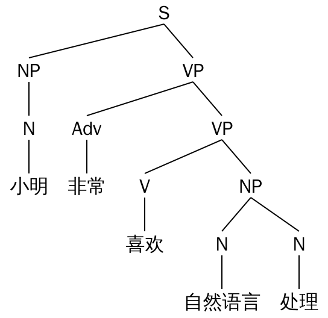
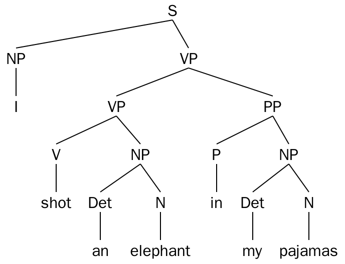
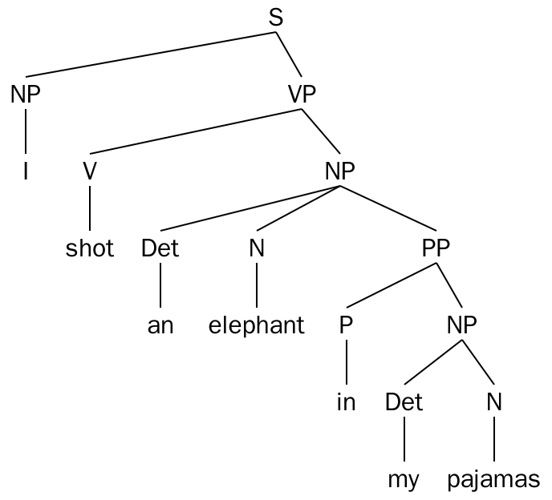
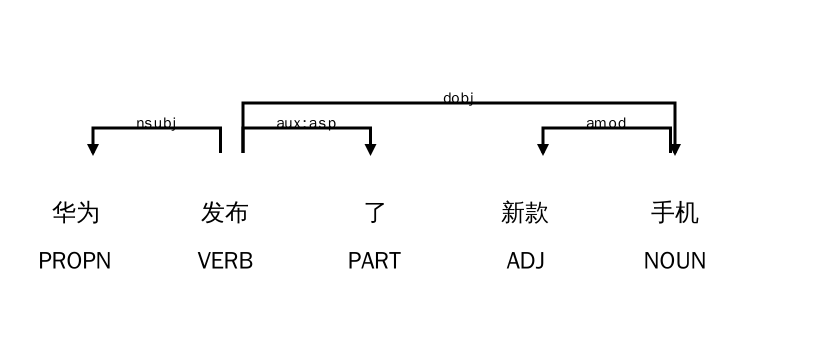
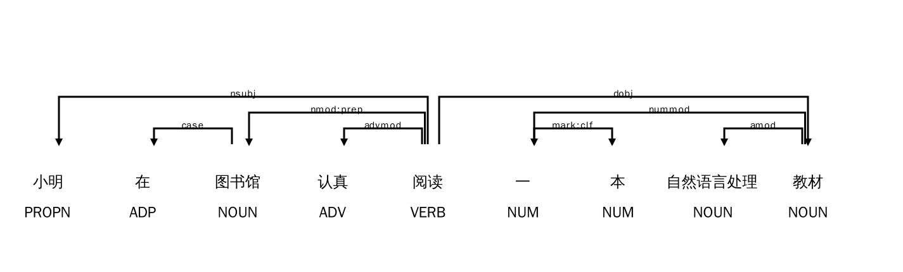
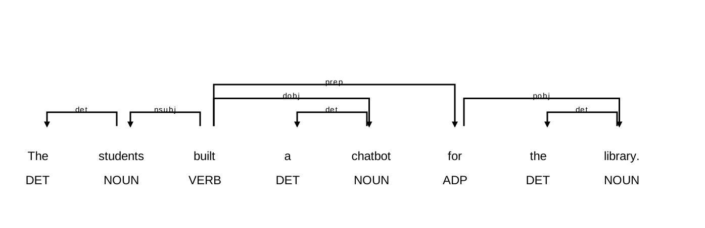
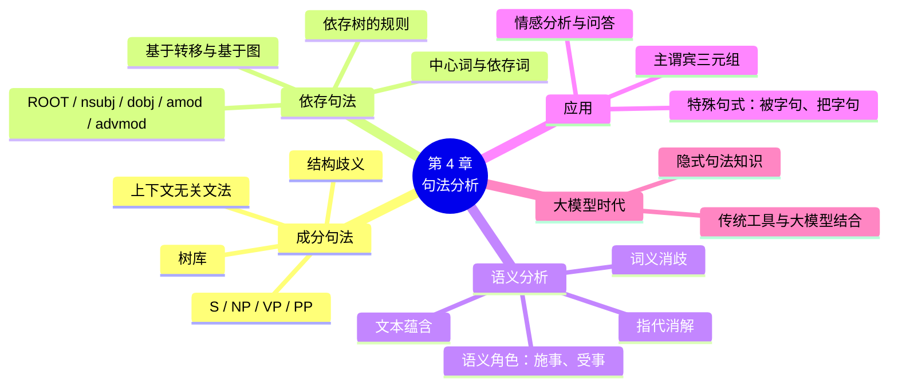

# 第 4 章 句法分析与语义分析

!!! abstract "本章学时"
    理论 5 学时 · 实验 1 学时（本章共 3 个实验，教师可任选）

## 学习目标

学完本章，你应该能够：

1. **说出**句法分析的任务，区分成分句法分析和依存句法分析；
2. **读懂**一棵成分句法树，用 NLTK 编写简单的上下文无关文法并解析句子；
3. **解释**结构歧义的成因，能为一个歧义句画出两种句法结构；
4. **识别**主谓、动宾、定中、状中等常见依存关系，读懂依存句法图；
5. **使用** spaCy 完成依存句法分析，并基于依存关系提取“主谓宾”三元组；
6. **说明**词义消歧、语义角色标注、指代消解、文本蕴含等语义分析任务的含义；
7. **评价**传统句法分析工具和大模型在句法分析上的优缺点。

## 情景导入

某市政务热线每天要接收上千条市民留言，工作人员需要把每条留言“谁、对什么、怎么了”提取出来，分派给对应的部门。例如：

> 留言 A：“小区物业**拆除**了楼下的自行车棚。”
> 留言 B：“楼下的自行车棚被小区物业**拆除**了。”
> 留言 C：“物业说要拆除车棚，业主们**不同意**。”

如果只做分词和词性标注，计算机只知道句子里有“物业”“拆除”“车棚”这些词，却不知道**谁拆了谁**。A 和 B 用了不同的句式，意思却一样；C 里有两个动作，涉及不同的人。

要回答“谁做了什么”，计算机必须看懂句子的**结构**：哪个词是主语，哪个词是谓语，哪个词是宾语，哪些词是修饰语。这就是本章要学习的**句法分析**。更进一步，计算机还要明白“物业”是动作的实施者、“车棚”是动作的承受者，不管句子用的是主动句还是被动句，这就进入了**语义分析**的范畴。

## 4.1 什么是句法分析

### 4.1.1 从“词”到“句”

上一章我们学习了词法分析，它让计算机认识了一个个“词”。但句子的意思不只是词义的简单相加，还取决于**词的组合方式**。

- “狗咬人”和“人咬狗”，用的词完全一样，意思却截然相反；
- “我喜欢的老师”和“喜欢我的老师”，词也一样，说的却是两种人。

**句法**（Syntax）研究的就是词怎样组合成短语和句子的规则。**句法分析**（Syntactic Parsing）的任务是：给定一个句子，自动分析出它的语法结构。

### 4.1.2 两种分析视角

对同一个句子“小明非常喜欢自然语言处理”，句法分析有两种主流的视角：

| 视角 | 关注什么 | 结果形式 | 打个比方 |
|---|---|---|---|
| **成分句法分析** | 句子由哪些“成分”（短语）一层层组成 | 一棵层次分明的树 | 像公司的组织架构图：公司 → 部门 → 小组 → 员工 |
| **依存句法分析** | 词与词之间谁依赖谁、是什么关系 | 词之间带标签的箭头 | 像人际关系图：张三是李四的上级，王五是李四的同事 |

两种视角各有用途。成分句法更符合我们语文课学的“主语部分、谓语部分”的分析方法；依存句法直接给出词与词之间的关系，更便于计算机提取信息，在中文处理和工业界用得更多。下面分别介绍。

### 4.1.3 中文句法的特点

和英语相比，汉语的句法有一些鲜明的特点，这些特点让中文句法分析更具挑战性：

**① 缺少形态变化。** 英语的词会随语法功能变化形态：动词有 -ed、-ing，名词有单复数，代词有 I / me 之分。这些形态变化是判断句子结构的重要线索。汉语的词基本没有形态变化，“学习”可以是动词（我学习英语），也可以是名词（学习很重要），只能依靠语序和上下文判断。

**② 语序和虚词承担了主要的语法功能。** “我打他”和“他打我”只是语序不同，意思就完全相反；“的”“地”“得”“了”“着”“过”“把”“被”等虚词，标示了修饰关系、时态和句式。

**③ 意合多于形合。** 英语的句子之间常用 because、although 等连接词明确表示逻辑关系（形合）；汉语常常把几个小句直接排在一起，逻辑关系靠意思来体会（意合），例如“下雨了，比赛取消”，中间没有“因为……所以……”。

**④ 主题句和省略常见。** “这家店的面条，我觉得还可以”中，“这家店的面条”是话题，并不是“觉得”的主语。日常口语中主语、宾语省略也很普遍：“吃了吗？”“吃了。”

**⑤ 分词是句法分析的前提。** 英语单词之间有空格，中文首先要分词（第 3 章），分词错误会直接导致句法分析错误。

正是由于这些特点，中文句法分析的准确率一直低于英文。了解这些特点，也有助于我们在使用工具时预判它可能出错的地方。

## 4.2 成分句法分析

### 4.2.1 句子的层次结构

我们在语文课上学过“划分句子成分”：一个句子可以分成主语部分和谓语部分，谓语部分又可以继续分成动词和宾语……这种逐层划分的思想，就是**成分句法**（Constituency Syntax，也叫短语结构句法）。

句子“小明非常喜欢自然语言处理”的成分句法树如下（实验 4-1 实测生成）：



树中的符号叫做**句法范畴**，常用的有：

| 符号 | 英文 | 含义 | 本例中 |
|---|---|---|---|
| S | Sentence | 句子 | 整句 |
| NP | Noun Phrase | 名词短语 | “小明”“自然语言处理” |
| VP | Verb Phrase | 动词短语 | “喜欢自然语言处理”“非常喜欢自然语言处理” |
| PP | Prepositional Phrase | 介词短语 | （本例没有）如“在图书馆” |
| N / V / Adj / Adv | — | 名词 / 动词 / 形容词 / 副词 | “小明”是 N，“喜欢”是 V，“非常”是 Adv |

读这棵树的方法是**从上往下**：句子 S 由名词短语 NP（小明）和动词短语 VP 组成；VP 又由副词（非常）和一个更小的 VP 组成；这个小 VP 由动词（喜欢）和名词短语 NP（自然语言处理）组成。

### 4.2.2 上下文无关文法

计算机怎样知道句子该怎样一层层划分？需要先给它一套**规则**，这套规则叫做**文法**（Grammar）。最常用的是**上下文无关文法**（Context-Free Grammar，CFG），它由一条条“改写规则”组成：

```text
S   -> NP VP          句子 = 名词短语 + 动词短语
NP  -> N | Adj N      名词短语 = 名词，或者 形容词 + 名词
VP  -> V NP | Adv VP  动词短语 = 动词 + 名词短语，或者 副词 + 动词短语
N   -> '小明' | '课程'  名词可以是“小明”“课程”……
V   -> '喜欢' | '学习'  动词可以是“喜欢”“学习”……
```

每条规则的意思是：箭头左边的成分，可以“改写”成箭头右边的样子；竖线 `|` 表示“或者”。所谓“上下文无关”，是指一条规则能不能用，只看箭头左边这个成分本身，不管它前后是什么。

有了文法，**句法分析器**（Parser）就能自动尝试各种规则组合，找出能够“拼出”整个句子的那棵树。NLTK 提供了现成的分析器，实验 4-1 中我们将亲手编写文法并让计算机画出句法树。

!!! note "手写文法的局限"
    手写的文法只能覆盖很少的句子。真实语言千变万化，要覆盖报纸上的所有句子，需要成千上万条规则，而且规则之间会产生大量冲突。所以现代句法分析器都是从人工标注好句法树的大型语料库（称为**树库**，Treebank）中**自动学习**的。著名的有英文的宾州树库（Penn Treebank）和中文的宾州中文树库（Chinese Treebank，CTB）。

### 4.2.3 结构歧义

第 1 章提到过**结构歧义**：同样的词，组合方式不同，意思就不同。句法分析能把这种歧义“画”出来。

英文中有一个著名的例子：“I shot an elephant in my pajamas.”（我穿着睡衣射中了一头大象 / 我射中了一头穿着我睡衣的大象）。用一个小文法分析，会得到两棵不同的树（实验 4-1 实测）：

**理解一：**“in my pajamas”修饰动作“shot”（我**穿着睡衣**射击）



**理解二：**“in my pajamas”修饰名词“elephant”（大象**穿着我的睡衣**）



区别在于介词短语 PP 挂在哪里：挂在 VP 下面，就修饰动作；挂在 NP 下面，就修饰名词。这类问题叫做**介词短语附着歧义**，是句法分析中最常见的歧义之一。

中文同样有大量结构歧义：

| 歧义句 | 理解一 | 理解二 |
|---|---|---|
| 咬死了猎人的狗 | [咬死了猎人]的狗（狗咬死了猎人） | 咬死了[猎人的狗]（猎人的狗被咬死） |
| 我看见拿着望远镜的女孩 | 我看见[拿着望远镜的女孩] | 我[拿着望远镜]看见女孩 |
| 发现了敌人的哨兵 | [发现了敌人]的哨兵 | 发现了[敌人的哨兵] |
| 两个学校的老师 | [两个学校]的老师 | 两个[学校的老师] |

句法分析器遇到歧义时，会根据从树库中学到的统计规律，选择**可能性最大**的那棵树。但正如人需要上下文才能判断一样，分析器也常常会选错。

### 4.2.4 怎样从多棵树中选出一棵：概率上下文无关文法

遇到歧义句，分析器会找到好几棵合法的树，它怎样决定选哪一棵？常用的办法是给每条文法规则加上一个**概率**，这就是**概率上下文无关文法**（Probabilistic CFG，PCFG）。

规则的概率从树库中统计得到。比如在树库中，动词短语 VP 一共出现了 1 万次，其中按“VP → V NP”展开的有 6000 次，那么这条规则的概率就是 0.6。一棵句法树的概率，等于树中用到的所有规则的概率**相乘**。

仍以“I shot an elephant in my pajamas”为例。假设从树库中统计得到（数字仅为说明方法而假设）：

| 规则 | 概率 | 含义 |
|---|---|---|
| VP → VP PP | 0.3 | 介词短语修饰动词短语 |
| NP → NP PP | 0.2 | 介词短语修饰名词短语 |

两棵树用到的其他规则完全相同，只有这一处不同：第一棵树（穿着睡衣射击）用了“VP → VP PP”，第二棵树（大象穿着睡衣）用了“NP → NP PP”。相同的部分乘积一样，所以只需要比较不同的部分：0.3 > 0.2，分析器选择第一棵树。这个结果也符合常识。

PCFG 的思路很朴素：**哪种结构在真实语料中更常见，就优先选哪种**。不过它只看规则本身，不看具体的词。“我用叉子吃面条”和“我吃带辣椒的面条”中，介词短语该挂在哪里，取决于“叉子”“辣椒”这些具体的词。后来的分析器把词汇信息、上下文信息都考虑进来，再后来用神经网络直接为每种结构打分，准确率才大幅提高。

## 4.3 依存句法分析

### 4.3.1 依存关系

**依存句法**（Dependency Syntax）的思想是：句子中的词与词之间存在“**支配与被支配**”的关系。被支配的词叫**依存词**（或从属词），支配它的词叫**中心词**（Head）。

一个句子中通常有一个词处于“核心”地位，一般是谓语动词，它不依存于任何词，叫做**根节点**（ROOT）。其他每个词都依存于且只依存于一个中心词。

用箭头表示依存关系，箭头从中心词指向依存词，箭头上标注关系的类型。句子“华为发布了新款手机”的依存句法图如下（实验 4-2 实测，spaCy 生成）：



从图中可以读出：

- “发布”是整句的核心（ROOT）；
- “华为”是“发布”的主语（nsubj）；
- “手机”是“发布”的宾语（dobj）；
- “了”是“发布”的体态助词（aux:asp），表示动作已完成；
- “新款”修饰“手机”（amod）。

和成分句法树相比，依存图没有 NP、VP 这类“中间层”，直接告诉我们**每个词和哪个词有什么关系**，非常适合用来回答“谁做了什么”。

### 4.3.2 常见的依存关系

依存关系的标签有很多，不同的标注规范有所不同。spaCy 中文模型使用的是基于中文树库和**通用依存关系**（Universal Dependencies，UD）的标签。下表列出最常用的几种：

| 标签 | 关系 | 中文名称 | 例子（依存词 ← 中心词） |
|---|---|---|---|
| ROOT | root | 根节点（核心谓语） | **发布**了新款手机 |
| nsubj | nominal subject | 名词性主语 | **华为** ← 发布 |
| dobj / obj | direct object | 直接宾语 | **手机** ← 发布 |
| amod | adjectival modifier | 形容词性修饰（定语） | **新款** ← 手机 |
| nmod | nominal modifier | 名词性修饰 | **图书馆** ← 阅读（在图书馆阅读） |
| advmod | adverbial modifier | 副词性修饰（状语） | **认真** ← 阅读 |
| nummod | numeric modifier | 数量修饰 | **一** ← 本 |
| compound | compound | 复合词（名词 + 名词） | **宿舍** ← 楼下 |
| case | case marking | 介词、格标记 | **在** ← 图书馆 |
| aux | auxiliary | 助词、助动词 | **了** ← 发布 |
| conj | conjunct | 并列 | 唱歌和**跳舞**（跳舞 ← 唱歌） |
| ccomp | clausal complement | 从句补语 | 我觉得**可以**（可以 ← 觉得） |

!!! tip "与语文课的对应"
    依存关系和语文课上学的句子成分有对应关系：nsubj ≈ 主语，ROOT ≈ 谓语，dobj ≈ 宾语，amod / nmod ≈ 定语，advmod ≈ 状语。如果记不住英文标签，抓住这几个最常用的就够了。

### 4.3.3 依存句法的特点

一个合格的依存分析结果满足以下几条规则：

1. 只有一个词是根节点（ROOT）；
2. 除根节点外，每个词都有且只有一个中心词；
3. 不存在“循环依存”（A 依存于 B，B 又依存于 A）；
4. 大多数情况下，箭头之间不交叉（称为**投射性**）。

这几条规则保证了依存结果一定是一棵“树”，所以依存分析的结果也叫**依存树**。

### 4.3.4 依存分析是怎样完成的

现代依存分析器主要有两类方法，我们只了解其直观思路：

- **基于转移的方法**：像人从左往右读句子一样，用一个“栈”暂存读过的词，每读一个词就做一个决定：“把它放进栈里”“它是栈顶那个词的依存词”“栈顶那个词是它的依存词”……一系列决定做完，依存树就建好了。每一步做什么决定，由一个从树库中训练出的分类器来判断。这种方法速度很快，spaCy 用的就是这类方法。
- **基于图的方法**：先给句子中任意两个词之间“存在依存关系”的可能性打分，再从所有可能的树中找出总分最高的那一棵。这种方法考虑得更全面，准确率通常更高，但速度慢一些。

#### 动手推演：用“栈”分析一句话

下面用最常见的一种转移方法（称为 arc-standard）手工分析“华为 发布 了 新款 手机”，体会分析器是怎样一步步“搭”出依存树的。分析器有两个容器：一个**栈**（像一摞盘子，只能在顶上放、从顶上取），开始时只放着一个虚拟的 ROOT；一个**缓冲区**，按顺序排着还没读的词。每一步只能做三种动作之一：

- **移进**（SHIFT）：把缓冲区的第一个词放到栈顶；
- **左弧**（LEFT-ARC）：栈顶第二个词依存于栈顶的词，建立这条依存关系后，把第二个词从栈中拿走；
- **右弧**（RIGHT-ARC）：栈顶的词依存于栈顶第二个词，建立关系后，把栈顶的词拿走。

| 步骤 | 动作 | 栈（右边是栈顶） | 缓冲区 | 新建立的依存关系 |
|---|---|---|---|---|
| 0 | （开始） | ROOT | 华为 发布 了 新款 手机 | |
| 1 | 移进 | ROOT 华为 | 发布 了 新款 手机 | |
| 2 | 移进 | ROOT 华为 发布 | 了 新款 手机 | |
| 3 | 左弧 | ROOT 发布 | 了 新款 手机 | 华为 ← 发布（nsubj） |
| 4 | 移进 | ROOT 发布 了 | 新款 手机 | |
| 5 | 右弧 | ROOT 发布 | 新款 手机 | 发布 → 了（aux:asp） |
| 6 | 移进 | ROOT 发布 新款 | 手机 | |
| 7 | 移进 | ROOT 发布 新款 手机 | （空） | |
| 8 | 左弧 | ROOT 发布 手机 | （空） | 新款 ← 手机（amod） |
| 9 | 右弧 | ROOT 发布 | （空） | 发布 → 手机（dobj） |
| 10 | 右弧 | ROOT | （空） | ROOT → 发布（root） |

10 步之后，缓冲区空了，栈中只剩 ROOT，5 个词都找到了自己的中心词，依存树就建好了，和前面 spaCy 画出的图完全一致。可以发现，一个有 n 个词的句子正好需要 2n 步（每个词移进一次、被“挂”到中心词上一次），所以这种方法的速度和句子长度成正比，非常快。

真正的难点在于**每一步该选哪个动作**。比如第 6 步，栈顶是“发布”，缓冲区的第一个词是“新款”，分析器必须判断“先移进，等后面的词出现再说”，而不是急着让“新款”成为“发布”的宾语。这个判断由一个分类器根据栈顶的几个词、缓冲区的前几个词以及它们的词性等信息做出，而分类器是在树库上训练出来的。一步判断错误，后面的结构往往跟着出错，这也是转移方法的主要弱点。

基于图的方法则换了一种思路：先给每一对词打分，例如“手机 依存于 发布”得 9 分、“手机 依存于 新款”得 2 分，再在所有满足 4.3.3 节规则的树中，找出各条边分数之和最大的那一棵。它不会因为某一步判断失误而“一错到底”，但计算量更大。

现在两类方法都用神经网络（第 8、9 章）来打分或做决定，英文依存分析的准确率已经超过 95%，中文由于分词错误和更灵活的语序，准确率要低一些。

### 4.3.5 怎样评价依存分析的结果

依存分析的结果是“每个词的中心词是谁、关系是什么”，所以评价方法也很直观，逐个词检查：

- **无标记依存正确率**（Unlabeled Attachment Score，UAS）：中心词找对了的词所占的比例，不管关系标签对不对；
- **带标记依存正确率**（Labeled Attachment Score，LAS）：中心词和关系标签**都**对了的词所占的比例。

例如，一个 6 个词的句子，分析器为 5 个词找对了中心词，其中 4 个词的关系标签也对，那么 UAS = 5/6 ≈ 83.3%，LAS = 4/6 ≈ 66.7%。LAS 总是小于或等于 UAS。评价时通常把标点符号排除在外。

在中文上，分析器的错误有相当一部分来自**上游的分词和词性标注错误**：分词错了，后面的句法分析很难正确。这种“错误层层传递”的现象叫做**错误传播**，是“流水线”式 NLP 系统的共同问题。实验 4-2 中会看到，给 jieba 或 spaCy 加入自定义词典后，依存分析的结果也随之改善。

### 4.3.6 常用的中文句法分析工具

| 工具 | 开发者 | 特点 |
|---|---|---|
| **spaCy** | Explosion 公司 | 多语言工业级流水线，速度快，本书实验使用 |
| **LTP** | 哈尔滨工业大学 | 国内较早的中文语言技术平台，提供分词、词性、依存句法、语义角色、语义依存等功能 |
| **HanLP** | 开源社区 | 功能全面的中文 NLP 工具包，支持多种句法和语义分析任务 |
| **Stanza** | 斯坦福大学 | 支持 60 多种语言，基于通用依存关系标注 |
| **DDParser** | 百度 | 基于大规模标注数据训练的中文依存句法分析工具 |

不同工具使用的依存标签体系可能不同，例如 spaCy 中文模型的主语标签是 nsubj，而 LTP 使用 SBV（主谓关系）、VOB（动宾关系）这样的中文语法体系标签。比较不同工具的结果时，要先弄清楚各自的标签含义。

### 4.3.7 读懂分析器的结果：几个实测例子

句法分析器不是“标准答案”。下面是用 spaCy 中文模型（`zh_core_web_sm`）实际分析几个句子得到的结果（格式为“词 / 关系 / 中心词”），我们来逐个读一读，看看哪些分析得好，哪些出了问题。

**例 1：咬死了猎人的狗**

> 咬死 / ROOT / 咬死，了 / aux:asp / 咬死，猎人 / nmod:assmod / 狗，的 / case / 猎人，狗 / dobj / 咬死

分析器选择了“咬死了[猎人的狗]”这种理解：狗是被咬死的对象，“猎人”修饰“狗”。4.2.3 节说过，这个短语还有“[咬死了猎人]的狗”的理解。分析器只能输出一棵树，它按照训练数据中更常见的结构做了选择，**并不会告诉你这里有歧义**。在实际应用中，如果歧义会影响结论，就需要结合上下文或人工复核。

**例 2：小王被老师表扬了**

> 小王 / nsubjpass / 表扬，被 / auxpass / 表扬，老师 / nsubj / 表扬，表扬 / ROOT / 表扬，了 / aux:asp / 表扬

这句分析得很好。“小王”被标为**被动主语**（nsubjpass），“老师”被标为真正的动作发出者（nsubj）。如果我们的“主谓宾”提取程序只认 nsubj 和 dobj，就会得出“老师 表扬 ？”，把小王丢掉；只有专门处理 nsubjpass，才能得到“老师 表扬 小王”。这正是实验 4-2 中要处理不同句式的原因。

**例 3：把作业交给老师**

> 把 / aux:ba / 交给，作业 / dep / 交给，交给 / ROOT / 交给，老师 / dobj / 交给

“把”字被标为专门的 aux:ba，但“作业”只得到了一个笼统的 dep 标签（意思是“有关系，但说不清是什么关系”）。从语义上说，作业是被交的东西，老师是接收者，分析器却把“老师”标成了宾语。遇到 dep 标签，往往说明分析器“没有把握”，程序中可以把它当作需要额外检查的信号。

**例 4：他吃了一个苹果和一个香蕉**

> 他 / nsubj / 吃，吃 / ROOT / 吃，了 / aux:asp / 吃，一个 / dep / 吃，苹果 / conj / 香蕉，和 / cc / 香蕉，一个 / dep / 和，香蕉 / dobj / 吃

这句的问题比较明显。分析器把“香蕉”当作宾语，“苹果”作为它的并列成分（conj），这个大方向可以接受；但两个“一个”都只得到 dep 标签，第二个“一个”还被挂到了“和”上，这显然不对。数量短语与并列结构叠加在一起，是中文句法分析的难点之一。

从这几个例子可以总结出使用句法分析器的三条经验：第一，**简单句通常分析得很准，长句和特殊句式要多检查**；第二，**dep 这类笼统标签是“低置信度”的信号**；第三，**下游程序要考虑多种句式**，不能只按“主动句”写规则。

!!! tip "自己动手核对"
    读分析结果时，最直观的办法是用 `displacy.render(doc, style="dep")` 把依存图画出来，顺着箭头读一遍，看看每个词“挂”在哪个词上、和自己的语感是否一致。不同版本的模型分析结果可能略有不同，同学们实际运行时如果看到与本书不一样的结果，正好可以比较一下哪一个更合理。

## 4.4 句法分析的应用

### 4.4.1 提取“主谓宾”三元组

有了依存树，就可以写简单的规则提取信息。最典型的是提取 **（主语，谓语，宾语）三元组**：

1. 找到所有动词（尤其是 ROOT）；
2. 找出它的 nsubj 依存词作为主语，dobj 依存词作为宾语；
3. 把宾语连同它的修饰语一起取出，形成完整的短语。

对“华为发布了新款手机”，可以得到三元组（华为，发布，新款手机）。大量这样的三元组汇集起来，就能构建**知识图谱**（第 7 章）。

### 4.4.2 处理不同句式

回到情景导入的例子。“物业拆除了车棚”是主动句，“车棚被物业拆除了”是被动句。用 spaCy 中文模型分析被动句“楼下的自行车棚被小区物业拆除了”（实测）：

```text
棚<-nsubjpass-拆除   被<-auxpass-拆除   物业<-nsubj-拆除   拆除<-ROOT-拆除
```

被动句中，承受动作的“车棚”被标为 **nsubjpass**（被动主语），“被”被标为 **auxpass**（被动标记），实施动作的“物业”被标为 nsubj。写规则时，只要发现动词带有 nsubjpass，就把它当作宾语、把 nsubj 当作主语，两个句子就能统一成同一个三元组（物业，拆除，车棚）。

有意思的是，对主动句“小区物业拆除了楼下的自行车棚”，spaCy 反而分析错了：它把“棚”当成了核心词，把“拆除”当成了“棚”的修饰语，理解成了“[小区物业拆除了楼下]的自行车棚”这样一个名词短语。这说明自动分析器的结果**一定要抽查**，不能盲目信任。

中文还有“**把**”字句（“骑手把外卖送到了楼下”）、主题句（“这家店的面条我觉得还可以”）等特殊句式，处理时都需要专门的规则。实验 4-2、4-3 中会看到工具在这些句式上的表现。

### 4.4.3 其他应用

| 应用 | 句法分析的作用 |
|---|---|
| 情感分析 | 找出评价词修饰的对象：“**服务**很好，但**菜**太咸”中，“好”修饰服务，“咸”修饰菜 |
| 问答系统 | 理解问句结构：“谁发布了新款手机？”问的是主语 |
| 机器翻译 | 中英文语序不同，借助句法结构调整语序 |
| 语法检查 | 发现搭配错误，如“提高水平”正确，“提高问题”可疑 |

### 4.4.4 案例：政务留言的自动分派

回到情景导入中的政务热线。一个基于句法分析的留言分派系统，大致可以按以下流程设计：


以“楼下的自行车棚被小区物业拆除了”为例：分析出被动句结构后，统一得到三元组（物业，拆除，自行车棚）；“物业”和“拆除”提示这是物业管理纠纷，系统就把留言推荐给住房和城乡建设部门处理。

在这个流程中有几个设计要点：

1. **词典很重要**：小区名、道路名、单位名等专有名词如果被切错，后面全都会错，所以要提前整理本地的地名和单位名词典；
2. **规则要覆盖常见句式**：主动句、被动句、把字句、多个动作的长句，都需要相应的提取规则；
3. **提取失败时要有兜底**：句法分析不可能百分之百正确，提取不出三元组的留言，应当转给人工处理，或者交给大模型（4.6 节）；
4. **人工复核不能少**：分派结果直接影响办事效率，系统给出推荐，最终由工作人员确认。

## 4.5 从句法到语义：语义分析

句法分析回答的是“句子是怎么搭起来的”，但我们最终关心的是“句子是什么意思”。**语义分析**（Semantic Analysis）就是研究如何让计算机理解词语、句子乃至篇章的含义。它和词法分析、句法分析一起，构成了传统 NLP 的三个基本分析层次。

语义分析可以分为三个层面：

| 层面 | 主要任务 | 例子 |
|---|---|---|
| **词语** | 词义消歧、词语相似度（第 5 章） | 判断“苹果”指水果还是公司 |
| **句子** | 语义角色标注、语义依存分析、句子相似度、文本蕴含 | 判断“谁对谁做了什么”“两句话意思是否相同” |
| **篇章** | 指代消解、篇章关系分析 | 判断“它”指的是谁，前后两句是因果还是转折 |

下面介绍其中最重要的几个任务。

### 4.5.1 词义消歧

很多词有不止一个意思。以“打”为例：

| 句子 | “打”的意思 |
|---|---|
| 打电话 | 拨打、联系 |
| 打毛衣 | 编织 |
| 打酱油 | 购买 |
| 打篮球 | 进行某种游戏或运动 |
| 打车 | 乘坐、雇用（车辆） |

**词义消歧**（Word Sense Disambiguation）的任务是根据上下文，确定多义词在句子中的具体含义。人做这件事毫不费力，因为我们会看搭配：“打”后面跟着“电话”，就是拨打。计算机也是这样做的：

- **基于词典的方法**：比较上下文中的词与词典中每个义项的释义有多少重合，重合多的义项就是答案；
- **基于统计的方法**：在标注了词义的语料上训练分类器，根据上下文的词来判断义项；
- **基于上下文向量的方法**：第 5 章和第 9 章介绍的上下文相关词向量（如 BERT 的输出）中，同一个词在不同语境下的向量不同，“苹果手机”中的“苹果”和“吃苹果”中的“苹果”向量相距很远。这实际上让模型在表示层面自动完成了消歧。

词义消歧在机器翻译中尤为重要：把“打车”译成 hit the car 就闹笑话了。

### 4.5.2 语义角色标注

回顾情景导入的三条留言。“物业拆除了车棚”“车棚被物业拆除了”“物业把车棚拆除了”，句法结构各不相同：在被动句中，“车棚”在句法上甚至是主语。但从意思上看，三句话完全一样：**拆除**这个动作的**实施者**是物业，**承受者**是车棚。

**语义角色标注**（Semantic Role Labeling，SRL）就是以句子中的谓词（通常是动词）为中心，找出与它相关的各个**语义角色**：

| 语义角色 | 含义 | “昨天物业在小区用铲车拆除了车棚” |
|---|---|---|
| **施事** | 动作的发出者 | 物业 |
| **受事** | 动作的承受者 | 车棚 |
| **时间** | 动作发生的时间 | 昨天 |
| **地点** | 动作发生的地点 | 小区 |
| **工具 / 方式** | 动作借助的工具或方式 | 铲车 |

和句法分析相比，语义角色标注更接近“谁在什么时间、什么地点、用什么、对谁做了什么”这样的事件描述，**不受主动、被动、把字句等句式变化的影响**。它是第 7 章事件抽取的重要基础，在问答系统中也很有用：问“谁拆除了车棚”，就是在问“拆除”的施事。

### 4.5.3 语义依存分析

依存句法分析要求每个词只有一个中心词，结果是一棵树。但在语义上，一个词有时同时和多个词有关系。例如“我请他吃饭”中，“他”既是“请”的对象，又是“吃”的施事。**语义依存分析**放宽了“只有一个中心词”的限制，用“图”而不是“树”来表示词与词之间的语义关系，能更完整地刻画句子的意思。国内的 LTP 等工具提供了中文语义依存分析功能。

下表对比了“我请他吃饭”的依存句法分析和语义依存分析（示意，具体标签以工具为准）：

| 词 | 依存句法：唯一的中心词 | 语义依存：可以有多个中心词 |
|---|---|---|
| 我 | 请（主语） | 请（施事） |
| 他 | 请（宾语） | 请（受事）；吃（施事） |
| 吃 | 请（补充说明“请”的目的） | 请（目的） |
| 饭 | 吃（宾语） | 吃（受事） |

可以看到，“他”在语义依存图中有两个“上级”，因此结果不再是一棵树。这类同时充当两个角色的结构在汉语中非常常见，语文课上称为“兼语句”，如“老师让我们交作业”“公司派小王出差”。用依存句法分析这类句子时，“他”与“吃”之间的施事关系会丢失；如果应用需要回答“谁吃饭”，就要借助语义依存分析，或在依存句法结果的基础上写规则补充。

### 4.5.4 指代消解

> 小猫追老鼠，**它**跑累了。
>
> 张经理告诉李主任，**他**下周要出差。

**指代消解**（Coreference Resolution）的任务是找出代词（他、她、它、这、那）或简称（“浙大”）指的是前文中的哪个实体。第一句中“它”多半指小猫；第二句中的“他”则真的有歧义，可能是张经理，也可能是李主任。

指代消解在多轮对话中特别重要。用户问“华为最新的手机多少钱？”，接着问“它的电池多大？”，系统必须知道“它”指刚才说的手机。第 9 章将看到，Transformer 的自注意力机制让模型在计算“它”的表示时能够“关注”到前文的“小猫”，这正是大模型擅长处理指代的原因。

### 4.5.5 文本蕴含与语义相似度

判断两句话之间的语义关系，是很多应用的基础：

- **语义相似度**：两句话的意思是否相同或相近。“怎么修改密码”和“密码忘了怎么重置”意思相近，这是第 11 章 FAQ 问答和语义检索的核心；
- **文本蕴含**（也叫自然语言推理）：已知前提句，判断假设句是**一定成立**（蕴含）、**一定不成立**（矛盾）还是**无法确定**（中立）。

| 前提 | 假设 | 关系 |
|---|---|---|
| 小王上周在杭州参加了马拉松比赛 | 小王上周去过杭州 | 蕴含 |
| 小王上周在杭州参加了马拉松比赛 | 小王上周一直待在家里 | 矛盾 |
| 小王上周在杭州参加了马拉松比赛 | 小王获得了冠军 | 中立 |

文本蕴含看似简单，却需要综合运用词义、句法和常识，因此长期被用来检验模型的“理解”能力。今天它还有一个重要用途：检查大模型生成的回答是否被参考资料所支持，也就是检测“幻觉”（第 11 章）。

!!! note "语义分析的发展"
    早期的语义分析依赖语言学家构建的词典和规则（如义项词典、语义角色框架），后来发展为在标注语料上训练的统计模型和神经网络模型。在大模型时代，词义消歧、指代消解、文本蕴含等任务大多可以由大模型直接完成，但这些任务的概念，仍然是我们理解、评价和改进 NLP 系统的基本工具。

## 4.6 前沿视窗：大模型时代还需要句法分析吗？

大模型出现后，很多过去需要“分词 → 词性标注 → 句法分析 → 规则提取”多个步骤完成的任务，现在只需一句提示词：“请从下面的句子中提取主语、谓语、宾语”。那么，句法分析还有必要学吗？

**大模型“隐式”地学到了句法。** 研究者分析大模型内部发现，模型在训练过程中自发地学到了相当多的语法知识：它的某些内部结构能够反映词与词之间的依存关系。也就是说，大模型虽然没有显式地输出句法树，但已经把句法知识“化”进了模型里。这也是它能写出通顺句子的原因之一。

**但显式的句法分析仍然有用武之地：**

| 对比项 | 传统句法分析器（如 spaCy） | 大模型 |
|---|---|---|
| 速度 | 极快，每秒可处理上千句 | 较慢，每句需要零点几秒到几秒 |
| 成本 | 免费，在普通电脑上运行 | 按 Token 收费，或需要高性能服务器 |
| 结果格式 | 固定、规范，便于程序处理 | 自由文本，格式可能不稳定 |
| 可解释性 | 每个关系都有明确标签 | 是“黑箱”，有时会给出看似合理的错误答案 |
| 对歧义和复杂句式 | 较弱，容易出错 | 较强，能结合常识判断 |
| 适合场景 | 海量文本批处理、需要稳定输出的系统 | 少量复杂文本、需要理解常识的场景 |

实际工作中，常见的做法是**两者结合**：用传统工具对海量文本做快速初筛，把难以处理的句子交给大模型；或者用大模型生成训练数据，再训练一个小巧、快速的专用模型。此外，句法知识也是**评估大模型输出**的工具：当大模型对一个歧义句给出了错误的理解，我们只有懂句法，才能说清楚它错在哪里。

## 本章实验

!!! abstract "实验总览"
    | 实验 | 类型 | 建议时长 | 内容 |
    |---|---|---|---|
    | 实验 4-1 | ★ 基础 | 45 分钟 | 编写上下文无关文法并画出句法树 |
    | 实验 4-2 | ★ 基础 | 45 分钟 | 依存句法分析、可视化与“主谓宾”提取 |
    | 实验 4-3 | ☆ 拓展 | 45 分钟 | 传统句法分析工具与大模型对比 |

    实验代码见配套资源 `labs/ch04/` 目录。

### 实验 4-1 ★ 编写上下文无关文法并画出句法树

**实验目的**

1. 学会用 NLTK 编写上下文无关文法；
2. 使用 NLTK 的句法分析器解析句子，以文本和图形两种方式显示句法树；
3. 通过英文歧义句，观察同一个句子得到多棵句法树的现象。

**实验环境**：实验 1-1 的环境。若要在 Jupyter 中以图形方式显示句法树，需另装 `pip install svgling`，装好后在单元格中直接写变量名 `tree` 并运行即可显示图形。

**实验步骤与代码**

```python
import nltk

# ===== 第 1 部分：一个简单的中文文法 =====
# 规则左边是“成分”，右边是它可以由哪些成分组成；带引号的是具体的词
zh_grammar = nltk.CFG.fromstring("""
S  -> NP VP
NP -> N | Adj N | N N
VP -> V NP | Adv VP
N  -> '小明' | '同学' | '自然语言' | '处理' | '课程'
Adj -> '新'
V  -> '喜欢' | '学习'
Adv -> '非常'
""")
parser = nltk.ChartParser(zh_grammar)
sentence = ["小明", "非常", "喜欢", "自然语言", "处理"]   # 已经分好词的句子
for tree in parser.parse(sentence):
    print(tree)              # 括号形式
    tree.pretty_print()      # 树形图

# ===== 第 2 部分：结构歧义——一句话，两棵树 =====
en_grammar = nltk.CFG.fromstring("""
S  -> NP VP
PP -> P NP
NP -> Det N | Det N PP | 'I'
VP -> V NP | VP PP
Det -> 'an' | 'my'
N  -> 'elephant' | 'pajamas'
V  -> 'shot'
P  -> 'in'
""")
parser = nltk.ChartParser(en_grammar)
sent = "I shot an elephant in my pajamas".split()
trees = list(parser.parse(sent))
print(f"共找到 {len(trees)} 种分析结果：")
for i, tree in enumerate(trees, 1):
    print(f"\n第 {i} 种：")
    tree.pretty_print()
```

运行结果（第 1 部分）：

```text
(S (NP (N 小明)) (VP (Adv 非常) (VP (V 喜欢) (NP (N 自然语言) (N 处理)))))
```

括号形式和树形图表达的是同一棵树：每对括号是一个成分，括号里第一个符号是成分的名称。`pretty_print()` 打印的文本树形图中，汉字比英文字母宽，可能会出现对不齐的情况，属于正常现象，图形显示效果见 4.2.1 节的图。

运行结果（第 2 部分，节选）：

```text
共找到 2 种分析结果：

第 1 种：
     S
  ___|______________
 |                  VP
 |         _________|__________
 |        VP                   PP
 |    ____|___              ___|___
 |   |        NP           |       NP
 |   |     ___|_____       |    ___|_____
 NP  V   Det        N      P  Det        N
 |   |    |         |      |   |         |
 I  shot  an     elephant  in  my     pajamas
```

第 2 种结果中，PP 挂在了“an elephant”下面，两棵树的图形见 4.2.3 节。

代码解读：

- `nltk.CFG.fromstring()` 把文本形式的规则转换成文法对象；
- `nltk.ChartParser` 是一种图表分析器，它会系统地尝试所有可能的规则组合，**找出全部**合法的句法树，所以能发现歧义；
- `parser.parse()` 的输入必须是**已经分好词的列表**，句子中的每个词都必须在文法中出现，否则会报错。

**常见问题排查**

| 现象 | 原因与解决办法 |
|---|---|
| `ValueError: Grammar does not cover some of the input words` | 句子中有文法里没有的词，把它加到对应的词类规则中 |
| 没有任何输出 | 文法中的规则组合不出这个句子，检查句子结构是否被规则覆盖 |
| 规则中的引号报错 | 词要用英文单引号括起来，文法整体用三引号字符串 |

**思考与练习**

1. 修改中文文法，让它能够解析“同学 学习 新 课程”。
2. 给中文文法增加介词短语规则（如 `PP -> P NP`、`P -> '在'`），使它能解析“小明 在 图书馆 学习 课程”。
3. 设计一个文法，使“咬死了猎人的狗”能分析出两棵不同的句法树。（提示：需要 “的” 字结构的规则，如 `NP -> VP '的' N | NP '的' N`。）

**实验报告要求**

提交修改后的文法、代码和句法树截图，并用文字说明思考题 3 中两棵树分别对应哪种理解。

### 实验 4-2 ★ 依存句法分析与“主谓宾”提取

**实验目的**

1. 用 spaCy 对中英文句子进行依存句法分析，读懂分析结果；
2. 用 displaCy 将依存关系可视化；
3. 基于依存关系编写“主谓宾”三元组提取程序，并观察添加自定义词典对结果的影响。

**实验环境**：实验 1-1 的环境（需已安装 spaCy 中文、英文模型）。

**实验步骤与代码**

```python
import spacy
from spacy import displacy

nlp_zh = spacy.load("zh_core_web_sm")
nlp_en = spacy.load("en_core_web_sm")

# ===== 第 1 部分：查看依存关系 =====
doc = nlp_zh("小明在图书馆认真阅读一本自然语言处理教材")
print(f"{'词':<8}{'词性':<7}{'依存关系':<10}{'中心词'}")
for t in doc:
    print(f"{t.text:<8}{t.pos_:<7}{t.dep_:<10}{t.head.text}")

# ===== 第 2 部分：可视化（在 Jupyter 中会直接显示图形）=====
svg = displacy.render(doc, style="dep", jupyter=False,
                      options={"compact": True, "distance": 110})
open("dep_zh.svg", "w", encoding="utf-8").write(svg)
print("依存图已保存为 dep_zh.svg，可用浏览器打开")


# ===== 第 3 部分：提取“主谓宾”三元组 =====
def extract_svo(doc):
    """找出每个动词的主语（nsubj）和宾语（dobj / obj），组成三元组"""
    triples = []
    for token in doc:
        if token.pos_ == "VERB":
            subj = [w for w in token.children if w.dep_ in ("nsubj", "nsubjpass")]
            obj = [w for w in token.children if w.dep_ in ("dobj", "obj")]
            if subj and obj:
                # 宾语带上它的修饰语，形成完整的短语
                obj_phrase = "".join(w.text_with_ws for w in obj[0].subtree).strip()
                triples.append((subj[0].text, token.text, obj_phrase))
    return triples

zh_sentences = ["小明在图书馆认真阅读一本自然语言处理教材",
                "华为发布了新款手机",
                "骑手把外卖送到了宿舍楼下"]
for s in zh_sentences:
    print(s, "→", extract_svo(nlp_zh(s)))

en_sentences = ["The students built a chatbot for the library.",
                "Alibaba released a new open-source model last week."]
for s in en_sentences:
    print(s, "→", extract_svo(nlp_en(s)))

# ===== 第 4 部分：添加自定义词典后再分析 =====
nlp_zh.tokenizer.pkuseg_update_user_dict(["自然语言处理"])
doc = nlp_zh(zh_sentences[0])
print("\n添加词典后：", " ".join(f"{t.text}/{t.dep_}" for t in doc))
print(zh_sentences[0], "→", extract_svo(doc))
```

运行结果：

```text
词       词性     依存关系      中心词
小明      PROPN  nsubj     阅读
在       ADP    case      图书馆
图书馆     NOUN   nmod:prep 阅读
认真      ADV    advmod    阅读
阅读      VERB   ROOT      阅读
一       NUM    nummod    语言
本       NUM    mark:clf  一
自然      NOUN   compound:nn语言
语言      NOUN   dobj      阅读
处理      VERB   conj      阅读
教材      NOUN   dobj      处理
依存图已保存为 dep_zh.svg，可用浏览器打开
小明在图书馆认真阅读一本自然语言处理教材 → [('小明', '阅读', '一本自然语言')]
华为发布了新款手机 → [('华为', '发布', '新款手机')]
骑手把外卖送到了宿舍楼下 → [('骑手', '送到', '宿舍楼下')]
The students built a chatbot for the library. → [('students', 'built', 'a chatbot')]
Alibaba released a new open-source model last week. → [('Alibaba', 'released', 'a new open-source model')]

添加词典后： 小明/nsubj 在/case 图书馆/nmod:prep 认真/advmod 阅读/ROOT 一/nummod 本/mark:clf 自然语言处理/amod 教材/dobj
小明在图书馆认真阅读一本自然语言处理教材 → [('小明', '阅读', '一本自然语言处理教材')]
```

添加词典后，第一个句子的依存图如下：



英文句子的依存图如下：



结果解读：

- **第 1 部分**：spaCy 把“自然语言处理”切成了“自然 / 语言 / 处理”，并把“处理”当成了与“阅读”并列（conj）的动词，于是整句被误解为“阅读一本自然语言，并处理教材”。**分词错误导致了句法分析错误**，这就是第 1 章说的“一错到底”；
- **第 4 部分**：用 `pkuseg_update_user_dict` 把“自然语言处理”加入词典后，它被正确地识别为一个词，作为“教材”的修饰语（amod），三元组也变成了正确的（小明，阅读，一本自然语言处理教材）。可见第 3 章学到的**自定义词典**在句法分析中同样有效；
- “华为发布了新款手机”和两个英文句子的三元组都正确；
- “骑手把外卖送到了宿舍楼下”提取出的是（骑手，送到，宿舍楼下），而实际被送的东西是“外卖”。在“把”字句中，“把”后面的名词才是真正的受事，spaCy 把它标成了笼统的 dep（未分类依存）。要正确处理，需要在规则中增加对 `aux:ba`（“把”字标记）的判断；
- 代码中 `token.children` 表示一个词的所有直接依存词，`subtree` 表示这个词连同它下面所有依存词组成的子树，`text_with_ws` 是“词 + 它后面原有的空格”，用它拼接短语，中英文都能还原成原来的样子。

**常见问题排查**

| 现象 | 原因与解决办法 |
|---|---|
| 依存图在 Jupyter 中不显示 | 把 `jupyter=False` 改为 `jupyter=True`，或直接使用 `displacy.render(doc, style="dep")` |
| SVG 文件用浏览器打开后汉字是方框 | 系统缺少中文字体，可在 `options` 中加入 `"font": "SimHei"` |
| `AttributeError: ... pkuseg_update_user_dict` | spaCy 版本过旧，执行 `pip install -U spacy` 并重新下载中文模型 |

**思考与练习**

1. 修改 `extract_svo` 函数，处理“把”字句：如果动词有 `aux:ba` 依存词，就把“把”后面的名词作为宾语。用“骑手把外卖送到了宿舍楼下”测试。
2. 分析被动句“新款手机被华为发布了”，观察“手机”和“华为”分别被标成了什么关系。你的三元组程序能正确处理吗？
3. 从第 2 章清洗好的外卖评论中选 10 条，提取三元组，统计能成功提取的比例，分析失败的原因。

**实验报告要求**

提交改进后的 `extract_svo` 函数、测试结果和至少两张依存句法图截图，总结 spaCy 中文依存分析的 2~3 个常见错误。

### 实验 4-3 ☆ 传统句法分析工具与大模型对比

**实验目的**

1. 用 spaCy 分析一组歧义句和特殊句式，记录分析结果；
2. 让大模型分析同一组句子，比较两者在准确性、格式、速度上的差异；
3. 体会“传统工具 + 大模型”结合的思路。

**实验环境**：实验 1-1 的环境。第 2 部分需要大模型 API Key（见附录 D），没有 API Key 的同学可以把提示词粘贴到大模型网页版中手动完成。

**实验步骤与代码**

```python
import os
import spacy

nlp = spacy.load("zh_core_web_sm")
sentences = ["咬死了猎人的狗",
             "骑手把外卖送到了宿舍楼下",
             "我看见拿着望远镜的女孩",
             "这家店的面条我觉得还可以"]

# ===== 第 1 部分：spaCy 的分析结果 =====
for s in sentences:
    doc = nlp(s)
    print(s)
    print("   ", " ".join(f"{t.text}<-{t.dep_}-{t.head.text}" for t in doc))

# ===== 第 2 部分：让大模型分析同一组句子 =====
if os.environ.get("DEEPSEEK_API_KEY"):
    from openai import OpenAI
    client = OpenAI(api_key=os.environ["DEEPSEEK_API_KEY"],
                    base_url=os.environ.get("LLM_BASE_URL", "https://api.deepseek.com"))
    prompt = """请分析下面句子的句法结构：
1. 指出主语、谓语、宾语（没有的写“无”）；
2. 如果句子有歧义，列出所有可能的理解；
3. 用不超过 80 字回答。
句子：{s}"""
    for s in sentences:
        resp = client.chat.completions.create(
            model=os.environ.get("LLM_MODEL", "deepseek-chat"),
            messages=[{"role": "user", "content": prompt.format(s=s)}],
            temperature=0)
        print(f"\n【{s}】\n{resp.choices[0].message.content}")
else:
    print("\n未设置 DEEPSEEK_API_KEY，跳过第 2 部分")
```

运行结果（第 1 部分）：

```text
咬死了猎人的狗
    咬死<-ROOT-咬死 了<-aux:asp-咬死 猎人<-nmod:assmod-狗 的<-case-猎人 狗<-dobj-咬死
骑手把外卖送到了宿舍楼下
    骑手<-nsubj-送到 把<-aux:ba-送到 外卖<-dep-送到 送到<-ROOT-送到 了<-aux:asp-送到 宿舍<-compound:nn-楼下 楼下<-dobj-送到
我看见拿着望远镜的女孩
    我<-nsubj-看见 看见<-acl-女孩 拿<-acl-女孩 着<-aux:asp-拿 望远镜<-dobj-拿 的<-mark-拿 女孩<-ROOT-女孩
这家店的面条我觉得还可以
    这家<-det-店 店<-nmod:assmod-面条 的<-case-店 面条<-nmod:topic-觉得 我<-nsubj-觉得 觉得<-ROOT-觉得 还<-advmod-可以 可以<-ccomp-觉得
```

输出格式“A<-关系-B”表示 A 依存于 B。结果解读：

- **咬死了猎人的狗**：spaCy 选择了“咬死了[猎人的狗]”这一种理解，没有提示还存在另一种理解。传统分析器每次只输出一棵树；
- **骑手把外卖送到了宿舍楼下**：如实验 4-2 所述，“外卖”只得到了笼统的 dep 标签；
- **我看见拿着望远镜的女孩**：spaCy 把“女孩”当成了整句的核心（ROOT），把“看见”当作“女孩”的修饰语，这是一个明显的错误，正确的核心应该是“看见”；
- **这家店的面条我觉得还可以**：spaCy 正确识别出“面条”是话题（nmod:topic），“我”是“觉得”的主语，分析得不错。

!!! warning "待实测"
    第 2 部分大模型的分析结果将在编写环境开放大模型 API 访问后实测补充。

**对比记录表**

| 句子 | spaCy 是否正确 | 大模型是否正确 | 大模型是否指出歧义 | 备注 |
|---|---|---|---|---|
| 咬死了猎人的狗 | | | | |
| 骑手把外卖送到了宿舍楼下 | | | | |
| 我看见拿着望远镜的女孩 | | | | |
| 这家店的面条我觉得还可以 | | | | |

**思考与练习**

1. 用 Python 的 `time` 模块分别测量 spaCy 分析 1000 个句子和大模型分析 10 个句子所需的时间，估算两者的速度差异。
2. 如果要从 100 万条政务留言中提取“谁对什么做了什么”，你会怎样组合使用 spaCy 和大模型？画出处理流程图。
3. 再找 3 个你认为有歧义的句子，分别交给 spaCy 和大模型分析，记录结果。

**实验报告要求**

提交填写完整的对比记录表、思考题 2 的流程图，以及 300 字左右的对比结论。

## 本章小结

- **句法分析**研究词怎样组合成短语和句子，分为**成分句法分析**和**依存句法分析**两种视角。
- **成分句法**把句子逐层划分为 NP、VP、PP 等成分，结果是一棵句法树；**上下文无关文法**用改写规则描述句子结构，现代分析器从**树库**中自动学习。
- **结构歧义**是同一组词有多种组合方式，在句法上表现为多棵不同的树，如介词短语附着歧义。
- **依存句法**分析词与词之间的支配关系，核心词为 **ROOT**，常见关系有 **nsubj**（主语）、**dobj**（宾语）、**amod**（定语）、**advmod**（状语）等。
- 句法分析器用**概率**在多棵候选树中选择最可能的一棵；依存分析用 **UAS / LAS** 评价，中文常用工具有 spaCy、LTP、HanLP 等。
- 依存分析可用于提取**主谓宾三元组**、构建知识图谱、细粒度情感分析等；分词错误会导致句法错误，自定义词典能有效改善。
- **语义分析**研究语言的含义，主要任务包括**词义消歧**、**语义角色标注**（施事、受事、时间、地点等，不受句式变化影响）、**语义依存分析**、**指代消解**和**文本蕴含**。
- 大模型**隐式**学到了句法知识，擅长处理歧义和复杂句；传统分析器速度快、成本低、格式规范，实际中常**两者结合**。



**拓展阅读**

- 通用依存关系项目官网（universaldependencies.org），可查询各种依存关系标签的定义和例句。
- 车万翔、郭江、崔一鸣，《自然语言处理：基于预训练模型的方法》，电子工业出版社。哈工大团队编写，介绍了句法分析、语义分析等任务及 LTP 工具。
- spaCy 官方文档“Linguistic Features”一节（spacy.io/usage/linguistic-features），介绍了依存分析的全部用法。

## 课后练习

**一、选择题**

1. 用 S、NP、VP 等成分逐层划分句子结构的分析方法是（　　）。
   A. 依存句法分析　B. 成分句法分析　C. 词性标注　D. 语义角色标注

2. 在依存句法中，一个句子中不依存于任何词的核心词称为（　　）。
   A. 主语　B. 宾语　C. 根节点（ROOT）　D. 叶子节点

3. 依存关系 nsubj 表示（　　）。
   A. 主语　B. 宾语　C. 定语　D. 状语

4. “I shot an elephant in my pajamas”的歧义属于（　　）。
   A. 切分歧义　B. 词汇歧义　C. 介词短语附着歧义　D. 指代歧义

5. 上下文无关文法规则 `VP -> V NP` 的含义是（　　）。
   A. 动词短语可以由动词加名词短语组成
   B. 名词短语可以由动词组成
   C. 动词后面一定是名词
   D. 动词短语不能包含名词

6. 下列关于大模型与传统句法分析器的说法，正确的是（　　）。
   A. 大模型速度比传统分析器快得多
   B. 传统分析器能理解所有歧义句
   C. 大模型擅长结合常识处理歧义，但成本较高
   D. 有了大模型，句法分析的知识已经没有用了

**二、判断题**

1. 在依存句法中，除根节点外，每个词都有且只有一个中心词。（　　）
2. 手写的上下文无关文法能够覆盖所有中文句子。（　　）
3. 分词错误可能导致句法分析错误。（　　）
4. 依存句法分析的结果中，可以有两个根节点。（　　）
5. 树库是人工标注了句法结构的语料库。（　　）

**三、填空题**

1. 句法分析的两种主要视角是成分句法分析和________句法分析。
2. 名词短语的英文缩写是________。
3. 依存关系中表示直接宾语的标签是________。
4. 在“物业把车棚拆除了”中，“车棚”的语义角色是________（填“施事”或“受事”）。

**四、简答题**

1. 比较成分句法分析和依存句法分析的区别，各举一个适用的场景。
2. 为“两个学校的老师”画出两种不同的结构，说明各自的含义。
3. 说明如何基于依存句法分析结果提取“主谓宾”三元组。
4. 仿照 4.3.4 节的表格，用“移进、左弧、右弧”三种动作手工分析“小王 喜欢 读书”（“喜欢”是核心，“小王”是主语，“读书”是宾语），写出每一步的动作、栈和缓冲区。这个句子一共需要几步？

**五、实践题**

收集 20 条你所在城市政务平台或校园论坛上的公开留言（注意去掉个人信息），用实验 4-2 的程序提取三元组，人工判断正确率，并为提取失败的句子分类说明原因。

??? success "参考答案"
    **选择题：** 1. B　2. C　3. A　4. C　5. A　6. C

    **判断题：** 1. √　2. ×　3. √　4. ×　5. √

    **填空题：** 1. 依存　2. NP　3. dobj（或 obj）　4. 受事

    **简答题 4 提示：** 共 6 步：移进“小王”；移进“喜欢”；左弧（小王 ← 喜欢）；移进“读书”；右弧（喜欢 → 读书）；右弧（ROOT → 喜欢）。3 个词需要 2 × 3 = 6 步，最后栈中只剩 ROOT，缓冲区为空。
