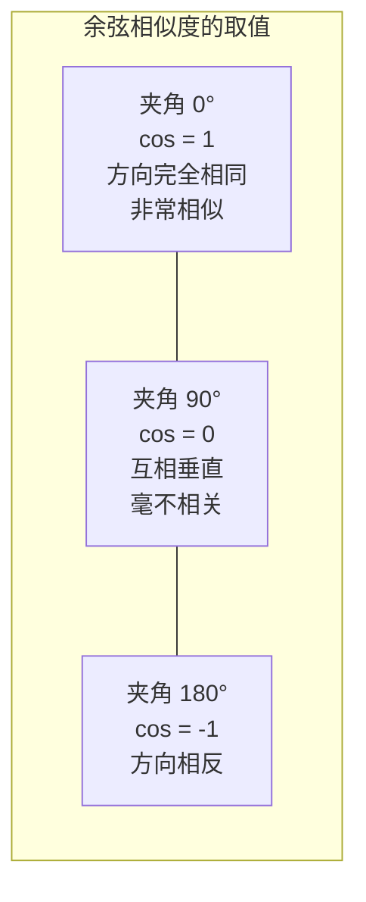
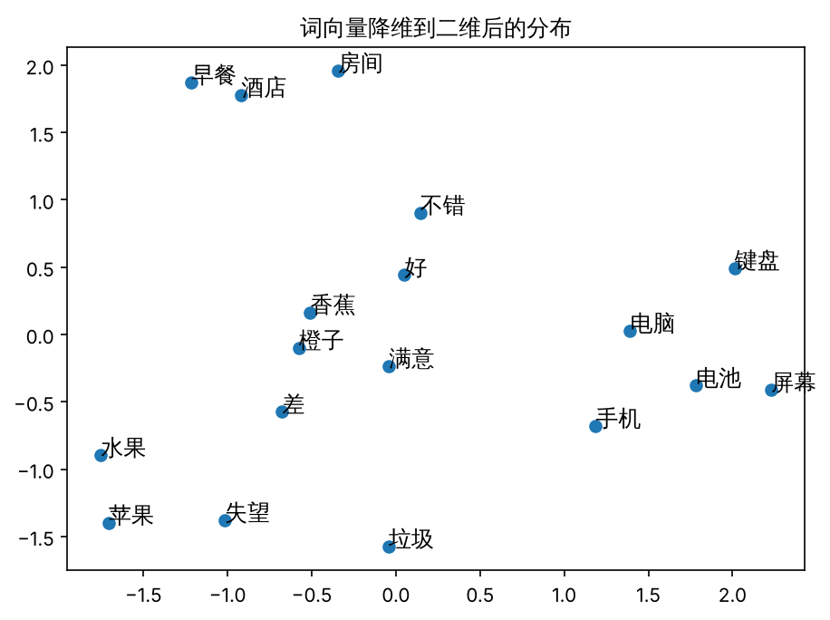
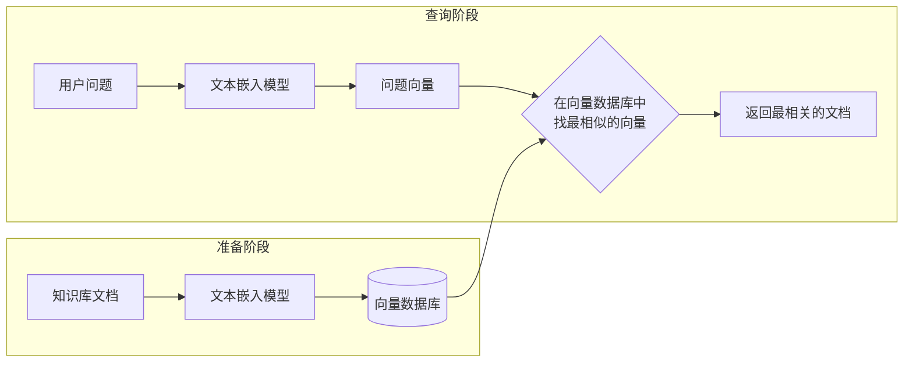
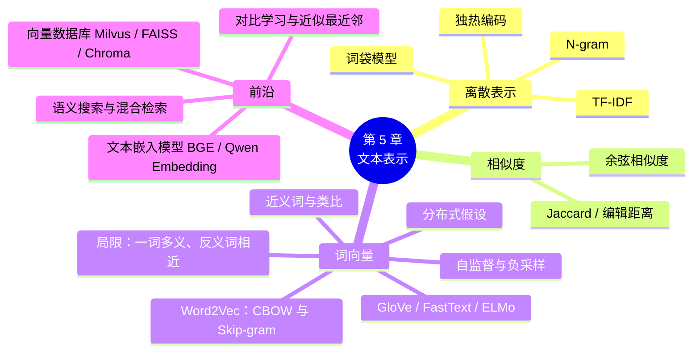

# 第 5 章 文本表示：从词袋到文本嵌入

!!! abstract "本章学时"
    理论 6 学时 · 实验 1 学时（本章共 3 个实验，教师可任选）

## 学习目标

学完本章，你应该能够：

1. **解释**为什么计算机处理文本前要先把文本变成数字；
2. **写出**一个小语料的独热编码和词袋向量，说出它们的局限；
3. **计算**一个词的 TF-IDF 值，用 TF-IDF 提取文章关键词，说出 BM25 的改进思路；
4. **用**余弦相似度计算两段文本的相似程度，实现简单的相似文章推荐；
5. **说明**词向量的基本思想，用 gensim 训练 Word2Vec 模型并查找近义词；
6. **描述**文本嵌入模型、向量数据库和语义搜索的工作原理，比较关键词搜索与语义搜索。

!!! info "先修要求"
    学习本章前，你需要掌握：

    - 用 jieba 对中文分词（[3.3.3 jieba 的分词原理](../03-lexical/index.md#333-jieba)），本章的词袋和 TF-IDF 都建立在分词结果上；
    - 停用词的概念（[2.5 英文文本预处理](../02-preprocessing/index.md#25)）；
    - 中学数学中的平面直角坐标、对数和三角函数中的余弦，用于理解向量、IDF 和余弦相似度；
    - Python 列表和 pandas 表格的基本操作（[附录 A](../../appendix/a-python.md)），实验 5-1 会用到。

??? abstract "本章概念清单（21 个，点击查看定义和例子）"
    1. [文本表示](../../appendix/e-glossary.md#g-文本表示)
    2. [独热编码](../../appendix/e-glossary.md#g-独热编码)
    3. [词袋模型](../../appendix/e-glossary.md#g-词袋模型)
    4. [N-gram 特征](../../appendix/e-glossary.md#g-N-gram-特征)
    5. [TF-IDF](../../appendix/e-glossary.md#g-TF-IDF)
    6. [BM25](../../appendix/e-glossary.md#g-BM25)
    7. [余弦相似度](../../appendix/e-glossary.md#g-余弦相似度)
    8. [Jaccard 相似度](../../appendix/e-glossary.md#g-Jaccard-相似度)
    9. [编辑距离](../../appendix/e-glossary.md#g-编辑距离)
    10. [分布式假设](../../appendix/e-glossary.md#g-分布式假设)
    11. [词向量 / 词嵌入](../../appendix/e-glossary.md#g-词向量-词嵌入)
    12. [Word2Vec](../../appendix/e-glossary.md#g-Word2Vec)
    13. [自监督学习](../../appendix/e-glossary.md#g-自监督学习)
    14. [负采样](../../appendix/e-glossary.md#g-负采样)
    15. [上下文相关的词向量](../../appendix/e-glossary.md#g-上下文相关的词向量)
    16. [文本嵌入](../../appendix/e-glossary.md#g-文本嵌入)
    17. [对比学习](../../appendix/e-glossary.md#g-对比学习)
    18. [向量数据库](../../appendix/e-glossary.md#g-向量数据库)
    19. [近似最近邻检索](../../appendix/e-glossary.md#g-近似最近邻检索)
    20. [语义搜索](../../appendix/e-glossary.md#g-语义搜索)
    21. [混合检索](../../appendix/e-glossary.md#g-混合检索)

## 情景导入

某网店的智能客服后台存着一份“常见问题”清单，其中一条是“**商品出现质量问题如何申请退货？**”。

一天，顾客发来一句：“**东西坏了能退吗**”。人一看就知道这两句话说的是一回事，可客服系统却回复了“退款多久能到账？”。

为什么会这样？因为系统是按“**字面**”匹配的：顾客的话里有“退”字，“退款多久能到账”里也有“退”字，而和正确答案几乎没有一个相同的词，“东西”不等于“商品”，“坏了”不等于“质量问题”。

计算机要真正理解“东西坏了”和“质量问题”意思相近，首先要解决一个根本问题：**怎样把文字变成计算机能计算的数字，并且让意思相近的文字，变成的数字也相近？**这就是本章要学习的[**文本表示**](../../appendix/e-glossary.md#g-文本表示 "把文本转换为计算机可以计算的数值向量"){ .term }。学完本章，你将亲手做出一个能“按意思搜索”的客服问答系统。

## 5.1 为什么需要文本表示

计算机本质上只会做数学运算：加减乘除、比较大小。图片天然就是数字（每个像素的颜色值），声音也天然是数字（每个时刻的振幅），但文字不是。“好吃”两个字，计算机不能拿来做加法，也不知道它和“美味”有多接近。

所以，几乎所有 NLP 方法的第一步，都是把文字转换成一串数字，也就是**向量**（Vector）。这个过程叫**文本表示**（Text Representation），也叫**文本向量化**。

!!! tip "什么是向量"
    向量就是“一排有顺序的数字”，比如 `[0.2, -1.5, 3.0]` 是一个三维向量。你可以把它想象成空间中的一个点的坐标：二维向量是平面上的点，三维向量是空间中的点。向量可以有几百甚至几千维，虽然画不出来，但计算方法是一样的。

文本表示的好坏，直接决定了后续任务的效果。一个好的表示方法应该做到：

1. **意思相近的文本，向量也相近**（这是最重要的一条）；
2. **向量不要太长**，否则计算量大、占用空间多；
3. **能够处理没见过的新文本**。

本章按照技术发展的顺序，依次介绍几种表示方法，你会看到它们是怎样一步步接近这些目标的。

## 5.2 独热编码

### 5.2.1 方法

最简单的办法是：先把所有出现过的词编成一张**词表**，然后每个词用一个和词表一样长的向量表示，**只有这个词所在的位置是 1，其余位置全是 0**。这种方法叫[**独热编码**](../../appendix/e-glossary.md#g-独热编码 "用只有一个位置为 1、其余为 0 的向量表示词"){ .term }（One-Hot Encoding），“独热”就是“只有一个位置是热的（为 1）”。

假设词表只有 5 个词：[我, 喜欢, 自然语言, 机器, 学习]，那么：

| 词 | 独热编码 |
|---|---|
| 我 | [1, 0, 0, 0, 0] |
| 喜欢 | [0, 1, 0, 0, 0] |
| 自然语言 | [0, 0, 1, 0, 0] |
| 机器 | [0, 0, 0, 1, 0] |
| 学习 | [0, 0, 0, 0, 1] |

### 5.2.2 缺点

独热编码简单直观，但有两个致命的缺点：

1. **维度太高、太稀疏**：中文常用词有几十万个，每个词的向量就有几十万维，而且几乎全是 0，非常浪费；
2. **无法表示词义的相似**：任意两个不同的词，向量都“毫无共同之处”。“手机”和“电话”的距离，与“手机”和“香蕉”的距离完全一样。用数学的话说，任意两个独热向量都是**正交**的（相互垂直）。

## 5.3 词袋模型

### 5.3.1 方法

独热编码表示的是一个“词”，那怎样表示一句话或一篇文章呢？最直接的办法是：**统计每个词在文本中出现了几次**，组成一个向量。这就是[**词袋模型**](../../appendix/e-glossary.md#g-词袋模型 "只统计词出现次数、忽略词序的文本表示方法"){ .term }（Bag of Words，BoW）。

“词袋”这个名字很形象：把一篇文章里的词全部倒进一个袋子里，摇一摇，只关心每个词有几个，不关心它们原来的顺序。

例如，对下面三句话（实验 5-1 实测，词表按字符编码顺序自动排列）：

- 句 0：我喜欢自然语言处理
- 句 1：我喜欢机器学习
- 句 2：自然语言处理和机器学习都很有趣

```text
   和  喜欢  处理  学习  很  我  有趣  机器  自然语言  都
0  0   1   1   0  0  1   0   0     1  0
1  0   1   0   1  0  1   0   1     0  0
2  1   0   1   1  1  0   1   1     1  1
```

每一行就是一句话的词袋向量。比如句 0 的向量是 [0, 1, 1, 0, 0, 1, 0, 0, 1, 0]，表示它包含“喜欢”“处理”“我”“自然语言”各一次。

### 5.3.2 优点和缺点

词袋模型的优点是简单、快速，而且效果并不差。在第 6 章中你会看到，“词袋 + 简单分类器”就能把评论情感分类做到相当高的准确率。但它的缺点也很明显：

| 缺点 | 例子 |
|---|---|
| **丢失词序** | “狗咬人”和“人咬狗”的词袋向量完全相同 |
| **高频词喧宾夺主** | “的”“了”“是”出现次数最多，但几乎不含信息 |
| **仍然无法表示词义相似** | “东西坏了”和“质量问题”没有共同的词，向量毫不相关 |
| **维度高、稀疏** | 向量长度等于词表大小 |

!!! note "N-gram：给词袋加一点顺序"
    为了保留一点顺序信息，可以把相邻的两个词（或三个词）也当成一个“词”放进袋子，如“狗咬”“咬人”。这叫做 [**N-gram 特征**](../../appendix/e-glossary.md#g-N-gram-特征 "把相邻的两个或三个词也当成一个“词”放进词袋，保留部分词序"){ .term }（与第 1 章的 N 元语法是同一个思想）。“狗咬人”包含“狗咬”“咬人”，“人咬狗”包含“人咬”“咬狗”，两者就能区分了。代价是词表会变得更大。

### 5.3.3 动手前要想清楚的几个选择

用 scikit-learn 的 `CountVectorizer` 或 `TfidfVectorizer` 构建词袋时，有几个参数会明显影响效果，它们背后都是实际项目中经常要做的判断：

| 参数 | 作用 | 怎样选 |
|---|---|---|
| `tokenizer` | 用什么方法分词 | 中文必须指定分词函数（如 `jieba.lcut`），否则会按空格切分，整句话变成一个“词” |
| `ngram_range` | 是否加入相邻词组合 | `(1, 1)` 只用单个词；`(1, 2)` 同时用单个词和相邻两个词，能捕捉“不 好吃”这类搭配 |
| `min_df` | 至少在几篇文档中出现过的词才保留 | 设为 2 或 3，可以去掉错别字、偶然出现的词，大幅缩小词表 |
| `max_df` | 在超过多大比例的文档中出现的词要去掉 | 设为 0.9 等，相当于自动去掉“的”“了”这类到处都有的词 |
| `max_features` | 词表最多保留多少个词 | 按词频保留前若干个，控制向量长度 |
| `stop_words` | 停用词表 | 传入第 2 章使用过的停用词表 |

有一个容易犯的错误需要特别提醒：词表只能在**训练数据**上建立（`fit`），测试数据只能用已经建好的词表转换（`transform`）。如果把测试数据也拿来建词表，相当于在考试前偷看了试卷，评价结果会偏高。第 6 章的实验会严格遵守这个规则。

另外，加入 N-gram 后词表会急剧膨胀。编者用 jieba 分词对约 1.2 万条外卖评论实测：只用单个词时，词表有 10995 个词；加上相邻两词组合后，猛增到 81069 个。设置 `min_df=2` 后，两者分别降到 5292 个和 23440 个。可见大量的词和词组只出现过一次，配合 `min_df` 一起使用很有必要。

## 5.4 TF-IDF

### 5.4.1 思路

词袋模型的第二个缺点是“高频词喧宾夺主”。怎样判断一个词对一篇文章是否重要？可以从两个角度看：

- 一个词在**这篇文章里**出现得越多，越可能是这篇文章的重点。比如一篇讲大模型的新闻，“模型”这个词会反复出现。这叫**词频**（Term Frequency，TF）。
- 一个词在**所有文章里**都经常出现（如“的”“我们”“表示”），说明它很普通，区分度很低；只在少数文章里出现的词，区分度高。这用**逆文档频率**（Inverse Document Frequency，IDF）来衡量。<sup class="cite">[[3]](#ref5-3)</sup>

把两者相乘，就得到 [**TF-IDF**](../../appendix/e-glossary.md#g-TF-IDF "用词在文档中的频率与其在整个语料中的稀有程度的乘积衡量词的重要性"){ .term }：

$$
\text{TF-IDF} = \text{TF} \times \text{IDF}
$$

一个词的 TF-IDF 值高，意味着它“**在这篇文章里出现得多，在其他文章里出现得少**”，这正是关键词的特征。

### 5.4.2 计算方法

常用的计算公式是：

$$
\text{TF}(词, 文章) = \frac{这个词在文章中出现的次数}{文章的总词数}
\qquad
\text{IDF}(词) = \log\frac{文章总数}{包含这个词的文章数 + 1}
$$

IDF 中的“+1”是为了防止分母为 0；取对数（log）是为了让数值不至于太大。

**算一算**：假设有 1000 篇新闻，某篇新闻共 200 个词：

| 词 | 在这篇中出现次数 | TF | 包含它的文章数 | IDF（以 10 为底） | TF-IDF |
|---|---|---|---|---|---|
| 的 | 10 | 10/200 = 0.05 | 999 | log(1000/1000) = 0 | 0 |
| 发布 | 4 | 4/200 = 0.02 | 99 | log(1000/100) = 1 | 0.02 |
| 大模型 | 6 | 6/200 = 0.03 | 9 | log(1000/10) = 2 | 0.06 |

“的”虽然出现最多，但几乎每篇文章都有，TF-IDF 为 0；“大模型”只在少数文章中出现，在这篇里又出现了 6 次，TF-IDF 最高，是这篇文章的关键词。

!!! info "实际工具中的公式略有不同"
    scikit-learn、jieba 等工具在细节上各有调整（例如 scikit-learn 默认在分子分母上都加 1，并对整个向量做归一化），所以算出的数值和手算不完全一样，但“出现多且少见的词权重高”这个核心思想是一致的。

### 5.4.3 TF-IDF 的应用

| 应用 | 怎样用 TF-IDF |
|---|---|
| **关键词提取** | 取一篇文章中 TF-IDF 值最大的几个词 |
| **文本表示** | 用 TF-IDF 值代替词袋中的出现次数，作为文本向量，用于分类、聚类 |
| **搜索排序** | 搜索词在哪篇文章中 TF-IDF 值高，哪篇文章就排在前面（传统搜索引擎的核心思想之一，后来发展为 BM25 算法）<sup class="cite">[[1]](#ref5-1)</sup> |
| **相似文章推荐** | 用 TF-IDF 向量计算文章之间的相似度 |

直到今天，TF-IDF 及其改进版 BM25 仍然是搜索引擎和 RAG 系统（第 11 章）中“关键词检索”的标准方法，常与语义检索结合使用。

### 5.4.4 从 TF-IDF 到 BM25

TF-IDF 有一个不太合理的地方：词频越高，权重就**按比例**越大。一篇文章中“退货”出现 10 次，权重是出现 1 次的 10 倍。可是从人的感觉来说，出现 10 次的那篇并不比出现 2 次的那篇“相关 5 倍”。另外，长文章天然包含更多的词，词频普遍更高，在比较中占了便宜。

[**BM25**](../../appendix/e-glossary.md#g-BM25 "在 TF-IDF 基础上加入词频饱和与长度惩罚的关键词检索打分方法"){ .term } 算法针对这两个问题做了改进，<sup class="cite">[[4]](#ref5-4)</sup>它是今天搜索引擎和 RAG 关键词检索的标准方法（实验 11-2 会用到）。它的词频部分是这样计算的：

$$
\text{词频得分} = \frac{\text{tf} \times (k_1 + 1)}{\text{tf} + k_1 \times \left(1 - b + b \times \dfrac{\text{文章长度}}{\text{平均文章长度}}\right)}
$$

公式看起来复杂，只要理解两个效果：

**1. 词频“饱和”。** 取常用参数 $k_1 = 1.2$、$b = 0.75$，并假设文章长度正好等于平均长度（括号中的部分就等于 1）。那么词频得分为：

| 词频 tf | 1 | 2 | 5 | 10 | 无穷大 |
|---|---|---|---|---|---|
| 得分 | 1.00 | 1.38 | 1.77 | 1.96 | 趋近 2.2 |

词频从 1 到 2，得分增加明显；从 5 到 10，得分几乎不变。也就是说，一个词出现过几次就足以说明文章与它有关，再多出现也加不了多少分，这就防止了“靠堆砌关键词刷排名”。

**2. 长度惩罚。** 如果一篇文章比平均长度长，分母变大，得分降低；比平均长度短，得分升高。参数 $b$ 控制惩罚的力度，$b = 0$ 时完全不考虑长度。

最后，每个查询词的得分还要乘上它的 IDF，再把所有查询词的得分加起来，就得到文章的总分。BM25 不需要训练，计算很快，对专有名词、产品型号、法条编号这类“必须字面一致”的查询非常可靠，这也是它在大模型时代仍被广泛使用的原因。

<iframe class="sim-frame" src="../../sims/tfidf-calculator/main.html" height="900" loading="lazy" title="TF-IDF 计算器"></iframe>

**交互动画：TF-IDF 计算器**。选一篇“文章”，表格会列出每个词的 TF、IDF 和 TF-IDF，可以直接修改文章内容；下半部分拖动滑块，看 BM25 的词频得分怎样“饱和”。[全屏打开](../../sims/tfidf-calculator/main.html){ target=_blank } · [教学说明](../../sims/tfidf-calculator/index.md)
{ .sim-caption }

## 5.5 文本相似度

有了文本向量，就可以计算两段文本有多相似。最常用的方法是[**余弦相似度**](../../appendix/e-glossary.md#g-余弦相似度 "用两个向量夹角的余弦值衡量其相似程度，取值 -1 到 1"){ .term }（Cosine Similarity）。

### 5.5.1 余弦相似度

把两个向量想象成从原点出发的两支箭头。两支箭头的**夹角越小，方向越一致**，说明两段文本越相似。余弦相似度就是计算这个夹角的余弦值：

$$
\cos\theta = \frac{A \cdot B}{|A| \times |B|}
$$

其中 $A \cdot B$ 是两个向量对应位置相乘再相加（点积），$|A|$ 是向量的长度。



**算一算**：句 0 和句 1 的词袋向量分别是 A = [0,1,1,0,0,1,0,0,1,0]，B = [0,1,0,1,0,1,0,1,0,0]。

- 点积：只有“喜欢”和“我”两个位置都为 1，A · B = 2；
- 长度：A 中有 4 个 1，|A| = √4 = 2；B 中也有 4 个 1，|B| = 2；
- 余弦相似度 = 2 ÷ (2 × 2) = 0.5。

由于词频都不会是负数，词袋和 TF-IDF 向量的余弦相似度总在 0 到 1 之间。

!!! tip "为什么不直接算距离？"
    也可以用两个点之间的直线距离（**欧氏距离**）衡量相似度。但一篇长文章和一篇短文章，即使主题相同，词频向量的“长度”也差别很大，距离会很远。余弦相似度只看**方向**、不看长度，对文本长短不敏感，所以在文本处理中更常用。

### 5.5.2 其他相似度方法

| 方法 | 思路 | 适用 |
|---|---|---|
| [**Jaccard 相似度**](../../appendix/e-glossary.md#g-Jaccard-相似度 "两个集合的交集大小除以并集大小"){ .term } | 两段文本的词集合，交集大小 ÷ 并集大小 | 短文本、去重 |
| [**编辑距离**](../../appendix/e-glossary.md#g-编辑距离 "把一个字符串变成另一个所需的最少插入、删除、替换次数"){ .term } | 一个字符串最少改几个字能变成另一个 | 拼写纠错、近似重复检测 |
| **欧氏距离** | 两个向量之间的直线距离 | 向量长度有意义时 |
| **余弦相似度** | 两个向量的夹角 | 文本向量（最常用） |

**算一算 Jaccard 相似度。** 把句 0“我 / 喜欢 / 自然语言 / 处理”和句 1“我 / 喜欢 / 机器 / 学习”看作两个词集合：交集是 {我, 喜欢}，有 2 个词；并集是 {我, 喜欢, 自然语言, 处理, 机器, 学习}，有 6 个词。Jaccard 相似度 = 2 ÷ 6 ≈ 0.33。它只看“有没有”，不看“有几次”，计算非常简单，常用于海量文本的快速去重，比如判断两篇新闻是不是互相转载的。

**算一算编辑距离。** 把“退款到账”改成“退货到账”，只需把“款”替换成“货”，编辑距离为 1；把“苹果手机”改成“苹果手机壳”，需要插入一个“壳”，编辑距离也是 1。编辑距离允许的操作有三种：插入一个字、删除一个字、替换一个字。它特别适合发现**错别字和近似写法**，例如用户输入“苹果手几”，可以根据编辑距离找到商品库中最接近的“苹果手机”。但要注意，编辑距离小不代表意思相近：“退款”和“退货”只差一个字，意思却不同；“东西坏了”和“质量问题”一个字都不同，意思却相近。所以，编辑距离适合处理“写法”的问题，处理“意思”的问题还得靠后面的词向量和[文本嵌入](../../appendix/e-glossary.md#g-文本嵌入 "把整句或整段文本表示为一个向量，用于语义检索和匹配"){ .term }。

**算一算情景导入中的例子。** 回到本章开头的客服问题：用户问“东西坏了能退吗”，常见问题库中有“商品出现质量问题如何申请退货”和“退款多久能到账”。用 jieba 分词后：

- 用户问题：东西 / 坏 / 了 / 能 / 退 / 吗
- 问题 A：商品 / 出现 / 质量 / 问题 / 如何 / 申请 / 退货
- 问题 B：退款 / 多久 / 能 / 到 / 账

用户问题和问题 A **没有一个相同的词**（“退”和“退货”是不同的词），词袋向量的点积为 0，余弦相似度也是 0；而和问题 B 有一个共同的词“能”，相似度大于 0。于是系统选择了问题 B，答非所问。这说明，**只要表示方法建立在“字面相同”的基础上，就无法解决同义表达的问题**，哪怕计算方法再精细也没用。要解决它，必须让向量本身携带“意思”，这就是下一节词向量的出发点。

## 5.6 词向量

### 5.6.1 分布式假设

前面的方法都没能解决一个根本问题：**表示词义的相似**。“手机”和“电话”在词表中是两个毫无关系的位置。

语言学家很早就提出了一个想法：**一个词的意思，可以由它周围经常出现的词来决定**。这叫[**分布式假设**](../../appendix/e-glossary.md#g-分布式假设 "上下文相似的词，意义也相似"){ .term }（Distributional Hypothesis），<sup class="cite">[[2]](#ref5-2)</sup>英国语言学家弗斯（J. R. Firth）有一句名言：“观其伴，知其义”（You shall know a word by the company it keeps）。

举个例子，你不认识“榴莲”这个词，但看到下面几句话：

- 这家水果店的**榴莲**很新鲜。
- **榴莲**闻起来很臭，吃起来很香。
- 我买了一个金枕**榴莲**，剥开有五房果肉。

你大概能猜出：榴莲是一种水果，味道特别。因为它周围出现的词（水果店、新鲜、吃、果肉）和“苹果”“芒果”周围的词很像。

### 5.6.2 什么是词向量

基于分布式假设，我们可以让计算机从大量文本中学习：给每个词分配一个**短而稠密**的向量（通常 100 到 300 维，每一维都是一个小数），使得**经常出现在相似语境中的词，向量也相近**。这样的向量叫做[**词向量**](../../appendix/e-glossary.md#g-词向量-词嵌入 "用低维稠密向量表示词，语义相近的词向量相近"){ .term }（Word Vector），也叫**词嵌入**（Word Embedding）。

| 对比 | 独热编码 | 词向量 |
|---|---|---|
| 维度 | 等于词表大小（几十万） | 通常 100~300 |
| 数值 | 只有一个 1，其余为 0 | 每一维都是小数，如 0.23、-0.81 |
| 相似词 | 无法表示 | 相似词的向量距离近 |
| 怎样得到 | 直接编号 | 从大量文本中训练出来 |

“嵌入”的意思是：把每个词“嵌”到一个几百维的空间中，成为空间中的一个点，意思相近的词聚在一起。实验 5-2 中，我们把训练出的词向量降到二维画出来，可以清楚地看到电子产品、水果、酒店、评价词各自聚成一团：



### 5.6.3 Word2Vec

2013 年，谷歌的米科洛夫（Tomas Mikolov）等人提出了 [**Word2Vec**](../../appendix/e-glossary.md#g-Word2Vec "通过预测上下文（Skip-gram）或中心词（CBOW）学习词向量的方法"){ .term }，<sup class="cite">[[5]](#ref5-5)</sup>它能在普通电脑上快速地从海量文本中训练出高质量的词向量，掀起了 NLP 的“词向量革命”。

Word2Vec 的训练过程可以理解为一个**“填空游戏”**，有两种玩法：

| 玩法 | 名称 | 怎样玩 | 例子 |
|---|---|---|---|
| 根据上下文猜中间的词 | **CBOW**（连续词袋） | 给出周围的词，猜中间是什么词 | 这家____的榴莲很新鲜 → 水果店 |
| 根据中间的词猜上下文 | **Skip-gram**（跳字模型） | 给出一个词，猜它周围可能有哪些词 | 榴莲 → 水果、新鲜、臭、果肉 |

一开始，每个词的向量都是随机的，猜得一塌糊涂。模型每猜错一次，就把相关词的向量稍微调整一点，让下次猜得更准。在几百万、几亿个句子上反复玩这个游戏之后，经常出现在相似语境中的词，它们的向量就被调整得越来越接近。

**训练数据是怎样“自动”产生的？** Word2Vec 最妙的地方在于，它不需要任何人工标注，训练数据直接从原始文本中生成。以 Skip-gram 为例，设定**窗口大小**为 2（即中心词左右各看 2 个词），对分好词的句子“这家 / 水果店 / 的 / 榴莲 / 很 / 新鲜”，当中心词是“榴莲”时，可以生成 4 个训练样本：

| 输入（中心词） | 要猜的词（上下文） |
|---|---|
| 榴莲 | 水果店 |
| 榴莲 | 的 |
| 榴莲 | 很 |
| 榴莲 | 新鲜 |

让窗口在句子上从头滑到尾，每个词都轮流当一次中心词，一句话就能产生几十个样本，几百万句评论就能产生上亿个样本。这种“从数据自身构造题目来训练”的方法叫做[**自监督学习**](../../appendix/e-glossary.md#g-自监督学习 "从数据自身构造题目和答案来训练，不需要人工标注"){ .term }，第 9 章的 BERT 和 GPT 用的也是同样的思想，只是“填空题”变得更难了。

**负采样：把“多选题”变成“判断题”。** 如果每次都要从几十万个词中猜出正确的上下文词，计算量太大。Word2Vec 用了一个巧妙的办法：把问题改成判断题。对每个真实的样本（榴莲，新鲜），再随机抽几个词（比如“键盘”“周一”“打印”）构成假样本（榴莲，键盘），让模型判断每一对词“是不是真的经常一起出现”。这叫[**负采样**](../../appendix/e-glossary.md#g-负采样 "随机抽词组成假样本，把多选题变成判断题以加快训练"){ .term }（Negative Sampling），<sup class="cite">[[6]](#ref5-6)</sup>它让训练速度提高了很多倍，也是 Word2Vec 能在普通电脑上训练的关键原因之一。

训练时还有几个常用参数：`vector_size` 是词向量的维数，一般取 100 到 300；`window` 是窗口大小，窗口小时学到的更多是“用法相似”（如“好吃”和“好喝”），窗口大时学到的更多是“话题相关”（如“好吃”和“外卖”）；`min_count` 规定出现次数少于多少的词不参与训练，因为出现太少的词学不出可靠的向量。

!!! tip "CBOW 和 Skip-gram 怎么选？"
    一般来说，CBOW 训练速度更快，对高频词效果好；Skip-gram 训练慢一些，但对低频词和小语料效果更好。实验 5-2 中我们使用 Skip-gram。<sup class="cite">[[10]](#ref5-10)</sup>

### 5.6.4 词向量的神奇性质

训练好的词向量有一些有趣的性质（实验 5-2 用 6 万条网购评论实测）：

**1. 找近义词。** 与“快递”最相似的词是“物流”“配送”“小哥”“送货”；与“好吃”最相似的是“甜”“新鲜”“很甜”“脆”。这些词的关系完全是模型从评论中自己学出来的，我们没有告诉它任何词义。

**2. 词的类比。** 词向量可以做“加减法”。最著名的例子是：

$$
\vec{国王} - \vec{男人} + \vec{女人} \approx \vec{女王}
$$

意思是：“国王”和“男人”的差别，与“女王”和“女人”的差别是一样的（都是“王室身份”）。实验中，我们用网购评论训练的词向量计算“酒店 + 电池 − 手机”，得到的最相近的词是“酒店设施”“服务”，可以理解为“电池之于手机，相当于设施、服务之于酒店”。

**3. 找出不合群的词。** 在“香蕉、苹果、橙子、键盘”中，模型能找出“键盘”不属于同一类。

<iframe class="sim-frame" src="../../sims/word-vectors/main.html" height="820" loading="lazy" title="词向量与余弦相似度"></iframe>

**交互动画：词向量与余弦相似度**。左边拖动两支箭头，看夹角和余弦相似度；右边在词语地图上找近义词、做“国王 − 男人 + 女人”的类比、找出不合群的词。[全屏打开](../../sims/word-vectors/main.html){ target=_blank } · [教学说明](../../sims/word-vectors/index.md)
{ .sim-caption }

### 5.6.5 词向量的局限

| 局限 | 说明 | 例子 |
|---|---|---|
| **一词多义** | 每个词只有一个固定的向量，无法区分不同的意思 | “苹果”在“吃苹果”和“苹果手机”中意思不同，但向量相同 |
| **反义词也相近** | 反义词常出现在相同的语境中 | 实验中“满意”和“失望”的相似度高达 0.5 左右，因为它们都常出现在“我对……很____”中 |
| **依赖训练语料** | 语料是什么领域，学到的词义就偏向什么领域 | 网购评论训练出的词向量中，“苹果”更接近水果，而不是手机品牌 |
| **未登录词** | 训练时没见过的词没有向量 | 新出现的网络用语 |

第一个局限尤其重要。2018 年以后出现的 BERT 等模型能根据上下文给同一个词生成不同的向量（称为[**上下文相关的词向量**](../../appendix/e-glossary.md#g-上下文相关的词向量 "同一个词在不同语境中得到不同向量的表示方法，如 BERT 的输出"){ .term }），解决了一词多义问题，我们将在第 9 章学习。

### 5.6.6 Word2Vec 之后的词向量方法

Word2Vec 之后，又出现了一些改进的词向量方法，了解它们的思路有助于理解后来的发展：

| 方法 | 提出者 | 核心思路 | 解决了什么问题 |
|---|---|---|---|
| **GloVe** | 斯坦福大学（2014） | 先统计整个语料中任意两个词共同出现的次数，再根据这张统计表学习词向量 | 同时利用了全局统计信息和局部上下文 |
| **FastText** | Facebook（2016） | 把一个词拆成若干个更小的片段（如英文单词的字母组合），词向量由片段向量相加得到 | 能为训练时没见过的词“拼”出向量，缓解未登录词问题 |
| **ELMo** | 艾伦人工智能研究所（2018） | 用双向 LSTM 读整个句子，根据上下文生成每个词的向量 | 同一个词在不同句子中有不同的向量，开始解决一词多义 |

从 ELMo 开始，词的表示不再是“查表”得到的固定向量，而是“读完整句话后算出来”的动态向量。这条路线很快被 BERT 推向高峰（第 9 章），而今天大模型内部的表示，本质上也是这种上下文相关的向量。

!!! warning "词向量会学到社会偏见"
    词向量是从人写的文本中学出来的，文本中隐含的刻板印象也会被一起学进去。研究者曾发现，用新闻语料训练的英文词向量中，“男人 − 女人”的方向与“程序员 − 家庭主妇”的方向很接近。<sup class="cite">[[7]](#ref5-7)</sup>这类问题在后来的预训练模型和大模型中同样存在，我们将在第 12 章专门讨论如何检测和缓解。

!!! info "预训练词向量"
    训练词向量需要大量语料。国内有一些机构和企业公开发布了在海量中文语料上训练好的**预训练词向量**，例如腾讯 AI Lab 发布的中文词向量、北京师范大学等发布的 Chinese Word Vectors 项目，下载后可以直接使用。

### 5.6.7 实测：词向量能解决客服的问题吗？

学了词向量，我们回到情景导入中的客服问题，看看它能不能帮上忙。编者用实验 5-2 训练好的词向量（6 万多条网购评论，Skip-gram，100 维）做了两项测试。

**测试一：词与词的相似。** 查询几个关键词最相似的词：

| 词 | 最相似的词（相似度） |
|---|---|
| 退 | 退货（0.82）、退换（0.80）、差价（0.79）、没退（0.78）、不换（0.78） |
| 东西 | 东东（0.70）、电子产品（0.68）、商品（0.66）、生鲜（0.65）、电器（0.65） |
| 坏 | 烂（0.85）、长毛（0.77）、烂掉（0.76）、坏掉（0.74）、腐烂（0.74） |

词袋模型认为“退”和“退货”毫无关系，词向量却给出了 0.82 的高相似度；“东西”和“商品”也被认为相近。在词的层面，词向量确实学到了意思。

**测试二：句与句的相似。** 一个最简单的句子表示方法，是把句子中所有词的向量取平均。用这种方法计算用户问题“东西坏了能退吗”与两个候选问题的余弦相似度：

| 候选问题 | 平均词向量的余弦相似度 |
|---|---|
| A：商品出现质量问题如何申请退货（正确答案） | 0.777 |
| B：退款多久能到账 | 0.837 |

结果令人意外：系统**仍然选择了错误的 B**。原因在于，取平均时“了”“能”“吗”这些虚词和关键词的权重一样，而 B 和用户问题都是口语化的短句，包含“能”这样的词，平均之后反而更像；另外，“坏”在网购评论中多指水果“烂了”，和“质量问题”的联系也没有我们想象的那么紧密。

这个实测结果说明了两点：第一，**词的相似不等于句子的相似**，简单地把词向量平均会丢掉大量信息；第二，**词向量的含义受训练语料影响很大**。要真正解决“按意思匹配句子”的问题，需要专门为句子训练的表示方法，这就是 5.7 节的文本嵌入模型。实验 5-3 中，你可以用 BGE 模型重新做一次这个测试，比较结果。（由于训练过程有一定的随机性，你自己训练的词向量算出的数值可能与上表略有不同。）

## 5.7 前沿视窗：文本嵌入、向量数据库与语义搜索

### 5.7.1 从词向量到文本嵌入

词向量表示的是一个“词”。在实际应用中，我们更常需要表示一整个句子、一个段落或一篇文档。简单的做法是把句子中所有词的向量取平均，但这样会丢失词序和结构信息。

现在的主流做法是使用专门训练的**文本嵌入模型**（Text Embedding Model）：输入一段文字，直接输出一个固定长度的向量（通常 512 到 4096 维），**意思相近的文本，向量就相近**，无论它们用词是否相同。“东西坏了能退吗”和“商品出现质量问题如何申请退货”在文本嵌入空间中会非常接近。

文本嵌入模型一般基于 Transformer（第 9 章），用大量“意思相近的句子对”训练而成。常见的中文文本嵌入模型和服务有：

| 模型 / 服务 | 发布方 | 特点 |
|---|---|---|
| BGE 系列 | 北京智源人工智能研究院 | 开源，中文效果好，有小、中、大多种尺寸，其中 BGE-M3 支持多语言和长文本 |
| Qwen Embedding 系列 | 阿里巴巴通义团队 | 开源，多语言能力强 |
| 各大模型平台的嵌入 API | 阿里云百炼、百度千帆、智谱等 | 通过 API 调用，按 Token 计费，免部署 |

衡量嵌入模型好坏，有专门的评测榜单，如 MTEB（大规模文本嵌入评测基准）及其中文版 C-MTEB，选择模型时可以参考。<sup class="cite">[[8]](#ref5-8)</sup>

### 5.7.2 向量数据库

一个企业的知识库可能有几百万段文本，每段都变成一个向量。用户提问时，要从几百万个向量中迅速找出最相似的几个，一个个比较太慢了。[**向量数据库**](../../appendix/e-glossary.md#g-向量数据库 "存储向量并能快速找出最相似向量的数据库"){ .term }（Vector Database）就是专门用来存储向量、并能快速找出“最相似向量”的数据库。

| 向量数据库 | 特点 |
|---|---|
| Milvus | 国产开源，适合大规模企业应用 |
| FAISS | Meta 开源的向量检索库，速度快，适合嵌入到程序中 |
| Chroma | 轻量级，安装简单，适合学习和小项目 |
| 各云平台的向量检索服务 | 免运维，按量付费 |

怎么选？学习和做小项目时，用 Chroma 或者直接用 NumPy 计算就够了；企业中数据量达到百万、千万级，并且需要多人同时查询、数据持续更新时，才需要 Milvus 这样的专业向量数据库或云服务。不少传统数据库（如 PostgreSQL、Elasticsearch）也增加了向量检索功能，已有这些系统的单位可以直接利用。

### 5.7.3 语义搜索

把文本嵌入模型和向量数据库结合起来，就能实现[**语义搜索**](../../appendix/e-glossary.md#g-语义搜索 "根据含义而非字面匹配进行的检索"){ .term }（Semantic Search）：按“意思”搜索，而不是按“字面”搜索。



| 对比 | 关键词搜索（TF-IDF / BM25） | 语义搜索（文本嵌入） |
|---|---|---|
| 匹配方式 | 字面相同 | 意思相近 |
| “东西坏了”能否找到“质量问题” | 不能 | 能 |
| 搜专有名词、型号（如“A1200”） | 准确 | 有时不够准确 |
| 速度和成本 | 快、便宜 | 需要嵌入模型，成本稍高 |
| 可解释性 | 好，能看出是哪个词匹配上的 | 较差 |

两者各有所长，所以实际系统中常使用[**混合检索**](../../appendix/e-glossary.md#g-混合检索 "同时做关键词检索和语义检索，再合并排序"){ .term }：同时做关键词搜索和语义搜索，再把结果合并排序。语义搜索是第 11 章 **RAG（检索增强生成）**的核心组成部分，大模型知识库问答、智能客服都建立在它的基础上。

### 5.7.4 文本嵌入模型是怎样训练出来的

文本嵌入模型的训练方法叫做[**对比学习**](../../appendix/e-glossary.md#g-对比学习 "让意思相近的句子向量靠近、无关句子向量远离的训练方法"){ .term }（Contrastive Learning），思路很像老师教学生“找朋友”：

1. 准备大量**意思相近的句子对**，比如“东西坏了能退吗”和“商品出现质量问题如何申请退货”，或者“一个问题”和“它的正确答案”。这些句子对可以来自问答网站、搜索引擎的点击记录（用户搜了 A，点开了文档 B）、人工标注，现在也越来越多地由大模型生成；
2. 训练时，把一批句子对放在一起。对其中每个句子来说，和它配对的那个句子是“朋友”，同一批里的其他句子都是“陌生人”；
3. 训练的目标是：让每个句子的向量和“朋友”的向量**尽量接近**，和“陌生人”的向量**尽量远离**。

经过上亿个句子对的训练，模型就学会了把意思相近的文本放在向量空间中相近的位置。为了让模型更会区分，训练时还会特意加入“**难负例**”：看起来很像、但意思不同的句子，比如“怎么申请退货”和“怎么取消退货申请”。正是这些难负例，让嵌入模型学会了关注细微的差别。

### 5.7.5 怎样从百万向量中快速找到最相似的

如果知识库有 100 万段文本，用户每问一个问题，就要计算问题向量和 100 万个向量的相似度，再排序。这种“逐个比较”的方法叫**暴力检索**，结果最准确，但数据量大时太慢。

向量数据库普遍采用[**近似最近邻检索**](../../appendix/e-glossary.md#g-近似最近邻检索 "牺牲一点准确性、大幅提高速度的相似向量查找方法"){ .term }（Approximate Nearest Neighbor，ANN）：牺牲一点点准确性，换取速度的大幅提升。常见的思路有两种：

- **先分组，再查找**：事先把所有向量按照相近程度分成若干组（比如 1000 组），每组有一个“组长”。查询时，先和 1000 个组长比较，找出最接近的几组，再只在这几组里逐个比较。这就像在图书馆找书，先找到对应的书架，再在书架上找；
- **建“关系网”，顺藤摸瓜**：事先让每个向量记住和自己最相近的若干个“邻居”。查询时，从某个入口出发，每次走向离问题更近的邻居，很快就能走到最相似的向量附近。目前最常用的 HNSW 算法就属于这一类。<sup class="cite">[[9]](#ref5-9)</sup>

近似检索偶尔会漏掉真正最相似的结果，但在大多数应用中，速度提升几十倍到几百倍、准确率只损失一点，是非常划算的。对于本书实验中只有几十、几百段文本的小知识库，直接暴力检索就足够了。

### 5.7.6 在项目中使用文本嵌入的注意事项

把语义搜索真正用到项目中，还有几个经验值得了解：

| 注意事项 | 说明 |
|---|---|
| **查询指令** | 一些检索用的嵌入模型建议在“问题”前面加上一句固定的指令（例如 BGE 中文模型的“为这个句子生成表示以用于检索相关文章：”），文档则不加，这样检索效果更好。具体以模型说明为准<sup class="cite">[[11]](#ref5-11)</sup> |
| **同一个模型** | 问题和文档必须用**同一个**嵌入模型转换成向量；更换模型后，所有文档要重新计算向量 |
| **相似度阈值** | 无论问什么，检索总会返回“最相似”的结果，即使它其实毫不相关。需要设定一个阈值，相似度低于阈值时回答“没有找到相关内容”，而不是硬给一个答案 |
| **文本长度** | 嵌入模型能处理的长度有上限，太长的文档要先切成段落（第 11 章叫“切块”） |
| **评估** | 准备几十个真实问题和对应的正确文档，统计“正确文档出现在前 1 个、前 3 个结果中”的比例，用数据而不是感觉来比较不同模型和参数 |

第三条尤其重要。实验 5-3 中可以试着问一个和知识库完全无关的问题，比如“今天天气怎么样”，观察返回结果的相似度分数，体会为什么需要阈值。

## 本章实验

!!! abstract "实验总览"
    | 实验 | 类型 | 建议时长 | 内容 |
    |---|---|---|---|
    | 实验 5-1 | ★ 基础 | 45 分钟 | 词袋模型、TF-IDF 关键词提取与相似文章推荐 |
    | 实验 5-2 | ★ 基础 | 45 分钟 | 训练 Word2Vec 词向量 |
    | 实验 5-3 | ★ 基础 | 45 分钟 | 用嵌入模型做语义搜索 |

    实验代码见配套资源 `labs/ch05/` 目录。

### 实验 5-1 ★ 词袋模型、TF-IDF 关键词提取与相似文章推荐

**实验目的**

1. 用 scikit-learn 的 `CountVectorizer` 构建词袋模型；
2. 用 `TfidfVectorizer` 和 `jieba.analyse` 提取新闻关键词；
3. 计算文章之间的余弦相似度，实现“猜你喜欢”式的相似文章推荐。

**实验环境**：实验 1-1 的环境（已安装 jieba、scikit-learn、pandas）。

**实验数据**：`news_samples.csv`，8 篇短新闻（科技、体育、财经、教育各 2 篇），字段为 `id`、`category`、`title`、`content`；中文停用词表 `cn_stopwords.txt`。

**实验步骤与代码**

```python
import jieba
import jieba.analyse
import pandas as pd
from sklearn.feature_extraction.text import CountVectorizer, TfidfVectorizer
from sklearn.metrics.pairwise import cosine_similarity

jieba.setLogLevel("WARN")
stopwords = set(open("cn_stopwords.txt", encoding="utf-8").read().split())

def tokenize(text):
    """分词并去掉停用词、单字和数字"""
    return [w for w in jieba.cut(text)
            if len(w) > 1 and w not in stopwords and not w.isdigit()]

# ===== 第 1 部分：词袋模型 =====
docs = ["我喜欢自然语言处理", "我喜欢机器学习", "自然语言处理和机器学习都很有趣"]
cv = CountVectorizer(tokenizer=jieba.lcut, token_pattern=None)
bow = cv.fit_transform(docs)
print("词表：", list(cv.get_feature_names_out()))
print("词袋矩阵：")
print(pd.DataFrame(bow.toarray(), columns=cv.get_feature_names_out()))

# ===== 第 2 部分：TF-IDF 关键词提取 =====
news = pd.read_csv("news_samples.csv")
tfidf = TfidfVectorizer(tokenizer=tokenize, token_pattern=None)
matrix = tfidf.fit_transform(news["content"])
words = tfidf.get_feature_names_out()
print(f"\n8 篇新闻共有 {len(words)} 个不同的词，TF-IDF 矩阵形状：{matrix.shape}")
for i in [0, 2, 6]:
    row = matrix[i].toarray()[0]
    top = row.argsort()[::-1][:5]                 # 权重最大的 5 个词
    print(f"《{news.title[i]}》关键词：",
          "、".join(f"{words[j]}({row[j]:.2f})" for j in top))

# jieba 自带的 TF-IDF 关键词提取（使用 jieba 内置的大语料 IDF）
print("\njieba.analyse 提取第 1 篇关键词：",
      jieba.analyse.extract_tags(news.content[0], topK=5))

# ===== 第 3 部分：余弦相似度与“猜你喜欢” =====
sim = cosine_similarity(matrix)
print("\n文章相似度矩阵（保留两位小数）：")
print(pd.DataFrame(sim, index=news.id, columns=news.id).round(2))

def recommend(article_id, k=2):
    i = article_id - 1
    order = sim[i].argsort()[::-1]
    order = [j for j in order if j != i][:k]       # 去掉文章自己
    return [(news.title[j], float(round(sim[i][j], 2))) for j in order]

for aid in [1, 6]:
    print(f"\n读了《{news.title[aid-1]}》的用户，猜你喜欢：", recommend(aid))
```

运行结果：

```text
词表： ['和', '喜欢', '处理', '学习', '很', '我', '有趣', '机器', '自然语言', '都']
词袋矩阵：
   和  喜欢  处理  学习  很  我  有趣  机器  自然语言  都
0  0   1   1   0  0  1   0   0     1  0
1  0   1   0   1  0  1   0   1     0  0
2  1   0   1   1  1  0   1   1     1  1

8 篇新闻共有 223 个不同的词，TF-IDF 矩阵形状：(8, 223)
《国产大模型迎来开源热潮》关键词： 模型(0.54)、企业(0.32)、部署(0.26)、开源(0.26)、成本(0.26)
《中国女排三比一逆转取胜》关键词： 比赛(0.33)、中国女排(0.33)、对手(0.33)、迎战(0.17)、环节(0.17)
《职业院校开设人工智能技术应用专业》关键词： 训练(0.31)、应用(0.31)、技术(0.31)、智能(0.16)、职业(0.16)

jieba.analyse 提取第 1 篇关键词： ['模型', '开源', '部署', '适配', '企业']

文章相似度矩阵（保留两位小数）：
id     1     2     3     4     5     6     7     8
id
1   1.00  0.04  0.02  0.01  0.02  0.03  0.12  0.01
2   0.04  1.00  0.02  0.05  0.00  0.05  0.03  0.03
3   0.02  0.02  1.00  0.01  0.00  0.01  0.00  0.01
4   0.01  0.05  0.01  1.00  0.00  0.03  0.03  0.03
5   0.02  0.00  0.00  0.00  1.00  0.03  0.02  0.01
6   0.03  0.05  0.01  0.03  0.03  1.00  0.03  0.06
7   0.12  0.03  0.00  0.03  0.02  0.03  1.00  0.01
8   0.01  0.03  0.01  0.03  0.01  0.06  0.01  1.00

读了《国产大模型迎来开源热潮》的用户，猜你喜欢： [('职业院校开设人工智能技术应用专业', 0.12), ('智能手机厂商发力端侧人工智能', 0.04)]

读了《外卖平台推出商家扶持计划》的用户，猜你喜欢： [('成人教育推出灵活学习方式', 0.06), ('智能手机厂商发力端侧人工智能', 0.05)]
```

结果解读：

- **词袋矩阵**与 5.3.1 节的手工分析一致。`tokenizer=jieba.lcut` 告诉 scikit-learn 用 jieba 分词，`token_pattern=None` 表示不再使用它默认的英文分词规则；
- **TF-IDF 关键词**：第 1 篇的关键词“模型、企业、部署、开源、成本”准确概括了新闻内容；jieba 的结果与我们的结果相近，但多了“适配”，因为 jieba 使用的是它在大规模语料上统计的 IDF 值；
- **相似度矩阵**：对角线都是 1（每篇文章和自己完全相同）。第 1 篇（大模型开源）和第 7 篇（职业院校 AI 专业）最相似，两篇都提到了“模型”“训练”等词；
- **TF-IDF 的局限**：所有文章之间的相似度都很低（大多不到 0.1），因为短新闻之间很少有相同的词。第 6 篇外卖平台新闻推荐了“成人教育”新闻，理由只是都出现了“推出”“平台”等词，这种推荐并不合理。**TF-IDF 只认字面，不懂意思**，这正是实验 5-3 要解决的问题；
- `argsort()[::-1]` 是 NumPy 中常用的写法：`argsort()` 返回从小到大排序后的位置编号，`[::-1]` 把它倒过来，变成从大到小。

**常见问题排查**

| 现象 | 原因与解决办法 |
|---|---|
| 警告 `The parameter 'token_pattern' will not be used` | 使用自定义 `tokenizer` 时，需同时设置 `token_pattern=None` |
| `get_feature_names_out` 不存在 | scikit-learn 版本过旧（低于 1.0），执行 `pip install -U scikit-learn` |
| 关键词里出现了“表示”“近日”等无意义词 | 把它们加入停用词表 |

**思考与练习**

1. 把 `CountVectorizer` 的参数改为 `ngram_range=(1, 2)`，观察词表的变化，解释 N-gram 的作用。
2. 根据 5.4.2 节的公式，手工计算“模型”一词在第 1 篇新闻中的 TF 和 IDF。
3. 从新闻网站上再找 12 篇不同类别的新闻加入数据中，观察推荐结果是否变得更合理。

**实验报告要求**

提交代码与运行截图，完成思考题 2 的手工计算过程，并分析 TF-IDF 推荐结果中一个“合理”和一个“不合理”的例子。

### 实验 5-2 ★ 训练 Word2Vec 词向量

**实验目的**

1. 用 gensim 在 6 万多条网购评论上训练 Word2Vec 词向量；
2. 查找近义词、计算词语相似度、做词语类比，体会词向量的性质和局限；
3. 用 PCA 将词向量降到二维并画图。

**实验环境**：实验 1-1 的环境，另需安装 `pip install gensim matplotlib`。训练约需 30 秒到 2 分钟（取决于电脑性能）。

**实验数据**：`online_shopping_10_cats.zip`，网购评论数据集，包含书籍、平板、手机、水果、洗发水、热水器、蒙牛、衣服、计算机、酒店共 10 个类别，约 6.3 万条评论。

**实验步骤与代码**

```python
import zipfile
import jieba
import pandas as pd
from gensim.models import Word2Vec

jieba.setLogLevel("WARN")

# ===== 第 1 部分：准备语料：6 万多条网购评论，每条评论分词后是一个词列表 =====
with zipfile.ZipFile("online_shopping_10_cats.zip") as z:
    df = pd.read_csv(z.open("online_shopping_10_cats.csv"))
reviews = df["review"].dropna().astype(str)
sentences = [jieba.lcut(r) for r in reviews]
print("评论数：", len(sentences), " 示例：", sentences[1][:12])

# ===== 第 2 部分：训练模型 =====
model = Word2Vec(sentences,
                 vector_size=100,   # 每个词用 100 个数字表示
                 window=5,          # 看前后各 5 个词
                 min_count=5,       # 出现少于 5 次的词忽略
                 sg=1,              # 1 = Skip-gram，0 = CBOW
                 workers=4, epochs=5, seed=42)
print("词表大小：", len(model.wv))
print("“手机”的词向量（前 8 维）：", model.wv["手机"][:8].round(3))

# ===== 第 3 部分：找近义词 =====
for w in ["手机", "快递", "好吃", "酒店", "差"]:
    sims = model.wv.most_similar(w, topn=6)
    print(f"与“{w}”最相似：", "、".join(f"{x}({s:.2f})" for x, s in sims))

# ===== 第 4 部分：计算相似度与类比 =====
for a, b in [("手机", "电脑"), ("手机", "苹果"), ("手机", "洗发水"), ("满意", "失望")]:
    print(f"相似度({a}, {b}) = {model.wv.similarity(a, b):.3f}")
# 类比：手机 - 电池 + 酒店 ≈ ?
print("手机 - 电池 + 酒店 ≈", model.wv.most_similar(positive=["酒店", "电池"],
                                                 negative=["手机"], topn=3))
print("不合群的词：", model.wv.doesnt_match(["香蕉", "苹果", "橙子", "键盘"]))

model.save("shopping_w2v.model")      # 保存模型，下次用 Word2Vec.load() 加载

# ===== 第 5 部分：降维可视化 =====
import matplotlib.pyplot as plt
from sklearn.decomposition import PCA
plt.rcParams["font.sans-serif"] = ["WenQuanYi Zen Hei", "SimHei", "PingFang SC"]
words = ["手机", "电脑", "屏幕", "电池", "键盘", "酒店", "房间", "早餐",
         "香蕉", "苹果", "橙子", "水果", "好", "不错", "满意", "差", "失望", "垃圾"]
vecs = PCA(n_components=2, random_state=0).fit_transform([model.wv[w] for w in words])
plt.figure(figsize=(7, 5))
plt.scatter(vecs[:, 0], vecs[:, 1])
for w, (x, y) in zip(words, vecs):
    plt.annotate(w, (x, y), fontsize=12)
plt.title("词向量降维到二维后的分布")
plt.savefig("w2v_pca.png", dpi=150, bbox_inches="tight")
print("图片已保存为 w2v_pca.png")
```

运行结果：

```text
评论数： 62773  示例： ['作者', '真有', '英国人', '严谨', '的', '风格', '，', '提出', '观点', '、', '进行', '论述']
词表大小： 17020
“手机”的词向量（前 8 维）： [-0.407  0.365 -0.118  0.187  0.545  0.45   0.409 -0.112]
与“手机”最相似： 机子(0.76)、平板(0.74)、机器(0.73)、x2(0.66)、A1200(0.65)、笔记本(0.64)
与“快递”最相似： 物流(0.83)、配送(0.83)、小哥(0.82)、送货(0.79)、员(0.79)、送货员(0.74)
与“好吃”最相似： 甜(0.84)、新鲜(0.82)、很甜(0.81)、脆(0.77)、很脆(0.76)、口感(0.75)
与“酒店”最相似： 宾馆(0.82)、饭店(0.77)、店(0.67)、客房(0.66)、，(0.65)、住宿(0.64)
与“差”最相似： 很差(0.74)、差劲(0.71)、太差(0.70)、不好(0.69)、差差(0.69)、超差(0.69)
相似度(手机, 电脑) = 0.614
相似度(手机, 苹果) = 0.324
相似度(手机, 洗发水) = 0.439
相似度(满意, 失望) = 0.517
手机 - 电池 + 酒店 ≈ [('酒店设施', 0.6228740215301514), ('服务', 0.5744845867156982), ('周边环境', 0.566398024559021)]
不合群的词： 键盘
图片已保存为 w2v_pca.png
```

!!! note "你的结果可能与教材略有不同"
    Word2Vec 训练时使用了随机数，且多线程（`workers=4`）训练的顺序不固定，所以每次训练的结果会略有差异，但整体规律是一致的。

结果解读：

- **近义词**：“快递”的近义词“物流、配送、小哥、送货”，“好吃”的近义词“甜、新鲜、脆、口感”，“差”的近义词“很差、差劲、不好”，都非常合理，说明模型确实学到了词义；
- **领域特色**：与“手机”最相似的词中有“x2”“A1200”，这是数据集中评论较多的手机型号，词向量“记住”了训练语料的特点；
- **语料的影响**：“手机”和“苹果”的相似度（0.32）甚至比和“洗发水”（0.44）还低，因为这份数据中“苹果”几乎都出现在水果评论里，模型学到的“苹果”是水果；
- **反义词相近**：“满意”和“失望”的相似度达到 0.52，印证了 5.6.5 节所说的局限；
- **标点混入**：“酒店”的近义词中出现了逗号“，”，因为我们没有去掉标点。思考题 1 会让你改进这一点；
- **可视化**：降维图中，电子产品（手机、电脑、电池、键盘、屏幕）聚在右侧，酒店相关词（酒店、房间、早餐）聚在左上角，水果和评价词也各自成团。PCA（主成分分析）是一种把高维数据压缩到低维、同时尽量保留差异信息的方法，这里只用它来画图。

**常见问题排查**

| 现象 | 原因与解决办法 |
|---|---|
| `KeyError: "Key '某词' not present"` | 这个词出现次数少于 `min_count`，或分词结果不同，换一个词，或调小 `min_count` |
| 图中汉字显示为方框 | 把 `font.sans-serif` 改为本机已有的中文字体，Windows 用 `SimHei`，macOS 用 `PingFang SC` |
| 训练很慢 | 先用 `sentences[:20000]` 取部分数据训练 |

**思考与练习**

1. 修改程序，在分词后去掉标点和停用词再训练，观察“酒店”的近义词是否改善。
2. 把 `sg=1` 改为 `sg=0`（CBOW），比较训练速度和近义词结果的差异。
3. 自己设计 3 组词语类比（如“手机 : 屏幕 = 酒店 : ?”），用 `most_similar(positive=..., negative=...)` 测试，记录哪些成功、哪些失败。

**实验报告要求**

提交降维图、思考题的代码与结果，并用 200 字左右总结词向量的优点和局限（结合本实验的具体结果）。

### 实验 5-3 ★ 用嵌入模型做语义搜索

**实验目的**

1. 用 TF-IDF 实现一个简单的“常见问题”关键词搜索，观察它的局限；
2. 用开源中文文本嵌入模型 BGE 实现语义搜索；
3. 比较关键词搜索和语义搜索的效果。

**实验环境**：实验 1-1 的环境，另需安装 `pip install sentence-transformers`。第 2 部分首次运行需联网下载约 100MB 的模型，请先按实验 1-1 步骤 6 设置 Hugging Face 镜像。

**实验步骤与代码**

```python
import jieba
from sklearn.feature_extraction.text import TfidfVectorizer
from sklearn.metrics.pairwise import cosine_similarity

jieba.setLogLevel("WARN")
faqs = ["商品出现质量问题如何申请退货？",
        "下单后多久发货？",
        "可以开具增值税发票吗？",
        "如何修改收货地址？",
        "会员积分可以兑换什么？",
        "快递一直没有更新物流信息怎么办？",
        "支持货到付款吗？",
        "优惠券为什么无法使用？",
        "怎样联系人工客服？",
        "退款多久能到账？"]
queries = ["东西坏了能退吗", "钱什么时候退回来", "我想找真人说话", "包裹好几天没动静"]

# ===== 第 1 部分：关键词搜索（TF-IDF）=====
tfidf = TfidfVectorizer(tokenizer=jieba.lcut, token_pattern=None)
faq_vec = tfidf.fit_transform(faqs)
print("【关键词搜索】")
for q in queries:
    scores = cosine_similarity(tfidf.transform([q]), faq_vec)[0]
    best = scores.argmax()
    print(f"  {q} → {faqs[best]}（相似度 {scores[best]:.2f}）")

# ===== 第 2 部分：语义搜索（文本嵌入模型）=====
# 首次运行会下载约 100MB 的模型；国内请先设置 HF_ENDPOINT=https://hf-mirror.com
from sentence_transformers import SentenceTransformer
model = SentenceTransformer("BAAI/bge-small-zh-v1.5")
faq_emb = model.encode(faqs, normalize_embeddings=True)       # 每个问题变成一个向量
print("\n每个句子被表示为", faq_emb.shape[1], "维的向量")
print("【语义搜索】")
for q in queries:
    q_emb = model.encode([q], normalize_embeddings=True)
    scores = (q_emb @ faq_emb.T)[0]                           # 归一化后，点积就是余弦相似度
    best = scores.argmax()
    print(f"  {q} → {faqs[best]}（相似度 {scores[best]:.2f}）")
```

运行结果（第 1 部分）：

```text
【关键词搜索】
  东西坏了能退吗 → 退款多久能到账？（相似度 0.35）
  钱什么时候退回来 → 会员积分可以兑换什么？（相似度 0.45）
  我想找真人说话 → 商品出现质量问题如何申请退货？（相似度 0.00）
  包裹好几天没动静 → 商品出现质量问题如何申请退货？（相似度 0.00）
```

结果解读：关键词搜索**四个问题全部答错**。

- “东西坏了能退吗”只因为都有“退”字匹配到了“退款多久能到账”；
- “钱什么时候退回来”匹配到了“会员积分可以兑换什么”，是因为两句都有“什么”；
- “我想找真人说话”和“包裹好几天没动静”与所有问题都没有共同的词，相似度为 0，程序只能返回第一个问题。

这就是情景导入中客服系统“答非所问”的原因。

!!! warning "待实测"
    第 2 部分语义搜索的运行结果将在编写环境开放模型下载后实测补充（bge-small-zh-v1.5 输出的向量为 512 维）。请把你的运行结果与第 1 部分对比，看看语义搜索答对了几个。

代码解读：

- `SentenceTransformer("BAAI/bge-small-zh-v1.5")` 加载智源研究院开源的中文小型嵌入模型，`small` 表示小尺寸版本，适合在普通电脑上运行；
- `normalize_embeddings=True` 把每个向量的长度统一为 1，这样两个向量的点积（`@` 运算）就直接等于余弦相似度，计算更快；
- 在真实系统中，`faq_emb` 会存入向量数据库，查询时由数据库负责快速找出最相似的向量。

**常见问题排查**

| 现象 | 原因与解决办法 |
|---|---|
| 下载模型时报网络错误 | 设置 `HF_ENDPOINT=https://hf-mirror.com` 后重新运行；或使用魔搭社区：`pip install modelscope` 后用 `modelscope download --model BAAI/bge-small-zh-v1.5` 下载到本地，再把模型文件夹路径传给 `SentenceTransformer` |
| 内存不足 | 关闭其他程序；bge-small 模型只需约 500MB 内存 |
| 运行较慢 | 第一次加载模型需要十几秒，属于正常现象 |

**思考与练习**

1. 自己再写 5 个“换了说法”的问题测试两种搜索方法，统计各自的正确率。
2. 修改程序，让语义搜索返回最相似的前 3 个问题及其相似度。当最高相似度低于某个值（如 0.5）时，回复“抱歉，没有找到相关问题，正在为您转接人工客服”。这个“阈值”应该怎样确定？
3. 尝试实现“混合检索”：把 TF-IDF 相似度和语义相似度按一定比例相加（如 0.3 × 关键词得分 + 0.7 × 语义得分），观察效果。

**实验报告要求**

提交代码、两种搜索方法的对比表格（至少 9 个问题），以及对思考题 2 中阈值设定方法的说明。

## 本章小结

- **文本表示**是把文字转换成向量的过程，是几乎所有 NLP 方法的第一步，好的表示要让**意思相近的文本向量也相近**。
- **独热编码**：每个词一个只有一位为 1 的向量，维度高、稀疏、无法表示相似。
- **词袋模型**：统计每个词出现的次数，简单有效，但丢失词序，高频词喧宾夺主；N-gram 可以保留部分顺序。
- **TF-IDF** = 词频 × 逆文档频率，突出“本文多、他文少”的词，用于关键词提取、搜索排序和文本表示；**BM25** 在此基础上加入了词频饱和与长度惩罚，是关键词检索的标准方法。
- **余弦相似度**用向量夹角衡量相似程度，取值越接近 1 越相似，对文本长度不敏感。
- **词向量**基于“观其伴，知其义”的分布式假设，**Word2Vec** 用 CBOW 或 Skip-gram“填空游戏”训练，能表示近义词和类比关系，但不能区分一词多义；它的训练数据从原始文本中自动生成（自监督），并用负采样加快训练。实测表明，把词向量简单平均得到的句子表示并不可靠。
- **文本嵌入模型**直接把整段文本变成向量，配合**向量数据库**实现**语义搜索**，是 RAG 和智能客服的基础；实际系统常将关键词检索与语义检索**混合**使用。嵌入模型用**对比学习**训练，向量数据库用**近似最近邻检索**提速，使用时要注意查询指令、相似度阈值和效果评估。



**下一章预告**

有了词袋、TF-IDF 和文本嵌入，一段评论就能变成一个向量。接下来最常见的任务是：给这个向量贴上标签，好评还是差评？垃圾短信还是正常短信？第 6 章将学习文本分类与情感分析，用本章的 TF-IDF 向量训练第一个真正的分类模型，并学会用准确率、精确率、召回率评价它。

## 参考文献

正文中的上标编号（如<sup class="cite">[[1]](#ref5-1)</sup>）对应下面的文献。带链接的可以直接打开；书籍可在图书馆或电子书平台查阅。

<div class="refs" markdown>

**教材与科普**

- <span id="ref5-1"></span>[1] 吴军. 数学之美（第 2 版）[M]. 北京：人民邮电出版社，2014.
    <span class="ref-note">第 11 章“如何确定网页和查询的相关性”用很通俗的方式讲了 TF-IDF 的由来，适合作为 5.4 节的课外读物。</span>
- <span id="ref5-2"></span>[2] Jurafsky D, Martin J H. Speech and Language Processing（3rd ed. draft）[EB/OL]. <https://web.stanford.edu/~jurafsky/slp3/>
    <span class="ref-note">免费在线教材。第 5 章“Embeddings”讲 TF-IDF、余弦相似度和 Word2Vec，第 11 章讲信息检索，可对照本章 5.4～5.7 节阅读。</span>

**经典论文**

- <span id="ref5-3"></span>[3] Spärck Jones K. A Statistical Interpretation of Term Specificity and Its Application in Retrieval[J]. Journal of Documentation, 1972, 28(1): 11-21.
    <span class="ref-note">提出“逆文档频率（IDF）”思想的原始论文：在越少文章中出现的词，越能说明文章的特点。</span>
- <span id="ref5-4"></span>[4] Robertson S, Zaragoza H. The Probabilistic Relevance Framework: BM25 and Beyond[J]. Foundations and Trends in Information Retrieval, 2009, 3(4): 333-389.
    <span class="ref-note">BM25 提出者之一写的总结，解释了词频饱和与长度惩罚的来历，对应 5.4.4 节。</span>
- <span id="ref5-5"></span>[5] Mikolov T, Chen K, Corrado G, Dean J. Efficient Estimation of Word Representations in Vector Space[EB/OL]. 2013. <https://arxiv.org/abs/1301.3781>
    <span class="ref-note">提出 Word2Vec 的 CBOW 和 Skip-gram 两种模型，也是“国王 − 男人 + 女人 ≈ 女王”这个例子的出处。</span>
- <span id="ref5-6"></span>[6] Mikolov T, Sutskever I, Chen K, Corrado G, Dean J. Distributed Representations of Words and Phrases and their Compositionality[C]//Advances in Neural Information Processing Systems 26 (NIPS 2013). <https://arxiv.org/abs/1310.4546>
    <span class="ref-note">Word2Vec 的第二篇论文，提出了负采样等加快训练的技巧，对应 5.6.3 节。</span>
- <span id="ref5-7"></span>[7] Bolukbasi T, Chang K W, Zou J, Saligrama V, Kalai A. Man is to Computer Programmer as Woman is to Homemaker? Debiasing Word Embeddings[C]//Advances in Neural Information Processing Systems 29 (NIPS 2016). <https://arxiv.org/abs/1607.06520>
    <span class="ref-note">发现词向量中存在性别刻板印象并提出消除方法的论文，5.6.6 节提醒框中的例子就来自这里，第 12 章还会继续讨论。</span>
- <span id="ref5-8"></span>[8] Xiao S, Liu Z, Zhang P, Muennighoff N, Lian D, Nie J Y. C-Pack: Packed Resources For General Chinese Embeddings[EB/OL]. 2023. <https://arxiv.org/abs/2309.07597>
    <span class="ref-note">BGE 中文嵌入模型和中文评测榜单 C-MTEB 的介绍论文，讲了怎样用对比学习和难负例训练文本嵌入模型，对应 5.7.1 和 5.7.4 节。</span>
- <span id="ref5-9"></span>[9] Malkov Y A, Yashunin D A. Efficient and Robust Approximate Nearest Neighbor Search Using Hierarchical Navigable Small World Graphs[EB/OL]. 2016. <https://arxiv.org/abs/1603.09320>
    <span class="ref-note">提出 HNSW 算法的论文，就是 5.7.5 节“建关系网，顺藤摸瓜”的方法，今天大多数向量数据库都支持它。</span>

**在线资源与工具**

- <span id="ref5-10"></span>[10] gensim 官方教程. Word2Vec Model[EB/OL]. <https://radimrehurek.com/gensim/auto_examples/tutorials/run_word2vec.html>
    <span class="ref-note">有完整的训练、保存和查询近义词的示例代码，并解释了 `vector_size`、`window`、`min_count` 等参数，对应实验 5-2。</span>
- <span id="ref5-11"></span>[11] FlagOpen. FlagEmbedding[EB/OL]. <https://github.com/FlagOpen/FlagEmbedding>
    <span class="ref-note">BGE 系列嵌入模型的官方仓库，说明了各模型的尺寸、用法以及查询指令该怎样加，对应实验 5-3 和 5.7.6 节。</span>

</div>

## 课后练习

选择题和判断题可以直接点击选项作答，系统会马上告诉你对错，并展开答案与解析；填空、简答和实践题请先自己作答，再点开“答案与解析”核对。每道题的解析下方都有“回看”链接，做错了可以直接跳回正文复习。

**一、选择题**

<div class="quiz" data-answer="B" markdown>

**1.** 独热编码的主要缺点是（　　）。

- A. 计算太复杂
- B. 无法表示词与词之间的相似
- C. 向量太短
- D. 只能用于英文

</div>

??? tip "答案与解析"
    **答案：B**

    任意两个不同词的独热向量都是正交的，点积为 0，所以“手机”和“电话”、“手机”和“香蕉”的距离完全一样，表示不出词义的相似。它的另一个缺点是维度太高、太稀疏，而不是“太短”。

    考查：独热编码 · 认知层次：理解 · [回看 5.2.2](#522)
    { .quiz-meta }

<div class="quiz" data-answer="A" markdown>

**2.** “狗咬人”和“人咬狗”的词袋向量（　　）。

- A. 完全相同
- B. 完全不同
- C. 部分相同
- D. 无法计算

</div>

??? tip "答案与解析"
    **答案：A**

    词袋模型只统计每个词出现几次，不管顺序。两句话都是“狗、咬、人”各一次，向量完全相同。加入 N-gram（“狗咬”“咬人”）可以区分它们。

    考查：词袋模型 · 认知层次：应用 · [回看 5.3.2](#532)
    { .quiz-meta }

<div class="quiz" data-answer="B" markdown>

**3.** 某词在所有文章中都出现，它的 IDF 值（　　）。

- A. 很大
- B. 接近 0
- C. 等于 1
- D. 为负无穷

</div>

??? tip "答案与解析"
    **答案：B**

    IDF = log(文章总数 ÷ 包含它的文章数)，一个词几乎每篇都出现，括号里接近 1，log 1 = 0。所以“的”这样的词 IDF 接近 0，TF-IDF 也接近 0。

    考查：TF-IDF · 认知层次：理解 · [回看 5.4.2](#542)
    { .quiz-meta }

<div class="quiz" data-answer="A" markdown>

**4.** 两个向量的余弦相似度为 1，说明（　　）。

- A. 方向完全相同
- B. 相互垂直
- C. 方向相反
- D. 长度相同

</div>

??? tip "答案与解析"
    **答案：A**

    余弦相似度 = 1 表示夹角为 0°，两个向量方向完全相同；= 0 表示互相垂直；= −1 表示方向相反。余弦相似度只看方向、不看长度。

    考查：余弦相似度 · 认知层次：记忆 · [回看 5.5.1](#551)
    { .quiz-meta }

<div class="quiz" data-answer="B" markdown>

**5.** Word2Vec 中“根据上下文预测中间词”的方法是（　　）。

- A. Skip-gram
- B. CBOW
- C. TF-IDF
- D. BPE

</div>

??? tip "答案与解析"
    **答案：B**

    CBOW（连续词袋）给出周围的词猜中间的词；Skip-gram 反过来，给出中间的词猜周围的词。TF-IDF 和 BPE 都不是训练词向量的方法。

    考查：Word2Vec · 认知层次：记忆 · [回看 5.6.3](#563-word2vec)
    { .quiz-meta }

<div class="quiz" data-answer="C" markdown>

**6.** 能让“东西坏了能退吗”找到“商品出现质量问题如何申请退货”的方法是（　　）。

- A. 关键词精确匹配
- B. 词袋模型
- C. 语义搜索
- D. 正则表达式

</div>

??? tip "答案与解析"
    **答案：C**

    这两句话几乎没有相同的词，关键词匹配、词袋和正则都找不到它们的联系。语义搜索用文本嵌入模型把句子变成向量，按意思而不是字面比较，才能匹配上。

    考查：语义搜索 · 认知层次：应用 · [回看 5.7.3](#573)
    { .quiz-meta }

<div class="quiz" data-answer="D" markdown>

**7.** BM25 相比 TF-IDF 的主要改进是（　　）。

- A. 能理解同义词
- B. 需要先在标注数据上训练
- C. 词频越高，得分按比例越高
- D. 词频得分会“饱和”，并对长文章做长度惩罚

</div>

??? tip "答案与解析"
    **答案：D**

    BM25 中词频从 1 增加到 2 得分明显上升，从 5 增加到 10 几乎不变，防止堆砌关键词；文章比平均长度长时得分降低。它仍然按字面匹配，不能理解同义词，也不需要训练。C 恰好是 TF-IDF 的问题。

    考查：BM25 · 认知层次：理解 · [回看 5.4.4](#544-tf-idf-bm25)
    { .quiz-meta }

<div class="quiz" data-answer="C" markdown>

**8.** 把“我 / 爱 / 北京”和“我 / 爱 / 上海”看作两个词集合，它们的 Jaccard 相似度是（　　）。

- A. 0.33
- B. 0.67
- C. 0.5
- D. 1

</div>

??? tip "答案与解析"
    **答案：C**

    交集是 {我, 爱}，2 个词；并集是 {我, 爱, 北京, 上海}，4 个词；Jaccard 相似度 = 2 ÷ 4 = 0.5。

    考查：Jaccard 相似度 · 认知层次：应用 · [回看 5.5.2](#552)
    { .quiz-meta }

<div class="quiz" data-answer="A" markdown>

**9.** Word2Vec 训练中使用“负采样”的主要目的是（　　）。

- A. 把“从几十万个词中猜出上下文词”变成“判断一对词是否真的一起出现”，大幅加快训练
- B. 去掉语料中的负面评论
- C. 让反义词的向量离得更远
- D. 减少词表中的低频词

</div>

??? tip "答案与解析"
    **答案：A**

    负采样为每个真实词对随机抽几个词组成假词对，让模型做判断题而不是几十万选一的多选题，计算量大大减少。去掉低频词靠的是 `min_count` 参数，负采样也不能解决反义词相近的问题。

    考查：负采样 · 认知层次：理解 · [回看 5.6.3](#563-word2vec)
    { .quiz-meta }

<div class="quiz" data-answer="D" markdown>

**10.** 某客服系统用语义搜索回答问题。用户问“今天天气怎么样”，系统返回了知识库中“退货运费谁承担”的答案。最合适的改进是（　　）。

- A. 换一个维度更高的嵌入模型
- B. 把知识库全部改用关键词搜索
- C. 让用户换一种问法
- D. 设定相似度阈值，低于阈值时回答“没有找到相关内容”

</div>

??? tip "答案与解析"
    **答案：D**

    检索总会返回“最相似”的结果，哪怕它毫不相关。设定阈值，相似度太低时承认找不到，是语义搜索落地的基本做法。换模型或改用关键词搜索都不能根本解决“无关问题也硬给答案”。

    考查：文本嵌入的使用 · 认知层次：应用 · [回看 5.7.6](#576)
    { .quiz-meta }

**二、判断题**

<div class="quiz quiz-judge" data-answer="√" markdown>

**1.** TF-IDF 值高的词，通常是在本文中出现多、在其他文章中出现少的词。

- √ 正确
- × 错误

</div>

??? tip "答案与解析"
    **答案：√**

    TF 高说明在本文中出现多，IDF 高说明在其他文章中出现少，两者相乘高，正是关键词的特征。

    考查：TF-IDF · 认知层次：理解 · [回看 5.4.1](#541)
    { .quiz-meta }

<div class="quiz quiz-judge" data-answer="×" markdown>

**2.** Word2Vec 能自动区分“苹果”作为水果和作为手机品牌的不同含义。

- √ 正确
- × 错误

</div>

??? tip "答案与解析"
    **答案：×**

    Word2Vec 给每个词只学一个固定的向量，“吃苹果”和“苹果手机”中的“苹果”向量相同，不能区分一词多义。BERT 等上下文相关的词向量才能区分（第 9 章）。

    考查：词向量的局限 · 认知层次：理解 · [回看 5.6.5](#565)
    { .quiz-meta }

<div class="quiz quiz-judge" data-answer="√" markdown>

**3.** 词向量训练语料的领域会影响学到的词义。

- √ 正确
- × 错误

</div>

??? tip "答案与解析"
    **答案：√**

    语料是什么领域，学到的词义就偏向什么领域。例如用网购评论训练的词向量中，“苹果”更接近水果，“坏”多指水果烂了。

    考查：词向量的局限 · 认知层次：理解 · [回看 5.6.5](#565) · [回看 5.6.7](#567)
    { .quiz-meta }

<div class="quiz quiz-judge" data-answer="√" markdown>

**4.** 向量数据库的作用是快速找出与查询向量最相似的向量。

- √ 正确
- × 错误

</div>

??? tip "答案与解析"
    **答案：√**

    向量数据库专门存储向量，并用近似最近邻检索等方法，从百万级向量中快速找出与查询向量最相似的几个。

    考查：向量数据库 · 认知层次：记忆 · [回看 5.7.2](#572)
    { .quiz-meta }

<div class="quiz quiz-judge" data-answer="×" markdown>

**5.** 有了语义搜索，关键词搜索就完全没有用了。

- √ 正确
- × 错误

</div>

??? tip "答案与解析"
    **答案：×**

    搜索产品型号、法条编号等必须字面一致的内容时，关键词搜索更准确，可解释性也更好。所以实际系统常把两者结合，做混合检索。

    考查：语义搜索与关键词搜索 · 认知层次：理解 · [回看 5.7.3](#573)
    { .quiz-meta }

**三、填空题**

**1.** “观其伴，知其义”描述的是________假设。

??? tip "答案与解析"
    **答案：分布式**

    分布式假设认为一个词的意思可以由它周围经常出现的词来决定，这是词向量的理论基础。

    考查：分布式假设 · 认知层次：记忆 · [回看 5.6.1](#561)
    { .quiz-meta }

**2.** TF-IDF 中，TF 指________，IDF 指逆文档频率。

??? tip "答案与解析"
    **答案：词频**

    TF 是 Term Frequency，即这个词在本文中出现的次数除以文章总词数；IDF 是 Inverse Document Frequency。

    考查：TF-IDF · 认知层次：记忆 · [回看 5.4.1](#541)
    { .quiz-meta }

**3.** 把高维向量降到二维以便画图的常用方法是________（填英文缩写）。

??? tip "答案与解析"
    **答案：PCA**

    PCA（主成分分析）把高维数据压缩到低维、同时尽量保留差异信息。实验 5-2 用它把 100 维的词向量降到二维画图。

    考查：词向量可视化 · 认知层次：记忆 · [回看 实验 5-2](#5-2-word2vec)
    { .quiz-meta }

**4.** 智源研究院开源的中文文本嵌入模型系列简称________。

??? tip "答案与解析"
    **答案：BGE**

    BGE 是北京智源人工智能研究院开源的文本嵌入模型系列，中文效果好，实验 5-3 使用的就是它。

    考查：文本嵌入模型 · 认知层次：记忆 · [回看 5.7.1](#571)
    { .quiz-meta }

**5.** 把“苹果手几”改成“苹果手机”的编辑距离是________。

??? tip "答案与解析"
    **答案：1**

    只需把“几”替换成“机”，一次替换，编辑距离为 1。编辑距离适合处理错别字这类“写法”问题。

    考查：编辑距离 · 认知层次：应用 · [回看 5.5.2](#552)
    { .quiz-meta }

**6.** 训练文本嵌入模型时，让相近句子的向量靠近、无关句子的向量远离的方法叫做________学习。

??? tip "答案与解析"
    **答案：对比**

    对比学习让每个句子的向量和与它配对的“朋友”尽量接近，和同一批中的“陌生人”尽量远离。

    考查：对比学习 · 认知层次：记忆 · [回看 5.7.4](#574)
    { .quiz-meta }

**四、简答题**

**1.** 已知 A = [1, 1, 0]，B = [1, 0, 1]，计算它们的余弦相似度。

??? tip "答案与解析"
    **参考答案：** A · B = 1×1 + 1×0 + 0×1 = 1；|A| = √(1+1+0) = √2，|B| = √2；余弦相似度 = 1 ÷ (√2 × √2) = 0.5。

    **解析：** 先算点积，再算两个向量的长度，最后相除。只有第一个位置两者都为 1，所以点积是 1。

    考查：余弦相似度 · 认知层次：应用 · [回看 5.5.1](#551)
    { .quiz-meta }

**2.** 说明词向量相比独热编码的三个优点。

??? tip "答案与解析"
    **参考答案：**

    1. **维度低、稠密**：通常只有 100～300 维，而独热编码的维度等于词表大小，可达几十万维且几乎全是 0；
    2. **能表示词义的相似**：意思相近的词向量也相近，例如“快递”和“物流”，而任意两个独热向量都毫不相关；
    3. **能表示词与词的关系**：可以做类比运算，如“国王 − 男人 + 女人 ≈ 女王”，还能找出不合群的词。

    **解析：** 答出“维度低”“能表示相似”两点是关键，第三点也可以答“从大量无标注文本中自动学习，不需要人工编词典”。

    考查：词向量与独热编码 · 认知层次：理解 · [回看 5.6.2](#562) · [回看 5.6.4](#564)
    { .quiz-meta }

**3.** 比较关键词搜索和语义搜索的优缺点，并说明为什么实际系统常使用混合检索。

??? tip "答案与解析"
    **参考答案：**

    - **关键词搜索**（TF-IDF / BM25）：按字面匹配，速度快、成本低、可解释，搜型号和专有名词准确；但找不到用词不同、意思相同的内容。
    - **语义搜索**（文本嵌入）：按意思匹配，能用“东西坏了”找到“质量问题”；但需要嵌入模型，成本稍高，可解释性差，对型号、编号有时不够准。
    - **混合检索**：两者优缺点正好互补，同时做两种搜索再合并排序，既能找到同义表达，又不会漏掉必须字面一致的结果。

    **解析：** 要从匹配方式、成本、可解释性、适合的查询几方面比较，最后落到“优势互补”上。第 11 章的 RAG 系统常用这种做法。

    考查：关键词搜索与语义搜索 · 认知层次：分析 · [回看 5.7.3](#573)
    { .quiz-meta }

**4.** 对句子“我 / 喜欢 / 吃 / 新鲜 / 水果”，设窗口大小为 1，写出以“吃”为中心词时 Skip-gram 生成的训练样本。整句话一共能生成多少个样本？

??? tip "答案与解析"
    **参考答案：** 以“吃”为中心词：（吃，喜欢）、（吃，新鲜）。整句：“我”1 个、“喜欢”2 个、“吃”2 个、“新鲜”2 个、“水果”1 个，共 8 个样本。

    **解析：** 窗口大小为 1，就是只看中心词左右各 1 个词。句首和句尾的词只有一侧有邻居，所以只能生成 1 个样本。

    考查：Skip-gram 训练样本 · 认知层次：应用 · [回看 5.6.3](#563-word2vec)
    { .quiz-meta }

**5.** 根据 5.4.4 节的表格，说明 BM25 中“词频饱和”的含义，以及它为什么能防止“堆砌关键词”。

??? tip "答案与解析"
    **参考答案：** 词频从 1 增加到 2 时得分明显提高（1.00 → 1.38），但从 5 增加到 10 时得分几乎不变（1.77 → 1.96），最高不超过 $k_1 + 1$（即 2.2）。因此一个词在文章中重复堆砌很多次，也只能获得有限的分数。

    **解析：** “饱和”就是“加到一定程度就加不上去了”。结合表格中的数字说明即可，不需要推导公式。

    考查：BM25 · 认知层次：理解 · [回看 5.4.4](#544-tf-idf-bm25)
    { .quiz-meta }

**五、实践题**

为你的学校或单位整理 20 条常见问题及答案，分别用 TF-IDF 和文本嵌入模型实现问答匹配，邀请 3 位同学各提 5 个问题进行测试，统计两种方法的正确率并写出分析报告。

??? tip "评分要点"
    1. **数据**：20 条问答真实、表述清楚；15 个测试问题由同学提出，不要照抄知识库中的原句，最好包含同义换说法；
    2. **实现**：两种方法都能运行，TF-IDF 用 jieba 分词，嵌入模型的问题和文档用同一个模型转换；
    3. **结果**：表格列出每个测试问题在两种方法下匹配到的答案和对错，分别计算正确率；
    4. **分析**：举例说明哪些问题 TF-IDF 答错而嵌入模型答对（多为同义表达），反过来又有哪些，并提出改进办法，如设定相似度阈值或混合检索。

    考查：文本表示的综合应用 · 认知层次：分析 · [回看 实验 5-1](#5-1-tf-idf) · [回看 实验 5-3](#5-3)
    { .quiz-meta }
