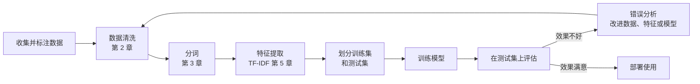
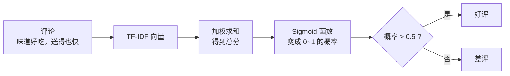
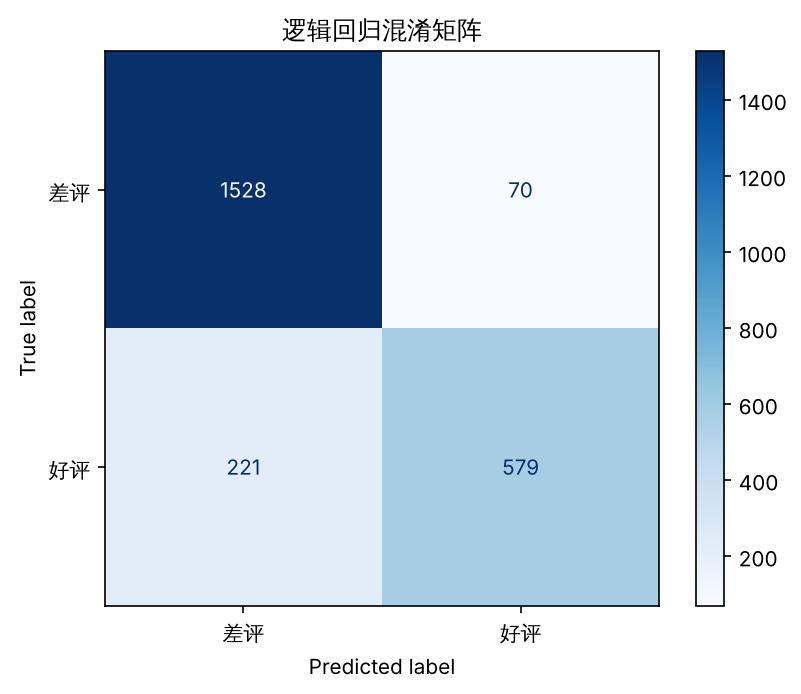
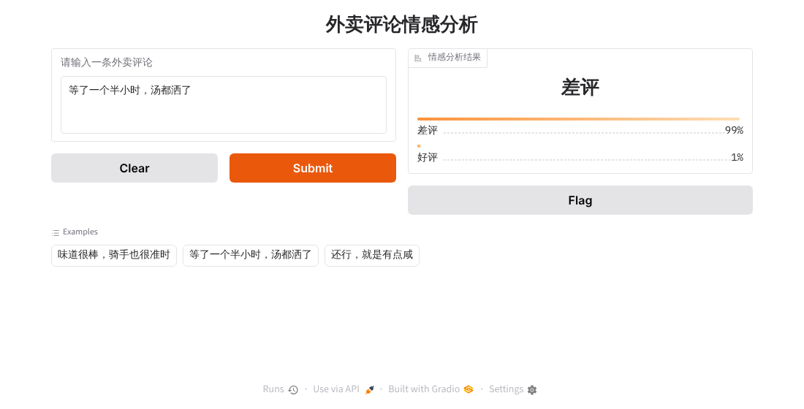
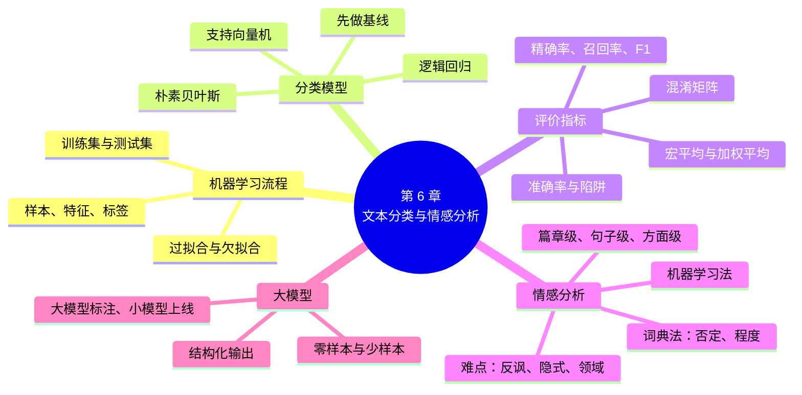

# 第 6 章 文本分类与情感分析

!!! abstract "本章学时"
    理论 6 学时 · 实验 1 学时（本章共 3 个实验，教师可任选）

## 学习目标

学完本章，你应该能够：

1. **说出**文本分类的定义和典型应用，区分二分类、多分类和多标签分类；
2. **描述**机器学习的基本流程，解释训练集、测试集、过拟合等概念；
3. **解释**朴素贝叶斯和逻辑回归的直观原理；
4. **计算**准确率、精确率、召回率和 F1 值，读懂混淆矩阵和分类报告，能根据业务调整阈值、处理类别不平衡；
5. **实现**基于情感词典的情感分析和基于 TF-IDF + 机器学习的情感分类，并进行错误分析；
6. **比较**传统分类模型与大模型零样本分类的优缺点，能够根据场景选择合适的方案。

!!! info "先修要求"
    学习本章前，你需要掌握：

    - 用正则表达式和 jieba 清洗、切分中文文本（[2.6 中文文本清洗](../02-preprocessing/index.md#26)、[3.2 中文分词](../03-lexical/index.md#32)）；
    - 用 TF-IDF 把文本变成向量（[5.4 TF-IDF](../05-representation/index.md#54-tf-idf)）；
    - 用 pandas 读取 CSV 文件（[附录 A.7 pandas](../../appendix/a-python.md#a7-pandas)）。

??? abstract "本章概念清单（26 个，点击查看定义和例子）"
    1. [文本分类](../../appendix/e-glossary.md#g-文本分类)
    2. [多标签分类](../../appendix/e-glossary.md#g-多标签分类)
    3. [监督学习](../../appendix/e-glossary.md#g-监督学习)
    4. [训练集](../../appendix/e-glossary.md#g-训练集)
    5. [测试集](../../appendix/e-glossary.md#g-测试集)
    6. [过拟合](../../appendix/e-glossary.md#g-过拟合)
    7. [欠拟合](../../appendix/e-glossary.md#g-欠拟合)
    8. [朴素贝叶斯](../../appendix/e-glossary.md#g-朴素贝叶斯)
    9. [拉普拉斯平滑](../../appendix/e-glossary.md#g-拉普拉斯平滑)
    10. [逻辑回归](../../appendix/e-glossary.md#g-逻辑回归)
    11. [阈值](../../appendix/e-glossary.md#g-阈值)
    12. [支持向量机](../../appendix/e-glossary.md#g-支持向量机)
    13. [基线](../../appendix/e-glossary.md#g-基线)
    14. [混淆矩阵](../../appendix/e-glossary.md#g-混淆矩阵)
    15. [准确率](../../appendix/e-glossary.md#g-准确率)
    16. [精确率](../../appendix/e-glossary.md#g-精确率)
    17. [召回率](../../appendix/e-glossary.md#g-召回率)
    18. [F1 值](../../appendix/e-glossary.md#g-F1-值)
    19. [交叉验证](../../appendix/e-glossary.md#g-交叉验证)
    20. [类别不平衡](../../appendix/e-glossary.md#g-类别不平衡)
    21. [错误分析](../../appendix/e-glossary.md#g-错误分析)
    22. [情感分析](../../appendix/e-glossary.md#g-情感分析)
    23. [方面级情感分析](../../appendix/e-glossary.md#g-方面级情感分析)
    24. [情感词典](../../appendix/e-glossary.md#g-情感词典)
    25. [零样本学习](../../appendix/e-glossary.md#g-零样本学习)
    26. [意图识别](../../appendix/e-glossary.md#g-意图识别)


## 情景导入

某外卖平台每天会收到几十万条用户评论。运营部门想知道：今天的差评比昨天多了还是少了？差评主要集中在哪些商家？顾客最不满意的是口味、配送还是服务？

靠人工一条条看显然不现实。如果有一个程序能自动判断每条评论是“好评”还是“差评”，再把差评按“口味问题”“配送问题”“服务问题”分好类，运营人员每天只要看一张统计报表就够了。

这个“自动判断类别”的任务，就是[**文本分类**](../../appendix/e-glossary.md#g-文本分类 "把文本自动归入预先定义好的一个或多个类别"){ .term }；而判断评论的情感倾向，是文本分类中最常见的一种，叫做[**情感分析**](../../appendix/e-glossary.md#g-情感分析 "分析文本表达的情感倾向、态度和观点的技术，也叫观点挖掘"){ .term }。本章我们将用上一章学到的 TF-IDF 把评论变成向量，再训练一个分类模型，最终做出一个可以在网页上使用的“评论情感分析小工具”。

## 6.1 什么是文本分类

### 6.1.1 定义与类型

**文本分类**（Text Classification）就是根据文本的内容，自动把它归入预先定义好的一个或多个类别中。

根据类别的设置方式，文本分类可以分为三种类型：

| 类型 | 说明 | 例子 |
|---|---|---|
| **二分类** | 只有两个类别，二选一 | 好评 / 差评；垃圾邮件 / 正常邮件 |
| **多分类** | 有多个类别，多选一 | 新闻分为科技、体育、财经、教育……中的一类 |
| [**多标签分类**](../../appendix/e-glossary.md#g-多标签分类 "一条文本可以同时属于多个类别的分类任务"){ .term } | 一条文本可以同时属于多个类别 | 一条评论同时涉及“口味”和“配送”两个方面 |

### 6.1.2 典型应用

| 应用 | 输入 | 类别 |
|---|---|---|
| 情感分析 | 商品评论、微博 | 正面、负面、中性 |
| 垃圾信息过滤 | 邮件、短信 | 垃圾、正常 |
| 新闻分类 | 新闻稿 | 科技、体育、财经…… |
| 意图识别 | 用户对客服说的话 | 查物流、退货、投诉、咨询价格…… |
| 工单分派 | 政务热线留言、IT 报修单 | 交通、环保、城管……对应的处理部门 |
| 内容审核 | 用户发布的帖子、评论 | 正常、广告、辱骂、违规…… |
| 数据质量过滤 | 大模型训练数据 | 高质量、低质量（第 2 章前沿视窗） |

可以说，文本分类是 NLP 中**应用最广泛**的任务。很多看起来复杂的系统，核心都是一个或几个分类器。例如智能客服的第一步，就是用意图识别分类器判断用户想干什么。

## 6.2 机器学习的基本流程

### 6.2.1 让机器从例子中学习

在规则方法中，我们要亲自写出“出现哪些词就是差评”的规则。而**机器学习**（Machine Learning）的思路是：**给机器看大量带有正确答案的例子，让它自己总结出分类的规律**。

这就像教小孩认识猫和狗：我们不会给他讲“猫的耳朵是尖的、狗的嘴巴更长”这样的规则，而是指着一只只猫和狗告诉他“这是猫”“这是狗”，看多了，他自己就会分辨了。

这种“从带答案的例子中学习”的方式叫做[**监督学习**](../../appendix/e-glossary.md#g-监督学习 "从带有正确答案（标签）的样本中学习规律的机器学习方式"){ .term }（Supervised Learning）。其中有几个基本概念：

| 概念 | 含义 | 在评论情感分类中 |
|---|---|---|
| **样本** | 一个例子 | 一条评论 |
| **特征** | 描述样本的数字 | 评论的 TF-IDF 向量 |
| **标签** | 样本的正确答案 | 好评（1）或差评（0） |
| **模型** | 从特征推断标签的“规律” | 朴素贝叶斯、逻辑回归等分类器 |
| **训练** | 让模型从样本中学习规律的过程 | 用 1 万条已标注的评论训练模型 |
| **预测** | 用训练好的模型判断新样本 | 判断一条新评论是好评还是差评 |

### 6.2.2 训练集和测试集

模型学得好不好，不能用它“学过的题”来考，否则就像考试前把答案泄露给学生，分数再高也说明不了问题。所以，我们要把数据分成两部分：

- [**训练集**](../../appendix/e-glossary.md#g-训练集 "用来训练模型的数据，相当于“课本和练习题”"){ .term }（Training Set）：用来训练模型，相当于“课本和练习题”，通常占 70%~80%；
- [**测试集**](../../appendix/e-glossary.md#g-测试集 "训练时不让模型看见、训练完成后用来评估模型的数据，相当于“期末考试卷”"){ .term }（Test Set）：训练时完全不让模型看见，训练完成后用来考试，相当于“期末考试卷”，通常占 20%~30%。

有时还会再分出一部分[**验证集**](../../appendix/e-glossary.md#g-验证集 "训练过程中用来调整参数、选择阈值的数据，相当于“模拟考试”"){ .term }（Validation Set），用于在训练过程中调整模型参数，相当于“模拟考试”。

!!! warning "测试集绝对不能“偷看”"
    一个常见的错误是：在全部数据上计算 TF-IDF 的词表和 IDF，再划分训练集和测试集。这样测试集的信息就“泄露”给了模型，测出来的成绩会偏高。正确做法是：**只在训练集上做 `fit`（学习），测试集只做 `transform`（转换）**，实验 6-2 的代码就是这样写的。

### 6.2.3 过拟合与欠拟合

| 现象 | 含义 | 打个比方 | 表现 |
|---|---|---|---|
| [**欠拟合**](../../appendix/e-glossary.md#g-欠拟合 "模型太简单、没学到规律，训练集和测试集成绩都差的现象"){ .term } | 模型太简单，没学到规律 | 学生没好好学，练习题和考试都考不好 | 训练集、测试集成绩都差 |
| **过拟合** | 模型把训练数据“死记硬背”下来，没学到通用规律 | 学生把练习题答案背得滚瓜烂熟，换道题就不会 | 训练集成绩很好，测试集成绩差 |
| **恰到好处** | 学到了通用规律 | 真正理解了知识 | 两者成绩都不错且接近 |

防止过拟合的常用方法有：增加训练数据、简化模型、在训练中加入“正则化”（对模型的复杂程度进行惩罚）等。

### 6.2.4 完整流程



可以看到，前面几章学的内容在这里全部串起来了。这也是“传统机器学习做 NLP”的标准流程。

## 6.3 常用的分类模型

### 6.3.1 朴素贝叶斯

[**朴素贝叶斯**](../../appendix/e-glossary.md#g-朴素贝叶斯 "基于贝叶斯定理、假设各个词相互独立的分类算法"){ .term }（Naive Bayes）是最经典的文本分类方法，曾被广泛用于垃圾邮件过滤。它的思想来自概率论中的**贝叶斯定理**，但直观理解并不难。

**直观思路**：先从训练数据中统计“每个词在好评中出现的概率”和“在差评中出现的概率”。比如：

| 词 | 在好评中出现的概率 | 在差评中出现的概率 |
|---|---|---|
| 好吃 | 高 | 低（偶尔出现在“不好吃”中） |
| 慢 | 低 | 高 |
| 小时 | 低 | 高（“等了两个小时”） |
| 味道 | 中 | 中 |

遇到一条新评论“味道好吃，送得也快”，模型会分别计算：“如果它是好评，出现这些词的可能性有多大？”“如果它是差评，出现这些词的可能性有多大？”哪个可能性更大，就判为哪一类。

**“朴素”在哪里？** 计算时，模型假设评论中的每个词都是**相互独立**出现的，这样只要把每个词的概率相乘就可以了。这个假设显然不完全符合实际（“送”和“快”经常一起出现），所以叫“朴素”（Naive）。但令人意外的是，这个简化的模型在文本分类中效果相当好，而且训练和预测都极快。<sup class="cite">[[1]](#ref6-1)</sup><sup class="cite">[[3]](#ref6-3)</sup>

**算一算：一个迷你例子。** 假设训练集只有 5 条已经分好词的评论：

| 评论 | 标签 |
|---|---|
| 好吃 快 | 好评 |
| 好吃 便宜 | 好评 |
| 慢 难吃 | 差评 |
| 慢 凉 | 差评 |
| 好吃 慢 | 差评 |

**第 1 步，统计先验概率**：5 条中好评 2 条、差评 3 条，所以 P(好评) = 2/5 = 0.4，P(差评) = 3/5 = 0.6。

**第 2 步，统计每个词在各类中的概率**：好评中一共有 4 个词，“好吃”出现 2 次、“快”1 次、“便宜”1 次；差评中一共有 6 个词，“慢”3 次、“难吃”1 次、“凉”1 次、“好吃”1 次。这里有个问题：“快”在差评中从来没有出现过，概率是 0，一旦相乘，整个结果就变成 0，一个词就“一票否决”了。为了避免这种情况，计算时给每个词的次数都加 1，这叫[**拉普拉斯平滑**](../../appendix/e-glossary.md#g-拉普拉斯平滑 "统计概率时给每个词的次数加 1，避免没出现过的词使概率变成 0"){ .term }。全部数据中共有 6 个不同的词，于是：

$$
P(\text{词} \mid \text{好评}) = \frac{\text{次数} + 1}{4 + 6},\qquad P(\text{词} \mid \text{差评}) = \frac{\text{次数} + 1}{6 + 6}
$$

**第 3 步，判断新评论“好吃 慢”**：

- 好评：0.4 × P(好吃｜好评) × P(慢｜好评) = 0.4 × (3/10) × (1/10) = 0.012
- 差评：0.6 × P(好吃｜差评) × P(慢｜差评) = 0.6 × (2/12) × (4/12) ≈ 0.033

差评的得分更高，判为差评。把两个得分换算成比例，是差评的概率约为 0.033 ÷ (0.012 + 0.033) ≈ 73%。用同样的方法计算“好吃 快”：好评得分 0.4 × (3/10) × (2/10) = 0.024，差评得分 0.6 × (2/12) × (1/12) ≈ 0.008，判为好评。

这个例子说明了朴素贝叶斯的工作方式：“好吃”在好评中更常见，“慢”在差评中更常见，模型把每个词提供的“证据”乘在一起，再结合类别本身的多少，做出判断。真实的训练集有上万条评论、上万个词，计算方法完全一样，只是交给计算机去做。

!!! tip "贝叶斯公式（了解即可）"
    $$
    P(\text{好评} \mid \text{评论}) \propto P(\text{好评}) \times P(\text{词}_1 \mid \text{好评}) \times P(\text{词}_2 \mid \text{好评}) \times \cdots
    $$

    读作：“已知这条评论，它是好评的概率”正比于“好评本身的比例”乘以“好评中出现每个词的概率”。$P(\text{好评})$ 叫做**先验概率**，反映了类别本身的多少。

### 6.3.2 逻辑回归

[**逻辑回归**](../../appendix/e-glossary.md#g-逻辑回归 "给每个特征一个权重、加权求和后用 Sigmoid 函数输出类别概率的分类模型"){ .term }（Logistic Regression）虽然名字里有“回归”，实际上是一种**分类**方法，也是工业界最常用的基础分类器之一。<sup class="cite">[[1]](#ref6-1)</sup><sup class="cite">[[3]](#ref6-3)</sup>

**直观思路**：给每个词一个**权重**（可以理解为“分值”），好评词的权重是正数，差评词的权重是负数。一条评论的总分就是它包含的所有词的权重之和（严格地说，是 TF-IDF 值乘以权重再相加）。

| 词 | 权重（示意） |
|---|---|
| 好吃 | +3.2 |
| 不错 | +2.5 |
| 快 | +1.8 |
| 味道 | +0.1 |
| 慢 | −2.6 |
| 难吃 | −3.5 |

然后，用一个叫 **Sigmoid** 的函数，把总分“压缩”到 0 到 1 之间，作为“是好评的概率”：总分很高时接近 1，总分很低时接近 0，总分为 0 时正好是 0.5。最后以 0.5 为界（这个界限叫[**阈值**](../../appendix/e-glossary.md#g-阈值 "把概率转换成类别时使用的分界值"){ .term }），大于 0.5 判为好评，否则判为差评。

**算一算 Sigmoid。** Sigmoid 函数的公式是 $\sigma(z) = \dfrac{1}{1 + e^{-z}}$，其中 $z$ 是总分。用实验 6-2 训练好的逻辑回归模型实测：评论“味道好吃，送得也快”的总分是 1.884，代入公式得 $1 / (1 + e^{-1.884}) \approx 0.868$，即有约 87% 的把握是好评；“太慢了”的总分是 −4.378，是好评的概率只有约 1.2%；“还行”的总分是 −1.800，是好评的概率约 14%，模型认为它更像差评。最后一个结果很有意思：在外卖评论中，“还行”往往是勉强接受、带有不满的说法，模型从数据中学到了这一点。



训练逻辑回归，就是让计算机自动找到一组最合适的权重，使训练集上的预测尽可能准确。逻辑回归有两个突出的优点：

1. **能输出概率**：不只告诉你“是好评”，还能告诉你“有 87% 的把握是好评”；
2. **可解释性好**：看权重就知道模型认为哪些词最重要（实验 6-2 第 5 部分）。

### 6.3.3 支持向量机

[**支持向量机**](../../appendix/e-glossary.md#g-支持向量机 "在两类样本之间寻找间隔最大的分界线的分类算法"){ .term }（Support Vector Machine，SVM）的直观思路是：在“好评”和“差评”两堆点之间，画一条“分界线”，并且让这条线**离两边最近的点都尽可能远**，就像在两个阵营之间划出一条尽可能宽的“隔离带”。隔离带越宽，对新样本的判断就越有把握。

SVM 在文本分类中效果通常很好，特别适合特征维度很高（如 TF-IDF 有几万维）的情况。

### 6.3.4 怎样选择

| 模型 | 速度 | 效果 | 能否输出概率 | 可解释性 | 适合场景 |
|---|---|---|---|---|---|
| 朴素贝叶斯 | 最快 | 良好 | 能（但不太准） | 较好 | 数据量小、快速做基线 |
| 逻辑回归 | 快 | 良好 | 能 | 好 | 需要概率和解释的业务场景 |
| 支持向量机 | 较快 | 通常最好 | 默认不能 | 一般 | 追求准确率 |

!!! note "先做一个“基线”"
    在真实项目中，不论最终打算用多复杂的模型（如第 9 章的 BERT、第 11 章的大模型），都建议先用“TF-IDF + 逻辑回归”这样的简单方法做一个[**基线**](../../appendix/e-glossary.md#g-基线 "用简单方法得到的参照成绩，用来衡量复杂方法是否真的更好"){ .term }（Baseline）。它只需要几分钟，就能告诉你这个任务大概能做到什么水平。如果复杂模型连基线都超不过，就说明哪里出了问题。

## 6.4 分类效果的评价

### 6.4.1 混淆矩阵

评价分类模型，首先要把预测结果和真实标签对比，整理成一张表，叫做[**混淆矩阵**](../../appendix/e-glossary.md#g-混淆矩阵 "按“实际类别 × 预测类别”交叉统计样本数量的表格"){ .term }（Confusion Matrix）。以“判断差评”为例（把差评当作我们关心的“正类”）：

| | 预测为差评 | 预测为好评 |
|---|---|---|
| **实际是差评** | **真正例 TP**：差评被正确识别 | **假负例 FN**：差评被漏掉了 |
| **实际是好评** | **假正例 FP**：好评被错判为差评 | **真负例 TN**：好评被正确识别 |

TP、FP 中的 T / F 表示判断对还是错（True / False），P / N 表示预测成正类还是负类（Positive / Negative）。

### 6.4.2 四个常用指标

| 指标 | 公式 | 含义 |
|---|---|---|
| [**准确率**](../../appendix/e-glossary.md#g-准确率 "预测正确的样本占全部样本的比例"){ .term }（Accuracy） | (TP + TN) ÷ 全部样本 | 所有样本中，判断对的比例 |
| [**精确率**](../../appendix/e-glossary.md#g-精确率 "预测为某类的样本中，真正属于该类的比例（判得准不准）"){ .term }（Precision） | TP ÷ (TP + FP) | 判为差评的里面，真正是差评的比例（**判得准不准**） |
| [**召回率**](../../appendix/e-glossary.md#g-召回率 "某类的全部样本中，被正确找出来的比例（找得全不全）"){ .term }（Recall） | TP ÷ (TP + FN) | 所有真实的差评中，被找出来的比例（**找得全不全**） |
| [**F1 值**](../../appendix/e-glossary.md#g-F1-值 "精确率与召回率的调和平均数，综合衡量两者"){ .term } | 2 × 精确率 × 召回率 ÷ (精确率 + 召回率) | 精确率和召回率的综合 |

**算一算**：实验 6-2 中，逻辑回归在测试集上的混淆矩阵如下（实测）：



测试集共 2398 条评论，其中差评 1598 条、好评 800 条。以“差评”为正类：TP = 1528，FN = 70，FP = 221，TN = 579。

- 准确率 = (1528 + 579) ÷ 2398 ≈ 87.9%
- 差评的精确率 = 1528 ÷ (1528 + 221) ≈ 87.4%
- 差评的召回率 = 1528 ÷ (1528 + 70) ≈ 95.6%
- 差评的 F1 = 2 × 0.874 × 0.956 ÷ (0.874 + 0.956) ≈ 91.3%

同样可以以“好评”为正类计算：好评的召回率 = 579 ÷ 800 ≈ 72.4%，也就是说，**有将近三成的好评被误判成了差评**。只看 87.9% 的准确率，是发现不了这个问题的。

### 6.4.3 准确率的陷阱

当各类别的样本数量相差很大时（称为[**类别不平衡**](../../appendix/e-glossary.md#g-类别不平衡 "各类别样本数量相差很大的情况"){ .term }），准确率会严重误导人。

假设 1000 封邮件中只有 10 封是垃圾邮件。一个“偷懒”的模型把所有邮件都判为正常邮件，准确率高达 99%，但它一封垃圾邮件也没拦住，召回率为 0，毫无用处。

本章使用的外卖评论数据中，差评约占三分之二。如果一个模型把所有评论都判为差评，准确率也能达到约 67%。所以，评价模型时一定要：

1. 先算出“全部猜成数量最多的类别”的准确率，作为**最低参照线**；
2. 同时查看**每个类别**的精确率、召回率和 F1 值。

### 6.4.4 精确率和召回率哪个更重要

精确率和召回率往往此消彼长：想把差评一个不漏地找出来（提高召回率），就难免会误伤一些好评（降低精确率）。哪个更重要，取决于业务：

| 场景 | 更看重 | 原因 |
|---|---|---|
| 垃圾邮件过滤 | 精确率 | 把重要的正常邮件当成垃圾邮件删掉，损失很大 |
| 疾病初筛 | 召回率 | 宁可多查几个健康人，也不能漏掉一个病人 |
| 违规内容审核 | 召回率 | 漏掉违规内容后果严重，误判的可以人工复核 |
| 差评预警 | 召回率 | 尽量不漏掉每一条差评，及时处理 |
| 精准营销推送 | 精确率 | 推送给不感兴趣的人会造成打扰 |

### 6.4.5 分类报告

scikit-learn 的 `classification_report` 会一次性给出每个类别的指标，以及两种平均值：

- **macro avg**（宏平均）：各类别指标的简单平均，每个类别同等重要；
- **weighted avg**（加权平均）：按各类别的样本数加权平均，样本多的类别影响更大。

类别不平衡时，宏平均更能反映模型在少数类上的表现。

### 6.4.6 调整阈值：在精确率和召回率之间做选择

逻辑回归输出的是“是好评的概率”，默认以 0.5 为界。但这个界限并不是固定的，可以根据业务需要调整。编者用实验 6-2 训练好的逻辑回归模型，在测试集上尝试了不同的阈值（概率大于等于阈值判为好评，否则判为差评），结果如下（实测）：

| 阈值 | 准确率 | 差评的精确率 | 差评的召回率 | 好评的召回率 |
|---|---|---|---|---|
| 0.3 | 87.74% | 93.06% | 88.17% | 86.88% |
| 0.4 | 88.87% | 90.11% | 93.55% | 79.50% |
| 0.5（默认） | 87.86% | 87.36% | 95.62% | 72.38% |
| 0.6 | 86.28% | 84.46% | 97.31% | 64.25% |
| 0.7 | 83.44% | 80.84% | 98.50% | 53.37% |

规律非常清楚：阈值越高，模型越不容易把评论判为好评，于是差评“一个都跑不掉”，差评召回率从 88% 一路升到 98.5%；但误判成差评的好评也越来越多，差评的精确率从 93% 降到 81%。这正是 6.4.4 节所说的“此消彼长”。

怎么选？如果系统用于“差评预警”，每条差评都要客服回访，漏掉一条可能就流失一个顾客，可以选 0.6 或 0.7；如果系统用于统计“今天好评率是多少”，需要两类都尽量准确，0.4 时准确率最高，是更好的选择。**阈值的选择是一个业务决策，而不是技术决策**。注意，严格的做法是在验证集上选阈值，再在测试集上报告最终成绩，这里为了演示直接用了测试集。

**动手试一试：阈值与混淆矩阵**

<iframe class="sim-frame" src="../../sims/threshold-confusion/main.html" height="640" loading="lazy" title="阈值与混淆矩阵"></iframe>

用的正是实验 6-2 的真实预测结果。拖动竖线，看混淆矩阵的四个数字怎样移动；点“差评预警”“统计好评率”两个按钮，对照上面的表格。[全屏打开](../../sims/threshold-confusion/main.html){ target=_blank } · [教学说明](../../sims/threshold-confusion/index.md)
{ .sim-caption }

### 6.4.7 交叉验证：让评价更可靠

只划分一次训练集和测试集，评价结果会受到“运气”的影响：如果恰好难的评论都分到了测试集，成绩就偏低，反之则偏高。[**交叉验证**](../../appendix/e-glossary.md#g-交叉验证 "把数据分成几份、轮流做测试集，取多次成绩平均值的评价方法"){ .term }（Cross Validation）的做法是：把数据平均分成 5 份，轮流用其中 1 份做测试、其余 4 份做训练，一共训练和测试 5 次，最后取 5 次成绩的平均值。这叫做 **5 折交叉验证**。<sup class="cite">[[2]](#ref6-2)</sup>

编者对“TF-IDF + 逻辑回归”做了 5 折交叉验证，5 次的准确率分别是 87.91%、89.12%、89.49%、87.73%、88.86%，平均 88.62%，标准差约 0.7 个百分点（实测）。可以看到，仅仅因为数据划分不同，成绩就可以在 87.7% 到 89.5% 之间波动。所以，如果两个模型的准确率只差零点几个百分点，很可能只是划分的“运气”造成的，不能据此断定哪个模型更好。scikit-learn 中用 `cross_val_score` 函数一行代码就能完成交叉验证。

### 6.4.8 类别不平衡怎么办

实际业务中，各类别的样本数量常常相差很大：外卖评论中差评约占三分之二，垃圾短信可能只占百分之几，严重的投诉可能只占千分之几。模型在训练时会自然地“偏向”数量多的类别，因为猜多数类“更划算”。6.4.2 节中，好评的召回率只有 72.4%，原因之一就是好评样本较少。

常用的应对方法有：

| 方法 | 做法 | 注意事项 |
|---|---|---|
| **调整类别权重** | 训练时加大少数类出错的“惩罚”，例如 scikit-learn 中设置 `class_weight="balanced"` | 最简单，改一个参数即可 |
| **过采样** | 把少数类的样本复制几份，或者让大模型改写生成相似样本 | 复制过多容易过拟合 |
| **欠采样** | 从多数类中随机抽取一部分，使两类数量接近 | 会丢掉一部分数据 |
| **调整阈值** | 训练好之后，不以 0.5 为界，而是根据业务需要调整（6.4.6 节） | 不需要重新训练 |
| **补充数据** | 专门收集、标注更多少数类样本 | 效果最好，但成本最高 |

编者在实验 6-2 的数据上试了第一种方法：只在逻辑回归中加上 `class_weight="balanced"`，其他完全不变。结果对比如下（实测）：

| 指标 | 默认设置 | 调整类别权重后 |
|---|---|---|
| 准确率 | 87.86% | 88.62% |
| 差评的召回率 | 95.62% | 92.05% |
| 好评的召回率 | 72.38% | 81.75% |
| 宏平均 F1 | 85.61% | 87.12% |

好评的召回率提高了 9 个多百分点，代价是差评的召回率下降了 3.6 个百分点，总体的准确率和宏平均 F1 都有所提高。两类的表现变得更加均衡了。

### 6.4.9 错误分析：模型到底错在哪里

指标只能告诉我们“错了多少”，要知道“为什么错、该怎么改”，必须亲自看错误的样本，这叫[**错误分析**](../../appendix/e-glossary.md#g-错误分析 "逐条阅读模型判错的样本、归纳错误类型，以找到改进方向的方法"){ .term }。它是改进模型最有效的方法，却常常被初学者忽略。

做法很简单：从判断错误的样本中随机抽取几十条，逐条阅读，归纳出错误的类型，再统计每种类型的数量。实验 6-2 中，逻辑回归在测试集上一共判错了 291 条。编者从中随机抽取了 40 条，人工归类如下（归类带有一定的主观性，仅供参考）：

| 错误类型 | 数量 | 例子（真实标签 → 预测） |
|---|---|---|
| **褒贬混合**：一条评论里既有表扬又有批评 | 14 | “速度挺快的。包子挺好吃，凉菜量太少！”（好评 → 差评）；“油太多了。服务态度好。”（差评 → 好评） |
| **明显的好评被判为差评** | 12 | “送货真的很快。。。。。”（好评 → 差评）；“太他妈好吃了”（好评 → 差评） |
| **标签与内容不符**：原数据的标签可能标错了 | 7 | “速度很快，味道还不错”（差评 → 好评）；“包装的是不错的，但是这个肘子卷味道是真的不敢恭维。下次不会来了。”（好评 → 差评） |
| **隐含、反讽或比较** | 6 | “宇宙最慢的卷饼”（差评 → 好评）；“小炒肉整成回锅肉”（差评 → 好评） |
| 其他 | 1 | |

这张表透露了很多信息：

- **褒贬混合**是最大的错误来源。对这类评论，“好评 / 差评”二选一本身就不太合理，更好的办法是改用方面级情感分析（6.6.2 节），分别判断对口味、配送的评价；
- **明显的好评被判错**，说明模型对一些表达掌握得不好。比如“送货真的很快。。。。。”中的一串句号，在训练数据中多出现在抱怨的评论里，于是被模型当成了负面信号（编者统计，全部数据中好评约占 33%，而含有“。。。”的 323 条评论中好评只占 19%）；“太他妈好吃了”中的粗话在数据中也几乎都出现在差评里（含“他妈”的 33 条评论中只有 1 条是好评）。这类问题可以通过增加训练数据、改进数据清洗或换用更强的模型（第 9 章）来改善；
- **标签与内容不符**的样本，模型其实“判对了”，错的是标准答案。公开数据集中的标签常常来自用户的星级打分，用户可能手滑打错，也可能对某次体验整体不满意，却在文字中只写了优点。这类样本说明，模型成绩的上限受到数据质量的限制，清理训练数据中的错误标签，往往比更换模型更有效；
- **隐含、反讽和比较**需要常识和推理，传统模型很难处理，这正是大模型的优势所在。

可以看到，同样是“准确率 88%”，经过错误分析，我们就知道了下一步该把力气用在哪里。实验 6-2 的第 4 部分会随机展示一些错误样本，建议同学们也像这样动手归类统计。

## 6.5 情感分析

### 6.5.1 什么是情感分析

**情感分析**（Sentiment Analysis），也叫**观点挖掘**或**意见挖掘**，是分析文本中表达的情感、态度和观点的技术。按照分析的粒度，可以分为三个层次：<sup class="cite">[[4]](#ref6-4)</sup>

| 粒度 | 分析对象 | 例子 |
|---|---|---|
| **篇章级** | 整篇文本的总体情感 | 这条评论是好评 |
| **句子级** | 每个句子的情感 | “味道不错。”正面；“就是太慢了。”负面 |
| **方面级** | 针对每个评价对象的情感 | 口味：正面；配送速度：负面；价格：中性 |

[**方面级情感分析**](../../appendix/e-glossary.md#g-方面级情感分析 "针对文本中每个评价对象（方面）分别判断情感"){ .term }（Aspect-Based Sentiment Analysis）最有商业价值：商家不仅想知道顾客满不满意，更想知道**对哪方面**满意、**对哪方面**不满意。<sup class="cite">[[7]](#ref6-7)</sup>

### 6.5.2 基于情感词典的方法

最直接的方法是准备一部[**情感词典**](../../appendix/e-glossary.md#g-情感词典 "收录词语及其情感倾向和强度的词典"){ .term }，记录哪些词是正面的、哪些是负面的，然后在文本中“数词打分”。一个基本的词典法包括四类词：

| 词类 | 作用 | 例子 |
|---|---|---|
| 正面情感词 | +1 分 | 好吃、满意、新鲜、热情 |
| 负面情感词 | −1 分 | 难吃、失望、慢、凉 |
| 否定词 | 让后面情感词的分数**翻转** | 不、没、没有、并非 |
| 程度副词 | 让后面情感词的分数**加权** | 太（×2）、很（×1.5）、有点（×0.5） |

例如“不好吃，而且送得非常慢”：“好吃”+1，前面有“不”，翻转为 −1；“慢”−1，前面有“非常”，加权为 −2；总分 −3，判为差评。

**动手试一试：情感词典打分**

<iframe class="sim-frame" src="../../sims/lexicon-scorer/main.html" height="560" loading="lazy" title="情感词典打分演示"></iframe>

点“下一步”，一步步看否定词怎样“翻转”、程度副词怎样“加权”；也可以输入自己的评论，或者往词典里加词。[全屏打开](../../sims/lexicon-scorer/main.html){ target=_blank } · [教学说明](../../sims/lexicon-scorer/index.md)
{ .sim-caption }

常用的中文情感词典有知网（HowNet）情感词典、大连理工大学情感词汇本体库、台湾大学 NTUSD 词典等。<sup class="cite">[[6]](#ref6-6)</sup>

**词典法的优缺点**：

- 优点：不需要标注数据，结果可解释，容易根据业务修改；
- 缺点：覆盖率有限（很多评论中一个情感词都没有）；难以处理复杂的表达；不同领域需要不同的词典。

### 6.5.3 基于机器学习的方法

把情感分析当作一个文本分类问题，用 6.2 节的流程：标注一批评论 → 提取 TF-IDF 特征 → 训练分类器。模型会从数据中自动学到哪些词、哪些词组合代表正面或负面情感，不需要人工编写词典。实验 6-2 中，“TF-IDF + 逻辑回归”在外卖评论上达到了约 88% 的准确率，明显高于词典法。<sup class="cite">[[5]](#ref6-5)</sup>

### 6.5.4 情感分析的难点

| 难点 | 例子 | 说明 |
|---|---|---|
| **否定与转折** | “不难吃”“味道还行，就是太贵” | 否定会翻转情感，转折后面的部分往往才是重点 |
| **反讽** | “这速度真是‘快’啊，两个小时才到” | 字面是夸奖，实际是批评 |
| **隐式情感** | “吃完之后肚子疼了一晚上” | 没有任何情感词，但显然是差评 |
| **领域依赖** | “手机很**小**巧”是好评，“房间很**小**”是差评 | 同一个词在不同领域情感不同 |
| **标注不一致** | 同样是“好吃但很慢”，有的用户打好评，有的打差评 | 训练数据的标签本身就有“噪声”，实验 6-2 的错误分析中可以看到 |

### 6.5.5 情感分析的扩展：情绪、立场与舆情

“好评 / 差评”只是情感分析最基本的形式。在实际应用中，还有几种常见的扩展：

| 任务 | 做什么 | 例子与应用 |
|---|---|---|
| **情感强度** | 不只判断正负，还判断程度 | 1~5 星打分预测；“还行”和“太棒了”都是正面，但强度不同 |
| **情绪识别** | 识别具体的情绪类别 | 喜悦、愤怒、悲伤、恐惧、惊讶、厌恶等；客服系统发现用户“愤怒”时优先转人工 |
| **立场检测** | 判断作者对某个话题是支持、反对还是中立 | 对某项新政策的网络讨论中，有多少人支持、多少人反对 |
| **舆情监测** | 持续跟踪某个品牌、事件在网络上的讨论量和情感变化 | 企业发现负面讨论突然增多时及时预警和回应 |

这些任务在技术上都可以看作文本分类：情感强度是 5 个类别的多分类，情绪识别常常是多标签分类（一句话可能既愤怒又失望），立场检测则需要同时输入“话题”和“文本”。它们的难度普遍比二分类更高，因为类别之间的界限更模糊，人工标注的一致性也更低。比如“这都第三次了！”是愤怒还是失望，不同的标注员可能会给出不同的答案。这时，第 7 章介绍的标注规范和一致性检验就显得格外重要。

舆情监测还要特别注意一点：网络上的声音并不等于全体用户的声音。愿意发帖、评论的往往是体验特别好或特别差的人，水军和刷评也会干扰统计。分析结果要结合其他数据一起看，不能简单地把“网络差评率”当成“用户不满意率”。

## 6.6 前沿视窗：大模型怎样做文本分类

### 6.6.1 零样本与少样本分类

大模型出现后，文本分类有了一种全新的做法：**不用训练，直接用提示词让大模型分类**。<sup class="cite">[[8]](#ref6-8)</sup>

**零样本分类**（Zero-shot）：不给任何例子，直接说明任务。

```text
判断下面这条外卖评论的情感倾向。只回答一个字：“好”表示好评，“差”表示差评。
评论：送的太快也不是好事=,=！
```

**少样本分类**（Few-shot）：给几个例子，让模型“照葫芦画瓢”，对格式和标准把握得更准。

```text
判断外卖评论的情感倾向，只回答“好”或“差”。
评论：味道正宗，下次还点 → 好
评论：汤洒了一半，骑手态度还差 → 差
评论：菜挺好的，就是太慢，一个多小时才到 → 好
评论：{新评论} →
```

大模型的强大之处在于，它已经从海量文本中学会了理解语言，能够处理反讽、隐式情感等传统方法难以处理的情况，而且**换一个分类任务只需要改提示词**，不需要重新收集数据、训练模型。

### 6.6.2 方面级情感分析：大模型的拿手好戏

方面级情感分析用传统方法需要分别标注“方面”和“情感”，工作量很大；而大模型只需一个提示词，就能直接输出结构化的结果：

```text
分析下面评论中顾客对“口味、配送、包装、价格、服务”各方面的评价，
用 JSON 格式输出，没有提到的方面写 null。
评论：粉很好吃，就是配送员找不到位置还一直埋怨，送来时已经坨了！
```

期望的输出格式：

```json
{"口味": "正面", "配送": "负面", "包装": null, "价格": null, "服务": "负面"}
```

这种让大模型输出 JSON 的方法叫做**结构化输出**，第 7 章信息抽取会进一步学习。

### 6.6.3 传统模型还是大模型

| 对比项 | TF-IDF + 逻辑回归 | 微调 BERT（第 9 章） | 大模型零样本 / 少样本 |
|---|---|---|---|
| 需要的标注数据 | 数千条 | 数千条 | 几条甚至不需要 |
| 准确率 | 良好 | 通常最高 | 良好到很好，依赖提示词 |
| 处理反讽、隐式情感 | 弱 | 较强 | 强 |
| 速度 | 极快（每秒上万条） | 快 | 慢（每条零点几秒到几秒） |
| 成本 | 几乎为零 | 需要 GPU 训练 | 按 Token 付费 |
| 数据隐私 | 本地运行 | 本地运行 | 调用 API 时数据要发给服务商（可本地部署开源模型） |
| 换一个分类任务 | 重新标注、训练 | 重新标注、训练 | 改提示词即可 |

!!! example "一种常见的组合方式：用大模型给小模型“当老师”"
    某平台想对每天上千万条评论做方面级情感分析。全部交给大模型，费用和速度都承受不了；全部人工标注训练数据，又太慢太贵。于是他们这样做：

    1. 用大模型对 5 万条评论进行方面级情感标注；
    2. AI 训练师抽检其中的 2000 条，修正错误，并据此优化提示词；
    3. 用这 5 万条“大模型标注 + 人工校对”的数据，训练一个小巧快速的 BERT 模型；
    4. 上线运行这个小模型，每天处理全部评论；遇到小模型拿不准的评论（概率接近 0.5），再交给大模型复核。

    这种做法兼顾了大模型的“聪明”和小模型的“又快又省”，是大模型时代 NLP 落地的典型模式。

### 6.6.4 案例：智能客服的意图识别

文本分类在企业中最典型的应用之一，是智能客服的[**意图识别**](../../appendix/e-glossary.md#g-意图识别 "判断用户一句话想要做什么的文本分类任务"){ .term }。用户在 App 中输入一句话，系统首先要判断他想做什么，再转到对应的处理流程：

| 用户输入 | 意图类别 | 后续处理 |
|---|---|---|
| 我的外卖怎么还没到 | 查询订单进度 | 调用订单系统，返回骑手位置和预计时间 |
| 菜少送了一份 | 申请售后 | 进入退款流程，引导上传照片 |
| 能开发票吗 | 咨询发票 | 返回开票说明 |
| 你们这服务太差了 | 投诉 | 记录投诉，转人工客服 |
| 今天天气怎么样 | 无关问题 | 礼貌说明服务范围 |

设计这样一个系统，需要综合运用本章的知识：

1. **定义类别**：意图类别要覆盖大多数用户需求，彼此不重叠，并且一定要有“其他 / 无关”这一类，否则系统会把所有输入硬塞进某个类别；
2. **准备数据**：从历史客服记录中为每个类别收集几十到几百条真实说法，也可以让大模型改写生成更多样的说法，再人工检查；
3. **训练与评估**：先用 TF-IDF + 逻辑回归做基线，查看每个类别的精确率和召回率，找出容易混淆的类别（比如“查询订单”和“催单”）；
4. **设置置信度门槛**：模型输出最大概率低于某个值（如 0.6）时，不要硬判，而是追问用户“请问您是想查询订单还是申请售后？”，或者直接转人工；
5. **持续改进**：定期查看被转人工和用户不满意的对话，补充训练数据，更新模型。

现在，越来越多的系统用大模型完成意图识别，甚至直接让大模型理解用户的需求并调用相应的系统（第 11 章的智能体）。但上面这些设计原则，特别是“设置兜底类别”“低置信度时不硬判”“持续用真实数据评估”，无论用什么模型都同样适用。

## 本章实验

!!! abstract "实验总览"
    | 实验 | 类型 | 建议时长 | 内容 |
    |---|---|---|---|
    | 实验 6-1 | ★ 基础 | 40 分钟 | 基于情感词典的情感分析 |
    | 实验 6-2 | ★ 基础 | 50 分钟 | 电商评论情感分类与模型评估 |
    | 实验 6-3 | ☆ 拓展 | 60 分钟 | 大模型零样本分类与网页小工具 |

    实验代码见配套资源 `labs/ch06/` 目录。

### 实验 6-1 ★ 基于情感词典的情感分析

**实验目的**

1. 实现一个包含正面词、负面词、否定词和程度副词的情感词典打分程序；
2. 在 2000 条真实外卖评论上测试准确率，理解词典法的优点和局限；
3. 学会用“多数类基线”判断准确率的高低。

**实验环境**：实验 1-1 的环境。**实验数据**：`waimai_10k.csv`。

**实验步骤与代码**

```python
import jieba
import pandas as pd

jieba.setLogLevel("WARN")

# 一个小型情感词典（真实词典有上万个词，如知网 HowNet、大连理工情感词汇本体库）
POSITIVE = {"好吃", "好", "不错", "满意", "快", "新鲜", "美味", "喜欢", "赞", "棒",
            "推荐", "热情", "准时", "实惠", "干净", "香", "划算", "周到", "好评", "可口"}
NEGATIVE = {"难吃", "差", "慢", "凉", "冷", "失望", "贵", "少", "咸", "淡", "差评",
            "糟糕", "恶心", "垃圾", "退款", "投诉", "硬", "腥", "坑", "难等"}
NEGATIONS = {"不", "没", "没有", "别", "无", "并非", "不是"}
DEGREE = {"太": 2.0, "很": 1.5, "非常": 2.0, "特别": 2.0, "超": 2.0, "有点": 0.5, "稍微": 0.5}


def sentiment_score(text, verbose=False):
    words = jieba.lcut(text)
    score = 0.0
    for i, w in enumerate(words):
        if w in POSITIVE or w in NEGATIVE:
            s = 1.0 if w in POSITIVE else -1.0
            # 往前看最多 3 个词：遇到程度副词就加权，遇到否定词就翻转
            for prev in words[max(0, i - 3):i]:
                if prev in DEGREE:
                    s *= DEGREE[prev]
                if prev in NEGATIONS:
                    s *= -1
            if verbose:
                print(f"    {w}: {s:+.1f}")
            score += s
    return score


examples = ["味道很好，送餐也快", "太难吃了，再也不点了", "不好吃，而且送得非常慢",
            "味道不错，就是有点贵", "包装没有破损，饭菜也没凉"]
for t in examples:
    print(t)
    sc = sentiment_score(t, verbose=True)
    print(f"  总分 {sc:+.1f} → {'好评' if sc > 0 else '差评' if sc < 0 else '中性'}")

# 在 2000 条真实评论上测试准确率
df = pd.read_csv("waimai_10k.csv").sample(2000, random_state=1)
df["score"] = df["review"].apply(sentiment_score)
df["pred"] = (df["score"] > 0).astype(int)        # 大于 0 判为好评(1)，否则差评(0)
acc = (df["pred"] == df["label"]).mean()
print(f"\n2000 条评论上的准确率：{acc:.1%}")
print("得分为 0（词典里一个词都没匹配上）的评论占比：", f"{(df['score'] == 0).mean():.1%}")
```

运行结果：

```text
味道很好，送餐也快
    好: +1.5
    快: +1.0
  总分 +2.5 → 好评
太难吃了，再也不点了
    难吃: -2.0
  总分 -2.0 → 差评
不好吃，而且送得非常慢
    好吃: -1.0
    慢: -2.0
  总分 -3.0 → 差评
味道不错，就是有点贵
    不错: +1.0
    贵: -0.5
  总分 +0.5 → 好评
包装没有破损，饭菜也没凉
  总分 +0.0 → 中性

2000 条评论上的准确率：81.9%
得分为 0（词典里一个词都没匹配上）的评论占比： 45.6%
```

结果解读：

- 前四个例子中，否定词（不）和程度副词（很、太、非常、有点）都起到了作用，判断全部正确；
- 第五个例子“包装没有破损，饭菜也没凉”明明是好评，但得分为 0：“破损”不在词典里，“没凉”被 jieba 切成了一个词，也匹配不上。这说明**词典的覆盖面和分词结果都会影响效果**；
- 81.9% 的准确率看起来不错，但要注意：有 **45.6%** 的评论一个情感词都没匹配上，得分为 0，被一律判为差评。而数据中差评本来就占三分之二，所以这近一半评论“蒙对”的可能性很大。**多数类基线**（全部猜差评）的准确率约为 67%，词典法只比它高出约 15 个百分点。

**常见问题排查**

| 现象 | 原因与解决办法 |
|---|---|
| 准确率与教材不同 | `sample` 的随机种子或 jieba 版本不同，属于正常现象 |
| 否定词不起作用 | 检查分词结果，否定词可能和后面的词被切成了一个词（如“没凉”），可以用 `jieba.add_word` 调整或把这类词直接加入情感词典 |

**思考与练习**

1. 给词典补充 20 个外卖领域的情感词（可以参考实验 3-2 的差评高频词），重新测试准确率和“得分为 0”的比例。
2. 增加对转折词的处理：遇到“但是”“就是”“不过”时，把后半句情感词的分数乘以 1.5。测试“味道不错，就是有点贵”的结果变化。
3. 计算 2000 条评论中“全部猜差评”的准确率，与词典法比较。

**实验报告要求**

提交改进后的词典和代码，用表格记录每次改进后的准确率和“得分为 0”的比例。

### 实验 6-2 ★ 电商评论情感分类与模型评估

**实验目的**

1. 按照机器学习的标准流程，划分训练集和测试集，提取 TF-IDF 特征；
2. 训练朴素贝叶斯、逻辑回归和支持向量机三种分类器，比较效果；
3. 用分类报告和混淆矩阵全面评估模型，进行错误分析；
4. 查看模型学到的“好评词”和“差评词”，用训练好的模型预测新评论。

**实验环境**：实验 1-1 的环境（scikit-learn、matplotlib、pandas）。**实验数据**：`waimai_10k.csv`。

**实验步骤与代码**

```python
import jieba
import pandas as pd
import matplotlib.pyplot as plt
from sklearn.model_selection import train_test_split
from sklearn.feature_extraction.text import TfidfVectorizer
from sklearn.naive_bayes import MultinomialNB
from sklearn.linear_model import LogisticRegression
from sklearn.svm import LinearSVC
from sklearn.metrics import (accuracy_score, classification_report,
                             confusion_matrix, ConfusionMatrixDisplay)

jieba.setLogLevel("WARN")
plt.rcParams["font.sans-serif"] = ["WenQuanYi Zen Hei", "SimHei", "PingFang SC"]

# ===== 第 1 部分：准备数据 =====
df = pd.read_csv("waimai_10k.csv")
X_train, X_test, y_train, y_test = train_test_split(
    df["review"], df["label"], test_size=0.2, random_state=42, stratify=df["label"])
print("训练集：", len(X_train), "条；测试集：", len(X_test), "条")

# 特征：TF-IDF，同时使用单个词和相邻两个词（N-gram）
vec = TfidfVectorizer(tokenizer=jieba.lcut, token_pattern=None, ngram_range=(1, 2), min_df=2)
Xtr = vec.fit_transform(X_train)        # 只在训练集上“学习”词表和 IDF
Xte = vec.transform(X_test)             # 测试集只做转换
print("特征维度：", Xtr.shape[1])

# ===== 第 2 部分：训练并比较三种模型 =====
models = {"朴素贝叶斯": MultinomialNB(),
          "逻辑回归": LogisticRegression(max_iter=1000),
          "支持向量机": LinearSVC()}
for name, clf in models.items():
    clf.fit(Xtr, y_train)
    print(f"{name} 准确率：{accuracy_score(y_test, clf.predict(Xte)):.4f}")

# ===== 第 3 部分：详细评估逻辑回归 =====
best = models["逻辑回归"]
pred = best.predict(Xte)
print("\n分类报告：")
print(classification_report(y_test, pred, target_names=["差评", "好评"], digits=4))
cm = confusion_matrix(y_test, pred)
print("混淆矩阵：\n", cm)
ConfusionMatrixDisplay(cm, display_labels=["差评", "好评"]).plot(cmap="Blues")
plt.title("逻辑回归混淆矩阵")
plt.savefig("confusion_matrix.png", dpi=150, bbox_inches="tight")

# ===== 第 4 部分：错误分析——看看模型错在哪里 =====
result = pd.DataFrame({"review": X_test, "label": y_test, "pred": pred})
wrong = result[result["label"] != result["pred"]]
print(f"\n判断错误 {len(wrong)} 条，随机展示 6 条：")
for _, r in wrong.sample(6, random_state=3).iterrows():
    print(f"  真实:{'好评' if r.label else '差评'} 预测:{'好评' if r.pred else '差评'} | {r.review}")

# ===== 第 5 部分：模型学到了什么——权重最大的词 =====
words = vec.get_feature_names_out()
coef = best.coef_[0]
top_pos = coef.argsort()[::-1][:10]
top_neg = coef.argsort()[:10]
print("\n最能代表好评的词：", "、".join(words[i] for i in top_pos))
print("最能代表差评的词：", "、".join(words[i] for i in top_neg))

# ===== 第 6 部分：预测新评论 =====
new = ["菜量很足，味道也正宗，下次还来", "等了两个小时，饭都凉了", "还行吧，一般般"]
for t, p in zip(new, best.predict_proba(vec.transform(new))):
    print(f"  {t} → 好评概率 {p[1]:.2f}")
```

运行结果：

```text
训练集： 9589 条；测试集： 2398 条
特征维度： 19414
朴素贝叶斯 准确率：0.8716
逻辑回归 准确率：0.8786
支持向量机 准确率：0.8841

分类报告：
              precision    recall  f1-score   support

          差评     0.8736    0.9562    0.9131      1598
          好评     0.8921    0.7238    0.7992       800

    accuracy                         0.8786      2398
   macro avg     0.8829    0.8400    0.8561      2398
weighted avg     0.8798    0.8786    0.8751      2398

混淆矩阵：
 [[1528   70]
 [ 221  579]]

判断错误 291 条，随机展示 6 条：
  真实:差评 预测:好评 | 速度有点慢
  真实:差评 预测:好评 | 粉很好吃，就是配送员找不到位置还一直埋怨，送来时已经坨了！
  真实:好评 预测:差评 | 送的太快也不是好事=,=！
  真实:好评 预测:差评 | 要是菜再多些就更好了
  真实:好评 预测:差评 | 人大写成三义庙不好意思。
  真实:好评 预测:差评 | 菜挺好的，就是太慢，一个多小时才到

最能代表好评的词： 好吃、好、不错、很、赞、很快、辛苦、快、小哥、好评
最能代表差评的词： 不、难吃、不 好吃、一般、了、没有、差、太慢、没、小时
  菜量很足，味道也正宗，下次还来 → 好评概率 0.57
  等了两个小时，饭都凉了 → 好评概率 0.01
  还行吧，一般般 → 好评概率 0.19
```

结果解读：

- **三种模型**的准确率都在 87%~88% 之间，支持向量机略高，比实验 6-1 的词典法高出 6 个百分点以上，而且不需要人工编写词典；
- **分类报告**显示，差评的召回率高达 95.6%，但好评的召回率只有 72.4%。原因是训练数据中差评是好评的两倍，模型更“倾向于”判为差评。这就是**类别不平衡**带来的影响；
- **错误分析**很有启发：
    - “速度有点慢”标注为差评，“菜挺好的，就是太慢，一个多小时才到”却标注为好评，这两条的标注标准并不一致，说明**训练数据本身存在噪声**，这样的错误其实不能怪模型；
    - “送的太快也不是好事”是带调侃的好评，“要是菜再多些就更好了”是带建议的好评，都需要理解言外之意，TF-IDF 模型难以处理；
    - “人大写成三义庙不好意思”是顾客在为写错地址道歉，评论本身没有情感，标签是好评，模型无从判断；
- **模型学到的词**：好评词有“好吃、赞、很快、辛苦、小哥”，差评词有“难吃、太慢、小时、没有”。特别注意“不 好吃”（两个词的组合）出现在差评词中，这是 `ngram_range=(1, 2)` 的功劳，它让模型学到了“不好吃”是负面的；
- **新评论预测**：“等了两个小时，饭都凉了”的好评概率只有 0.01，判断非常有把握；“菜量很足，味道也正宗”的好评概率只有 0.57，说明“菜量足”“正宗”这些词在训练数据中出现较少，模型不太确定。

**常见问题排查**

| 现象 | 原因与解决办法 |
|---|---|
| 逻辑回归出现 `ConvergenceWarning` | 训练迭代次数不够，增大 `max_iter` 参数 |
| 混淆矩阵图中汉字显示为方框 | 修改 `font.sans-serif` 为本机已有的中文字体 |
| 运行较慢 | 分词和 N-gram 特征计算需要十几秒，属于正常现象 |

**思考与练习**

1. 把逻辑回归改为 `LogisticRegression(max_iter=1000, class_weight="balanced")`，让模型对两个类别“一视同仁”，观察好评召回率和差评精确率的变化。
2. 把 `ngram_range=(1, 2)` 改为 `(1, 1)`，比较准确率的变化，并查看“最能代表差评的词”是否还有“不 好吃”。
3. 改用实验 2-3 中清洗过的评论（或对 `review` 列先做清洗）再训练，效果是否有变化？
4. 用网购评论数据集 `online_shopping_10_cats` 做**商品类别分类**（10 个类别的多分类），报告准确率并分析最容易混淆的两个类别。

**实验报告要求**

提交三种模型的对比表、混淆矩阵图、思考题 1 和 2 的对比结果，并从错误样本中再找出 10 条，按“标注问题”“需要理解言外之意”“其他”分类统计。

### 实验 6-3 ☆ 大模型零样本分类与网页小工具

**实验目的**

1. 用大模型 API 对评论进行零样本情感分类，与逻辑回归的结果对比；
2. 学会用 scikit-learn 的流水线（Pipeline）把“特征提取 + 分类器”打包并保存；
3. 用 Gradio 快速把模型做成一个可以在浏览器中使用的网页小工具。

**实验环境**：实验 1-1 的环境，另需安装 `pip install gradio joblib openai`。第 1 部分需要大模型 API Key。

**第 1 部分：大模型零样本分类**

```python
import os
import time
import pandas as pd
from openai import OpenAI

client = OpenAI(api_key=os.environ["DEEPSEEK_API_KEY"],
                base_url=os.environ.get("LLM_BASE_URL", "https://api.deepseek.com"))
MODEL = os.environ.get("LLM_MODEL", "deepseek-chat")

PROMPT = """判断下面这条外卖评论的情感倾向。
只回答一个字：“好”表示好评，“差”表示差评。
评论：{review}"""

def llm_classify(review):
    resp = client.chat.completions.create(
        model=MODEL, temperature=0, max_tokens=2,
        messages=[{"role": "user", "content": PROMPT.format(review=review)}])
    answer = resp.choices[0].message.content.strip()
    return 1 if answer.startswith("好") else 0

# 为节省费用，只取 100 条评论测试（好评、差评各 50 条）
df = pd.read_csv("waimai_10k.csv")
sample = pd.concat([df[df.label == 1].sample(50, random_state=7),
                    df[df.label == 0].sample(50, random_state=7)])
start = time.time()
sample["llm"] = [llm_classify(r) for r in sample["review"]]
print(f"大模型准确率：{(sample['llm'] == sample['label']).mean():.2%}，"
      f"用时 {time.time() - start:.1f} 秒")
wrong = sample[sample["llm"] != sample["label"]]
print("大模型判断错误的评论：")
for _, r in wrong.iterrows():
    print(f"  真实:{'好评' if r.label else '差评'} | {r.review}")
```

代码解读：`max_tokens=2` 限制大模型最多输出 2 个 Token，既节省费用，又防止它输出长篇解释；提示词中明确要求“只回答一个字”，便于程序解析结果。

!!! warning "待实测"
    第 1 部分的运行结果将在编写环境开放大模型 API 访问后实测补充。请将你的结果记录在下面的对比表中。

| 方法 | 100 条样本准确率 | 用时 | 费用 |
|---|---|---|---|
| 逻辑回归（实验 6-2 的模型） | | | 0 |
| 大模型零样本 | | | |
| 大模型少样本（思考题 1） | | | |

**第 2 部分：用 Gradio 做网页小工具**

```python
import os
import jieba
import joblib
import pandas as pd
import gradio as gr
from sklearn.feature_extraction.text import TfidfVectorizer
from sklearn.linear_model import LogisticRegression
from sklearn.pipeline import make_pipeline

jieba.setLogLevel("WARN")
MODEL_FILE = "sentiment_model.joblib"


def cut(text):
    """分词函数。要保存模型，不能直接用 jieba.lcut，需要包装成自己定义的函数"""
    return jieba.lcut(text)

# 第一次运行时训练并保存模型，以后直接加载
if os.path.exists(MODEL_FILE):
    model = joblib.load(MODEL_FILE)
else:
    df = pd.read_csv("waimai_10k.csv")
    model = make_pipeline(   # 把“特征提取 + 分类器”打包成一个整体
        TfidfVectorizer(tokenizer=cut, token_pattern=None, ngram_range=(1, 2), min_df=2),
        LogisticRegression(max_iter=1000))
    model.fit(df["review"], df["label"])
    joblib.dump(model, MODEL_FILE)


def predict(review):
    prob = model.predict_proba([review])[0]
    return {"好评": float(prob[1]), "差评": float(prob[0])}


demo = gr.Interface(
    fn=predict,
    inputs=gr.Textbox(lines=3, label="请输入一条外卖评论"),
    outputs=gr.Label(label="情感分析结果"),
    title="外卖评论情感分析",
    examples=["味道很棒，骑手也很准时", "等了一个半小时，汤都洒了", "还行，就是有点咸"])

if __name__ == "__main__":
    demo.launch()            # 运行后在浏览器打开 http://127.0.0.1:7860
```

运行后，命令行会显示 `Running on local URL: http://127.0.0.1:7860`，用浏览器打开这个地址，就能看到下面的网页（实测截图）：



对三个示例评论的实测结果：“味道很棒，骑手也很准时”好评 88%；“等了一个半小时，汤都洒了”差评 99%；“还行，就是有点咸”好评 54%（模型不太确定，这条评论本身也确实介于好坏之间）。

代码解读：

- `make_pipeline` 把 TF-IDF 和逻辑回归串成一条“流水线”，训练和预测时只需调用一次 `fit` 或 `predict_proba`，保存和加载也只需要一个文件；
- `joblib.dump` / `joblib.load` 用于保存和加载训练好的模型，这样网页每次启动时不用重新训练；
- **Gradio** 是一个专门为机器学习模型快速制作网页界面的工具，只需告诉它“调用哪个函数（fn）、输入是什么（inputs）、输出是什么（outputs）”，几行代码就能生成网页。在 Hugging Face 和魔搭社区中，很多模型的在线演示都是用 Gradio 做的。

**常见问题排查**

| 现象 | 原因与解决办法 |
|---|---|
| `TypeError: cannot pickle '_thread.RLock' object` | 直接把 `jieba.lcut` 传给了 `tokenizer`，模型无法保存。按代码中的写法，用自定义的 `cut` 函数包装 |
| `EOFError` 或加载模型报错 | 上一次保存模型时出错，留下了损坏的文件。删除 `sentiment_model.joblib` 后重新运行 |
| 浏览器打不开网页 | 确认程序仍在运行（不要关闭命令行窗口），地址是否为 `http://127.0.0.1:7860`；在线平台上运行时，使用 `demo.launch(share=True)` 生成临时公网链接 |

**思考与练习**

1. 把第 1 部分的提示词改为少样本形式（参考 6.6.1 节，给出 3~5 个例子），比较准确率的变化。
2. 对比大模型和逻辑回归判断错误的评论，有哪些是大模型对了、逻辑回归错了的？反过来呢？
3. 修改网页小工具，增加一个“分析方法”下拉框，可以选择“逻辑回归”或“大模型”。（提示：使用 `gr.Dropdown`。）

**实验报告要求**

提交填写完整的对比表、网页运行截图，以及 300 字左右的分析：在什么情况下你会选择大模型，什么情况下选择逻辑回归？

## 本章小结

- **文本分类**是根据内容把文本归入预定义类别的任务，分为二分类、多分类和多标签分类，是 NLP 应用最广泛的任务。
- **监督学习**从带标签的样本中学习规律，数据要分为**训练集**和**测试集**，测试集不能参与训练；要警惕**过拟合**。
- **朴素贝叶斯**基于词的条件概率，假设词相互独立，用拉普拉斯平滑避免零概率，简单快速；**逻辑回归**给每个词赋予权重，通过 Sigmoid 函数输出概率，可解释性好；**支持向量机**寻找最大间隔的分界线，效果通常较好。
- **混淆矩阵**是评价的基础，**错误分析**是改进模型最有效的方法；**准确率**在类别不平衡时会误导人，要同时看各类别的**精确率、召回率和 F1 值**；哪个指标更重要取决于业务。
- 调整**阈值**可以在精确率和召回率之间取舍；**交叉验证**让评价更可靠；**类别不平衡**可以通过调整类别权重、采样、调整阈值或补充数据缓解。
- **情感分析**分为篇章级、句子级和方面级；**词典法**不需要标注数据但覆盖率有限，**机器学习法**效果更好但需要标注数据；难点包括否定、转折、反讽、隐式情感、领域依赖和标注噪声；还可以扩展到情感强度、情绪识别、立场检测和舆情监测。
- **大模型**可以通过**零样本 / 少样本**提示词直接分类，擅长处理复杂表达和方面级情感分析，但速度慢、有成本；实际中常用“大模型标注 + 小模型上线”的组合方式。意图识别系统要设置“其他”类别，并在置信度低时追问或转人工。



**下一章预告**

本章我们学会了给一整段文本“贴标签”：好评还是差评，查订单还是要退款。但很多时候，我们更关心文本里提到了**谁**、**在哪里**、**什么时候**、**发生了什么**。第 7 章将学习命名实体识别与信息抽取，从简历、新闻中自动找出人名、机构名、地名等信息，并理清它们之间的关系。本章的训练流程和精确率、召回率、F1 值等评价指标，下一章还会继续用到。

## 参考文献

正文中的上标编号（如<sup class="cite">[[1]](#ref6-1)</sup>）对应下面的文献。带链接的可以直接打开；书籍可在图书馆或电子书平台查阅。

<div class="refs" markdown>

**教材与专著**

- <span id="ref6-1"></span>[1] 李航. 统计学习方法（第 2 版）[M]. 北京：清华大学出版社，2019.
    <span class="ref-note">国内最常用的机器学习教材之一。第 4 章朴素贝叶斯、第 6 章逻辑回归、第 7 章支持向量机，适合想弄懂 6.3 节公式来龙去脉的同学。</span>
- <span id="ref6-2"></span>[2] 周志华. 机器学习[M]. 北京：清华大学出版社，2016.
    <span class="ref-note">俗称“西瓜书”。第 2 章“模型评估与选择”系统讲解了训练集与测试集划分、交叉验证、精确率与召回率，对应 6.2 节和 6.4 节。</span>
- <span id="ref6-3"></span>[3] Jurafsky D, Martin J H. Speech and Language Processing（3rd ed. draft）[EB/OL]. <https://web.stanford.edu/~jurafsky/slp3/>
    <span class="ref-note">斯坦福大学的经典 NLP 教材，网上免费阅读。第 4 章“Logistic Regression and Text Classification”和附录 B“Naive Bayes Classification”用情感分类做例子，与本章思路一致，适合英语较好的同学。</span>
- <span id="ref6-4"></span>[4] Liu B. Sentiment Analysis and Opinion Mining[M]. Morgan & Claypool, 2012. <https://www.cs.uic.edu/~liub/FBS/SentimentAnalysis-and-OpinionMining.html>
    <span class="ref-note">情感分析领域的入门综述，作者刘兵是该领域的开创者之一。书中对篇章级、句子级、方面级情感分析的划分，就是 6.5.1 节的来源。</span>

**经典论文**

- <span id="ref6-5"></span>[5] Pang B, Lee L, Vaithyanathan S. Thumbs up? Sentiment Classification using Machine Learning Techniques[C]//Proceedings of EMNLP 2002: 79-86. <https://aclanthology.org/W02-1011/>
    <span class="ref-note">最早用朴素贝叶斯、最大熵（逻辑回归）、支持向量机做情感分类的论文之一，证明机器学习方法明显好于简单的词表法，对应 6.5.3 节。</span>
- <span id="ref6-6"></span>[6] 徐琳宏，林鸿飞，潘宇，等. 情感词汇本体的构造[J]. 情报学报，2008，27(2)：180-185.
    <span class="ref-note">介绍大连理工大学情感词汇本体库的构建方法。这是中文情感分析最常用的词典之一，对应 6.5.2 节和实验 6-1。</span>
- <span id="ref6-7"></span>[7] Pontiki M, Galanis D, Pavlopoulos J, et al. SemEval-2014 Task 4: Aspect Based Sentiment Analysis[C]//Proceedings of SemEval 2014. <https://aclanthology.org/S14-2004/>
    <span class="ref-note">方面级情感分析的标志性评测任务，定义了“方面词 + 情感”的标注方式，对应 6.5.1 节和 6.6.2 节。</span>
- <span id="ref6-8"></span>[8] Brown T B, Mann B, Ryder N, et al. Language Models are Few-Shot Learners[C]//Advances in Neural Information Processing Systems 33（NeurIPS 2020）. <https://arxiv.org/abs/2005.14165>
    <span class="ref-note">GPT-3 论文，第一次系统展示了大模型“零样本”“少样本”完成任务的能力，是 6.6.1 节做法的源头。</span>

**在线资源与数据**

- <span id="ref6-9"></span>[9] scikit-learn 官方教程. Working With Text Data[EB/OL]. <https://scikit-learn.org/stable/tutorial/text_analytics/working_with_text_data.html>
    <span class="ref-note">用 TF-IDF、朴素贝叶斯、线性 SVM、Pipeline 完整走一遍文本分类流程，和实验 6-2 的代码写法几乎一样，可以对照学习。</span>
- <span id="ref6-10"></span>[10] SophonPlus. ChineseNlpCorpus：中文自然语言处理数据集[EB/OL]. <https://github.com/SophonPlus/ChineseNlpCorpus>
    <span class="ref-note">本章实验所用外卖评论数据 `waimai_10k` 的出处（正向约 4000 条、负向约 8000 条），还收录了酒店、电商、微博等多个中文情感数据集，适合做课后练习。</span>

</div>

## 课后练习

选择题和判断题可以直接点击选项作答，系统会马上告诉你对错，并展开答案与解析；填空、简答和实践题请先自己作答，再点开“答案与解析”核对。每道题的解析下方都有“回看”链接，做错了可以直接跳回正文复习。

**一、选择题**

<div class="quiz" data-answer="C" markdown>

**1.** 一条评论可以同时被标记为“口味”和“配送”两个类别，这属于（　　）。

- A. 二分类
- B. 多分类
- C. 多标签分类
- D. 聚类

</div>

??? tip "答案与解析"
    **答案：C**

    一条文本可以同时属于多个类别，就是多标签分类。二分类是“二选一”，多分类是“多选一”，两者都要求每条文本只属于一个类别；聚类事先没有定义好的类别，不属于文本分类。

    考查：文本分类的类型 · 认知层次：理解 · [回看 6.1.1](#611)
    { .quiz-meta }

<div class="quiz" data-answer="B" markdown>

**2.** 模型在训练集上准确率 99%，在测试集上只有 60%，最可能的原因是（　　）。

- A. 欠拟合
- B. 过拟合
- C. 数据太多
- D. 测试集太大

</div>

??? tip "答案与解析"
    **答案：B**

    训练集成绩很好、测试集成绩很差，说明模型把训练数据“死记硬背”了下来，没有学到通用规律，这就是过拟合。欠拟合的表现是训练集和测试集成绩都差；数据多一般有助于减轻过拟合，而不是造成过拟合。

    考查：过拟合与欠拟合 · 认知层次：理解 · [回看 6.2.3](#623)
    { .quiz-meta }

<div class="quiz" data-answer="B" markdown>

**3.** 朴素贝叶斯中的“朴素”指的是（　　）。

- A. 模型很简单
- B. 假设各个词相互独立
- C. 不需要训练
- D. 只能做二分类

</div>

??? tip "答案与解析"
    **答案：B**

    “朴素”专指一个简化假设：评论中的每个词相互独立地出现，因此可以把各个词的概率直接相乘。这个假设并不完全符合实际（“送”和“快”经常一起出现），但模型效果依然不错。朴素贝叶斯需要训练（统计概率），也能做多分类。

    考查：朴素贝叶斯 · 认知层次：记忆 · [回看 6.3.1](#631)
    { .quiz-meta }

<div class="quiz" data-answer="B" markdown>

**4.** 判为差评的评论中，真正是差评的比例称为（　　）。

- A. 准确率
- B. 精确率
- C. 召回率
- D. F1 值

</div>

??? tip "答案与解析"
    **答案：B**

    精确率 = TP ÷ (TP + FP)，分母是“被判为差评的全部评论”，衡量的是“判得准不准”。召回率的分母是“真实的全部差评”，衡量“找得全不全”；准确率看的是全部样本；F1 是精确率和召回率的综合。

    考查：精确率 · 认知层次：记忆 · [回看 6.4.2](#642)
    { .quiz-meta }

<div class="quiz" data-answer="B" markdown>

**5.** 疾病初筛系统最应重视的指标是（　　）。

- A. 精确率
- B. 召回率
- C. 训练速度
- D. 模型大小

</div>

??? tip "答案与解析"
    **答案：B**

    初筛的目标是“一个病人都不能漏掉”，漏诊的代价远大于让健康人多做一次检查，所以最看重召回率。如果更怕“误伤”（例如把正常邮件当成垃圾邮件删掉），才更看重精确率。

    考查：精确率与召回率的取舍 · 认知层次：应用 · [回看 6.4.4](#644)
    { .quiz-meta }

<div class="quiz" data-answer="C" markdown>

**6.** 下列关于大模型零样本分类的说法，错误的是（　　）。

- A. 不需要标注大量训练数据
- B. 换一个分类任务只需修改提示词
- C. 速度一定比逻辑回归快
- D. 擅长处理反讽等复杂表达

</div>

??? tip "答案与解析"
    **答案：C**

    大模型每处理一条评论通常需要零点几秒到几秒，而 TF-IDF + 逻辑回归每秒能处理上万条，所以大模型并不比逻辑回归快，C 说法错误。A、B、D 都是大模型零样本分类的优点。

    考查：零样本分类、传统模型与大模型的比较 · 认知层次：理解 · [回看 6.6.3](#663)
    { .quiz-meta }

<div class="quiz" data-answer="D" markdown>

**7.** 小王先在全部评论上计算 TF-IDF 的词表和 IDF，然后才划分训练集和测试集。这样做最可能导致（　　）。

- A. 训练速度变慢
- B. 测试成绩偏低
- C. 没有任何影响
- D. 测试成绩偏高，不能真实反映模型效果

</div>

??? tip "答案与解析"
    **答案：D**

    在全部数据上计算 IDF，相当于让模型提前“偷看”了测试集的信息，这叫数据泄露，测出来的成绩会偏高。正确做法是只在训练集上 `fit`，测试集只做 `transform`。

    考查：训练集与测试集、数据泄露 · 认知层次：应用 · [回看 6.2.2](#622)
    { .quiz-meta }

<div class="quiz" data-answer="C" markdown>

**8.** 1000 封邮件中只有 10 封是垃圾邮件，某模型把所有邮件都判为正常邮件。它的准确率和垃圾邮件召回率分别是（　　）。

- A. 1%，100%
- B. 90%，10%
- C. 99%，0
- D. 99%，99%

</div>

??? tip "答案与解析"
    **答案：C**

    990 封正常邮件全部判对，准确率 = 990 ÷ 1000 = 99%；10 封垃圾邮件一封也没找出来，召回率 = 0 ÷ 10 = 0。这个例子说明，类别不平衡时准确率会严重误导人，必须同时看每个类别的召回率。

    考查：准确率的陷阱、类别不平衡 · 认知层次：分析 · [回看 6.4.3](#643)
    { .quiz-meta }

<div class="quiz" data-answer="A" markdown>

**9.** 实验 6-2 的逻辑回归以“概率大于等于阈值判为好评”。把阈值从 0.5 调高到 0.7，差评的召回率会（　　）。

- A. 升高
- B. 降低
- C. 不变
- D. 无法判断

</div>

??? tip "答案与解析"
    **答案：A**

    阈值越高，模型越不容易判为好评，更多评论会被判为差评，真实的差评就更不容易漏掉。6.4.6 节的实测表中，差评召回率从 95.62% 升到 98.50%；代价是差评的精确率从 87.36% 降到 80.84%。

    考查：阈值调整 · 认知层次：应用 · [回看 6.4.6](#646)
    { .quiz-meta }

<div class="quiz" data-answer="D" markdown>

**10.** 朴素贝叶斯计算时给每个词的出现次数都加 1（拉普拉斯平滑），目的是（　　）。

- A. 加快训练速度
- B. 解决类别不平衡
- C. 去除停用词
- D. 避免某个词在某类中没出现过，使整个概率乘积变成 0

</div>

??? tip "答案与解析"
    **答案：D**

    朴素贝叶斯要把各个词的概率相乘。如果“快”在差评中一次都没出现，它的概率就是 0，乘积也变成 0，一个词就“一票否决”了整条评论。每个词次数加 1 后，没出现过的词也有一个很小的概率，就不会出现这种情况。

    考查：朴素贝叶斯、拉普拉斯平滑 · 认知层次：理解 · [回看 6.3.1](#631)
    { .quiz-meta }

**二、判断题**

<div class="quiz quiz-judge" data-answer="√" markdown>

**1.** 计算 TF-IDF 时，应该只在训练集上学习词表和 IDF。

- √ 正确
- × 错误

</div>

??? tip "答案与解析"
    **答案：√**

    测试集要模拟“从来没见过的新数据”，所以词表和 IDF 只能从训练集中学习，测试集只做转换，否则会造成数据泄露。

    考查：训练集与测试集 · 认知层次：理解 · [回看 6.2.2](#622)
    { .quiz-meta }

<div class="quiz quiz-judge" data-answer="×" markdown>

**2.** 准确率越高，模型就一定越好。

- √ 正确
- × 错误

</div>

??? tip "答案与解析"
    **答案：×**

    类别不平衡时，“全部猜多数类”也能得到很高的准确率。本章外卖数据中差评约占三分之二，全部猜差评的准确率就有约 67%。评价模型要先算出这条最低参照线，再看每个类别的精确率、召回率和 F1。

    考查：准确率的陷阱 · 认知层次：理解 · [回看 6.4.3](#643)
    { .quiz-meta }

<div class="quiz quiz-judge" data-answer="√" markdown>

**3.** 逻辑回归可以输出属于某个类别的概率。

- √ 正确
- × 错误

</div>

??? tip "答案与解析"
    **答案：√**

    逻辑回归先把各个词的权重加起来得到总分，再用 Sigmoid 函数把总分压缩到 0~1 之间，作为“是好评的概率”。例如“味道好吃，送得也快”是好评的概率约为 87%。

    考查：逻辑回归、Sigmoid 函数 · 认知层次：记忆 · [回看 6.3.2](#632)
    { .quiz-meta }

<div class="quiz quiz-judge" data-answer="×" markdown>

**4.** 情感词典法需要大量的标注数据来训练。

- √ 正确
- × 错误

</div>

??? tip "答案与解析"
    **答案：×**

    词典法只需要一部情感词典和打分规则，不需要训练，也不需要标注数据，这正是它的优点。需要大量标注数据的是机器学习方法。

    考查：基于情感词典的方法 · 认知层次：记忆 · [回看 6.5.2](#652)
    { .quiz-meta }

<div class="quiz quiz-judge" data-answer="√" markdown>

**5.** 训练数据中的标注错误会影响模型效果。

- √ 正确
- × 错误

</div>

??? tip "答案与解析"
    **答案：√**

    模型是从标签中学习规律的，标签错了，学到的规律也会出偏差。6.4.9 节的错误分析中，40 条错误样本里有 7 条其实是原数据标错了。清理错误标签，往往比更换模型更有效。

    考查：错误分析、标注质量 · 认知层次：理解 · [回看 6.4.9](#649)
    { .quiz-meta }

**三、填空题**

**1.** 用来描述预测结果与真实标签对应关系的表格叫________。

??? tip "答案与解析"
    **答案：混淆矩阵**

    混淆矩阵按“实际类别 × 预测类别”交叉统计样本数量，得到 TP、FN、FP、TN 四个数，准确率、精确率、召回率都是由它计算出来的。

    考查：混淆矩阵 · 认知层次：记忆 · [回看 6.4.1](#641)
    { .quiz-meta }

**2.** 逻辑回归使用________函数把分数转换为 0 到 1 之间的概率。

??? tip "答案与解析"
    **答案：Sigmoid**

    Sigmoid 函数 σ(z) = 1 ÷ (1 + e⁻ᶻ)：总分很高时接近 1，总分很低时接近 0，总分为 0 时正好是 0.5。

    考查：逻辑回归 · 认知层次：记忆 · [回看 6.3.2](#632)
    { .quiz-meta }

**3.** 分析评论对“口味”“配送”等不同方面的情感，叫做________级情感分析。

??? tip "答案与解析"
    **答案：方面**

    方面级情感分析针对每个评价对象分别判断情感，例如“口味：正面；配送：负面”。它比篇章级、句子级更细，商业价值最高。

    考查：情感分析的粒度 · 认知层次：记忆 · [回看 6.5.1](#651)
    { .quiz-meta }

**4.** 各类别样本数量相差悬殊的现象叫做类别________。

??? tip "答案与解析"
    **答案：不平衡**

    类别不平衡时，模型会偏向数量多的类别。常用的应对方法有调整类别权重、过采样、欠采样、调整阈值和补充数据。

    考查：类别不平衡 · 认知层次：记忆 · [回看 6.4.8](#648)
    { .quiz-meta }

**四、简答题**

**1.** 已知某模型在 100 条垃圾短信和 900 条正常短信上的预测结果为：TP（垃圾短信判对）= 80，FN = 20，FP = 30，TN = 870。计算准确率，以及垃圾短信类的精确率、召回率和 F1 值。

??? tip "答案与解析"
    **参考答案：**

    - 准确率 = (80 + 870) ÷ 1000 = 95%
    - 精确率 = 80 ÷ (80 + 30) ≈ 72.7%
    - 召回率 = 80 ÷ (80 + 20) = 80%
    - F1 = 2 × 0.727 × 0.8 ÷ (0.727 + 0.8) ≈ 76.2%

    **解析：** 准确率高达 95%，但垃圾短信类的精确率只有 72.7%，说明被拦下的短信中有近三成是正常短信。这再次说明不能只看准确率。计算时先认准“正类”是垃圾短信，再套公式。

    考查：混淆矩阵与四个指标 · 认知层次：应用 · [回看 6.4.2](#642)
    { .quiz-meta }

**2.** 说明情感词典法中否定词和程度副词的作用，举例说明。

??? tip "答案与解析"
    **参考答案：** 否定词让后面情感词的分数翻转，例如“不好吃”中“好吃”原本 +1，前面有“不”，变成 −1。程度副词让后面情感词的分数加权，例如“非常慢”中“慢”原本 −1，乘以“非常”的权重 2，变成 −2。

    **解析：** 如果只数情感词，“不好吃”会被算成好评，“有点贵”和“太贵”得分也一样。加上否定词和程度副词后，打分才能更贴近原意。答题时要写清“作用”和“例子”两部分，例子最好写出打分的变化。

    考查：基于情感词典的方法 · 认知层次：理解 · [回看 6.5.2](#652)
    { .quiz-meta }

**3.** 某电商平台要对每天 1000 万条评论做情感分析，请设计一个结合传统模型和大模型的方案。

??? tip "答案与解析"
    **参考答案（要点）：**

    1. 用大模型对几万条评论做情感（或方面级情感）标注；
    2. 人工抽检其中一部分，修正错误，并据此优化提示词；
    3. 用这批数据训练一个又快又省的小模型（TF-IDF + 逻辑回归，或微调 BERT）；
    4. 上线小模型处理全部评论，把小模型拿不准的评论（概率接近 0.5）交给大模型复核；
    5. 定期抽查效果，补充数据，更新模型。

    **解析：** 1000 万条全部交给大模型，费用和速度都承受不了；全部人工标注训练数据，又太慢太贵。“大模型标注 + 小模型上线 + 大模型复核疑难样本”兼顾了效果和成本。答出“分工”和“理由”即可得分。

    考查：传统模型与大模型的组合 · 认知层次：应用 · [回看 6.6.3](#663)
    { .quiz-meta }

**4.** 仿照 6.3.1 节的迷你例子，用同样的 5 条训练评论，计算新评论“便宜 凉”是好评和差评的得分，判断它属于哪一类。

??? tip "答案与解析"
    **参考答案：**

    - 好评得分 = 0.4 × P(便宜｜好评) × P(凉｜好评) = 0.4 × (2/10) × (1/10) = 0.008
    - 差评得分 = 0.6 × P(便宜｜差评) × P(凉｜差评) = 0.6 × (1/12) × (2/12) ≈ 0.0083

    差评得分略高，判为差评。

    **解析：** “便宜”在好评中出现 1 次，平滑后是 (1 + 1) ÷ 10；在差评中出现 0 次，平滑后是 (0 + 1) ÷ 12。“凉”正好相反。两个得分非常接近，说明模型对这条评论没有把握；差评略占上风，主要是因为差评本身更多（先验概率 0.6）。

    考查：朴素贝叶斯计算 · 认知层次：应用 · [回看 6.3.1](#631)
    { .quiz-meta }

**5.** 根据 6.4.6 节的表格，如果系统用于“差评预警”，你会选择哪个阈值？如果用于统计每日好评率呢？说明理由。

??? tip "答案与解析"
    **参考答案：** 差评预警可选 0.6 或 0.7，统计每日好评率可选 0.4。

    **解析：** 差评预警最怕漏掉差评，应选差评召回率高的阈值（0.6 时 97.31%，0.7 时 98.50%），代价是多回访一些其实是好评的评论。统计好评率需要两类都尽量准确，0.4 时准确率最高（88.87%）。严格的做法应在验证集上选择阈值，再在测试集上报告成绩。

    考查：阈值调整、精确率与召回率的取舍 · 认知层次：分析 · [回看 6.4.6](#646)
    { .quiz-meta }

**五、实践题**

收集你所在城市某家餐厅或某件商品的 100 条公开评论（注意去除用户名等个人信息），人工标注好评 / 差评，用实验 6-2 训练的模型和大模型分别预测，比较两者的准确率，分析各自的错误类型。

??? tip "评分要点"
    1. **数据**：100 条评论来源清楚，已去除用户名、手机号等个人信息，标注标准写清楚（例如“褒贬混合按整体倾向标注”）；
    2. **结果**：用表格给出两种方法的准确率，以及好评、差评各自的召回率；
    3. **错误分析**：仿照 6.4.9 节，把两种方法的错误各归纳成几类，每类举 1~2 个例子；
    4. **结论**：说明在这批数据上哪种方法更合适、为什么。

    考查：完整的文本分类流程与错误分析 · 认知层次：分析 · [回看 6.4.9](#649) · [回看实验 6-2](#6-2)
    { .quiz-meta }
