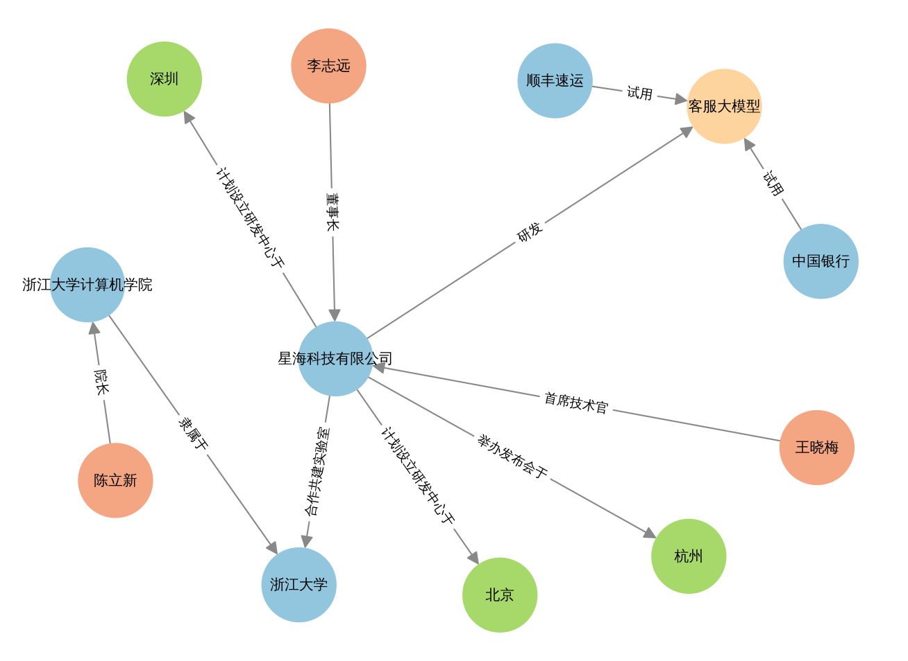
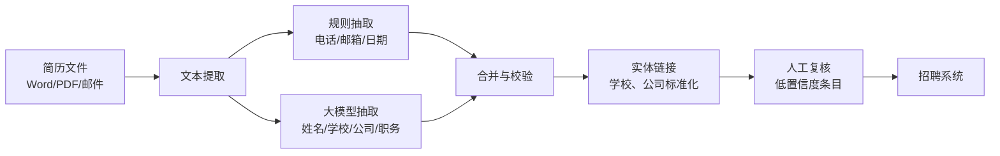
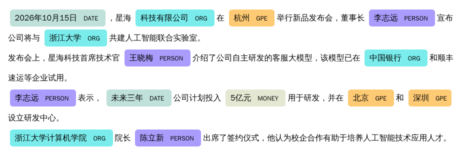
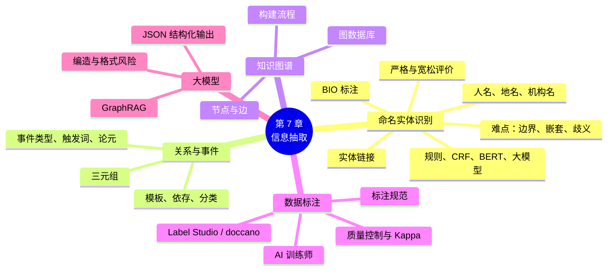

# 第 7 章 命名实体识别与信息抽取

!!! abstract "本章学时"
    理论 5 学时 · 实验 1 学时（本章共 3 个实验，教师可任选）

## 学习目标

学完本章，你应该能够：

1. **说出**信息抽取的定义和主要子任务，举例说明它的应用场景；
2. **识别**常见的命名实体类型，说明命名实体识别的难点；
3. **使用** BIO 方法标注句子中的实体，并能把 BIO 标签还原为实体，按严格和宽松标准计算 NER 的评价指标；
4. **解释**关系抽取、事件抽取和知识图谱的基本概念；
5. **描述**数据标注规范和质量控制方法，会计算 Kappa 一致性系数，了解 AI 训练师的职业要求；
6. **使用**规则、spaCy、预训练模型和大模型完成实体与关系抽取，并用 networkx 画出知识图谱。

## 情景导入

某公司人力资源部每天会收到上百份简历，格式五花八门：有的是 Word，有的是 PDF，有的直接写在邮件正文里。HR 小周的工作之一，是把每份简历中的**姓名、电话、毕业院校、专业、工作单位、工作年限**等信息，手工录入到公司的招聘系统里。一份简历要花 3 分钟，一天下来眼睛都花了。

能不能让计算机自动从简历中“找出”这些信息，填到表格里？这就是**信息抽取**要解决的问题。它的核心是先找出文本中的人名、机构名、地名、时间等“实体”，再弄清楚它们之间的关系：张三**毕业于**某大学，**就职于**某公司。

本章我们将学习这项技术，最后还会把一篇新闻中的人物、机构和它们之间的关系，画成一张“关系网”，也就是**知识图谱**。

## 7.1 信息抽取概述

### 7.1.1 什么是信息抽取

**信息抽取**（Information Extraction，IE）是从**非结构化**的自然语言文本中，自动抽取出指定类型的信息，并把它们整理成**结构化**数据的技术。

“非结构化”指的是像新闻、简历、聊天记录这样的自由文本；“结构化”指的是像数据库表格、JSON 这样有固定字段的数据。信息抽取就是在两者之间搭一座桥。例如：

> 原文：2026 年 10 月 15 日，星海科技有限公司在杭州举行新品发布会，董事长李志远宣布公司将与浙江大学共建人工智能联合实验室。

| 字段 | 抽取结果 |
|---|---|
| 时间 | 2026 年 10 月 15 日 |
| 地点 | 杭州 |
| 事件 | 新品发布会、签约共建实验室 |
| 公司 | 星海科技有限公司 |
| 人物及职务 | 李志远（董事长） |
| 合作方 | 浙江大学 |

（本章示例新闻中的公司和人物均为虚构。）

### 7.1.2 信息抽取的主要任务

| 任务 | 做什么 | 例子 |
|---|---|---|
| **命名实体识别** | 找出文本中的实体，并判断类型 | 李志远（人名）、星海科技有限公司（机构名）、杭州（地名） |
| **关系抽取** | 判断两个实体之间是什么关系 | （李志远，董事长，星海科技有限公司） |
| **事件抽取** | 找出发生了什么事件，以及事件的时间、地点、参与者 | 签约事件：时间 10 月 15 日，双方为星海科技和浙江大学 |
| **属性抽取** | 抽取实体的属性值 | 某手机：屏幕 6.7 英寸，电池 5000 毫安时 |

这几项任务是层层递进的：先识别实体，才能判断实体之间的关系；把实体和关系连起来，就构成了知识图谱。

**封闭域抽取与开放域抽取。** 按照抽取目标是否事先规定，信息抽取可以分为两类。**封闭域抽取**事先规定好要抽取哪些类型，比如只抽取“人名、公司、职务”三类实体和“任职”一种关系，企业中的绝大多数应用都属于这一类，因为业务系统的表格字段是固定的。**开放域抽取**不事先规定类型，从文本中抽出所有形如（主语，谓语，宾语）的事实，比如从“华为在深圳发布了新手机”中抽出（华为，发布，新手机）和（华为，在，深圳），第 4 章基于依存句法提取主谓宾的方法就属于这一类。开放域抽取覆盖面广，但结果杂乱、难以直接使用，通常还需要再做归类和整理。动手做一个抽取项目时，第一步就是和业务人员一起确定“到底要抽什么”，并写成清单，这比选择用什么模型更重要。

### 7.1.3 应用场景

| 行业 | 应用 | 抽取的内容 |
|---|---|---|
| 人力资源 | 简历解析 | 姓名、电话、学历、工作经历 |
| 法律 | 合同要素提取 | 甲方、乙方、金额、期限、违约条款 |
| 医疗 | 电子病历结构化 | 症状、诊断、药品、剂量 |
| 金融 | 公告和新闻分析 | 公司、高管变动、并购、融资金额 |
| 政务 | 热线工单分析 | 诉求人、地点、问题类型、涉及单位 |
| 电商 | 商品信息整理 | 品牌、型号、规格参数 |
| 物流 | 地址解析 | 省、市、区、街道、门牌号、收件人、电话 |

## 7.2 命名实体识别

### 7.2.1 什么是命名实体

**命名实体**（Named Entity）是指文本中具有特定意义的专有名称和数量表达。**命名实体识别**（Named Entity Recognition，NER）就是找出这些实体在文本中的位置，并判断它们的类型。

最基本的实体类型有“三大类”：

| 类型 | 英文标签 | 例子 |
|---|---|---|
| 人名 | PER / PERSON | 李志远、王晓梅 |
| 地名 | LOC / GPE | 杭州、长江、北京 |
| 机构名 | ORG | 浙江大学、中国银行、星海科技有限公司 |

此外，常见的还有**时间、日期、金额、数量、百分比**等数量表达，以及各行业的**领域实体**：医疗中的疾病、药品、症状；电商中的品牌、产品型号；法律中的法条、案由等。

!!! note "GPE 和 LOC 有什么区别？"
    spaCy 等工具会区分 GPE（Geo-Political Entity，地缘政治实体，即国家、省、城市等行政区划）和 LOC（Location，其他地点，如山川、河流、海洋）。“北京”是 GPE，“长江”是 LOC。

### 7.2.2 命名实体识别的难点

| 难点 | 例子 | 说明 |
|---|---|---|
| **边界难确定** | “浙江大学计算机学院院长陈立新” | 机构名是“浙江大学”还是“浙江大学计算机学院”？ |
| **嵌套实体** | “浙江大学计算机学院” | 机构名里嵌套着另一个机构名“浙江大学”，还嵌套着地名“浙江” |
| **类型有歧义** | “华为发布新手机”与“他叫华为” | 同一个词，可能是机构名，也可能是人名 |
| **简称与别名** | “浙大”“中行”“顺丰” | 同一实体有多种叫法，需要“实体链接”把它们对应起来 |
| **新实体不断出现** | 新成立的公司、新上市的产品 | 词典来不及收录 |
| **中文没有大写** | 英文中 “Apple” 首字母大写是个强提示 | 中文缺少这样的提示，更依赖上下文 |

### 7.2.3 BIO 标注

第 3 章我们学过，分词可以看作给每个字贴 B / M / E / S 标签的**序列标注**问题。命名实体识别也采用同样的思路，最常用的标注方法是 **BIO**：

| 标签 | 含义 |
|---|---|
| **B-类型**（Begin） | 实体的第一个字 |
| **I-类型**（Inside） | 实体的其余字 |
| **O**（Outside） | 不属于任何实体 |

例如“李志远在杭州创办了星海科技”：

```text
李    志    远    在   杭    州    创  办  了  星    海    科    技
B-PER I-PER I-PER O   B-LOC I-LOC O   O   O   B-ORG I-ORG I-ORG I-ORG
```

只要模型能给每个字贴对标签，就能把实体“拼”出来：从 B 开始，连上后面的 I，遇到 O 或下一个 B 就结束。实验 7-1 中我们会写一个函数完成这个“还原”过程。

!!! tip "为什么中文 NER 常常按“字”标注？"
    如果先分词再标注，分词的错误会直接传给实体识别（比如“星海科技”被切成“星海 / 科技”）。按字标注可以绕开分词错误，所以中文 NER 通常以字为单位。

BIO 还有一些变体，例如 **BIOES**（增加 E 表示实体结尾、S 表示单字实体），能提供更多的边界信息。

**标注时的几个常见错误。** 初学者用 BIO 标注时，最容易出现下面几类错误：

| 错误 | 错误标注 | 正确标注 | 说明 |
|---|---|---|---|
| 实体以 I 开头 | 杭/I-LOC 州/I-LOC | 杭/B-LOC 州/I-LOC | 每个实体的第一个字必须是 B |
| 类型前后不一致 | 星/B-ORG 海/I-LOC | 星/B-ORG 海/I-ORG | 同一个实体内部，类型必须相同 |
| 两个相邻实体连成一个 | 杭/B-LOC 州/I-LOC 西/I-LOC 湖/I-LOC | 杭/B-LOC 州/I-LOC 西/B-LOC 湖/I-LOC | 第二个实体要重新以 B 开头 |
| 职务、称呼混入人名 | 董/B-PER 事/I-PER 长/I-PER 李/I-PER…… | 董/O 事/O 长/O 李/B-PER…… | 按规范，职务不属于人名 |

第三种错误特别值得注意：“杭州西湖”中有两个相邻的地名，正是因为有 B 标签，我们才能区分“一个四字地名”和“两个两字地名”。如果只用 I 和 O 两种标签，这两种情况就无法区分了，这也是 BIO 中需要 B 标签的原因。

**嵌套实体怎么办？** BIO 中每个字只能有一个标签，因此无法同时表示“浙江大学计算机学院”（ORG）和其中的“浙江大学”（ORG）、“浙江”（LOC）。常见的处理办法有两种：一是在标注规范中约定**只标最外层**（或只标最内层），这是大多数数据集的做法；二是换用能处理嵌套的方法，比如先列出句子中所有可能的片段，再逐个判断每个片段是不是实体、是什么类型，这类方法叫做**片段分类**（Span-based）方法。大模型直接输出实体列表，天然没有嵌套的限制。

### 7.2.4 命名实体识别的方法

| 方法 | 思路 | 优点 | 缺点 |
|---|---|---|---|
| **规则与词典** | 用正则表达式匹配日期、金额；用实体名单匹配机构名 | 准确、可控、无需训练 | 覆盖不全，规则难维护 |
| **统计模型** | 条件随机场（CRF）等，根据字和上下文特征预测 BIO 标签 | 能识别新实体 | 需要人工设计特征和标注数据 |
| **深度学习** | BiLSTM-CRF：神经网络自动提取特征，CRF 保证标签序列合理 | 效果好 | 需要较多标注数据 |
| **预训练模型** | 在 BERT 等预训练模型上微调（第 9 章） | 效果最好，所需标注数据较少 | 需要一定算力 |
| **大模型** | 用提示词让大模型直接列出实体 | 无需训练，可随时增加新的实体类型 | 速度慢、有成本，可能“编造”实体 |

!!! note "CRF 的作用（了解即可）"
    BIO 标签之间有约束：I-PER 前面只能是 B-PER 或 I-PER，不可能紧跟在 O 后面。**条件随机场**（Conditional Random Field，CRF）的作用就是在预测时考虑这种前后标签的搭配关系，避免出现“O I-PER”这样不合理的结果。这和第 3 章 HMM 的“转移概率”是类似的思想。

**BiLSTM-CRF 是怎样工作的？** 在大模型出现之前，BiLSTM-CRF 是 NER 最经典的模型结构，也是许多企业系统中仍在使用的方案。它分为三层：

1. **嵌入层**：把每个字变成一个向量（第 5 章）；
2. **BiLSTM 层**：一个从左往右读、一个从右往左读的 LSTM（第 8 章），为每个字计算出一个“结合了上下文”的向量，再据此给每个字的每种标签打分。例如在“李志远在杭州”中，“远”字得到 I-PER 9 分、O 2 分；
3. **CRF 层**：不是简单地给每个字选分数最高的标签，而是把**整条标签序列**作为一个整体来打分：总分 = 各个字的标签分数之和 + 相邻标签的“搭配分数”。“B-PER → I-PER”这样合理的搭配得分高，“O → I-PER”这样不合理的搭配得分很低。最后选出总分最高的整条序列。

举个例子：如果只看单个字，模型可能认为“州”字最可能是 I-LOC，而“杭”字最可能是 O（因为“杭”单独出现时很少是地名），于是得到“杭/O 州/I-LOC”这样不合法的结果。加上 CRF 后，“O → I-LOC”的搭配分数很低，整体最优的序列就变成了“杭/B-LOC 州/I-LOC”。在实际系统中，BiLSTM 层也可以换成 BERT 等预训练模型，即 **BERT-CRF**，这是目前工业界中文 NER 的常用方案之一。

实际项目中，规则和模型常常**结合使用**：日期、金额、电话、身份证号这类格式固定的实体用规则，人名、机构名这类灵活的实体用模型，最后再用业务词典校正。

### 7.2.5 效果评价

NER 通常以“实体”为单位计算精确率、召回率和 F1 值，并且要求**边界和类型都完全正确**才算对：

- 标准答案是“星海科技有限公司（ORG）”，模型识别为“科技有限公司（ORG）”，边界错了，算错；
- 模型识别为“星海科技有限公司（PER）”，类型错了，也算错。

**计算示例。** 一段测试文本中共有 10 个标准答案实体，模型识别出了 9 个实体。逐个对照后发现：6 个边界和类型都完全正确；2 个类型正确但边界有误（如把“星海科技有限公司”识别为“星海科技”）；1 个边界正确但类型错误。按照严格标准：

$$
P = \frac{6}{9} \approx 0.667,\quad R = \frac{6}{10} = 0.600,\quad F_1 = \frac{2 \times 0.667 \times 0.600}{0.667 + 0.600} \approx 0.632
$$

在某些应用中，边界差一点也可以接受（比如只需要知道“这段话提到了星海科技”），这时可以采用**宽松标准**：只要预测的实体和标准答案有重叠、类型又相同，就算对。按宽松标准，上例中正确的实体有 6 + 2 = 8 个，P = 8/9 ≈ 0.889，R = 8/10 = 0.800，F1 ≈ 0.842。

报告 NER 结果时，一定要说明用的是严格标准还是宽松标准，否则两个数字没有可比性。另外，除了总体 F1，还应**按实体类型分别统计**：一个模型可能人名识别得很好（F1 0.95），机构名却很差（F1 0.70），只看总体数字会掩盖这种差异。

### 7.2.6 实体链接：识别出来之后，它到底是谁？

识别出实体还不够。“苹果发布新手机”和“苹果降价了”中的“苹果”，一个是公司，一个是水果；“浙大”“浙江大学”“ZJU”指的又是同一所学校。**实体链接**（Entity Linking）的任务是把文本中识别出的实体，对应到知识库中**唯一确定**的条目上。它通常分为两步：

1. **候选生成**：根据实体的名称，在知识库中找出可能的候选条目，比如“苹果”可能对应“苹果公司”“苹果（水果）”“苹果（电影）”等；
2. **候选排序**：根据上下文判断哪个候选最合适。上下文中出现了“手机”“发布会”，那么“苹果公司”的可能性最高。

实体链接是构建知识图谱时“实体融合”的关键一步（7.5.3 节），也是搜索引擎能够在搜索结果旁边显示正确“知识卡片”的基础。在企业应用中，知识库往往就是公司自己的客户表、产品表或员工表，例如把工单中的“老王”“王经理”“王建国”都对应到客户表中编号为 C1024 的同一条记录上。

### 7.2.7 中文 NER 的常用数据集

想要训练或评价一个中文 NER 模型，需要有标注好的数据集。下面几个是学习和研究中常见的公开数据集：

| 数据集 | 文本来源 | 实体类型 | 特点 |
|---|---|---|---|
| 人民日报语料 | 新闻 | 人名、地名、机构名 | 规范的新闻文本，是早期中文 NER 研究的常用数据 |
| MSRA NER | 新闻 | 人名、地名、机构名 | 规模较大，常用于比较模型效果 |
| Weibo NER | 微博 | 人名、地名、机构名、地缘政治实体等 | 口语化、不规范，难度明显更高 |
| CLUENER2020 | 新闻等 | 人名、公司、组织机构、政府、地址、书名、电影、游戏、职位、景点共 10 类 | 细粒度实体，实验 7-2 使用的模型就是在它上面训练的 |

同一个模型在规范的新闻文本上 F1 可能很高，到了微博、聊天记录这样的口语文本上就会明显下降。这提醒我们：**模型在公开数据集上的成绩，不等于在你自己业务数据上的成绩**。正式使用前，一定要用自己领域的少量数据做一次测试。


## 7.3 关系抽取

### 7.3.1 什么是关系抽取

**关系抽取**（Relation Extraction）是判断文本中两个实体之间存在什么语义关系，结果通常表示为**三元组**：

$$
(\text{头实体},\ \text{关系},\ \text{尾实体})
$$

例如：

| 句子 | 三元组 |
|---|---|
| 董事长李志远宣布…… | （李志远，董事长，星海科技有限公司） |
| 浙江大学计算机学院院长陈立新…… | （陈立新，院长，浙江大学计算机学院） |
| 该模型已在中国银行试用 | （中国银行，试用，客服大模型） |

### 7.3.2 关系抽取的方法

**1. 基于模板（规则）**：总结出表达某种关系的句式。例如“职务”关系可以写成：

```text
[机构名] + 董事长/总经理/院长 + [人名]       → (人名, 职务, 机构名)
[人名] + 是/担任 + [机构名] + 的 + 董事长    → (人名, 董事长, 机构名)
```

模板方法准确率高，但人们表达同一关系的方式太多，模板很难写全。

**2. 基于依存句法**：第 4 章学过的“主谓宾”提取，本质上就是一种关系抽取：（华为，发布，新款手机）。

**3. 基于机器学习**：先识别出句子中的两个实体，再把“两个实体 + 句子”交给一个分类器，判断它们属于哪种预定义的关系（如“职务”“隶属”“合作”“无关系”）。这就把关系抽取变成了第 6 章的文本分类问题。

**4. 联合抽取与大模型**：现代方法常常把实体识别和关系抽取放在一个模型中**同时完成**，避免前一步的错误传给后一步。大模型则更进一步，用一个提示词就能直接输出全部实体和关系（实验 7-3）。

### 7.3.3 关系抽取的难点

**1. 同一关系，说法千变万化。** “李志远是星海科技的董事长”“星海科技董事长李志远”“李志远执掌的星海科技”“作为星海科技的掌门人，李志远……”，表达的都是同一个“董事长”关系。模板方法很难把这些说法都写全，这也是机器学习方法和大模型的优势所在。

**2. 关系的方向不能弄反。** （李志远，董事长，星海科技）和（星海科技，董事长，李志远）意思完全不同。设计关系类型时，要明确规定头实体和尾实体的类型，例如“董事长”关系的头实体必须是人物，尾实体必须是机构。这样的约束也可以用来自动检查抽取结果是否合理。

**3. 标注数据难以获得。** 为每种关系人工标注大量句子，成本很高。一种经典的解决思路叫做**远程监督**（Distant Supervision）：如果知识库中已经有（李志远，董事长，星海科技）这条记录，那么就假设所有同时提到“李志远”和“星海科技”的句子都表达了“董事长”关系，自动把它们当作训练数据。这个假设显然不总成立，比如“李志远离开星海科技后创办了新公司”就没有表达董事长关系，所以远程监督得到的数据含有不少噪声，需要再用其他方法过滤。现在，用大模型自动标注、再由人工抽检，已经成为获取训练数据的常用方法。

**4. 跨句关系。** 很多关系的两个实体并不在同一句话里：前一句提到“星海科技”，后一句说“公司董事长李志远表示……”。要抽出这种关系，需要结合指代消解（第 4 章 4.5.4 节）和对整个段落的理解，这类任务叫做**篇章级关系抽取**，大模型由于能够一次读入很长的文本，在这类任务上进步明显。

## 7.4 事件抽取

**事件抽取**（Event Extraction）是从文本中识别出发生了什么事件，以及事件的各个要素。一个事件通常包括：

- **事件类型**：如签约、任职、融资、发布、事故等；
- **触发词**：最能表明事件发生的词，通常是动词，如“签约”“宣布”“发布”；
- **事件论元**：事件的参与者和属性，如时间、地点、主体、客体、金额。

例如：

> 李志远表示，未来三年公司计划投入 5 亿元用于研发，并在北京和深圳设立研发中心。

| 要素 | 内容 |
|---|---|
| 事件类型 | 投资计划 |
| 触发词 | 投入、设立 |
| 主体 | 星海科技有限公司（“公司”指代） |
| 金额 | 5 亿元 |
| 时间 | 未来三年 |
| 地点 | 北京、深圳 |

事件抽取在金融舆情监控（如自动发现“某公司高管被调查”“某公司获得融资”）、安全生产监测、政务热点追踪等领域有重要应用。注意上例中的“公司”需要结合上下文才知道指的是“星海科技有限公司”，这叫**指代消解**，是事件抽取中的一个难点。

**事件抽取怎样实现？** 传统的事件抽取通常分为两步：第一步**识别触发词并判断事件类型**，这可以看作一个序列标注问题，像 NER 一样给每个字贴上“B-投资”“I-投资”“O”这样的标签；第二步**抽取论元**，对每个识别出的事件，在句子中找出时间、地点、金额等要素，判断它们分别扮演什么角色。这一步和第 4 章的语义角色标注非常相似：触发词相当于谓语，论元相当于施事、受事、时间、地点等语义角色。

在实际业务中，事件的类型和要素一般事先用一张**事件模板**规定好。例如金融领域的“融资”事件模板可以是：

| 论元角色 | 含义 | 示例 |
|---|---|---|
| 融资方 | 获得投资的公司 | 星海科技 |
| 投资方 | 出钱的机构 | 某创投基金 |
| 轮次 | 天使轮、A 轮、B 轮…… | B 轮 |
| 金额 | 融资金额 | 3 亿元 |
| 时间 | 事件发生的时间 | 2026 年 9 月 |

抽取时，就是在文本中为模板的每个“空格”找到内容，这种做法也叫**模板填充**。用大模型做事件抽取时，把这张模板写进提示词，再要求模型按 JSON 格式输出，往往就能得到不错的结果。如果文本中没有提到某个论元（比如没有说投资方是谁），应当要求模型输出空值，而不是让它猜测。

## 7.5 知识图谱

### 7.5.1 什么是知识图谱

把大量的实体和关系三元组连接起来，就形成了一张巨大的“关系网”，这就是**知识图谱**（Knowledge Graph）。在知识图谱中：

- **节点**表示实体（人物、机构、地点、产品……）；
- **边**表示实体之间的关系（董事长、隶属于、合作、位于……）。

实验 7-3 中，我们用示例新闻中的实体和关系画出了下面这张小型知识图谱（实测生成）：



图中不同颜色代表不同类型的实体：橙色是人物，蓝色是机构，绿色是地点，黄色是产品。从图上一眼就能看出星海科技的董事长和首席技术官是谁、它和哪所大学合作、它的产品被哪些企业试用。

### 7.5.2 知识图谱的应用

你可能每天都在使用知识图谱：

- 在搜索引擎中搜索一位名人，右侧出现的“知识卡片”（出生日期、职业、代表作、相关人物）就来自知识图谱；
- 电商平台的“买了手机的人还买了手机壳”，部分依赖商品之间的关系图谱；
- 银行的反欺诈系统，通过分析账户、手机号、设备之间的关联图谱，发现团伙作案；
- 医疗知识图谱把疾病、症状、药品、检查连接起来，辅助医生诊断。

### 7.5.3 知识图谱的构建与存储

构建知识图谱的大致流程是：**数据收集 → 实体识别 → 关系抽取 → 实体链接与融合**（把“浙大”和“浙江大学”合并为同一个节点）**→ 存储与应用**。

知识图谱通常存储在**图数据库**中，例如开源的 Neo4j、国产的 NebulaGraph 等。它们擅长回答“与 A 有关系的所有实体”“A 和 B 之间有没有路径相连”这类查询。

### 7.5.4 怎样查询知识图谱

知识图谱的价值在于“查询”。在图数据库 Neo4j 中，使用一种叫 **Cypher** 的查询语言，它用小括号表示节点、用方括号和箭头表示关系，写起来很像在纸上画图。下面两个查询分别表示“星海科技的董事长是谁”和“与星海科技有合作关系的所有大学”：

```text
MATCH (p:人物)-[:董事长]->(c:机构 {name: "星海科技有限公司"}) RETURN p.name

MATCH (c:机构 {name: "星海科技有限公司"})-[:合作]-(u:大学) RETURN u.name
```

图数据库最擅长的是**多跳查询**，也就是沿着关系连续“走”好几步。比如银行反欺诈中的一个典型问题：“与这个可疑账户使用过同一部手机的账户，又和哪些账户之间有转账往来？”这需要从账户走到手机、再走回账户、再走到转账对象，一共三跳。如果用普通的表格数据库来查，要把好几张大表反复连接，既难写又慢；用图数据库查询，则又简单又快。

不会写 Cypher 也没关系。现在已经有工具可以让大模型把自然语言问题自动转换为 Cypher 查询（类似于把问题转换为 SQL 的 Text-to-SQL 技术），用户用中文提问，系统在后台查询知识图谱，再把结果组织成回答。这也是 7.7.3 节中知识图谱与大模型结合的一种形式。

## 7.6 数据标注

### 7.6.1 为什么需要数据标注

无论是训练 NER 模型，还是评估大模型的抽取效果，都需要人工标注的“标准答案”。**数据标注**就是由人按照统一的规范，给原始数据加上标签的工作。它是 **AI 训练师**（人工智能训练师）这一国家新职业的核心工作内容之一。

### 7.6.2 标注规范

标注之前，必须先制定一份详细的**标注规范**（也叫标注指南），否则不同的人会标出不同的结果。一份 NER 标注规范通常包括：

| 内容 | 示例 |
|---|---|
| 实体类型定义 | ORG：公司、学校、政府机关、社会团体等有组织的机构 |
| 边界规则 | 机构名包含后缀：“星海科技有限公司”整体标为 ORG，不能只标“星海科技” |
| 嵌套规则 | 只标注最外层实体：“浙江大学计算机学院”整体标为 ORG |
| 特殊情况 | 职务不属于人名：“董事长李志远”只标“李志远” |
| 正反例 | 列出容易混淆的例子，给出正确标法 |

### 7.6.3 标注工具

| 工具 | 特点 |
|---|---|
| **Label Studio** | 开源，支持文本、图像、音频等多种数据，网页界面操作，可多人协作 |
| **doccano** | 开源，专门用于文本标注（实体、分类、翻译），简单易用 |
| 各大企业的数据标注平台 | 支持大规模团队协作、质量管理和计费 |

以 Label Studio 为例，基本操作流程是：安装并启动（`pip install label-studio` 后执行 `label-studio start`）→ 在浏览器中创建项目 → 选择“命名实体识别”模板并设置实体类型 → 导入文本 → 用鼠标选中文字、点击类型标签进行标注 → 导出为 JSON 或 CoNLL（BIO）格式。

### 7.6.4 质量控制

标注质量直接决定模型质量。常用的质量控制方法有：

- **试标与培训**：正式标注前，所有标注员先试标同一批数据，讨论分歧，统一理解；
- **双人标注**：同一条数据由两人独立标注，计算两人的**一致率**，一致率低说明规范不清楚或有人理解有偏差；
- **抽检**：由质检员随机抽查一定比例的数据，统计错误率；
- **迭代修订规范**：把标注中遇到的新情况补充到规范中。

**一致率怎么算？** 最直接的方法是计算两人标注结果相同的比例，但这个数字会“虚高”：即使两人都随便乱标，也会有一部分碰巧一致。因此常用 **Kappa 系数**来扣除碰巧一致的部分。来看一个例子：两名标注员分别判断 100 个句子“是否包含机构名”，结果如下：

| | 标注员 B：包含 | 标注员 B：不包含 | 合计 |
|---|---|---|---|
| **标注员 A：包含** | 40 | 5 | 45 |
| **标注员 A：不包含** | 10 | 45 | 55 |
| 合计 | 50 | 50 | 100 |

- **实际一致率**：两人都判“包含”的 40 句，加上都判“不包含”的 45 句，$p_o = (40+45)/100 = 0.85$；
- **碰巧一致率**：A 判“包含”的比例是 0.45，B 是 0.50，两人碰巧都判“包含”的概率是 0.45 × 0.50 = 0.225；碰巧都判“不包含”的概率是 0.55 × 0.50 = 0.275，合计 $p_e = 0.5$；
- **Kappa 系数**：

$$
\kappa = \frac{p_o - p_e}{1 - p_e} = \frac{0.85 - 0.5}{1 - 0.5} = 0.70
$$

Kappa 等于 1 表示完全一致，等于 0 表示和随机乱标差不多。一般认为 0.6 到 0.8 之间是“较好”，0.8 以上是“很好”。本例的 0.70 说明两人的理解大体一致，但还有改进空间，应该把两人意见不同的 15 个句子拿出来讨论，看看是谁标错了，还是规范本身没有说清楚。


!!! info "大模型时代的标注新模式"
    现在越来越多的标注工作采用“**大模型预标注 + 人工校对**”的模式：先让大模型给数据打上初步标签，标注员只需检查和修改，效率可以提高数倍。标注员的角色也从“逐字标注”转变为“审核把关”和“编写规范”。

### 7.6.5 AI 训练师：一个新职业

2020 年，人力资源和社会保障部等部门发布的新职业中包括了**人工智能训练师**，随后又发布了这一职业的国家职业技能标准。按照标准，人工智能训练师分为**数据标注员**和**人工智能算法测试员**两个工种，等级从初级到高级逐步提高，工作内容从“按规范标注数据”逐步扩展到“设计标注规范”“分析模型的错误”“优化训练数据”。

对于人工智能技术应用专业的同学来说，这是一个门槛相对较低、又和本课程密切相关的就业方向。在大模型时代，这个岗位的工作内容也在发生变化：除了给文本标实体、标类别，越来越多的工作是**评价大模型的回答**（哪个回答更好、有没有事实错误、是否安全）、**编写高质量的问答示例**用于微调（第 9 章），以及**设计测试题**检验模型在某个行业中的能力。无论哪种工作，本章强调的几个基本功都同样重要：读懂并严格执行规范，发现规范没有覆盖的情况并及时反馈，以及用一致率等指标检查自己和团队的工作质量。


## 7.7 前沿视窗：用大模型做结构化抽取

### 7.7.1 让大模型输出 JSON

大模型擅长理解语言，但它的输出默认是自由文本，程序很难直接使用。在信息抽取中，我们希望大模型输出**结构化**的结果，最常用的格式是 JSON：

```json
{
  "entities": [{"name": "李志远", "type": "人物"}, {"name": "星海科技有限公司", "type": "机构"}],
  "relations": [{"head": "李志远", "relation": "董事长", "tail": "星海科技有限公司"}]
}
```

要让大模型稳定地输出 JSON，可以：

1. **在提示词中给出 JSON 模板**，并要求“严格按照格式输出，不要输出任何其他文字”；
2. **使用 JSON 模式**：很多大模型 API 支持 `response_format={"type": "json_object"}` 参数，保证输出是合法的 JSON；
3. **使用结构化输出或函数调用**：预先定义好字段名和类型（称为 JSON Schema），模型严格按照这个结构填写（第 11 章会介绍函数调用）；
4. **程序校验**：用 `json.loads()` 解析结果，检查必需字段是否齐全，失败时自动重试。

### 7.7.2 大模型抽取的风险

| 风险 | 表现 | 应对 |
|---|---|---|
| **编造实体** | 输出原文中根本没有的实体或关系 | 用程序检查每个实体是否真的出现在原文中 |
| **类型不一致** | 有时把“浙江大学”标为“学校”，有时标为“机构” | 在提示词中限定可选类型 |
| **格式错误** | JSON 缺括号、多了解释文字 | 使用 JSON 模式，解析失败时重试 |
| **数据安全** | 合同、病历等敏感文本被发送到外部服务 | 使用本地部署的开源模型，或先脱敏再处理（第 12 章） |

### 7.7.3 知识图谱与大模型的结合

大模型和知识图谱可以互相帮助：一方面，用大模型从海量文本中抽取三元组，大大降低了构建知识图谱的成本；另一方面，知识图谱中准确、结构化的知识，可以在大模型回答问题时提供可靠的依据，减少“幻觉”。后者的一种方法叫做 **GraphRAG**（基于图的检索增强生成），是第 11 章 RAG 技术的一个发展方向。


### 7.7.4 从“一个任务一个模型”到通用信息抽取

过去，实体识别、关系抽取、事件抽取各需要一个专门的模型，每换一种实体类型或关系类型，都要重新标注数据、重新训练。2022 年前后出现了**通用信息抽取**的思路，代表性工作是 UIE（Universal Information Extraction）：把各种抽取任务统一成“根据给定的抽取目标，从文本中找出对应片段”的形式。使用时只需告诉模型“要抽取人名、公司、职务”，它就能直接完成，不需要为每个任务单独建模，少量标注数据就能适配新领域。国内的 PaddleNLP 等工具包提供了这类中文模型。

大模型把这条路走得更远：抽取目标完全用自然语言描述，还可以附上几个示例。不过，在数据量很大、要求速度快、成本低的场景中（比如每天处理几百万条物流地址），经过微调的小模型仍然更合适。比较常见的做法是：先用大模型自动标注一批数据，再用这些数据训练一个小模型上线，兼顾效果和成本。

### 7.7.5 案例：一个简历解析系统的设计

回到本章开头 HR 小周的问题。综合本章所学，一个简历解析系统可以这样设计：



这个设计中有几个值得体会的地方：

- **规则和大模型分工**：电话、邮箱、日期这类格式固定的信息用正则表达式提取，又快又准，也不用花钱；姓名、学校、工作单位这类灵活的信息交给大模型；
- **校验**：检查大模型抽出的学校、公司名称是否真的出现在原文中，防止编造；检查毕业时间是否早于参加工作的时间等逻辑关系；
- **标准化**：把“浙大”“浙江大学”统一为标准名称，方便以后按学校筛选，这就是实体链接；
- **人工复核**：校验不通过或模型不确定的条目，交给 HR 人工确认，而不是直接入库；
- **隐私保护**：简历中包含大量个人信息，如果使用在线大模型，需要选择合规的服务，并在公司隐私政策中说明（第 12 章）。

这样一来，HR 的工作从“逐份录入”变成了“检查少数有疑问的条目”，效率可以大大提高。这也是大多数 AI 应用落地的真实形态：**机器处理大部分常规情况，人负责把关和处理例外**。

## 本章实验

!!! abstract "实验总览"
    | 实验 | 类型 | 建议时长 | 内容 |
    |---|---|---|---|
    | 实验 7-1 | ★ 基础 | 40 分钟 | BIO 标注实践与规则抽取 |
    | 实验 7-2 | ★ 基础 | 45 分钟 | spaCy 与 Transformers 命名实体识别 |
    | 实验 7-3 | ★ 基础 | 50 分钟 | 大模型结构化抽取与知识图谱 |

    实验代码见配套资源 `labs/ch07/` 目录。实验使用的新闻 `news_ner.txt` 为教材编写的虚构新闻。

### 实验 7-1 ★ BIO 标注实践与规则抽取

**实验目的**

1. 读懂 BIO 标注，编写函数把 BIO 标签还原为实体；
2. 用正则表达式抽取日期、金额和机构名，体会规则的优点和问题；
3. 用实体词典进行匹配。

**实验环境**：实验 1-1 的环境。**实验数据**：`news_ner.txt`。

**实验步骤与代码**

```python
import re

# ===== 第 1 部分：读懂 BIO 标注 =====
chars = list("李志远在杭州创办了星海科技")
tags = ["B-PER", "I-PER", "I-PER", "O", "B-LOC", "I-LOC", "O", "O", "O",
        "B-ORG", "I-ORG", "I-ORG", "I-ORG"]
for c, t in zip(chars, tags):
    print(f"{c}\t{t}")


def bio_to_entities(chars, tags):
    """把逐字的 BIO 标签还原成 (实体, 类型) 列表"""
    entities, current, etype = [], "", None
    for c, t in zip(chars, tags):
        if t.startswith("B-"):                 # 新实体开始
            if current:
                entities.append((current, etype))
            current, etype = c, t[2:]
        elif t.startswith("I-") and current:   # 实体继续
            current += c
        else:                                  # O：实体结束
            if current:
                entities.append((current, etype))
            current, etype = "", None
    if current:
        entities.append((current, etype))
    return entities

print("还原出的实体：", bio_to_entities(chars, tags))

# ===== 第 2 部分：用规则抽取日期、金额和机构 =====
text = open("news_ner.txt", encoding="utf-8").read()
rules = {
    "日期": r"\d{4}年\d{1,2}月\d{1,2}日",
    "金额": r"\d+(?:\.\d+)?[万亿]?元",
    "机构": r"[一-龥]{2,8}(?:有限公司|大学|学院|银行|实验室)",
}
for label, pattern in rules.items():
    print(f"{label}：{re.findall(pattern, text)}")

# 词典法：用一份已知的机构名单进行匹配
ORG_DICT = ["星海科技", "浙江大学", "中国银行", "顺丰速运"]
found = sorted({org for org in ORG_DICT if org in text})
print("词典匹配到的机构：", found)
```

运行结果：

```text
李	B-PER
志	I-PER
远	I-PER
在	O
杭	B-LOC
州	I-LOC
创	O
办	O
了	O
星	B-ORG
海	I-ORG
科	I-ORG
技	I-ORG
还原出的实体： [('李志远', 'PER'), ('杭州', 'LOC'), ('星海科技', 'ORG')]
日期：['2026年10月15日']
金额：['5亿元']
机构：['星海科技有限公司', '宣布公司将与浙江大学', '共建人工智能联合实验室', '该模型已在中国银行', '浙江大学计算机学院']
词典匹配到的机构： ['中国银行', '星海科技', '浙江大学', '顺丰速运']
```

结果解读：

- `bio_to_entities` 函数正确地把逐字标签还原成了三个实体。代码的核心逻辑是：遇到 B 开始一个新实体，遇到 I 把字接到当前实体后面，遇到 O 结束当前实体；
- 日期和金额的规则抽取完全正确，这类格式固定的实体非常适合用规则；
- 机构名的规则 `[一-龥]{2,8}(?:有限公司|大学|...)` 意思是“2 到 8 个汉字，后面跟着这些后缀”。它找到了“星海科技有限公司”和“浙江大学计算机学院”，但也抓到了“宣布公司将与浙江大学”“该模型已在中国银行”这样的错误结果，因为规则无法判断机构名从哪里开始。**规则写得太宽会误抓，写得太窄又会漏掉**，这是规则方法的通病；
- 词典匹配结果准确，但只能找到名单里已有的机构。

**常见问题排查**

| 现象 | 原因与解决办法 |
|---|---|
| 还原出的实体少了最后一个 | 循环结束后忘了把最后一个实体加入列表，检查函数末尾的 `if current:` |
| 读取文件出现乱码 | 确认 `open` 中写了 `encoding="utf-8"` |

**思考与练习**

1. 用 BIO 方法手工标注句子“王晓梅介绍了公司在深圳的研发计划”，写出每个字的标签，并用 `bio_to_entities` 验证。
2. 改进机构名的正则表达式，减少误抓。（提示：可以先用 jieba 分词，再要求机构名从一个名词开始；或者结合词典。）
3. 用 Label Studio 或 doccano 标注 `news_ner.txt` 中的全部实体，导出结果并截图。

**实验报告要求**

提交思考题 1 的标注表、改进后的正则表达式及其抽取结果，以及标注工具的操作截图（选做）。

### 实验 7-2 ★ spaCy 与 Transformers 命名实体识别

**实验目的**

1. 用 spaCy 对中英文新闻进行命名实体识别，并可视化结果；
2. 调用 Hugging Face 上的中文预训练 NER 模型；
3. 比较不同工具的识别效果，分析错误原因。

**实验环境**：实验 1-1 的环境。第 3 部分首次运行需联网下载约 400MB 的模型（请先设置 Hugging Face 镜像）。

**实验步骤与代码**

```python
import spacy
from spacy import displacy

text = open("news_ner.txt", encoding="utf-8").read()

# ===== 第 1 部分：spaCy 中文实体识别 =====
nlp = spacy.load("zh_core_web_sm")
doc = nlp(text)
print("spaCy 识别出的实体：")
for ent in doc.ents:
    print(f"  {ent.text:<12}{ent.label_:<10}{spacy.explain(ent.label_)}")

html = displacy.render(doc, style="ent", jupyter=False)   # 在 Jupyter 中用 jupyter=True 直接显示
open("ner_zh.html", "w", encoding="utf-8").write(html)

# ===== 第 2 部分：spaCy 英文实体识别 =====
nlp_en = spacy.load("en_core_web_sm")
en = ("On October 15, 2026, Xinghai Technology announced in Hangzhou that it will invest "
      "500 million yuan with Zhejiang University. CEO Li Zhiyuan attended the event.")
print("\n英文实体：", [(e.text, e.label_) for e in nlp_en(en).ents])

# ===== 第 3 部分：Transformers 预训练中文 NER 模型 =====
# 首次运行需下载约 400MB 模型，国内请先设置 HF_ENDPOINT=https://hf-mirror.com
from transformers import pipeline
ner = pipeline("token-classification",
               model="uer/roberta-base-finetuned-cluener2020-chinese",
               aggregation_strategy="simple")          # 把同一实体的多个字合并
print("\nTransformers 识别出的实体：")
for line in text.splitlines():
    for e in ner(line):
        print(f"  {e['word'].replace(' ', ''):<12}{e['entity_group']:<14}{e['score']:.2f}")
```

运行结果（第 1、2 部分）：

```text
spaCy 识别出的实体：
  2026年10月15日 DATE      Absolute or relative dates or periods
  科技有限公司      ORG       Companies, agencies, institutions, etc.
  杭州          GPE       Countries, cities, states
  李志远         PERSON    People, including fictional
  浙江大学        ORG       Companies, agencies, institutions, etc.
  王晓梅         PERSON    People, including fictional
  中国银行        ORG       Companies, agencies, institutions, etc.
  李志远         PERSON    People, including fictional
  未来三年        DATE      Absolute or relative dates or periods
  5亿元         MONEY     Monetary values, including unit
  北京          GPE       Countries, cities, states
  深圳          GPE       Countries, cities, states
  浙江大学计算机学院   ORG       Companies, agencies, institutions, etc.
  陈立新         PERSON    People, including fictional

英文实体： [('October 15, 2026', 'DATE'), ('Xinghai Technology', 'ORG'), ('Hangzhou', 'GPE'), ('500 million yuan', 'MONEY'), ('Zhejiang University', 'ORG'), ('Li Zhiyuan', 'PERSON')]
```

spaCy 中文识别结果的可视化效果如下（displaCy 生成）：



结果解读：

- spaCy 正确识别了全部人名（李志远、王晓梅、陈立新）、地名、日期和金额；
- **错误 1（边界错误）**：第一句的机构名只识别出“科技有限公司”，漏掉了“星海”，因为“星海”是一个虚构的、模型从没见过的名字；
- **错误 2（漏识别）**：第二句的“星海科技”和“顺丰速运”都没有被识别出来；
- 英文句子的实体全部识别正确，因为英文有首字母大写这一明显提示，而且 spaCy 英文模型的训练数据更多；
- `spacy.explain()` 可以查询标签的英文解释。

!!! warning "待实测"
    第 3 部分 Transformers 模型的运行结果将在编写环境开放模型下载后实测补充。这个模型在 CLUENER2020 中文细粒度实体数据集上训练，实体类型更丰富（如 company、government、position、name、address 等），请对比它和 spaCy 的结果。

**常见问题排查**

| 现象 | 原因与解决办法 |
|---|---|
| 实体可视化在 Jupyter 中不显示 | 使用 `displacy.render(doc, style="ent", jupyter=True)` |
| Transformers 输出的实体中字之间有空格 | 这是分词器的显示方式，代码中用 `replace(' ', '')` 去掉 |
| 模型下载失败 | 设置 `HF_ENDPOINT` 镜像，或参考实验 5-3 的魔搭社区下载方法 |

**思考与练习**

1. 统计 spaCy 在 `news_ner.txt` 上的实体识别精确率和召回率（以你在实验 7-1 中的人工标注为标准答案）。
2. 用 spaCy 的 `EntityRuler`（实体规则）组件把“星海科技”“顺丰速运”加入识别规则，再运行一次，看看能否修正错误。（提示：`ruler = nlp.add_pipe("entity_ruler", before="ner")`，`ruler.add_patterns([{"label": "ORG", "pattern": "星海科技"}])`。）
3. 找一份你自己的简历（或虚构一份），测试 spaCy 能识别出哪些信息。

**实验报告要求**

提交可视化截图、思考题 1 的统计表和思考题 2 的代码与结果。

### 实验 7-3 ★ 大模型结构化抽取与知识图谱

**实验目的**

1. 编写提示词，让大模型以 JSON 格式输出实体和关系；
2. 用 networkx 把实体和关系画成知识图谱；
3. 在知识图谱上进行简单的查询。

**实验环境**：实验 1-1 的环境，另需安装 `pip install networkx openai`。第 1 部分需要大模型 API Key；没有 API Key 时，程序会自动使用配套的 `relations_sample.json`（教材编者根据新闻人工整理的抽取结果）完成后续步骤。

**实验步骤与代码**

```python
import os
import json
import networkx as nx
import matplotlib.pyplot as plt

text = open("news_ner.txt", encoding="utf-8").read()

# ===== 第 1 部分：让大模型以 JSON 格式输出实体和关系 =====
PROMPT = """你是一名信息抽取助手。请从下面的新闻中抽取实体和实体之间的关系。
要求：
1. 实体类型只能是：人物、机构、地点、产品；
2. 关系用简短的词语表示，如“董事长”“合作”“位于”；
3. 严格按照下面的 JSON 格式输出，不要输出任何其他文字：
{{"entities": [{{"name": "实体名", "type": "类型"}}],
  "relations": [{{"head": "实体1", "relation": "关系", "tail": "实体2"}}]}}
新闻：
{text}"""

if os.environ.get("DEEPSEEK_API_KEY"):
    from openai import OpenAI
    client = OpenAI(api_key=os.environ["DEEPSEEK_API_KEY"],
                    base_url=os.environ.get("LLM_BASE_URL", "https://api.deepseek.com"))
    resp = client.chat.completions.create(
        model=os.environ.get("LLM_MODEL", "deepseek-chat"),
        messages=[{"role": "user", "content": PROMPT.format(text=text)}],
        response_format={"type": "json_object"},     # 要求模型只输出合法的 JSON
        temperature=0)
    data = json.loads(resp.choices[0].message.content)
    json.dump(data, open("relations_llm.json", "w", encoding="utf-8"),
              ensure_ascii=False, indent=2)
    print("大模型抽取结果已保存到 relations_llm.json")
else:
    print("未设置 DEEPSEEK_API_KEY，使用人工整理的示例数据 relations_sample.json")
    data = json.load(open("relations_sample.json", encoding="utf-8"))

print(f"实体 {len(data['entities'])} 个，关系 {len(data['relations'])} 条")
for r in data["relations"][:5]:
    print(f"  ({r['head']}) -[{r['relation']}]-> ({r['tail']})")

# ===== 第 2 部分：用 networkx 画出知识图谱 =====
plt.rcParams["font.sans-serif"] = ["WenQuanYi Zen Hei", "SimHei", "PingFang SC"]
G = nx.DiGraph()                                         # 有方向的图
colors = {"人物": "#f4a582", "机构": "#92c5de", "地点": "#a6d96a", "产品": "#fdd49e"}
for e in data["entities"]:
    G.add_node(e["name"], color=colors.get(e["type"], "#dddddd"))
for r in data["relations"]:
    G.add_edge(r["head"], r["tail"], label=r["relation"])

pos = nx.spring_layout(G, k=2.0, seed=84)                # 自动计算每个节点的位置
plt.figure(figsize=(11, 8))
nx.draw_networkx_nodes(G, pos, node_size=2600,
                       node_color=[G.nodes[n].get("color", "#dddddd") for n in G])
nx.draw_networkx_labels(G, pos, font_size=10, font_family="WenQuanYi Zen Hei")
nx.draw_networkx_edges(G, pos, arrows=True, arrowsize=18, node_size=2600, edge_color="#888888")
nx.draw_networkx_edge_labels(G, pos, nx.get_edge_attributes(G, "label"),
                             font_size=9, font_family="WenQuanYi Zen Hei")
plt.axis("off")
plt.savefig("knowledge_graph.png", dpi=150, bbox_inches="tight")
print("知识图谱已保存为 knowledge_graph.png")

# ===== 第 3 部分：在图谱上做简单查询 =====
print("\n与“星海科技有限公司”直接相连的实体：")
for _, tail, d in G.out_edges("星海科技有限公司", data=True):
    print(f"  {d['label']} → {tail}")
print("谁试用了客服大模型：", [h for h, _, d in G.in_edges("客服大模型", data=True)
                          if d["label"] == "试用"])
```

运行结果（使用示例数据）：

```text
未设置 DEEPSEEK_API_KEY，使用人工整理的示例数据 relations_sample.json
实体 12 个，关系 11 条
  (李志远) -[董事长]-> (星海科技有限公司)
  (王晓梅) -[首席技术官]-> (星海科技有限公司)
  (陈立新) -[院长]-> (浙江大学计算机学院)
  (浙江大学计算机学院) -[隶属于]-> (浙江大学)
  (星海科技有限公司) -[合作共建实验室]-> (浙江大学)
知识图谱已保存为 knowledge_graph.png

与“星海科技有限公司”直接相连的实体：
  合作共建实验室 → 浙江大学
  研发 → 客服大模型
  举办发布会于 → 杭州
  计划设立研发中心于 → 北京
  计划设立研发中心于 → 深圳
谁试用了客服大模型： ['中国银行', '顺丰速运']
```

生成的知识图谱见 7.5.1 节的图。

代码解读：

- 提示词中的 JSON 模板用了双层花括号 `{{ }}`，这是因为 Python 的 `format` 方法会把单层花括号当成要替换的变量，双层花括号才表示真正的花括号字符；
- `response_format={"type": "json_object"}` 启用 JSON 模式，保证返回的是合法 JSON，可以直接用 `json.loads` 解析；
- `nx.DiGraph()` 创建一个**有向图**，因为关系是有方向的（李志远是星海科技的董事长，反过来就不对了）；
- `spring_layout` 用“弹簧模型”自动排布节点：相连的节点互相吸引，所有节点互相排斥。`seed` 固定了随机数，换一个 `seed` 图的样子会不同，可以多试几个，选一个最清楚的；
- `out_edges` 查询从某节点出发的边，`in_edges` 查询指向某节点的边。

!!! warning "待实测"
    使用大模型抽取的结果将在编写环境开放大模型 API 访问后实测补充。请把大模型的抽取结果与 `relations_sample.json` 对比，检查有没有遗漏、错误或“编造”的关系。

**常见问题排查**

| 现象 | 原因与解决办法 |
|---|---|
| `json.decoder.JSONDecodeError` | 大模型输出的不是合法 JSON。确认使用了 `response_format` 参数；或在代码中先用正则提取 `{...}` 部分再解析 |
| `KeyError: 'entities'` | 大模型使用了不同的字段名，在提示词中强调必须使用给定的字段名 |
| 图中节点和文字重叠 | 调整 `figsize`、`node_size`，或更换 `seed` |
| 图中汉字显示为方框 | 把 `font_family` 改为本机已有的中文字体 |

**思考与练习**

1. 编写一个检查函数：遍历大模型抽取的每个实体，判断它是否在原文中出现，把“原文中找不到的实体”打印出来。
2. 修改提示词，增加“事件”的抽取（事件类型、时间、地点、参与者），并输出为 JSON。
3. 找一篇真实的企业新闻（如上市公司公告），用大模型抽取实体和关系，画出知识图谱，并评价抽取的准确性。

**实验报告要求**

提交知识图谱截图、思考题 1 的检查函数和检查结果，以及思考题 3 的新闻原文、抽取结果和准确性评价。

## 本章小结

- **信息抽取**把非结构化文本转换为结构化数据，主要任务包括**命名实体识别、关系抽取、事件抽取和属性抽取**。
- **命名实体**包括人名、地名、机构名以及时间、金额等数量表达；难点有边界确定、嵌套实体、类型歧义、简称别名和新实体。
- NER 通常作为**序列标注**问题，用 **BIO** 方法逐字标注；方法从规则词典、CRF、BiLSTM-CRF 发展到预训练模型和大模型，实际中常**规则与模型结合**。评价时以实体为单位，区分**严格标准**和**宽松标准**，并按类型分别统计。
- **实体链接**把识别出的实体对应到知识库中唯一的条目，解决同名异义和一物多名的问题。
- **关系抽取**输出（头实体，关系，尾实体）三元组，可用模板、依存句法、分类模型或大模型完成，难点在于表达多样、方向约束、标注数据少和跨句关系；**事件抽取**识别事件类型、触发词和论元。
- 实体和关系连接起来构成**知识图谱**，广泛用于搜索、推荐、风控、医疗等领域，常存储在图数据库中。
- **数据标注**需要明确的标注规范和质量控制，常用 **Kappa 系数**衡量标注员之间的一致性；大模型预标注 + 人工校对是新的工作模式。
- **大模型**可以通过 JSON 模式等方式输出结构化抽取结果，但要防范编造实体、格式错误和数据安全风险。



**拓展阅读**

- CLUENER2020 中文细粒度命名实体识别数据集（github.com/CLUEbenchmark/CLUENER2020），可以了解中文 NER 的数据格式和实体类型。
- Label Studio 官方文档（labelstud.io），包含命名实体识别标注模板和导出格式说明。
- 人力资源和社会保障部发布的《人工智能训练师国家职业技能标准》，了解数据标注相关岗位的技能要求。

## 课后练习

**一、选择题**

1. 从“董事长李志远”中抽取出（李志远，董事长，星海科技有限公司），属于（　　）。
   A. 分词　B. 命名实体识别　C. 关系抽取　D. 文本分类

2. 在 BIO 标注中，标签 O 表示（　　）。
   A. 实体的开始　B. 实体的中间　C. 不属于任何实体　D. 机构名

3. “浙江大学计算机学院”中包含“浙江大学”，这种现象称为（　　）。
   A. 嵌套实体　B. 实体链接　C. 指代消解　D. 切分歧义

4. 下列实体最适合用正则表达式抽取的是（　　）。
   A. 人名　B. 机构名　C. 手机号码　D. 产品名

5. 知识图谱中的“边”表示（　　）。
   A. 实体　B. 实体之间的关系　C. 文本　D. 标签

6. 要求大模型 API 只返回合法 JSON 的参数是（　　）。
   A. temperature　B. max_tokens　C. response_format　D. model

**二、判断题**

1. NER 评价时，实体的边界和类型都正确才算识别正确。（　　）
2. 中文 NER 按字标注可以避免分词错误的影响。（　　）
3. 大模型抽取的实体一定都在原文中出现过。（　　）
4. 标注前制定统一的标注规范非常重要。（　　）
5. 事件抽取中的“触发词”通常是最能表明事件发生的词。（　　）

**三、填空题**

1. 信息抽取把________文本转换为结构化数据。
2. 关系抽取的结果通常表示为（头实体，________，尾实体）三元组。
3. 能考虑前后标签搭配关系、常与神经网络结合用于 NER 的模型是________（填英文缩写）。
4. 把“浙大”和“浙江大学”对应为同一实体的任务叫做实体________。
5. 衡量两名标注员的一致程度、并扣除了“碰巧一致”部分的指标是________系数。

**四、简答题**

1. 用 BIO 方法标注句子“陈立新毕业于北京大学”，写出每个字的标签。
2. 比较规则方法和预训练模型方法在命名实体识别上的优缺点。
3. 说明数据标注质量控制的常用方法。
4. 某 NER 模型在测试集上识别出 20 个实体，标准答案共有 25 个实体，其中 15 个预测边界和类型完全正确。计算严格标准下的精确率、召回率和 F1 值。
5. 两名标注员判断 200 条评论是否涉及“配送问题”，两人都判“是”的有 60 条，都判“否”的有 110 条。A 判“是”的共 80 条，B 判“是”的共 70 条。计算实际一致率和 Kappa 系数，并评价一致性。

**五、实践题**

以 5 份虚构的个人简历为素材，设计一套简历信息抽取方案：确定要抽取的字段，分别用规则（电话、邮箱）和大模型（学校、单位、职位）实现抽取，最后把结果整理成 Excel 表格，并统计每个字段的抽取正确率。

??? success "参考答案"
    **选择题：** 1. C　2. C　3. A　4. C　5. B　6. C

    **判断题：** 1. √　2. √　3. ×　4. √　5. √

    **填空题：** 1. 非结构化　2. 关系　3. CRF　4. 链接　5. Kappa

    **简答题第 1 题：** 陈/B-PER 立/I-PER 新/I-PER 毕/O 业/O 于/O 北/B-ORG 京/I-ORG 大/I-ORG 学/I-ORG

    **简答题第 4 题：** P = 15/20 = 0.75，R = 15/25 = 0.60，F1 = 2 × 0.75 × 0.60 /（0.75 + 0.60）≈ 0.667。

    **简答题第 5 题：** 实际一致率 = (60 + 110)/200 = 0.85；A 判“是”的比例 0.40，B 为 0.35，碰巧一致率 = 0.40 × 0.35 + 0.60 × 0.65 = 0.14 + 0.39 = 0.53；Kappa =（0.85 − 0.53）/（1 − 0.53）≈ 0.68，属于“较好”，但仍需讨论分歧样本。
