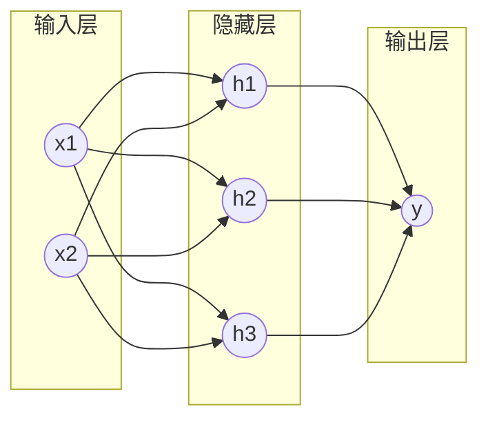
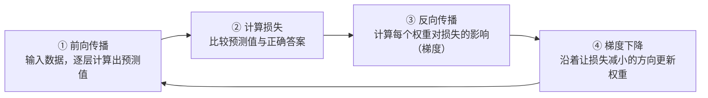
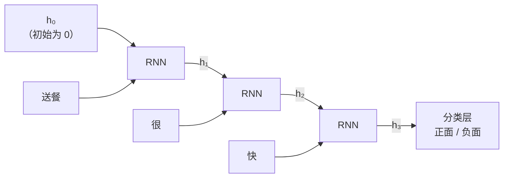
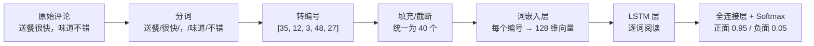
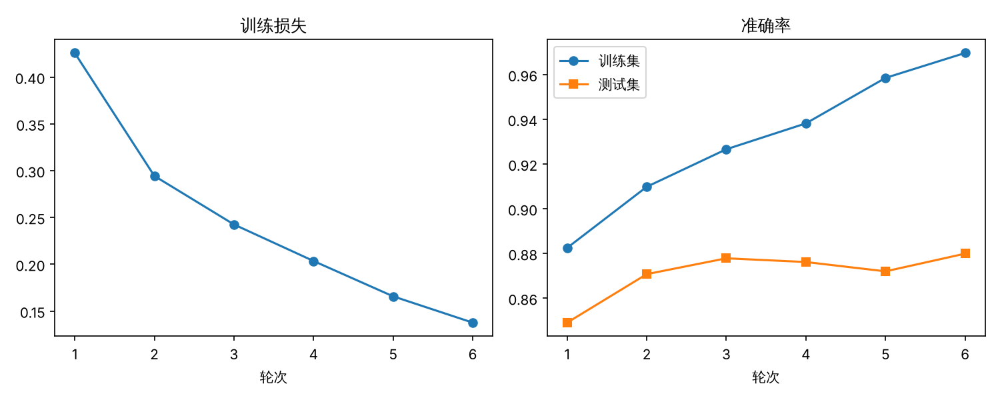
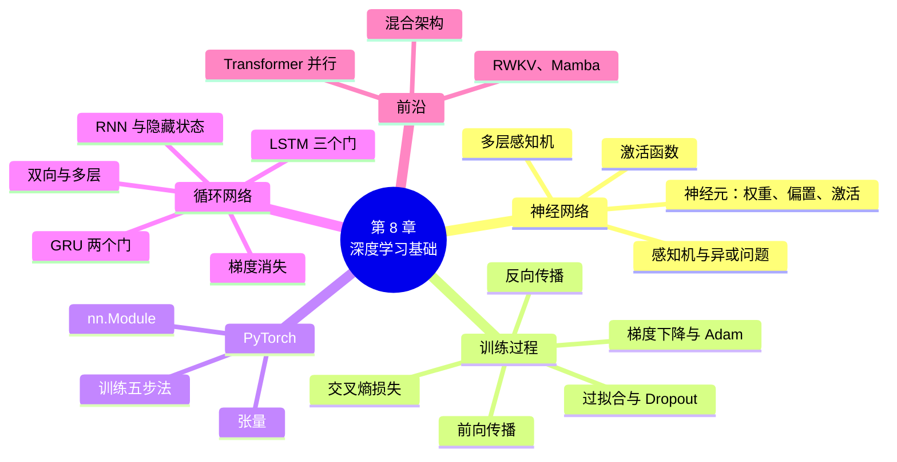

# 第 8 章 深度学习基础：神经网络、RNN 与 LSTM

!!! abstract "本章学时"
    理论 5 学时 · 实验 1 学时（本章共 3 个实验：2 个基础实验 ★，1 个拓展实验 ☆，教师可任选）

## 学习目标

学完本章，你应该能够：

1. **说出**深度学习与传统机器学习的区别，理解“表示学习”的含义；
2. **解释**神经元、权重、偏置、激活函数的作用，说明单层感知机为什么解决不了“异或”问题；
3. **描述**神经网络的训练过程：前向传播、损失函数、反向传播、梯度下降，理解轮次、批大小、学习率、过拟合等概念；
4. **使用** PyTorch 的张量、模型类和训练五步法搭建简单的神经网络；
5. **说明**循环神经网络处理序列的方式，以及它存在的梯度消失问题；
6. **解释** LSTM 和 GRU 中“门”的作用，并能根据任务选择合适的循环网络；
7. **完成**用 LSTM 进行中文情感分类的实验，并与第 6 章的传统方法比较。

## 情景导入

在第 6 章，我们用“TF-IDF + 逻辑回归”给外卖评论分类，准确率达到了 88% 左右。不过，回顾那个流程，你会发现一个问题：**特征是人设计的**。我们决定了用词袋表示句子，决定了要不要加二元词组，决定了用哪个停用词表。模型只负责在这些特征上“打分”。

词袋模型有一个天生的缺陷：它不关心词的顺序。“不是很好吃”和“很不好吃”分词后几乎是同样的几个词，可意思相差很远；“价格不便宜，但是真的好吃”里，先抑后扬的语气，词袋也很难体会。

人读句子是从左到右、边读边理解的，读到“但是”时，会自动把前面的抱怨“降权”。能不能让计算机也像这样**按顺序读句子，并且自己学会从文字中提取有用的特征**？这就是本章要学习的**深度学习**和**循环神经网络**。

学完本章，你会亲手写出一个能“按顺序读句子”的 LSTM 情感分类器。更重要的是，本章的神经网络、梯度下降和反向传播，是第 9 章 Transformer 和大模型的基础：今天的大模型虽然有几千亿个参数，但它们的训练原理和本章的小网络是完全一样的。

## 8.1 从机器学习到深度学习

### 8.1.1 特征工程的烦恼

传统机器学习完成一个任务，一般分三步：

1. **特征工程**：由人设计规则，把原始数据转换成数字特征，例如词袋、TF-IDF、情感词计数；
2. **训练模型**：用朴素贝叶斯、逻辑回归、支持向量机等算法学习特征和标签之间的关系；
3. **预测**：把新数据按同样的方法转换成特征，交给模型预测。

其中最费力、最依赖经验的是第一步。做情感分析时，你要想到否定词、程度副词、表情符号；换成新闻分类，又要重新考虑哪些词有区分度。特征设计得好，模型才能好；特征没设计到的信息，模型永远看不到。

### 8.1.2 深度学习：让模型自己学习特征

**深度学习**（Deep Learning）是机器学习的一个分支，它使用**多层神经网络**，直接从原始数据（或者很简单的表示，比如词的编号）中自动学习特征。网络的前几层学习简单的特征，后面的层把简单特征组合成更复杂、更抽象的特征。这种能力叫做**表示学习**（Representation Learning）。

拿图像识别打个比方：第一层神经元学会识别边缘和颜色，第二层把边缘组合成角和圆弧，第三层组合出眼睛、鼻子，最后一层判断“这是一只猫”。在语言上也是类似的：低层学到词的含义，中层学到短语和搭配（如“不 + 好吃”），高层学到整句话的情感和意图。

| 对比项 | 传统机器学习 | 深度学习 |
|---|---|---|
| 特征从哪里来 | 人工设计 | 模型自动学习 |
| 需要的数据量 | 几千条就能用 | 通常需要更多数据，或者在预训练模型基础上微调 |
| 计算资源 | 普通 CPU 即可 | 大模型需要 GPU，小模型 CPU 也能跑 |
| 可解释性 | 较好，能看到每个词的权重 | 较差，常被称为“黑箱” |
| 典型模型 | 朴素贝叶斯、逻辑回归、SVM、CRF | 多层感知机、CNN、RNN、LSTM、Transformer |

“深度”二字指的是网络的**层数多**。今天的大语言模型通常有几十层甚至上百层 Transformer 结构。

### 8.1.3 深度学习改变 NLP 的历程

| 时间 | 事件 | 意义 |
|---|---|---|
| 2003 年 | 本吉奥（Bengio）提出神经网络语言模型 | 第一次用神经网络预测下一个词，并学到了词向量 |
| 2013 年 | Word2Vec 发布（第 5 章） | 词向量被广泛使用，深度学习进入 NLP 主流 |
| 2014 年 | 序列到序列（Seq2Seq）模型、GRU 提出 | 用两个循环网络完成机器翻译 |
| 2015 年 | 注意力机制用于机器翻译 | 解决长句翻译效果差的问题（第 9 章） |
| 2016 年 | 谷歌神经机器翻译系统上线 | 基于 LSTM，翻译质量大幅提升 |
| 2017 年 | Transformer 提出 | 用注意力取代循环结构，开启大模型时代（第 9 章） |
| 2018 年以后 | BERT、GPT 系列、国产大模型 | 预训练 + 微调 / 提示成为主流 |

可以看到，循环神经网络（RNN、LSTM、GRU）是 2014–2017 年 NLP 的主角。现在大模型的主流架构已经换成了 Transformer，但学习循环网络仍然很有必要：它能帮助我们理解“序列建模”的思想和难点，理解 Transformer 为什么要那样设计；在资源受限的手机、嵌入式设备上，小型 LSTM 依然在语音唤醒、输入法联想等场景中使用；而且本章最后会看到，循环结构的思想正在新一代模型中“复活”。

## 8.2 神经网络基础

### 8.2.1 从生物神经元到人工神经元

人的大脑大约有 860 亿个神经元。每个神经元通过“树突”接收其他神经元传来的信号，在细胞体中汇总，如果信号足够强，就通过“轴突”把信号传给下一个神经元。

**人工神经元**是对这一过程的数学模仿。它接收若干个输入 \(x_1, x_2, \dots, x_n\)，每个输入乘上一个**权重** \(w_i\)，加起来再加上一个**偏置** \(b\)，最后通过一个**激活函数** \(f\) 得到输出：

$$
y = f(w_1x_1 + w_2x_2 + \dots + w_nx_n + b) = f(\mathbf{w}\cdot\mathbf{x} + b)
$$

- **权重**表示每个输入的重要程度。权重大的输入对结果影响大，权重为负的输入起抑制作用；
- **偏置**相当于“门槛”，决定神经元多容易被激活；
- **激活函数**决定输出的形式，后面单独介绍。

举一个生活中的例子：你决定周末要不要去看电影，会考虑三个因素：有没有好电影（\(x_1\)）、有没有朋友一起去（\(x_2\)）、天气好不好（\(x_3\)）。你很看重电影本身，权重 \(w_1=0.6\)；比较在意朋友，\(w_2=0.3\)；不太在意天气，\(w_3=0.1\)。偏置 \(b=-0.5\) 表示你本来有点懒。如果有好电影（1）、没有朋友（0）、天气好（1），加权和为 \(0.6+0+0.1-0.5=0.2>0\)，那就去看。这个“做决定”的过程就是一个神经元。

**学习**，就是根据大量的例子，自动找到合适的权重和偏置。

### 8.2.2 感知机及其局限

最早的人工神经网络是 1957 年罗森布拉特（Rosenblatt）提出的**感知机**（Perceptron）。它只有一个神经元，激活函数是**阶跃函数**：加权和大于 0 输出 1，否则输出 0。

感知机的学习规则非常朴素：**预测对了，不动；预测错了，就把权重往正确的方向调一点**：

$$
w_i \leftarrow w_i + \eta\,(y - \hat{y})\,x_i,\qquad b \leftarrow b + \eta\,(y-\hat{y})
$$

其中 \(y\) 是正确答案，\(\hat{y}\) 是预测值，\(\eta\)（读作“伊塔”）是**学习率**，控制每次调整的幅度。

感知机可以学会逻辑“与”和“或”运算，但学不会“异或”（XOR，两个输入不同时输出 1，相同时输出 0）。原因可以从几何上理解：感知机本质上是在平面上画**一条直线**，把输出为 1 的点和输出为 0 的点分开。

| \(x_1\) | \(x_2\) | 与 | 或 | 异或 |
|---|---|---|---|---|
| 0 | 0 | 0 | 0 | 0 |
| 0 | 1 | 0 | 1 | 1 |
| 1 | 0 | 0 | 1 | 1 |
| 1 | 1 | 1 | 1 | 0 |

把四个点画在坐标纸上就会发现：“与”只有右上角的点是 1，一条直线就能把它切出来；“或”只有左下角是 0，也能用直线分开；而“异或”的两个 1 在对角线的两端，两个 0 在另一条对角线的两端，**无论怎么画一条直线都分不开**。这类问题称为**线性不可分**问题。

1969 年，明斯基（Minsky）在书中指出了感知机的这个局限，神经网络研究因此陷入了十几年的低谷。实验 8-1 中，你将亲眼看到感知机在“异或”上反复调整却始终学不会。

### 8.2.3 多层神经网络

解决办法是**增加层数**。把多个神经元排成一层，再把多层连接起来，就得到了**多层感知机**（Multi-Layer Perceptron，MLP），也叫**前馈神经网络**或**全连接神经网络**。



- **输入层**：接收原始数据，不做计算；
- **隐藏层**：中间的计算层，可以有一层或多层，“隐藏”是因为我们看不到它的“正确答案”；
- **输出层**：给出最终结果，分类任务中通常每个类别对应一个输出神经元。

隐藏层的作用可以理解为“**换一个角度看问题**”。在“异或”问题上，隐藏层的一个神经元可以学会“或”，另一个学会“与非”，输出层再把两者做“与”，就得到了“异或”。原本用一条直线分不开的四个点，经过隐藏层变换到新的坐标空间后，就能用直线分开了。

理论上可以证明：只要隐藏层的神经元足够多，一个两层的神经网络就能以任意精度逼近任何连续函数，这叫做**万能逼近定理**。但在实践中，“又深又窄”的网络往往比“又浅又宽”的网络学得更好，这正是“深度”学习的由来。

### 8.2.4 激活函数

如果没有激活函数，每一层都只是“乘权重再相加”的线性运算，多层叠加以后仍然是线性运算，和一层没有区别，也就解决不了“异或”这样的问题。**激活函数为网络引入了非线性**，使深层网络能表达复杂的关系。

| 激活函数 | 公式 | 输出范围 | 特点与用途 |
|---|---|---|---|
| **Sigmoid** | \(\sigma(z)=\dfrac{1}{1+e^{-z}}\) | 0 到 1 | 输出可当作概率，常用于二分类输出层和 LSTM 的“门”；输入很大或很小时梯度接近 0 |
| **Tanh** | \(\tanh(z)=\dfrac{e^z-e^{-z}}{e^z+e^{-z}}\) | -1 到 1 | 以 0 为中心，常用于 RNN 的隐藏状态 |
| **ReLU** | \(\max(0, z)\) | 0 到正无穷 | 计算简单，正区间梯度恒为 1，训练快，是隐藏层最常用的激活函数 |
| **GELU / SwiGLU** | 较复杂 | 近似 ReLU 但更平滑 | BERT、GPT、Qwen、Llama 等大模型中常用 |
| **Softmax** | \(\dfrac{e^{z_i}}{\sum_j e^{z_j}}\) | 0 到 1，且总和为 1 | 用于多分类输出层，把得分变成各类别的概率 |

Softmax 值得多说几句。假设一个三分类的新闻分类器，输出层给“体育、财经、科技”的原始得分是 \(2.0, 1.0, 0.1\)。Softmax 先对每个得分求 \(e\) 的幂，得到约 \(7.39, 2.72, 1.11\)，再各自除以总和 \(11.22\)，得到概率约 \(0.66, 0.24, 0.10\)。得分越高，概率越大，而且三者加起来正好是 1。大模型在生成每一个字时，也是用 Softmax 把几万个候选词的得分变成概率，再从中挑选（第 10 章）。

### 8.2.5 神经网络如何学习

训练神经网络就是**不断调整权重，让预测越来越准**。这个过程包括四个环节，循环往复：



**① 前向传播**

数据从输入层进入，逐层做“加权求和 + 激活函数”的计算，最后在输出层得到预测值。

**② 损失函数**

**损失函数**（Loss Function）衡量预测值和正确答案之间的差距，损失越小，说明预测越准。

- **均方误差**（MSE）：预测值与真实值之差的平方的平均，常用于预测房价、温度等数值的**回归**任务；
- **交叉熵损失**（Cross-Entropy）：用于**分类**任务。如果正确类别的预测概率是 \(p\)，交叉熵损失就是 \(-\log p\)。\(p\) 越接近 1，损失越接近 0；\(p\) 越小，损失越大，而且增长得很快。

例如，一条评论实际是正面，模型预测正面的概率为 0.9，损失是 \(-\log 0.9\approx0.105\)；如果模型只给出 0.1，损失就是 \(-\log 0.1\approx2.303\)，惩罚大了二十多倍。交叉熵“对自信的错误惩罚特别重”，这让模型很快纠正明显的错误。大模型预训练时用的损失函数也是交叉熵：预测下一个词，正确的词概率越高越好。

**③ 梯度与反向传播**

知道了损失有多大，下一步要知道：**每个权重应该往哪个方向调、调多少？** 这要用到**梯度**（Gradient）。

梯度是损失对每个权重的**偏导数**，直观含义是：“这个权重增加一点点，损失会增加多少”。如果梯度为正，说明增大权重会让损失变大，那就应该减小它；如果梯度为负，就应该增大它；梯度的绝对值越大，说明这个权重对损失的影响越大。

神经网络有很多层，最后一层的权重直接影响输出，梯度好算；前面层的权重是通过后面的层间接影响输出的，怎么算呢？**反向传播**（Backpropagation）算法利用微积分中的**链式法则**，从输出层开始，一层一层往回计算梯度，就像“追责”：输出错了，先算出最后一层每个权重该承担多少“责任”，再把责任按连接的权重分摊给前一层，一直传回第一层。

反向传播在 1986 年由辛顿（Hinton）等人推广，是深度学习的基石。好消息是，在 PyTorch 等框架中，**反向传播是自动完成的**，只需要一行 `loss.backward()`。实验 8-1 中，我们会用 NumPy 手写一次反向传播，体会它的原理；之后就交给框架。

**④ 梯度下降**

求出梯度后，把每个权重沿着**梯度的反方向**移动一小步：

$$
w \leftarrow w - \eta \cdot \frac{\partial L}{\partial w}
$$

这就是**梯度下降**（Gradient Descent）。可以想象你蒙着眼睛站在山坡上，要走到山谷最低处：你用脚感受哪个方向最陡（梯度），然后往下坡方向迈一小步（学习率），重复很多次，就能慢慢走到谷底（损失最小）。

**学习率**是最重要的超参数之一：太大，步子迈得太大，可能越过谷底，在两边来回震荡，甚至越走越高；太小，下山太慢，训练很久都没有进展。常用的取值在 0.0001 到 0.01 之间。

实际训练中很少用最原始的梯度下降，而是用它的改进版本：

| 优化器 | 特点 |
|---|---|
| **SGD**（随机梯度下降） | 每次只用一小批数据计算梯度，速度快，带有随机性 |
| **SGD + 动量** | 像滚下山的球一样带有“惯性”，减少来回震荡 |
| **Adam** | 自动为每个参数调整步长，对学习率不太敏感，是最常用的默认选择 |
| **AdamW** | Adam 的改进版，训练 BERT、GPT 等大模型时的标准选择 |

### 8.2.6 训练中的常用概念

| 概念 | 含义 | 本章实验中的取值 |
|---|---|---|
| **批**（batch） | 每次更新参数时使用的一小组样本 | 64 条评论 |
| **批大小**（batch size） | 一批样本的数量。太大占内存，太小训练不稳定 | 64 |
| **轮次**（epoch） | 把全部训练数据完整地用一遍，称为一轮 | 6 轮 |
| **迭代**（iteration / step） | 用一批数据更新一次参数 | 每轮约 150 次 |
| **超参数** | 训练前由人设定、不由模型学习的参数 | 学习率、批大小、轮次、隐藏层大小 |
| **参数** | 由模型学习得到的权重和偏置 | 约 73 万个 |

**过拟合**是深度学习中最常见的问题。第 6 章已经介绍过：模型在训练集上表现很好，在测试集上却变差，就像学生把练习题的答案背下来了，换一道题就不会。神经网络的参数很多，“背答案”的能力很强，更容易过拟合。常见的应对方法有：

- **增加数据**：数据越多越难背下来，也可以用同义词替换、回译等方法进行**数据增强**；
- **Dropout**（随机失活）：训练时每次随机“关掉”一部分神经元（比如 30%），迫使网络不依赖少数几个神经元，相当于同时训练了许多个小网络；
- **提前停止**（Early Stopping）：在训练过程中持续观察验证集上的表现，一旦不再提升就停止训练；
- **正则化**（权重衰减）：在损失中加入对过大权重的惩罚，让模型更“简单”；
- **减小模型**：减少层数或神经元数量。

判断是否过拟合，最直观的方法是画出**训练曲线**：横轴是轮次，纵轴是训练集和验证集的准确率（或损失）。如果训练集准确率一路上升，验证集准确率却停滞甚至下降，两条曲线越拉越开，就说明过拟合了。实验 8-2 中你会看到这样一张图。

## 8.3 深度学习框架 PyTorch

### 8.3.1 为什么需要深度学习框架

实验 8-1 用 NumPy 手写一个两层网络，前向传播和反向传播加起来十几行代码，还要自己推导每一层的导数。如果网络有几十层、包含各种复杂结构，手写就几乎不可能了。**深度学习框架**帮我们做了三件事：

1. **自动求导**：只需写出前向传播，框架自动完成反向传播；
2. **GPU 加速**：把计算放到显卡上并行执行，速度可以提高几十倍；
3. **现成的组件**：常用的网络层、损失函数、优化器都已实现好，像搭积木一样调用。

| 框架 | 开发者 | 特点 |
|---|---|---|
| **PyTorch** | Meta（现由 PyTorch 基金会管理） | 简洁灵活，学术界和工业界最主流，Hugging Face Transformers 默认基于它 |
| **TensorFlow / Keras** | 谷歌 | 早期工业部署广泛，Keras 接口适合入门 |
| **JAX** | 谷歌 | 高性能科学计算，谷歌内部训练大模型使用 |
| **飞桨 PaddlePaddle** | 百度 | 国产开源框架，中文文档和产业案例丰富 |
| **昇思 MindSpore** | 华为 | 国产开源框架，与昇腾 AI 芯片深度适配 |

本书使用 PyTorch。在国内，飞桨和昇思也有大量应用，特别是在需要使用国产芯片的场景中。它们的基本概念和 PyTorch 相通，学会一个，再学另一个会容易很多。

### 8.3.2 PyTorch 的核心概念

**张量**（Tensor）是 PyTorch 中最基本的数据结构，可以理解为“能放到 GPU 上、能自动求导的多维数组”，用法和 NumPy 数组非常相似。

| 维度 | 名称 | NLP 中的例子 |
|---|---|---|
| 0 维 | 标量 | 一个损失值 |
| 1 维 | 向量 | 一个词的词向量，形状 `[128]` |
| 2 维 | 矩阵 | 一句话的所有词向量，形状 `[句子长度, 128]` |
| 3 维 | 三维张量 | 一批句子，形状 `[批大小, 句子长度, 128]` |

在 NLP 中，最常见的张量形状是 `[批大小, 序列长度, 向量维度]`。阅读深度学习代码时，**时刻关注张量的形状**，是避免出错的最好习惯。

**模型**通过继承 `nn.Module` 类来定义，包括两部分：在 `__init__` 中定义网络有哪些层，在 `forward` 中定义数据如何经过这些层：

```python
import torch.nn as nn

class SimpleClassifier(nn.Module):
    def __init__(self):
        super().__init__()
        self.hidden = nn.Linear(100, 32)    # 全连接层：100 个输入 -> 32 个神经元
        self.output = nn.Linear(32, 2)      # 输出层：2 个类别

    def forward(self, x):
        h = torch.relu(self.hidden(x))      # 隐藏层 + ReLU 激活
        return self.output(h)               # 输出各类别的得分
```

常用的网络层有：

| 网络层 | 作用 |
|---|---|
| `nn.Linear` | 全连接层，做“加权求和 + 偏置” |
| `nn.Embedding` | 词嵌入层，把词的编号变成词向量 |
| `nn.RNN` / `nn.LSTM` / `nn.GRU` | 循环层，处理序列 |
| `nn.Dropout` | 随机失活，防止过拟合 |
| `nn.CrossEntropyLoss` | 交叉熵损失（内部已包含 Softmax） |

### 8.3.3 训练五步法

无论模型多复杂，PyTorch 的训练循环几乎都是下面这五步，建议牢记：

```python
for epoch in range(轮次):
    for 一批数据, 一批标签 in 训练数据:
        optimizer.zero_grad()              # ① 清空上一批留下的梯度
        预测 = model(一批数据)              # ② 前向传播
        loss = loss_fn(预测, 一批标签)       # ③ 计算损失
        loss.backward()                    # ④ 反向传播，自动求出所有梯度
        optimizer.step()                   # ⑤ 优化器根据梯度更新参数
```

第 ① 步容易被忘记：PyTorch 默认会把每次求出的梯度**累加**起来，如果不清空，这一批的梯度就会和上一批的混在一起。

评估模型时，要用 `model.eval()` 切换到评估模式（关闭 Dropout 等训练时才用的操作），并用 `with torch.no_grad():` 关闭梯度计算，以节省内存、加快速度。

## 8.4 循环神经网络

### 8.4.1 为什么需要处理序列的网络

前面介绍的全连接网络有一个问题：**输入的长度是固定的**。而语言是**序列**，句子有长有短，而且词的**顺序**非常重要：“狗咬人”和“人咬狗”用的字完全一样，意思却截然不同。

一种简单的办法是把句子中所有词向量取平均，变成一个固定长度的向量，但这样就丢掉了顺序信息，回到了词袋模型的老问题。我们需要一种能够**逐个读入词语、并且记住前面读过的内容**的网络，这就是**循环神经网络**（Recurrent Neural Network，RNN）。

### 8.4.2 RNN 的结构

RNN 的核心思想是：**在读每个词时，把“当前的词”和“之前读到的内容”结合起来，形成新的理解**。这份“之前读到的内容”被保存在一个向量中，称为**隐藏状态**（hidden state），记作 \(h\)，可以理解为网络的“短期记忆”。

在第 \(t\) 个时刻（读第 \(t\) 个词），RNN 做的计算是：

$$
h_t = \tanh(W x_t + U h_{t-1} + b)
$$

- \(x_t\)：第 \(t\) 个词的词向量；
- \(h_{t-1}\)：上一时刻的隐藏状态，也就是“读到上一个词为止的理解”；
- \(W\)、\(U\)、\(b\)：权重和偏置，**每个时刻共用同一套参数**；
- \(h_t\)：新的隐藏状态，融合了当前词和之前所有内容的信息。

把 RNN 按时间“展开”，可以更清楚地看到这个过程。以“送餐很快”为例：



图中的三个“RNN”方框其实是**同一个网络**，只是在不同时刻被重复使用，这就是“循环”的含义。正因为参数共享，RNN 可以处理任意长度的句子：句子有 3 个词就循环 3 次，有 100 个词就循环 100 次，参数数量不变。

读完最后一个词后，隐藏状态 \(h_3\) 汇集了整句话的信息，把它送入一个全连接层，就可以完成情感分类。

这和人读句子的过程很像：读到“送餐”，你知道在说外卖配送；读到“很”，你预期后面是一个评价；读到“快”，你得出结论：这是一条正面评价。

### 8.4.3 RNN 的几种用法

根据输入和输出的对应关系，RNN 可以完成不同类型的任务：

| 模式 | 输入 → 输出 | NLP 任务举例 |
|---|---|---|
| **多对一** | 一个序列 → 一个结果 | 文本分类、情感分析：读完整句后输出一个类别 |
| **多对多（等长）** | 每个输入对应一个输出 | 序列标注：分词、词性标注、命名实体识别（第 7 章的 BIO 标注），每个字输出一个标签 |
| **一对多** | 一个输入 → 一个序列 | 看图说话：输入一张图片，生成一句描述 |
| **多对多（不等长）** | 一个序列 → 另一个序列 | 机器翻译、文本摘要：先用一个 RNN 读完原文（编码器），再用另一个 RNN 逐词生成译文（解码器），即**序列到序列**（Seq2Seq）模型，第 10 章详细介绍 |

此外，RNN 还可以作为**语言模型**：每读一个词，就预测下一个词是什么。把预测出的词再作为下一步的输入，就能一个词一个词地“写”出整段文本。这和今天 GPT 类大模型生成文字的方式是一样的，只是 GPT 把 RNN 换成了 Transformer。

### 8.4.4 RNN 的致命弱点：梯度消失

理论上，RNN 的隐藏状态能够记住整个序列的信息。但实际上，**普通 RNN 很难记住较远的内容**。

看这样一条评论：“这家店我之前点过很多次，包装一直很用心，配送也算准时，菜量也还可以，但是这次的菜实在太咸了，完全没法吃”。决定情感的关键在后半句。反过来，有些句子的关键信息在开头，比如“难吃，……（后面几十个字的描述）”，RNN 读到结尾时可能已经“忘了”开头的“难吃”。

原因在于训练时的**梯度消失**（Vanishing Gradient）。反向传播时，误差要从最后一个时刻一步一步传回到前面的时刻，每传一步，梯度都要乘上一个和权重、激活函数导数有关的系数。Tanh 函数的导数最大为 1，通常小于 1。如果每一步都乘上一个比 1 小的数，比如 0.5，传 10 步后梯度就变成原来的 \(0.5^{10}\approx0.001\)，传 50 步后几乎为 0。

这意味着：**距离结尾越远的词，对参数更新的影响越小**，网络根本“学不到”远处的词和结果之间的关系。反过来，如果每一步乘的数大于 1，梯度会越来越大，导致**梯度爆炸**，训练直接崩溃。梯度爆炸比较容易处理，常用**梯度裁剪**（Gradient Clipping），给梯度设一个上限；梯度消失则需要改造网络结构。

实验 8-3 中，你会亲手测量梯度消失：当序列长度为 50 时，普通 RNN 传回第一个词的梯度还不到最后一个词的一万亿分之一。

## 8.5 LSTM 与 GRU

### 8.5.1 LSTM 的核心思想：门控与记忆细胞

为了解决梯度消失，1997 年，霍克赖特（Hochreiter）和施密德胡伯（Schmidhuber）提出了**长短期记忆网络**（Long Short-Term Memory，LSTM）。它的名字有点拗口，意思是“能保持较长时间的短期记忆”。

LSTM 的关键创新有两个：

1. **记忆细胞**（cell state，记作 \(c\)）：在隐藏状态之外，增加一条专门的“记忆传送带”，信息可以沿着它几乎不变地传很远；
2. **门**（gate）：用三个“门”来控制信息的写入、保留和读出。每个门都是一个 Sigmoid 神经元，输出 0 到 1 之间的数，0 表示“完全关闭”，1 表示“完全打开”。

可以把 LSTM 的记忆细胞想象成一个**笔记本**，三个门决定怎么用这个笔记本：

| 门 | 作用 | 比喻 | 情感分析中的例子 |
|---|---|---|---|
| **遗忘门** \(f_t\) | 决定笔记本上哪些旧内容要擦掉 | 橡皮擦 | 读到“但是”时，擦掉前面“包装用心”的正面印象 |
| **输入门** \(i_t\) | 决定当前的新信息有多少写进笔记本 | 铅笔 | 读到“太咸了”时，把强烈的负面信息写进去 |
| **输出门** \(o_t\) | 决定从笔记本中读出多少，作为当前的隐藏状态 | 阅读灯 | 需要做判断时，把记住的负面信息读出来 |

### 8.5.2 LSTM 的计算过程

在每个时刻，LSTM 依次完成以下计算（\(\sigma\) 表示 Sigmoid，\(\odot\) 表示对应位置相乘）：

$$
\begin{aligned}
f_t &= \sigma(W_f x_t + U_f h_{t-1} + b_f) &\text{（遗忘门：保留多少旧记忆）}\\
i_t &= \sigma(W_i x_t + U_i h_{t-1} + b_i) &\text{（输入门：写入多少新信息）}\\
\tilde{c}_t &= \tanh(W_c x_t + U_c h_{t-1} + b_c) &\text{（候选记忆：新信息的内容）}\\
c_t &= f_t \odot c_{t-1} + i_t \odot \tilde{c}_t &\text{（更新记忆细胞）}\\
o_t &= \sigma(W_o x_t + U_o h_{t-1} + b_o) &\text{（输出门：读出多少）}\\
h_t &= o_t \odot \tanh(c_t) &\text{（新的隐藏状态）}
\end{aligned}
$$

公式看起来多，但核心只有一行：

$$
c_t = f_t \odot c_{t-1} + i_t \odot \tilde{c}_t
$$

**新记忆 = 保留的旧记忆 + 写入的新信息**。

这里用的是**加法**，而不是 RNN 中层层相乘的变换。当遗忘门接近 1 时，旧记忆几乎原封不动地传到下一时刻，梯度也就能沿着记忆细胞这条“高速公路”顺畅地传回很远的地方，而不会在每一步被大幅缩小。这就是 LSTM 能缓解梯度消失的原因。

这里有一个容易忽视的细节：门是**学**出来的。刚开始训练时，门的开合程度是随机的，遗忘门大约在 0.5 左右，梯度仍然会衰减；只有当网络学会“该记的时候把遗忘门打开”，长距离记忆才能真正发挥作用。实验 8-3 会让你看到：如果一开始就把遗忘门“调成打开”，LSTM 能轻松记住 60 步之前的信息；而默认设置的 LSTM 在同样的训练量下，序列长度为 10 时能学会，长度为 30 时就学不会了。这也是工程实践中常把遗忘门偏置初始化为 1 或更大的原因。

### 8.5.3 GRU：简化版的 LSTM

2014 年，Kyunghyun Cho 等人提出了**门控循环单元**（Gated Recurrent Unit，GRU）。它把 LSTM 的三个门简化为两个：

- **更新门** \(z_t\)：同时承担遗忘门和输入门的作用，决定“保留多少旧状态、加入多少新信息”，两者此消彼长；
- **重置门** \(r_t\)：决定在计算新信息时，参考多少过去的状态。

GRU 也去掉了单独的记忆细胞，直接在隐藏状态上做门控更新。它的参数比 LSTM 少约四分之一，训练更快，在很多任务上效果和 LSTM 相当。

### 8.5.4 双向与多层循环网络

普通 RNN 从左往右读，第 \(t\) 个位置只知道它**左边**的内容。可是理解一个词，常常也需要看**右边**的内容。比如“苹果很好吃”和“苹果发布了新手机”，要判断“苹果”是水果还是公司，得看后面的词。

**双向循环网络**（Bidirectional RNN）用两个循环网络，一个从左往右读，一个从右往左读，把两个方向的隐藏状态拼接起来，每个位置就同时掌握了上下文两侧的信息。双向 LSTM（BiLSTM）是序列标注任务的经典模型，第 7 章提到的 **BiLSTM-CRF** 就是在双向 LSTM 上加一层 CRF，在 BERT 出现之前一直是命名实体识别的主流方法。

注意：双向网络需要事先看到整个句子，所以适合分类、标注这类“理解”任务，**不能用于逐词生成文本**，因为生成时还不知道后面的词是什么。

此外，还可以把多个循环层叠起来，下一层的输入是上一层每个时刻的隐藏状态，形成**多层（堆叠）循环网络**，以学习更抽象的特征。在 PyTorch 中，只需设置 `nn.LSTM(..., num_layers=2, bidirectional=True)` 即可。

### 8.5.5 三种循环网络的比较

| 对比项 | RNN | LSTM | GRU |
|---|---|---|---|
| 提出时间 | 1980 年代 | 1997 年 | 2014 年 |
| 门的数量 | 无 | 3 个（遗忘、输入、输出） | 2 个（更新、重置） |
| 状态 | 隐藏状态 \(h\) | 隐藏状态 \(h\) + 记忆细胞 \(c\) | 隐藏状态 \(h\) |
| 参数量（相同隐藏层大小） | 1 份 | 约 4 份 | 约 3 份 |
| 长距离记忆 | 差 | 好 | 好 |
| 训练速度 | 快 | 较慢 | 中等 |
| 适用场景 | 短序列、教学演示 | 长文本、对效果要求高 | 数据较少、追求速度 |

在实际项目中，可以先用 GRU 或 LSTM 快速搭建基线；如果数据量足够、资源允许，再考虑第 9 章的 Transformer 和预训练模型。

## 8.6 用循环网络完成 NLP 任务

### 8.6.1 文本分类的完整流程

用 LSTM 做情感分类，数据要经过以下处理流程（实验 8-2 将完整实现）：



几个关键环节说明如下。

**建立词表**：统计训练集中出现过的词，给每个词分配一个编号。出现次数太少的词（如只出现 1 次）通常不放入词表，以减少噪声和参数量。另外要预留两个特殊编号：

- `<pad>`（填充符）：编号 0，用来把短句补齐到统一长度；
- `<unk>`（未登录词）：编号 1，测试时遇到词表中没有的词，统一用它代替。

**填充与截断**：同一批数据必须组成一个规整的张量，所以要把句子统一成相同长度：短的在后面补 0，长的截掉多余的部分。长度一般参考数据中大多数句子的长度来设定，例如外卖评论分词后 93% 不超过 40 个词，实验 8-2 就取 40。

**词嵌入层**：`nn.Embedding` 本质上是一张“查找表”，第 \(i\) 行就是编号为 \(i\) 的词的词向量。它的参数一开始是随机的，随着训练不断调整，最终学到对当前任务有用的词向量。也可以用第 5 章训练好的 Word2Vec 词向量来初始化，这叫做使用**预训练词向量**，数据较少时效果更好。

**取最后的隐藏状态**：LSTM 读完整句后的隐藏状态汇集了全句信息，送入全连接层分类。注意，如果句子后面有填充的 0，要让网络在真实的最后一个词处停下，PyTorch 中用 `pack_padded_sequence` 实现。

### 8.6.2 序列标注：BiLSTM-CRF

命名实体识别要给每个字输出一个 BIO 标签。BiLSTM 为每个字计算出包含上下文信息的隐藏状态，再通过全连接层得到每个标签的得分。但如果每个字独立选得分最高的标签，可能出现“O 后面直接跟 I-PER”这样不合规则的序列。在 BiLSTM 之上加一层 **CRF**（条件随机场），它会学习标签之间的转移规律（比如 B-PER 后面很可能是 I-PER，O 后面不可能是 I-PER），从整体上选出最合理的标签序列。

### 8.6.3 文本生成：字符级语言模型

把 LSTM 训练成语言模型：输入“床前明月”，让它预测下一个字“光”。在大量古诗上训练后，给它一个开头，它就能一个字一个字地“写诗”。早期的 AI 写诗、写歌词程序很多就是这样实现的。不过，循环网络写出的文字往往前后不连贯，写长了就“跑题”，这正是长距离依赖问题的体现。Transformer 出现后，文本生成的质量才有了质的飞跃。

## 8.7 前沿视窗：循环网络的局限与“复兴”

### 8.7.1 为什么 Transformer 取代了 RNN

LSTM 缓解了梯度消失，但循环网络还有一个根本的问题：**必须按顺序一个词一个词地算**。第 100 个词的计算要等前 99 个词都算完，无法并行。GPU 的强项是同时做成千上万个计算，循环网络却只能“排队”，浪费了大量算力。

2017 年提出的 **Transformer** 换了一种思路：不再按顺序传递记忆，而是让句子中的**每个词直接“看”所有其他词**，计算它们之间的关联程度（这就是**自注意力**机制，第 9 章详细介绍）。这样做的好处是：

- **可以并行**：所有位置同时计算，训练速度大大提高，模型可以做得非常大；
- **没有距离障碍**：第 1 个词和第 1000 个词之间只隔“一步”，不需要层层传递，不存在 RNN 那样的长距离遗忘。

代价是：每个词都要和所有词计算关联，计算量随序列长度的**平方**增长。序列长度翻倍，计算量变为四倍。处理几十万字的长文档时，这个开销非常可观；而且生成文字时，模型要保存之前所有词的信息（称为 KV 缓存），占用大量显存。

### 8.7.2 循环思想的回归：状态空间模型与线性注意力

有趣的是，为了解决 Transformer 的长序列问题，研究者们又把目光投向了循环结构：循环网络每一步只维护一个**固定大小的状态**，无论序列多长，计算量只随长度**线性**增长，生成时也不需要不断变大的缓存。问题只在于如何让它既能并行训练，又能记得住。近几年出现了几类重要的探索：

- **RWKV**：由中国开发者彭博发起的开源项目，名字来自其核心结构的四个参数。它训练时可以像 Transformer 一样并行，推理时像 RNN 一样只保留固定大小的状态，已发展出多个版本，并有社区开发的中文模型；
- **Mamba**：2023 年提出的**选择性状态空间模型**（Selective State Space Model）。它的核心思想和 LSTM 的“门”很像：根据当前输入，动态决定记住什么、忘记什么，同时通过巧妙的算法设计实现了高效的并行训练；
- **线性注意力与混合架构**：把注意力的计算改写成可以递推的形式，使其兼具 Transformer 和 RNN 的优点。目前的趋势是**混合架构**：大部分层使用线性注意力或状态空间结构来高效处理长文本，少数层保留标准注意力来保证精确的信息检索。国内外已有多个开源大模型采用了这样的混合设计。

这些新架构的共同点是：**门控机制**（决定记住什么、忘记什么）仍然是核心。本章学习的 LSTM 思想，在新一代模型中以新的形式继续发挥作用。

!!! tip "给同学们的建议"
    今天做 NLP 应用开发，主流做法是直接使用预训练的 Transformer 模型或大模型 API，一般不需要从零训练 LSTM。但是，本章学到的“训练五步法”、损失函数、过拟合和梯度的概念，会贯穿后面的所有章节：第 9 章微调 BERT、用 LoRA 微调大模型，用的都是同样的训练循环。

## 本章实验

!!! abstract "实验总览"
    | 实验 | 类型 | 建议时长 | 内容 |
    |---|---|---|---|
    | 实验 8-1 | ★ 基础 | 40 分钟 | 用 NumPy 从零实现感知机与两层神经网络 |
    | 实验 8-2 | ★ 基础 | 50 分钟 | 用 PyTorch 搭建 LSTM 情感分类器 |
    | 实验 8-3 | ☆ 拓展 | 45 分钟 | RNN、LSTM、GRU 对比与“记忆力测试” |

    实验代码见配套资源 `labs/ch08/` 目录。所有实验都可以在普通笔记本电脑的 CPU 上完成，实验 8-2 约需 1 分钟，实验 8-3 约需 3 分钟。

### 实验 8-1 ★ 用 NumPy 从零实现感知机与两层神经网络

**实验目的**

1. 实现感知机的学习规则，观察它学会“与”“或”，却学不会“异或”；
2. 用 NumPy 手写一个两层神经网络，亲手实现前向传播、交叉熵损失、反向传播和梯度下降；
3. 理解隐藏层和非线性激活函数的作用。

**实验环境**：实验 1-1 的环境，只需要 NumPy。

**实验步骤与代码**

```python
"""实验 8-1：用 NumPy 从零实现感知机与两层神经网络"""
import numpy as np

# ===== 第 1 部分：感知机学习“与”“或”运算 =====
X = np.array([[0, 0], [0, 1], [1, 0], [1, 1]])
targets = {"与 AND": np.array([0, 0, 0, 1]),
           "或 OR": np.array([0, 1, 1, 1]),
           "异或 XOR": np.array([0, 1, 1, 0])}


def train_perceptron(X, y, lr=0.1, epochs=20):
    w = np.zeros(2)     # 两个权重
    b = 0.0             # 偏置
    for epoch in range(epochs):
        errors = 0
        for xi, yi in zip(X, y):
            pred = 1 if xi @ w + b > 0 else 0     # 阶跃激活函数
            update = lr * (yi - pred)             # 预测对了 update=0，不调整
            w += update * xi
            b += update
            errors += int(update != 0)
        if errors == 0:                            # 一轮全对，提前结束
            return w, b, epoch + 1
    return w, b, None


for name, y in targets.items():
    w, b, ep = train_perceptron(X, y)
    preds = [1 if xi @ w + b > 0 else 0 for xi in X]
    status = f"第 {ep} 轮收敛" if ep else "20 轮仍未收敛"
    print(f"{name}: w={np.round(w, 2)}, b={b:.2f}, 预测={preds}, 目标={y.tolist()}, {status}")

# ===== 第 2 部分：两层神经网络解决“异或” =====
np.random.seed(0)
y = targets["异或 XOR"].reshape(-1, 1)
W1, b1 = np.random.randn(2, 4), np.zeros((1, 4))   # 隐藏层 4 个神经元
W2, b2 = np.random.randn(4, 1), np.zeros((1, 1))   # 输出层 1 个神经元


def sigmoid(z):
    return 1 / (1 + np.exp(-z))


lr = 1.0
for step in range(5001):
    # 前向传播
    h = np.tanh(X @ W1 + b1)
    out = sigmoid(h @ W2 + b2)
    loss = -np.mean(y * np.log(out) + (1 - y) * np.log(1 - out))   # 交叉熵损失
    # 反向传播：从输出往回，逐层求梯度
    d_out = (out - y) / len(X)
    dW2, db2 = h.T @ d_out, d_out.sum(axis=0, keepdims=True)
    d_h = (d_out @ W2.T) * (1 - h ** 2)        # tanh 的导数是 1 - tanh²
    dW1, db1 = X.T @ d_h, d_h.sum(axis=0, keepdims=True)
    # 梯度下降：参数沿梯度的反方向走一小步
    W1 -= lr * dW1; b1 -= lr * db1
    W2 -= lr * dW2; b2 -= lr * db2
    if step % 1000 == 0:
        print(f"第 {step:4d} 步  损失 = {loss:.4f}")

print("两层网络对异或的输出：", np.round(out.ravel(), 3))
print("四舍五入后的预测：  ", (out.ravel() > 0.5).astype(int), "目标：", y.ravel())
```

运行结果：

```text
与 AND: w=[0.2 0.1], b=-0.20, 预测=[0, 0, 0, 1], 目标=[0, 0, 0, 1], 第 6 轮收敛
或 OR: w=[0.1 0.1], b=0.00, 预测=[0, 1, 1, 1], 目标=[0, 1, 1, 1], 第 4 轮收敛
异或 XOR: w=[-0.1  0. ], b=0.10, 预测=[1, 1, 0, 0], 目标=[0, 1, 1, 0], 20 轮仍未收敛
第    0 步  损失 = 0.8381
第 1000 步  损失 = 0.0027
第 2000 步  损失 = 0.0012
第 3000 步  损失 = 0.0007
第 4000 步  损失 = 0.0005
第 5000 步  损失 = 0.0004
两层网络对异或的输出： [0.    0.999 1.    0.001]
四舍五入后的预测：   [0 1 1 0] 目标： [0 1 1 0]
```

**结果解读**

- **感知机学会了“与”和“或”**：“与”在第 6 轮收敛，学到的规则是 \(0.2x_1+0.1x_2-0.2>0\)。验算一下：只有 \(x_1=x_2=1\) 时，\(0.2+0.1-0.2=0.1>0\)，输出 1，其余情况都不大于 0。这条规则就是平面上的一条直线。
- **感知机学不会“异或”**：20 轮之后，它的预测是 `[1, 1, 0, 0]`，四个里错了两个。这不是训练轮次不够，再训练 1000 轮也一样，因为根本不存在一条能分开这四个点的直线。
- **两层网络学会了“异或”**：加入一个有 4 个神经元的隐藏层后，损失从 0.84 降到了 0.0004，四个输出分别接近 0、1、1、0。从损失的变化可以看出梯度下降的典型特点：开始下降很快，之后越来越慢。
- **反向传播的代码只有 4 行**：`d_out` 是输出层的误差；`dW2` 是输出层权重的梯度；`d_h` 把误差通过 `W2` 传回隐藏层，并乘上 tanh 的导数；`dW1` 是隐藏层权重的梯度。这正是“从后往前、逐层追责”的过程。

**常见问题排查**

| 现象 | 原因与解决办法 |
|---|---|
| 两层网络的损失下降很慢或停在 0.69 附近 | 0.69 约等于 \(\ln 2\)，相当于瞎猜。可能是学习率太小或随机初始化不好，换一个随机种子或把学习率调大一些 |
| 出现 `RuntimeWarning: divide by zero in log` | 输出恰好等于 0 或 1，\(\log 0\) 无意义。可以把输出限制在 \([10^{-7}, 1-10^{-7}]\) 之间：`out = np.clip(out, 1e-7, 1 - 1e-7)` |
| `ValueError: shapes not aligned` | 矩阵乘法 `@` 两边的形状不匹配，打印 `X.shape`、`W1.shape` 检查 |

**思考与练习**

1. 把隐藏层的神经元从 4 个改成 1 个、2 个，还能学会“异或”吗？结合 8.2.3 节解释原因。
2. 把学习率分别改成 0.01 和 10，记录第 5000 步的损失，说明学习率对训练的影响。
3. 删掉 `h = np.tanh(...)` 中的 `np.tanh`，即去掉隐藏层的激活函数（同时把反向传播中的 `(1 - h ** 2)` 改为 `1`），网络还能学会“异或”吗？为什么？

**实验报告要求**

提交三种逻辑运算的感知机运行结果截图、两层网络的损失变化截图，以及思考题 1–3 的实验记录和分析。

### 实验 8-2 ★ 用 PyTorch 搭建 LSTM 情感分类器

**实验目的**

1. 掌握文本数据转换为神经网络输入的完整流程：分词、建词表、转编号、填充；
2. 使用 PyTorch 定义包含词嵌入层、LSTM 层和全连接层的模型；
3. 掌握训练五步法，画出训练曲线，识别过拟合；
4. 与第 6 章“TF-IDF + 传统机器学习”的结果进行比较。

**实验环境**：实验 1-1 的环境（已安装 `torch`），另需 `pandas`、`jieba`、`matplotlib`、`scikit-learn`。不需要显卡。**实验数据**：第 6 章使用的外卖评论数据集 `waimai_10k.csv`（11987 条，正面 4000 条，负面 7987 条）。

**实验步骤与代码**

```python
"""实验 8-2：用 PyTorch 搭建 LSTM 情感分类器"""
from collections import Counter
import jieba
import pandas as pd
import torch
import torch.nn as nn
import matplotlib.pyplot as plt
from sklearn.model_selection import train_test_split

jieba.setLogLevel("WARN")
torch.manual_seed(42)
plt.rcParams["font.sans-serif"] = ["WenQuanYi Zen Hei", "SimHei", "PingFang SC"]
MAX_LEN = 40          # 每条评论最多保留 40 个词


# ===== 第 1 部分：准备数据（分词、建词表、转成编号） =====
def load_data():
    df = pd.read_csv("waimai_10k.csv")
    # 与实验 6-2 完全相同的划分方式，方便比较
    X_train, X_test, y_train, y_test = train_test_split(
        df["review"], df["label"], test_size=0.2, random_state=42, stratify=df["label"])
    train_tokens = [jieba.lcut(t) for t in X_train]
    test_tokens = [jieba.lcut(t) for t in X_test]
    counter = Counter(w for ws in train_tokens for w in ws)
    # 0 号留给填充 <pad>，1 号留给未登录词 <unk>
    vocab = {"<pad>": 0, "<unk>": 1}
    for w, c in counter.items():
        if c >= 2:                               # 只保留出现 2 次以上的词
            vocab[w] = len(vocab)
    return train_tokens, test_tokens, list(y_train), list(y_test), vocab


def encode(tokens_list, vocab):
    """把分好词的句子转成等长的编号张量，并记录每句的真实长度"""
    ids = torch.zeros(len(tokens_list), MAX_LEN, dtype=torch.long)
    lengths = []
    for i, ws in enumerate(tokens_list):
        seq = [vocab.get(w, 1) for w in ws][:MAX_LEN]
        ids[i, :len(seq)] = torch.tensor(seq)
        lengths.append(max(len(seq), 1))
    return ids, torch.tensor(lengths)


# ===== 第 2 部分：定义模型 =====
class SentimentRNN(nn.Module):
    def __init__(self, vocab_size, cell="LSTM", emb_dim=128, hidden=128):
        super().__init__()
        self.embedding = nn.Embedding(vocab_size, emb_dim, padding_idx=0)   # 词嵌入层
        rnn_class = {"RNN": nn.RNN, "LSTM": nn.LSTM, "GRU": nn.GRU}[cell]
        self.rnn = rnn_class(emb_dim, hidden, batch_first=True)              # 循环层
        self.fc = nn.Linear(hidden, 2)                                       # 输出层：2 个类别

    def forward(self, ids, lengths):
        x = self.embedding(ids)                  # [批大小, 40] -> [批大小, 40, 128]
        # pack：告诉循环层每句的真实长度，跳过末尾的填充
        packed = nn.utils.rnn.pack_padded_sequence(
            x, lengths, batch_first=True, enforce_sorted=False)
        _, h = self.rnn(packed)
        if isinstance(h, tuple):                 # LSTM 返回 (h, c)，只取 h
            h = h[0]
        return self.fc(h[-1])                    # 用读完整句后的隐藏状态做分类


# ===== 第 3 部分：训练与评估 =====
def evaluate(model, ids, lengths, labels):
    model.eval()
    with torch.no_grad():
        pred = model(ids, lengths).argmax(dim=1)
    return (pred == labels).float().mean().item()


def train_model(cell, data, epochs=6, batch_size=64, verbose=True):
    train_tokens, test_tokens, y_train, y_test, vocab = data
    Xtr, Ltr = encode(train_tokens, vocab)
    Xte, Lte = encode(test_tokens, vocab)
    ytr, yte = torch.tensor(y_train), torch.tensor(y_test)

    torch.manual_seed(42)
    model = SentimentRNN(len(vocab), cell)
    optimizer = torch.optim.Adam(model.parameters(), lr=1e-3)
    loss_fn = nn.CrossEntropyLoss()
    history = {"loss": [], "train_acc": [], "test_acc": []}
    for epoch in range(1, epochs + 1):
        model.train()
        perm = torch.randperm(len(Xtr))           # 每轮打乱训练数据
        total_loss = 0.0
        for i in range(0, len(Xtr), batch_size):
            idx = perm[i:i + batch_size]
            optimizer.zero_grad()                 # 1. 清空上一批的梯度
            logits = model(Xtr[idx], Ltr[idx])    # 2. 前向传播
            loss = loss_fn(logits, ytr[idx])      # 3. 计算损失
            loss.backward()                       # 4. 反向传播求梯度
            optimizer.step()                      # 5. 更新参数
            total_loss += loss.item() * len(idx)
        history["loss"].append(total_loss / len(Xtr))
        history["train_acc"].append(evaluate(model, Xtr, Ltr, ytr))
        history["test_acc"].append(evaluate(model, Xte, Lte, yte))
        if verbose:
            print(f"第 {epoch} 轮  损失 {history['loss'][-1]:.4f}  "
                  f"训练集准确率 {history['train_acc'][-1]:.4f}  "
                  f"测试集准确率 {history['test_acc'][-1]:.4f}")
    return model, history


if __name__ == "__main__":
    data = load_data()
    print("训练集", len(data[0]), "条，测试集", len(data[1]), "条，词表大小", len(data[4]))
    model, history = train_model("LSTM", data)
    print("模型参数量：", sum(p.numel() for p in model.parameters()))

    # 画训练曲线
    fig, (ax1, ax2) = plt.subplots(1, 2, figsize=(10, 4))
    epochs = range(1, len(history["loss"]) + 1)
    ax1.plot(epochs, history["loss"], marker="o")
    ax1.set_title("训练损失"); ax1.set_xlabel("轮次")
    ax2.plot(epochs, history["train_acc"], marker="o", label="训练集")
    ax2.plot(epochs, history["test_acc"], marker="s", label="测试集")
    ax2.set_title("准确率"); ax2.set_xlabel("轮次"); ax2.legend()
    plt.tight_layout(); plt.savefig("lstm_curve.png", dpi=150)

    # ===== 第 4 部分：用训练好的模型预测新评论 =====
    vocab = data[4]
    samples = ["送餐很快，味道也不错", "等了两个小时，饭都凉了",
               "不是很难吃", "价格不便宜，但是真的好吃"]
    ids, lengths = encode([jieba.lcut(s) for s in samples], vocab)
    model.eval()
    with torch.no_grad():
        probs = torch.softmax(model(ids, lengths), dim=1)[:, 1]
    for s, p in zip(samples, probs):
        print(f"{s:<16} 正面概率 {p:.3f}  -> {'正面' if p > 0.5 else '负面'}")
```

代码中的 `if __name__ == "__main__":` 表示：只有直接运行这个文件时才执行下面的训练代码；当实验 8-3 用 `import` 导入本文件中的函数时，不会重复训练。

运行结果（在 4 核 CPU 上约 45 秒）：

```text
训练集 9589 条，测试集 2398 条，词表大小 4708
第 1 轮  损失 0.4257  训练集准确率 0.8825  测试集准确率 0.8490
第 2 轮  损失 0.2943  训练集准确率 0.9098  测试集准确率 0.8707
第 3 轮  损失 0.2425  训练集准确率 0.9266  测试集准确率 0.8778
第 4 轮  损失 0.2034  训练集准确率 0.9382  测试集准确率 0.8761
第 5 轮  损失 0.1657  训练集准确率 0.9585  测试集准确率 0.8720
第 6 轮  损失 0.1376  训练集准确率 0.9697  测试集准确率 0.8799
模型参数量： 734978
送餐很快，味道也不错       正面概率 0.948  -> 正面
等了两个小时，饭都凉了      正面概率 0.002  -> 负面
不是很难吃            正面概率 0.001  -> 负面
价格不便宜，但是真的好吃     正面概率 0.883  -> 正面
```

生成的训练曲线 `lstm_curve.png` 如下：



**结果解读**

1. **训练曲线显示了过拟合的苗头**。训练损失从 0.43 一路降到 0.14，训练集准确率从 88% 升到 97%；可是测试集准确率在第 3 轮达到 87.8% 后就基本停滞，在 87%–88% 之间波动。右图两条曲线越拉越开，说明从第 3 轮起，模型新学到的东西主要是在“背”训练集。如果使用提前停止，3 轮就够了。
2. **和第 6 章打个平手**。第 6 章用 TF-IDF + 线性支持向量机在同一测试集上得到 88.4%，LSTM 最终是 88.0%，几乎一样。这说明：**深度学习并不总是更好**。对于一万多条短评论这样的小数据，传统方法又快又好；深度学习的优势要在数据更多、任务更复杂时，特别是借助预训练模型时（第 9 章）才能充分发挥。
3. **模型参数量约 73.5 万**。其中词嵌入层就占了 \(4708\times128\approx60\) 万，LSTM 层约 13.2 万（\(4\times(128\times128+128\times128+128+128)\)，“4”对应 LSTM 的 3 个门和 1 个候选记忆），输出层 258 个。可见在小模型中，词表往往是参数的“大户”。
4. **“价格不便宜，但是真的好吃”判断正确**（0.883）。这句话的前半句是负面的，LSTM 按顺序阅读，成功地把重点放在“但是”之后。
5. **“不是很难吃”被判为强烈负面**（0.001）。这句话的意思是“还行，不算难吃”，偏中性或略正面，模型却非常自信地判断为负面。原因是训练数据中“难吃”几乎总是出现在负面评论中，而“不是很难吃”这种委婉的表达很少见，模型没学会否定词和程度词的组合。这个例子提醒我们：**模型给出的概率高，不代表它一定正确**。

**常见问题排查**

| 现象 | 原因与解决办法 |
|---|---|
| `FileNotFoundError: waimai_10k.csv` | 把第 6 章的数据文件复制到当前目录，或在 `read_csv` 中写完整路径 |
| `RuntimeError: Expected tensor for argument #1 'indices' to have ... Long` | 送入 `nn.Embedding` 的编号必须是整数张量，创建时指定 `dtype=torch.long` |
| `RuntimeError: Length of all samples has to be greater than 0` | 有空评论导致长度为 0，代码中已用 `max(len(seq), 1)` 处理 |
| 每次运行的准确率略有不同 | 神经网络训练有随机性，代码已固定随机种子；不同电脑、不同版本的 PyTorch 结果仍可能有小幅差异，属于正常现象 |
| 训练很慢 | 减小 `MAX_LEN`、`hidden` 或轮次；有 NVIDIA 显卡的同学可以把模型和数据 `.to("cuda")` |
| 图中中文显示为方块 | 按实验 6-2 的方法设置中文字体 |

**思考与练习**

1. 在模型的全连接层之前加入 `nn.Dropout(0.5)`，重新训练，比较训练曲线的变化，过拟合是否缓解？
2. 把 `nn.LSTM` 改为双向：`nn.LSTM(emb_dim, hidden, batch_first=True, bidirectional=True)`，并将全连接层改为 `nn.Linear(hidden * 2, 2)`，`forward` 中改用 `torch.cat([h[-2], h[-1]], dim=1)`。测试集准确率有变化吗？
3. 多写 10 条带有否定、转折、反讽的评论（如“好吃到我再也不想点了”），测试模型的判断，统计正确率，分析模型的弱点。
4. 本数据集中负面评论是正面的两倍。如果模型把所有评论都判为负面，准确率是多少？由此说明为什么只看准确率不够（提示：复习第 6 章的精确率、召回率和 F1）。

**实验报告要求**

提交训练过程的输出截图和训练曲线图、对过拟合现象的分析、与第 6 章结果的比较表，以及思考题 1–3 的实验记录。

### 实验 8-3 ☆ RNN、LSTM、GRU 对比与“记忆力测试”

**实验目的**

1. 在同一数据集上比较 RNN、LSTM、GRU 的准确率、参数量和训练时间；
2. 设计“记忆力测试”，直观感受普通 RNN 的长距离遗忘，以及 LSTM 门控机制的作用；
3. 亲手测量梯度消失现象。

**实验环境**：同实验 8-2，并把 `lab8_2_lstm.py` 放在同一目录下。

**实验步骤与代码**

“记忆力测试”是一个专门设计的任务：随机生成一串 1 到 19 之间的数字，**只有第一个数字决定答案**（小于 10 为类别 1，否则为类别 0），后面的数字全是干扰。模型必须读完整串数字，在最后一步给出判断，因此必须把第一个数字“记”到最后。序列越长，越考验记忆力。

```python
"""实验 8-3：RNN、LSTM、GRU 对比与“记忆力测试”"""
import time
import torch
import torch.nn as nn
from lab8_2_lstm import load_data, train_model

# ===== 第 1 部分：在外卖评论上比较三种循环网络 =====
data = load_data()
print("模型    参数量    最终测试准确率  最高测试准确率  用时(秒)")
for cell in ["RNN", "LSTM", "GRU"]:
    start = time.time()
    model, hist = train_model(cell, data, verbose=False)
    n_params = sum(p.numel() for p in model.parameters())
    print(f"{cell:<6}{n_params:>8}{hist['test_acc'][-1]:>14.4f}"
          f"{max(hist['test_acc']):>16.4f}{time.time() - start:>10.1f}")


# ===== 第 2 部分：记忆力测试——答案藏在序列的第一个位置 =====
def make_memory_task(n, length):
    """随机生成 1~19 的数字序列，标签 = 第一个数字是否小于 10，后面的数字全是干扰"""
    x = torch.randint(1, 20, (n, length))
    y = (x[:, 0] < 10).long()
    return x, y


def build_rnn(cell, hidden=32):
    if cell == "LSTM(遗忘门打开)":
        rnn = nn.LSTM(16, hidden, batch_first=True)
        with torch.no_grad():
            # PyTorch 中 LSTM 偏置依次对应 输入门、遗忘门、候选记忆、输出门 各 hidden 个
            rnn.bias_ih_l0[hidden:2 * hidden].fill_(3.0)   # 遗忘门偏置设为 3，sigmoid(3)≈0.95
        return rnn
    return {"RNN": nn.RNN, "LSTM": nn.LSTM, "GRU": nn.GRU}[cell](16, hidden, batch_first=True)


class MemoryNet(nn.Module):
    def __init__(self, cell):
        super().__init__()
        self.emb = nn.Embedding(20, 16)
        self.rnn = build_rnn(cell)
        self.fc = nn.Linear(32, 2)

    def forward(self, x):
        out, _ = self.rnn(self.emb(x))
        return self.fc(out[:, -1])               # 只用最后一步的输出做判断


def memory_test(cell, length, steps=800):
    torch.manual_seed(0)
    x_train, y_train = make_memory_task(4000, length)
    x_test, y_test = make_memory_task(1000, length)
    model = MemoryNet(cell)
    opt = torch.optim.Adam(model.parameters(), lr=5e-3)
    for _ in range(steps):
        idx = torch.randint(0, 4000, (64,))
        loss = nn.functional.cross_entropy(model(x_train[idx]), y_train[idx])
        opt.zero_grad(); loss.backward(); opt.step()
    with torch.no_grad():
        return (model(x_test).argmax(1) == y_test).float().mean().item()


cells = ["RNN", "LSTM", "LSTM(遗忘门打开)"]
print("\n记忆力测试的测试集准确率（随机猜约为 0.5）")
for length in [10, 30, 60]:
    accs = [memory_test(c, length) for c in cells]
    print(f"序列长度 {length:>3}：" + "  ".join(f"{c} {a:.3f}" for c, a in zip(cells, accs)))


# ===== 第 3 部分：观察梯度消失——梯度能传回第一个词多少？ =====
print("\n第一个位置的梯度 ÷ 最后一个位置的梯度（越接近 0，说明梯度消失越严重）")
for cell in cells:
    ratios = []
    for length in [5, 20, 50]:
        torch.manual_seed(0)
        rnn = build_rnn(cell)
        x = torch.randn(32, length, 16, requires_grad=True)
        out, _ = rnn(x)
        out[:, -1].sum().backward()              # 只从最后一步的输出往回传梯度
        ratios.append((x.grad[:, 0].norm() / x.grad[:, -1].norm()).item())
    print(f"{cell:<16}" + "  ".join(f"长度{l}: {r:.1e}" for l, r in zip([5, 20, 50], ratios)))
```

运行结果（约 3 分钟）：

```text
模型    参数量    最终测试准确率  最高测试准确率  用时(秒)
RNN     635906        0.8561          0.8678      13.7
LSTM    734978        0.8799          0.8799      31.8
GRU     701954        0.8736          0.8837      23.9

记忆力测试的测试集准确率（随机猜约为 0.5）
序列长度  10：RNN 0.797  LSTM 1.000  LSTM(遗忘门打开) 1.000
序列长度  30：RNN 0.518  LSTM 0.504  LSTM(遗忘门打开) 1.000
序列长度  60：RNN 0.479  LSTM 0.470  LSTM(遗忘门打开) 0.999

第一个位置的梯度 ÷ 最后一个位置的梯度（越接近 0，说明梯度消失越严重）
RNN             长度5: 6.3e-02  长度20: 3.3e-06  长度50: 5.9e-14
LSTM            长度5: 8.2e-02  长度20: 3.6e-05  长度50: 1.7e-11
LSTM(遗忘门打开)     长度5: 6.9e-01  长度20: 6.6e-01  长度50: 4.6e-01
```

**结果解读**

1. **三种网络在外卖评论上差别不大**。LSTM 最终 88.0%，GRU 最高达到 88.4%，普通 RNN 也有 85.6%–86.8%。原因是外卖评论大多很短：分词后平均约 17 个词，一半的评论不超过 11 个词，超过 40 个词（被截断）的只占 7%，长距离依赖问题不突出。参数量方面，三者的差别主要来自循环层：RNN 循环层约 3.3 万个参数，GRU 约 9.9 万（3 份），LSTM 约 13.2 万（4 份），其余约 60 万都是共同的词嵌入层。训练时间与此对应：RNN 最快，LSTM 最慢，约为 RNN 的 2.3 倍。
2. **记忆力测试清楚地暴露了 RNN 的弱点**。序列长度为 10 时，RNN 只有 79.7%；长度为 30 和 60 时，RNN 的准确率约 0.5，和抛硬币没有区别，说明它完全没有学到“看第一个数字”这条规律。
3. **默认的 LSTM 也不是万能的**。长度 10 时它达到 100%，比 RNN 好得多；但长度 30 时，在同样 800 步的训练量下，它也没能学会。这说明 LSTM 只是**有能力**记住远处的信息，前提是门要学会“打开”，而这需要时间和合适的训练条件。
4. **把遗忘门“打开”以后，LSTM 轻松记住了 60 步之前的数字**（99.9%）。我们只改了一处：把遗忘门的偏置初始化为 3，使 \(\sigma(3)\approx0.95\)，也就是一开始就让记忆细胞“几乎不遗忘”。
5. **梯度测量从原理上解释了上面的结果**。序列长度为 50 时，普通 RNN 传回第一个位置的梯度只有最后一个位置的 \(5.9\times10^{-14}\)，默认 LSTM 也只有 \(1.7\times10^{-11}\)，都相当于“传不回去”；而遗忘门打开的 LSTM，梯度仍保留了 46%。梯度传不回去，前面的词就无法影响参数更新，网络自然学不到长距离的规律。这正是 8.5.2 节公式 \(c_t = f_t \odot c_{t-1} + \dots\) 的含义：遗忘门 \(f_t\) 接近 1 时，记忆和梯度都能沿着记忆细胞顺畅地传递。

**常见问题排查**

| 现象 | 原因与解决办法 |
|---|---|
| `ModuleNotFoundError: No module named 'lab8_2_lstm'` | 把 `lab8_2_lstm.py` 和本文件放在同一目录，并在该目录下运行 |
| 运行时又输出了实验 8-2 的训练过程 | 检查 `lab8_2_lstm.py` 中训练代码是否放在 `if __name__ == "__main__":` 下面 |
| 记忆力测试的结果与教材略有差异 | 随机数在不同版本 PyTorch 中可能不同，只要趋势一致即可 |

**思考与练习**

1. 把记忆力测试中的 `GRU` 加入 `cells` 列表，观察它在不同长度下的表现。
2. 把记忆力测试的训练步数 `steps` 从 800 增加到 3000，默认 LSTM 能否学会长度 30 的任务？这说明了什么？
3. 把遗忘门的偏置从 3.0 改为 1.0 和 -3.0，重新运行第 2、3 部分，结果有什么变化？结合 8.5.2 节的公式解释。

**实验报告要求**

提交三种网络的对比表和记忆力测试结果，用自己的话解释“梯度消失”和“遗忘门”的关系（不少于 200 字），以及思考题的实验记录。

## 本章小结

- **深度学习**使用多层神经网络自动从数据中学习特征（表示学习），减少了人工特征工程。
- **人工神经元**计算“加权求和 + 偏置”，再经过**激活函数**输出。单层**感知机**只能解决线性可分问题，学不会“异或”；加入隐藏层和非线性激活函数的**多层神经网络**可以解决。
- 常用激活函数有 Sigmoid、Tanh、ReLU、Softmax；大模型中常用 GELU、SwiGLU。
- 神经网络的训练是**前向传播 → 计算损失 → 反向传播 → 梯度下降**的循环。分类任务常用**交叉熵损失**，优化器常用 **Adam / AdamW**；**学习率**是最重要的超参数。
- **过拟合**表现为训练集效果好、测试集效果差，可用增加数据、Dropout、提前停止、正则化等方法缓解，通过**训练曲线**判断。
- **PyTorch** 的核心是张量、`nn.Module` 和**训练五步法**（清梯度、前向、算损失、反向、更新）。
- **RNN** 通过隐藏状态逐词传递信息，可以处理变长序列，但存在**梯度消失**，难以记住远处的信息。
- **LSTM** 用**记忆细胞**和**遗忘门、输入门、输出门**控制信息流动，以“加法”更新记忆，缓解了梯度消失；**GRU** 是只有两个门的简化版本。**双向 LSTM** 同时利用上下文，**BiLSTM-CRF** 曾是 NER 的主流模型。
- 循环网络无法并行计算，已被 **Transformer** 取代为主流架构；但 RWKV、Mamba、线性注意力等新架构正在以新的形式延续**循环与门控**的思想。



**拓展阅读**

- 邱锡鹏，《神经网络与深度学习》，机械工业出版社。国内高校广泛使用的深度学习教材，作者在网上公开了电子版和配套练习（nndl.github.io）。
- 阿斯顿·张、李沐等，《动手学深度学习》（PyTorch 版），人民邮电出版社。每一节都有可运行的代码，在线版见 zh.d2l.ai，其中“循环神经网络”和“现代循环神经网络”两章与本章内容对应。
- Christopher Olah 的博客文章 “Understanding LSTM Networks”，用大量图示讲解 LSTM 的结构，是理解 LSTM 最经典的入门材料之一，网上有多个中文译本。
- PyTorch 官方中文教程（pytorch.org/tutorials），可以从 “Learn the Basics” 系列开始。

## 课后练习

**一、选择题**

1. 深度学习与传统机器学习相比，最主要的区别是（　　）。
   A. 不需要数据　B. 能自动学习特征　C. 一定不需要 GPU　D. 可解释性更好

2. 单层感知机无法解决“异或”问题，根本原因是（　　）。
   A. 学习率太小　B. 训练轮次不够　C. 异或问题线性不可分　D. 数据太少

3. 多分类任务的输出层通常使用的激活函数是（　　）。
   A. ReLU　B. Tanh　C. Softmax　D. 阶跃函数

4. 在 PyTorch 训练循环中，`loss.backward()` 的作用是（　　）。
   A. 更新参数　B. 清空梯度　C. 前向传播　D. 计算梯度

5. 训练集准确率持续上升，测试集准确率停滞甚至下降，说明出现了（　　）。
   A. 欠拟合　B. 过拟合　C. 梯度爆炸　D. 数据泄露

6. LSTM 中决定“擦掉多少旧记忆”的是（　　）。
   A. 输入门　B. 输出门　C. 遗忘门　D. 重置门

**二、判断题**

1. 如果没有激活函数，多层神经网络与单层网络的表达能力相同。（　　）
2. 学习率越大，模型训练效果一定越好。（　　）
3. RNN 在不同时刻使用同一套参数。（　　）
4. GRU 比 LSTM 多一个门，因此效果更好。（　　）
5. 双向 LSTM 适合用于逐词生成文本。（　　）

**三、填空题**

1. 人工神经元的计算过程是：输入乘以________后求和，加上________，再经过激活函数。
2. 神经网络训练时，把全部训练数据完整使用一遍称为一个________。
3. RNN 难以学习长距离依赖，主要是因为训练时存在________问题。
4. LSTM 记忆细胞的更新公式是 \(c_t = f_t \odot c_{t-1} + i_t \odot \tilde{c}_t\)，它用________运算而不是连乘来传递记忆，从而缓解了梯度消失。

**四、简答题**

1. 简述神经网络训练的四个环节，以及每个环节的作用。
2. 什么是过拟合？列举三种缓解过拟合的方法。
3. 比较 RNN、LSTM 和 GRU 的结构与特点，说明它们各自适合的场景。

**五、实践题**

从第 6 章的 `online_shopping_10_cats` 数据集中任选一个商品类别（如“手机”或“酒店”），用实验 8-2 的代码训练 LSTM 情感分类器，并与第 6 章 TF-IDF + 逻辑回归的结果比较。要求：画出训练曲线并判断最佳训练轮次；至少尝试 Dropout、双向 LSTM 两种改进中的一种；写一份不少于 500 字的实验报告，说明在这个数据集上你会推荐哪种方法，理由是什么。

??? success "参考答案"
    **选择题：** 1. B　2. C　3. C　4. D　5. B　6. C

    **判断题：** 1. √　2. ×　3. √　4. ×（GRU 只有两个门，比 LSTM 少一个，效果通常相当）　5. ×（生成时看不到后面的词）

    **填空题：** 1. 权重；偏置　2. 轮次（epoch）　3. 梯度消失　4. 加法

    **简答题第 1 题：** ① 前向传播：输入数据逐层计算，得到预测值；② 计算损失：用损失函数衡量预测与正确答案的差距；③ 反向传播：利用链式法则从输出层往回计算每个参数的梯度；④ 梯度下降：沿梯度的反方向更新参数，使损失减小。四个环节循环进行，直到损失足够小或达到预定轮次。

    **简答题第 2 题：** 过拟合是指模型在训练集上表现很好，在新数据（测试集）上表现明显变差，相当于“背答案”。缓解方法：增加训练数据或数据增强；使用 Dropout；提前停止；加入正则化（权重衰减）；减小模型规模。

    **简答题第 3 题：** RNN 结构最简单，只有隐藏状态，训练快，但存在梯度消失，只适合短序列；LSTM 有记忆细胞和遗忘、输入、输出三个门，能较好地记住长距离信息，参数最多、训练较慢，适合长文本和对效果要求高的任务；GRU 只有更新门和重置门，参数比 LSTM 少，训练更快，效果通常与 LSTM 相当，适合数据较少或追求速度的场景。
