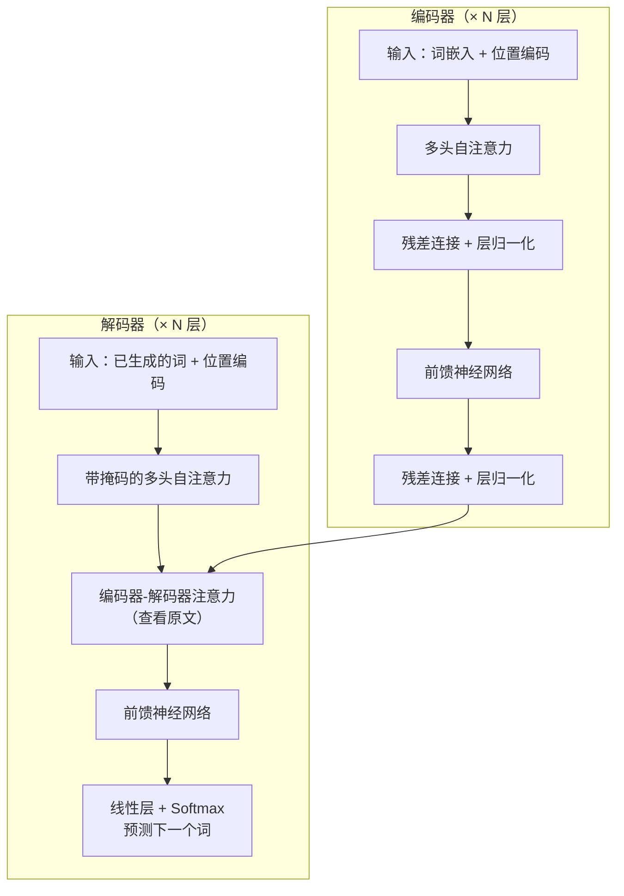
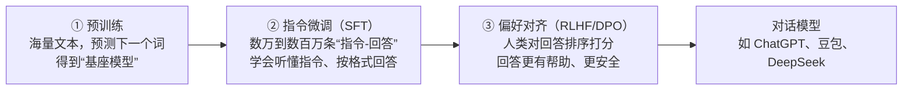
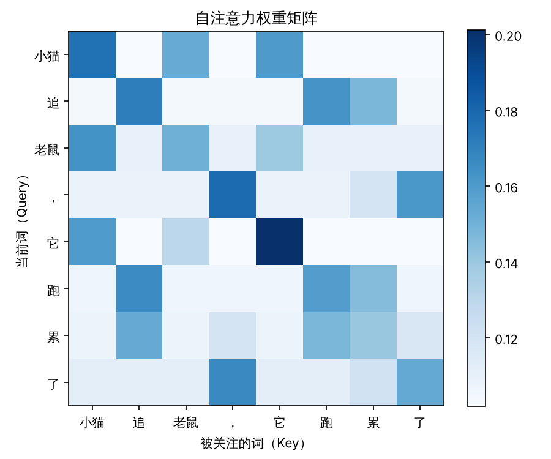
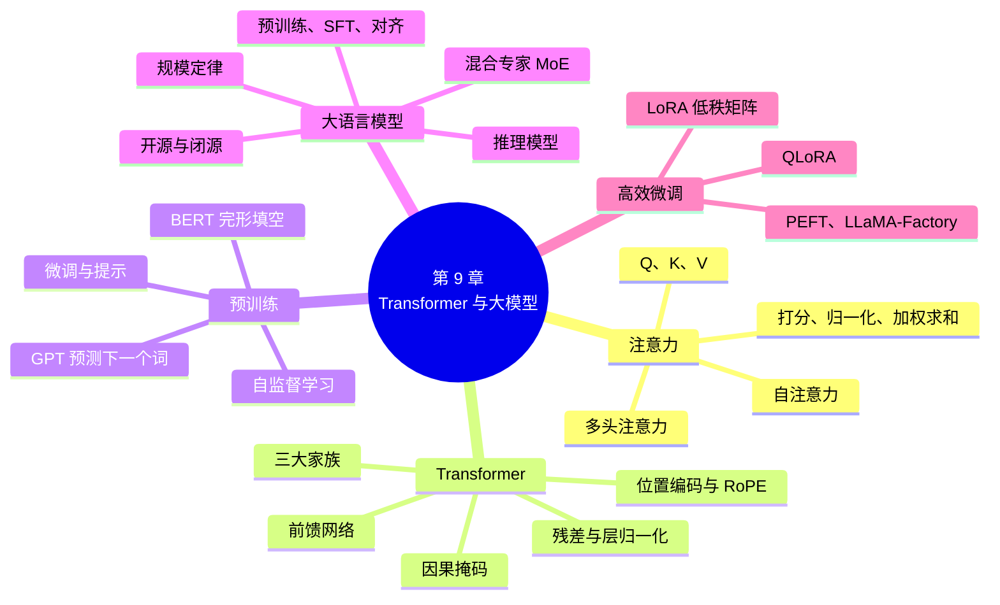

# 第 9 章 Transformer 与预训练大模型

!!! abstract "本章学时"
    理论 6 学时 · 实验 1 学时（本章共 3 个实验：2 个基础实验 ★，1 个拓展实验 ☆，教师可任选）

## 学习目标

学完本章，你应该能够：

1. **说明**注意力机制要解决的问题，用 Query、Key、Value 解释自注意力的计算过程；
2. **描述** Transformer 的主要组成部分：多头注意力、位置编码、前馈网络、残差连接与层归一化；
3. **区分**编码器、解码器、编码器-解码器三类 Transformer 模型及其代表；
4. **解释**“预训练 + 微调”的思想，说出 BERT 和 GPT 的预训练任务；
5. **描述**大语言模型的训练流程（预训练、指令微调、人类反馈强化学习），了解推理模型、混合专家模型等新技术；
6. **认识**国内外主流大模型产品和开源模型，了解 Hugging Face 与魔搭社区；
7. **解释** LoRA 参数高效微调的原理，并能用 Transformers 和 PEFT 库完成模型的微调。

## 情景导入

2022 年 11 月 30 日，OpenAI 发布了 ChatGPT，5 天用户突破 100 万，两个月突破 1 亿，成为当时历史上用户增长最快的消费级应用。2025 年初，国产大模型 DeepSeek 发布推理模型 R1，并公开了模型权重和技术报告，在国内外引起轰动。今天，豆包、通义千问、DeepSeek、文心一言、Kimi 等大模型应用已经走进了学习、工作和生活的方方面面。

这些大模型能写作文、写代码、做翻译、解数学题，好像无所不能。它们的“大脑”里到底是什么？

答案可能出乎你的意料：今天几乎所有大语言模型的核心，都是 2017 年谷歌的 8 位研究者在一篇论文中提出的同一种结构，**Transformer**。这篇论文的标题是《注意力就是你所需要的一切》（*Attention Is All You Need*）。从这篇论文出发，先后诞生了 BERT、GPT 以及今天的各类大模型。

第 8 章我们学习了循环神经网络，看到了它“记性不好”、“只能排队计算”的问题。本章我们来看 Transformer 如何用“注意力”解决这些问题，以及在它之上，“预训练大模型”是怎样炼成的。

## 9.1 注意力机制

### 9.1.1 从序列到序列模型说起

第 8 章介绍过，机器翻译可以用**序列到序列**（Seq2Seq）模型完成：一个循环网络（**编码器**）读完原文，把整句话的意思压缩成一个向量；另一个循环网络（**解码器**）根据这个向量，一个词一个词地生成译文。

这种做法有一个明显的瓶颈：**无论原文有多长，都只能压缩成一个固定长度的向量**。一句 5 个词的话和一段 50 个词的话，都要塞进同样大小的“行李箱”。句子越长，丢失的信息越多，翻译质量随句子变长而明显下降。

人工翻译时不是这样的。译员读完全文后，翻译每个词时都会**回头看原文中对应的部分**。比如把“我爱自然语言处理”翻译成英文，写 “natural” 时主要看“自然”，写 “processing” 时主要看“处理”。能不能让模型也这样做？

### 9.1.2 注意力的基本思想

2014–2015 年，研究者在 Seq2Seq 模型中引入了**注意力机制**（Attention Mechanism）：解码器在生成每一个词时，不再只看那个压缩后的向量，而是**回头查看编码器在每个位置的隐藏状态，并根据相关程度给它们分配不同的权重**，相关的多看，不相关的少看。

注意力机制的核心可以概括为三步：

1. **打分**：计算当前要处理的内容和每个候选位置的相关程度；
2. **归一化**：用 Softmax 把得分变成和为 1 的权重；
3. **加权求和**：按权重把各个位置的信息混合起来，得到一个新的向量。

这其实和人的注意力很像。你在嘈杂的食堂里和同学聊天，能听清他说的话，因为你把注意力集中在他的声音上，自动“调低”了周围的噪声。注意力机制让模型也学会了“抓重点”。

### 9.1.3 自注意力：句子内部的“互相关注”

上面的注意力发生在译文和原文之间。Transformer 更进一步，提出了**自注意力**（Self-Attention）：**让句子中的每个词，都去关注同一句话中的所有词（包括自己）**，从而理解每个词在上下文中的含义。

看这个例子：

> 小猫追老鼠，它跑累了。

“它”指的是谁？人一看就知道多半是“小猫”。模型要理解“它”，就需要把“它”和前面的“小猫”联系起来。自注意力正是这样做的：在计算“它”的新表示时，会特别关注“小猫”，把“小猫”的信息融合进来。

再如“苹果”一词：在“我买了一斤苹果”中，它会关注“一斤”“买”，表示水果；在“苹果发布了新手机”中，它会关注“发布”“手机”，表示公司。**同一个词在不同句子中会得到不同的向量**，这就是第 5 章提到的“上下文相关的词向量”，它解决了 Word2Vec“一词一向量”无法区分多义词的问题。

### 9.1.4 Query、Key、Value

自注意力是怎么计算的呢？它为每个词准备了三个向量：

| 向量 | 名称 | 含义 | 图书馆比喻 |
|---|---|---|---|
| **Q**（Query） | 查询 | “我想找什么样的信息” | 你在检索框里输入的问题 |
| **K**（Key） | 键 | “我能提供什么样的信息”，用来和别人的查询匹配 | 每本书的书名和关键词 |
| **V**（Value） | 值 | “我实际携带的信息内容” | 每本书的正文内容 |

用图书馆的比喻来说：你带着一个问题（Q）去图书馆，把它和每本书的书名关键词（K）比对，越匹配的书你读得越仔细（权重越大），最后综合各本书的内容（V），形成你的答案。

这三个向量都由词向量乘上三个不同的矩阵 \(W_Q\)、\(W_K\)、\(W_V\) 得到。这三个矩阵是模型的参数，在训练中学习。自注意力的计算公式为：

$$
\text{Attention}(Q, K, V) = \text{softmax}\left(\frac{QK^\top}{\sqrt{d_k}}\right)V
$$

拆开来看，就是 9.1.2 节的三步：

1. **打分**：用每个词的 Q 和所有词的 K 做点积（对应位置相乘再相加），点积越大说明越相关。所有词两两打分，就是矩阵乘法 \(QK^\top\)。再除以 \(\sqrt{d_k}\)（\(d_k\) 是向量的维度），防止向量维度大时点积过大，导致 Softmax 之后的权重过于集中，训练困难；
2. **归一化**：对每一行做 Softmax，得到每个词对所有词的注意力权重，每行之和为 1；
3. **加权求和**：用权重对所有词的 V 加权求和，得到每个词融合了上下文信息的新向量。

把所有词两两之间的注意力权重排成一个表格，就是**注意力权重矩阵**。实验 9-1 中我们会用 NumPy 一步一步算出这个矩阵，并把它画成热力图。

和循环网络相比，自注意力有两个突出的优点：

- **任意两个词之间都是“直达”的**：第 1 个词和第 1000 个词之间直接计算相关性，不需要像 RNN 那样一步一步传递，不存在长距离遗忘；
- **可以并行计算**：所有词的注意力用几次矩阵乘法一次算完，非常适合 GPU。

代价是计算量和序列长度的平方成正比：100 个词要算 1 万对，1 万个词就要算 1 亿对。这也是大模型“上下文长度”受限、长文本处理成本高的原因之一。

### 9.1.5 多头注意力

一句话中的词与词之间有多种关系：有语法上的（主语和谓语），有指代上的（“它”和“小猫”），有语义上的（“追”和“跑”）。只用一组 Q、K、V，可能只捕捉到其中一种。

**多头注意力**（Multi-Head Attention）的做法是：**同时使用多组不同的 \(W_Q\)、\(W_K\)、\(W_V\)**，每一组称为一个“头”，各自独立地计算注意力，最后把各个头的结果拼接起来，再经过一个矩阵变换。就像一个评审团，不同评委从不同角度打分，综合起来更全面。

研究者对训练好的模型进行可视化分析，发现不同的头确实会分工：有的头专门关注相邻的词，有的头关注句法上的依存关系，有的头关注指代关系。BERT-base 模型每层有 12 个头，大语言模型每层通常有几十个头。

## 9.2 Transformer 架构

### 9.2.1 整体结构

原始的 Transformer 是为机器翻译设计的，采用**编码器-解码器**结构：



- **编码器**：读入原文，每一层都用自注意力让每个词融合上下文信息，输出每个词的上下文表示。原论文中编码器有 6 层；
- **解码器**：根据编码器的输出和已经生成的译文，预测下一个词。它比编码器多了一个“编码器-解码器注意力”，用来回头查看原文，作用和 9.1.2 节的注意力一样。

下面介绍 Transformer 中除注意力以外的几个重要组件。

### 9.2.2 位置编码

自注意力有一个“副作用”：它**不关心词的顺序**。每个词和所有词计算相关性，如果把句子中的词打乱顺序，每个词得到的结果完全一样（实验 9-1 会验证这一点）。可是“狗咬人”和“人咬狗”的意思完全不同。

为此，Transformer 给每个位置准备一个**位置向量**，加到词向量上，这叫做**位置编码**（Positional Encoding）。这样，同一个词出现在不同位置时，输入向量就不同了。

- **原始 Transformer** 使用不同频率的正弦、余弦函数生成位置向量，不需要学习；
- **BERT、GPT-2** 等模型直接把位置向量作为参数来学习，但最大长度在训练时就固定了，比如 BERT 最多只能处理 512 个位置；
- **今天的大模型**（如 Llama、Qwen、DeepSeek）普遍使用**旋转位置编码**（RoPE）。它通过对 Q、K 向量进行“旋转”来表示位置，能更好地体现词与词之间的**相对距离**，并且可以通过一些技巧扩展到训练时没见过的更长文本，是大模型支持几十万字上下文的关键技术之一。

### 9.2.3 前馈网络、残差连接与层归一化

**前馈神经网络**（Feed-Forward Network，FFN）：注意力层负责让词与词之间“交流信息”，前馈网络负责对每个词各自进行“深加工”。它就是第 8 章介绍的两层全连接网络，中间层通常比输入大 4 倍左右。研究发现，模型学到的大量“知识”（比如“北京是中国的首都”）就储存在前馈网络的参数中。

**残差连接**（Residual Connection）：把一层的输入直接加到它的输出上，即 \(\text{输出} = x + \text{子层}(x)\)。这和 LSTM 用“加法”更新记忆细胞的思想类似：给信息和梯度开辟一条“直通车道”，使得几十层、上百层的深层网络也能顺利训练。

**层归一化**（Layer Normalization）：把每个词向量的数值调整到均值为 0、方差为 1 附近，防止数值在层层计算中变得过大或过小，让训练更稳定。

一个 Transformer 层就由“多头注意力 + 前馈网络”以及它们各自的残差连接和层归一化组成。把这样的层堆叠几十次，就构成了大模型的主体。

### 9.2.4 掩码：不许“偷看”答案

解码器在生成文字时，是一个词一个词地往后写的。训练时，为了效率，我们会把整句正确答案一次性输入解码器，让它同时学习预测每个位置的下一个词。但这就带来一个问题：预测第 3 个词时，如果模型能看到第 3 个词本身，就等于“偷看答案”了。

解决办法是使用**因果掩码**（Causal Mask）：在注意力权重矩阵中，把每个词“右边”（未来）的位置全部遮住（得分设为负无穷，经过 Softmax 后权重为 0），**每个词只能看到它自己和它左边的词**。带掩码的自注意力保证了训练和生成时的条件一致。今天所有 GPT 类的生成式大模型，都使用这种带因果掩码的自注意力。

### 9.2.5 Transformer 的三大家族

原始 Transformer 提出后，研究者发现，只用编码器或只用解码器，也能做出非常强大的模型。于是形成了三大家族：

| 家族 | 结构 | 注意力范围 | 擅长的任务 | 代表模型 |
|---|---|---|---|---|
| **仅编码器** | 只有编码器 | 双向：每个词能看到整句话 | 理解类任务：分类、命名实体识别、语义匹配、文本嵌入 | BERT、RoBERTa、ERNIE（早期版本）、BGE 嵌入模型 |
| **仅解码器** | 只有解码器（不含编码器-解码器注意力） | 单向：每个词只能看到左边 | 生成类任务：对话、写作、代码、几乎所有任务 | GPT 系列、Llama、Qwen、DeepSeek 等几乎所有大语言模型 |
| **编码器-解码器** | 两者都有 | 编码器双向，解码器单向 | 输入到输出的转换：翻译、摘要 | 原始 Transformer、T5、BART、mBART |

为什么今天的大语言模型几乎都选择了“仅解码器”结构？主要原因是：它的训练任务（预测下一个词）最简单通用，任何文本都能直接用来训练；结构统一，便于扩大规模；而且研究发现，当模型足够大时，生成式模型在理解类任务上也能做得很好。

## 9.3 预训练与微调

### 9.3.1 预训练的思想

第 6 章和第 8 章中，我们都是**从零开始**为某个任务训练模型：模型一开始对语言一无所知，只能从一万多条外卖评论中学习。可是一万多条评论能教给模型的语言知识实在有限。

**预训练**（Pre-training）的思想是：**先在海量的通用文本上，让模型学习语言的一般规律和世界知识；再在具体任务的少量数据上做调整**。后一步称为**微调**（Fine-tuning）。

这和人的学习过程很像：

- **预训练**相当于从小学到高中的**通识教育**：大量阅读，掌握语言、常识和基础知识。这个阶段花费的时间和资源最多；
- **微调**相当于大学阶段的**专业训练**：在通识基础上，用相对少的时间学会一个专业。

预训练不需要人工标注的数据。模型通过“自己出题、自己答题”的方式学习，比如把句子中的某个词遮住让模型猜，或者让模型根据前文预测下一个词。正确答案就在原文中，这种学习方式叫做**自监督学习**（Self-supervised Learning）。互联网上有海量文本，都可以直接拿来训练。

### 9.3.2 BERT：双向理解的“阅读高手”

2018 年，谷歌发布了 **BERT**（Bidirectional Encoder Representations from Transformers），它在 11 项 NLP 任务上刷新了纪录，开启了“预训练 + 微调”的时代。

BERT 使用 Transformer 的编码器，预训练任务主要是**掩码语言模型**（Masked Language Model，MLM），也就是“完形填空”：随机遮住句子中 15% 的字，让模型根据上下文猜被遮住的是什么字。

> 今天天气很[MASK]，我们去公园玩吧。→ 模型应该猜出“好”“晴”等

要猜对，模型必须同时理解遮盖位置左边和右边的内容，这就迫使模型学会了**双向的上下文理解**。BERT 原论文还使用了“下一句预测”任务，判断两个句子是不是前后相连的，但后来的研究发现这个任务帮助不大，RoBERTa 等改进模型就把它去掉了。

BERT 在输入的开头加一个特殊符号 **[CLS]**，句子之间用 **[SEP]** 分隔。微调做分类任务时，通常取 [CLS] 位置的输出向量，接一个全连接层进行分类。

**中文 BERT 模型**：

| 模型 | 发布者 | 特点 |
|---|---|---|
| bert-base-chinese | 谷歌 | 最早的中文 BERT，按字切分 |
| chinese-roberta-wwm-ext | 哈工大讯飞联合实验室 | 使用**全词掩码**：遮盖时把一个词的所有字一起遮住，更适合中文 |
| rbt3 | 哈工大讯飞联合实验室 | 只有 3 层的小模型，速度快，适合 CPU 和教学 |
| ERNIE 1.0 / 3.0 | 百度 | 加入了实体、短语级别的掩码和知识 |
| BGE 系列 | 北京智源人工智能研究院 | 专门为文本嵌入和语义检索训练的编码器模型（第 5 章、第 11 章） |

### 9.3.3 GPT：从左到右的“写作高手”

几乎与 BERT 同时，OpenAI 发布了 **GPT**（Generative Pre-trained Transformer，生成式预训练 Transformer）。GPT 使用 Transformer 的解码器，预训练任务是**根据前文预测下一个词**：

> 床前明月 → 光
> 床前明月光，疑是地上 → 霜

这个任务看起来简单，其实要做好非常难：要预测出合理的下一个词，模型需要理解语法、掌握常识，甚至进行推理。比如预测“中国的首都是____”，需要知识；预测“3 加 5 等于____”，需要计算。

GPT 系列的发展，最重要的规律就是“**越大越强**”：

| 模型 | 发布时间 | 参数量 | 意义 |
|---|---|---|---|
| GPT-1 | 2018 年 | 1.17 亿 | 验证了“生成式预训练 + 微调”的有效性 |
| GPT-2 | 2019 年 | 15 亿 | 能写出连贯的长文章，不微调也能完成一些任务 |
| GPT-3 | 2020 年 | 1750 亿 | 只需在提示中给几个例子，就能完成新任务（少样本学习） |
| ChatGPT | 2022 年 | 未公开 | 经过指令微调和人类反馈强化学习，能流畅地对话 |
| GPT-4 及以后 | 2023 年起 | 未公开 | 多模态（能看图、听声音）、推理能力不断增强 |

### 9.3.4 微调与提示：使用预训练模型的两种方式

有了预训练模型，使用它的方式主要有两种：

| 方式 | 做法 | 优点 | 缺点 | 适合的模型 |
|---|---|---|---|---|
| **微调** | 用任务数据继续训练模型，调整参数 | 效果好、推理成本低、可本地部署 | 需要标注数据和训练资源 | BERT 等中小模型；也可以微调开源大模型 |
| **提示** | 不改参数，用自然语言描述任务，必要时给几个例子 | 不需要训练，几分钟就能上手 | 依赖大模型、调用要付费，效果受提示词影响 | 大语言模型 |

第 6 章的实验 6-3 用的就是“提示”的方式：直接让大模型判断情感。本章实验 9-2 将使用“微调”的方式，把一个预训练模型调成外卖评论情感分类器。在实际项目中，两者经常结合使用：先用提示快速验证想法，数据积累起来后再微调一个小模型降低成本。

## 9.4 大语言模型

### 9.4.1 什么是大语言模型

**大语言模型**（Large Language Model，LLM）一般指参数量在数十亿以上、在海量文本上预训练、具有通用语言理解和生成能力的模型。今天的大模型参数从几亿到上万亿不等，训练文本多达数十万亿个 Token。

研究者发现，模型的效果随着**参数量、数据量、计算量**的增加而稳定提升，并且可以用数学公式提前预测，这一规律称为**规模定律**（Scaling Law）。这就是各大公司竞相投入巨资训练更大模型的原因。

人们还观察到，当模型规模达到一定程度后，会表现出小模型不具备的能力，比如理解复杂指令、多步推理、写代码，这被称为**涌现能力**（Emergent Abilities）。不过也有研究认为，“涌现”在一定程度上与评价方法有关，能力其实是逐步提升的。

### 9.4.2 大模型是怎样炼成的

一个能对话的大模型，通常要经过三个阶段的训练：



**① 预训练**：在网页、书籍、百科、论文、代码等海量文本上训练“预测下一个词”，花费最多，可能需要上万张 GPU 训练数月。得到的模型称为**基座模型**（Base Model）。它知识丰富，但只会“续写”：你问它“中国的首都是哪里？”，它可能接着写出“美国的首都是哪里？英国的首都是哪里？”，因为网上的考题经常这样排列。

**② 指令微调**（Supervised Fine-Tuning，SFT）：用大量人工编写或筛选的“指令-回答”对进行微调，让模型学会理解人的指令，以对话的形式给出回答。

**③ 偏好对齐**：让模型对同一个问题生成多个回答，由人（或另一个模型）排出好坏，再用这些偏好数据训练模型，使它的回答更有帮助、更诚实、更安全。经典方法是**基于人类反馈的强化学习**（RLHF）；后来出现了更简单的**直接偏好优化**（DPO）等方法。

**推理模型的新阶段**：2024 年 9 月 OpenAI 发布 o1，2025 年 1 月 DeepSeek 发布 R1，这类模型被称为**推理模型**。它们在回答前会先生成一段很长的“思考过程”（称为**思维链**），像人做数学题打草稿一样逐步推理、检查、修正，在数学、编程、科学问题上能力大幅提升。DeepSeek 在技术报告中公开了一个重要发现：只用**强化学习**，让模型在有标准答案的数学和编程题上反复尝试、答对给奖励，模型就能自发地学会长链条的思考和自我检查。现在许多大模型产品都提供“深度思考”开关，背后就是推理模型。

### 9.4.3 混合专家模型

模型越大越强，但计算成本也越高。**混合专家模型**（Mixture of Experts，MoE）提供了一种“又大又省”的办法：把前馈网络拆成许多个“专家”（小的前馈网络），再用一个“路由器”为每个 Token 挑选少数几个最合适的专家来处理。这样，模型的**总参数**可以非常大（储存更多知识），而每个 Token 实际用到的**激活参数**只占一小部分（计算量小）。

就像一家大医院有几十个科室的专家，但每位病人只需要看其中一两个科室。DeepSeek-V3 是典型的 MoE 模型：总参数约 6710 亿，每个 Token 只激活约 370 亿。目前国内外许多旗舰大模型都采用了 MoE 结构，模型名称中常见的“A3B”“A22B”等标记，指的就是激活参数为 30 亿、220 亿。

### 9.4.4 主流大模型一览

!!! note "说明"
    大模型更新非常快，几乎每月都有新版本发布。下表列出的是主要的模型系列（截至本书编写时），具体版本请以各厂商官网为准。

| 类别 | 模型系列 | 开发者 | 特点 |
|---|---|---|---|
| 国外闭源 | GPT 系列 | OpenAI | ChatGPT 背后的模型，多模态和推理能力强 |
| 国外闭源 | Claude 系列 | Anthropic | 长文档处理和编程能力突出 |
| 国外闭源 | Gemini 系列 | 谷歌 | 原生多模态，超长上下文 |
| 国外开源 | Llama 系列 | Meta | 影响最大的早期开源大模型之一 |
| 国产开源 | DeepSeek 系列 | 深度求索 | MoE 架构，训练成本低，推理模型 R1 影响广泛 |
| 国产开源 | 通义千问 Qwen 系列 | 阿里巴巴 | 尺寸齐全（从零点几 B 到数千亿），多语言，开源模型下载量全球领先 |
| 国产开源 | GLM 系列 | 智谱 | 清华大学技术背景，产品为智谱清言 |
| 国产开源 | Kimi 系列 | 月之暗面 | 以长文本起家，开源了万亿参数级的 MoE 模型 |
| 国产 | 文心系列 | 百度 | 产品为文心一言，接入百度搜索 |
| 国产 | 豆包系列 | 字节跳动 | 用户量大，价格低，语音交互体验好 |
| 国产 | 混元、MiniMax、讯飞星火等 | 腾讯、MiniMax、科大讯飞等 | 各有侧重，如讯飞星火在教育和语音领域应用较多 |

**开源与闭源**：

- **闭源模型**只能通过网页、App 或 API 使用，看不到模型参数；
- **开源模型**（更准确地说是“开放权重”模型）公开了模型参数，任何人都可以下载、在本地运行和微调。对于数据不能出本单位的企业（如医院、银行、政府部门），开源模型的本地部署非常重要。

**模型尺寸的读法**：模型名称中的“7B”“72B”表示参数量为 70 亿、720 亿（B 是 billion，十亿）。参数量决定了运行所需的内存：每个参数用 16 位浮点数存储时占 2 字节，一个 7B 模型就需要约 14GB 显存。为了让大模型在普通电脑上运行，常用**量化**技术把每个参数压缩到 8 位甚至 4 位，4 位量化后的 7B 模型只需约 4–5GB 内存（第 10 章实验 10-3 会在本地运行量化模型）。

### 9.4.5 大模型的局限

大模型很强大，但同学们必须清楚它的局限：

| 局限 | 表现 | 应对 |
|---|---|---|
| **幻觉** | 一本正经地编造事实、数据、文献 | 核实关键信息；使用检索增强生成（第 11 章） |
| **知识截止** | 不知道训练数据截止日期之后发生的事 | 联网搜索、RAG |
| **计算与逻辑错误** | 复杂计算、长链推理可能出错 | 使用推理模型；让模型调用计算器等工具 |
| **偏见与安全** | 可能输出带有偏见或有害的内容 | 对齐训练、内容审核（第 12 章） |
| **成本** | 训练和运行需要大量算力 | 选用合适尺寸的模型；MoE、量化、蒸馏 |

## 9.5 参数高效微调

### 9.5.1 全量微调的难题

微调 BERT 这样的小模型（1 亿参数左右），在一张普通显卡上就能完成。可是要微调一个 70 亿参数的大模型，问题就来了：训练时除了模型参数本身，还要保存梯度和优化器的状态（Adam 优化器要为每个参数额外保存两个数），所需显存可能是模型本身的好几倍，需要多张高端 GPU。而且每个任务都要保存一份完整的模型副本，存储成本也很高。

**参数高效微调**（Parameter-Efficient Fine-Tuning，PEFT）的思路是：**冻结预训练模型的绝大部分参数，只训练很少一部分新增的参数**。其中最常用的方法是 LoRA。

### 9.5.2 LoRA 的原理

**LoRA**（Low-Rank Adaptation，低秩适配）由微软的研究者在 2021 年提出。它的想法是：微调时，模型参数的变化量 \(\Delta W\) 其实不需要那么多“自由度”，可以用两个很“瘦”的矩阵相乘来近似：

$$
W' = W + \Delta W = W + BA
$$

其中 \(W\) 是原始的权重矩阵，比如 \(1024 \times 1024\)，有约 105 万个参数，**训练时保持不变**；\(B\) 是 \(1024 \times r\) 的矩阵，\(A\) 是 \(r \times 1024\) 的矩阵，\(r\) 称为**秩**，通常取 8、16 等很小的数。当 \(r = 8\) 时，\(A\) 和 \(B\) 合计只有 \(2 \times 1024 \times 8 = 16384\) 个参数，约为原矩阵的 1.6%。

可以把 LoRA 想象成给模型装了一个**小插件**：原模型这台“主机”保持不动，只训练插件。LoRA 有几个明显的好处：

- **省显存**：需要计算梯度和保存优化器状态的参数大大减少，消费级显卡甚至 CPU 就能微调小型大模型；
- **省存储**：每个任务只需要保存几 MB 到几十 MB 的 LoRA 参数，而不是几 GB 的完整模型；
- **可切换**：同一个基座模型可以加载不同的 LoRA 插件，一会儿是“客服助手”，一会儿是“法律助手”；
- **效果好**：在很多任务上，效果接近全量微调。

**QLoRA** 在 LoRA 的基础上，把冻结的原模型量化为 4 位存储，进一步降低显存需求，让单张消费级显卡也能微调几十亿参数的模型。

### 9.5.3 常用微调工具

| 工具 | 特点 |
|---|---|
| **PEFT**（Hugging Face） | 提供 LoRA 等多种参数高效微调方法，与 Transformers 无缝配合，实验 9-3 使用 |
| **LLaMA-Factory** | 国内开发者发起的开源微调框架，提供网页界面，几乎不用写代码就能完成大模型微调，支持上百种模型 |
| **ms-swift** | 魔搭社区推出的大模型训练和部署框架，与魔搭的模型和数据集配合方便 |
| **云平台** | 阿里云百炼、百度千帆、火山方舟等平台提供在线微调服务，上传数据即可训练 |

需要注意的是，**微调不是万能的**。如果只是想让模型知道一些新资料（如公司产品手册），用第 11 章的 RAG 往往更合适、更便宜，资料更新也方便；微调更适合教模型**新的行为方式**，比如特定的回答风格、输出格式或领域术语用法。

## 9.6 Hugging Face 与魔搭社区

### 9.6.1 模型社区

| 平台 | 网址 | 特点 |
|---|---|---|
| **Hugging Face** | huggingface.co | 全球最大的开源模型社区，托管数十万个模型和数据集，提供 Transformers 等开源库 |
| **魔搭社区 ModelScope** | modelscope.cn | 阿里巴巴发起的国内模型社区，下载速度快，提供免费的在线 Notebook 环境 |

在国内访问 Hugging Face 速度较慢甚至无法访问，可以使用两种办法：一是设置镜像站，在运行程序前设置环境变量 `HF_ENDPOINT=https://hf-mirror.com`；二是从魔搭社区下载，主流的国产模型在魔搭上都有官方发布。

在模型社区中，每个模型都有一个“模型卡片”（Model Card），说明模型的用途、训练数据、使用方法、许可证和局限性。**使用开源模型前，一定要阅读模型卡片中的许可证**，确认是否允许商业使用。

### 9.6.2 Transformers 库的基本用法

Hugging Face 的 **Transformers** 库是使用预训练模型的标准工具，课程描述中要求掌握的三大工具之一。它的核心用法有两个层次：

**第一层：pipeline（流水线）**，一行代码完成一个任务，适合快速体验：

```python
from transformers import pipeline
clf = pipeline("text-classification", model="模型名称")
clf("这家店的菜真好吃")
```

常用的任务名称有：`text-classification`（文本分类）、`token-classification`（序列标注，如 NER）、`fill-mask`（完形填空）、`question-answering`（抽取式问答）、`summarization`（摘要）、`translation`（翻译）、`text-generation`（文本生成）。

**第二层：AutoTokenizer + AutoModel**，自己控制每一步，适合微调和定制：

```python
from transformers import AutoTokenizer, AutoModelForSequenceClassification
tokenizer = AutoTokenizer.from_pretrained("模型名称")    # 加载配套的分词器
model = AutoModelForSequenceClassification.from_pretrained("模型名称", num_labels=2)
inputs = tokenizer("这家店的菜真好吃", return_tensors="pt")   # 文本 -> 编号张量
outputs = model(**inputs)                                     # 编号 -> 各类别得分
```

`Auto` 开头的类会根据模型名称自动选择正确的模型结构，所以换一个模型只需要改名称。注意：**模型和分词器必须配套使用**，用 A 模型的分词器处理文本、再交给 B 模型，结果会完全错误。

## 9.7 前沿视窗：大模型的新方向

- **多模态大模型**：不仅能读写文字，还能看图片、看视频、听声音、说话。例如，你可以拍一张电路图让模型解释原理，或者用语音和模型实时对话。国产的 Qwen-VL、GLM-4V 等都是开源的多模态模型。
- **推理模型与“慢思考”**：如 9.4.2 节所述，模型在回答前先进行长时间思考。研究者发现，增加思考时间（推理时的计算量）也能提升效果，这为模型能力提升开辟了一条新路径。
- **超长上下文**：主流大模型已能一次处理数十万甚至上百万个 Token 的输入，相当于几十本书，可以直接分析整份合同、整本教材或整个代码仓库。
- **端侧小模型**：参数在几亿到几十亿之间的小模型越来越强，可以直接在手机、电脑上离线运行，保护隐私、没有网络延迟。手机厂商纷纷在系统中内置了端侧大模型。
- **从对话到智能体**：大模型不再只是回答问题，而是能调用工具、操作软件、自主完成多步任务，这就是第 11 章将介绍的**智能体**（Agent）。

## 本章实验

!!! abstract "实验总览"
    | 实验 | 类型 | 建议时长 | 内容 |
    |---|---|---|---|
    | 实验 9-1 | ★ 基础 | 45 分钟 | 手算自注意力，并搭建小型 Transformer 分类器 |
    | 实验 9-2 | ★ 基础 | 60 分钟 | 用 Transformers 体验预训练模型，并微调中文 BERT |
    | 实验 9-3 | ☆ 拓展 | 60 分钟 | 用 LoRA 微调小型开源大模型，打造“校园助手” |

    实验代码见配套资源 `labs/ch09/` 目录。实验 9-1 完全离线运行；实验 9-2、9-3 首次运行需要下载模型，建议教师提前下载好，通过 U 盘或局域网分发，或者使用魔搭社区的免费 Notebook 环境。

### 实验 9-1 ★ 手算自注意力，并搭建小型 Transformer 分类器

**实验目的**

1. 用 NumPy 一步一步计算自注意力，理解“打分、归一化、加权求和”三个步骤；
2. 画出注意力权重热力图，理解多头注意力的形状变化；
3. 验证“没有位置编码时，自注意力不关心词序”；
4. 用 PyTorch 搭建一个小型 Transformer 分类器，与第 8 章的 LSTM 比较。

**实验环境**：实验 1-1 的环境；第 4 部分需要把 `lab8_2_lstm.py` 和 `waimai_10k.csv` 放在同一目录下。

**实验步骤与代码**

第 1–3 部分（`lab9_1_attention.py`）：

```python
"""实验 9-1：手算自注意力，并用 PyTorch 搭建小型 Transformer 分类器"""
import numpy as np
import matplotlib.pyplot as plt

plt.rcParams["font.sans-serif"] = ["WenQuanYi Zen Hei", "SimHei", "PingFang SC"]
np.set_printoptions(precision=2, suppress=True)

# ===== 第 1 部分：一步一步计算自注意力 =====
words = ["小猫", "追", "老鼠", "，", "它", "跑", "累", "了"]
# 手工设计的 4 维词向量，四个维度大致表示：[动物, 动作, 代词, 标点/虚词]
X = np.array([
    [1.0, 0.0, 0.3, 0.0],   # 小猫
    [0.0, 1.0, 0.0, 0.0],   # 追
    [0.8, 0.0, 0.0, 0.0],   # 老鼠
    [0.0, 0.0, 0.0, 1.0],   # ，
    [0.6, 0.0, 1.0, 0.0],   # 它
    [0.0, 0.9, 0.0, 0.0],   # 跑
    [0.0, 0.7, 0.0, 0.2],   # 累
    [0.0, 0.0, 0.0, 0.8],   # 了
])
d = X.shape[1]
# 为了看清原理，这里让 Q、K、V 直接等于词向量（相当于 W_Q、W_K、W_V 都是单位矩阵）
Q, K, V = X, X, X

scores = Q @ K.T / np.sqrt(d)                   # ① 打分：每个词和所有词做点积，再除以 √d
def softmax(z):
    e = np.exp(z - z.max(axis=-1, keepdims=True))
    return e / e.sum(axis=-1, keepdims=True)
weights = softmax(scores)                        # ② 归一化：每一行变成和为 1 的权重
output = weights @ V                             # ③ 加权求和：按权重把所有词的 V 混合起来

i = words.index("它")
print("“它”对每个词的注意力权重：")
for w, a in sorted(zip(words, weights[i]), key=lambda t: -t[1]):
    print(f"  {w}\t{a:.3f}")
print("“它”的原始向量：  ", X[i])
print("“它”融合上下文后：", output[i])

plt.figure(figsize=(6, 5))
plt.imshow(weights, cmap="Blues")
plt.xticks(range(len(words)), words); plt.yticks(range(len(words)), words)
plt.xlabel("被关注的词（Key）"); plt.ylabel("当前词（Query）")
plt.colorbar(); plt.title("自注意力权重矩阵")
plt.tight_layout(); plt.savefig("attention_heatmap.png", dpi=150)

# ===== 第 2 部分：可学习的投影矩阵与多头注意力 =====
rng = np.random.default_rng(0)
n_heads, d_model = 2, 4
d_head = d_model // n_heads
heads = []
for h in range(n_heads):
    W_q, W_k, W_v = (rng.normal(size=(d_model, d_head)) for _ in range(3))
    q, k, v = X @ W_q, X @ W_k, X @ W_v          # 每个头有自己的 Q、K、V 投影
    a = softmax(q @ k.T / np.sqrt(d_head))
    heads.append(a @ v)
    print(f"第 {h + 1} 个头：“它”最关注的词是“{words[a[i].argmax()]}”")
multi = np.concatenate(heads, axis=-1)           # 拼接各个头的输出
print("每个头的输出形状：", heads[0].shape, " 拼接后：", multi.shape)

# ===== 第 3 部分：没有位置信息时，打乱词序结果不变 =====
perm = [4, 5, 6, 7, 0, 1, 2, 3]                  # 把句子前后两半对调
out_shuffled = softmax(X[perm] @ X[perm].T / np.sqrt(d)) @ X[perm]
print("打乱词序后，“它”的输出：", out_shuffled[perm.index(i)])
print("与原来是否完全相同：", np.allclose(out_shuffled[perm.index(i)], output[i]))
```

运行结果：

```text
“它”对每个词的注意力权重：
  它	0.201
  小猫	0.160
  老鼠	0.130
  追	0.102
  ，	0.102
  跑	0.102
  累	0.102
  了	0.102
“它”的原始向量：   [0.6 0.  1.  0. ]
“它”融合上下文后： [0.38 0.26 0.25 0.2 ]
第 1 个头：“它”最关注的词是“它”
第 2 个头：“它”最关注的词是“，”
每个头的输出形状： (8, 2)  拼接后： (8, 4)
打乱词序后，“它”的输出： [0.38 0.26 0.25 0.2 ]
与原来是否完全相同： True
```

生成的注意力热力图如下（颜色越深，表示该行的词越关注该列的词）：



**第 1–3 部分结果解读**

1. **“它”最关注自己，其次是“小猫”（0.160）和“老鼠”（0.130）**。在我们设计的词向量中，“它”具有“代词”和一定的“动物”特征，所以和同样是动物的“小猫”“老鼠”相关性更高；而“小猫”的向量也带有一点“代词”成分（第 3 维 0.3），所以“它”与“小猫”的得分比与“老鼠”更高。在真实的模型中，这些向量和 \(W_Q\)、\(W_K\) 都是从大量文本中学到的。
2. **权重分布比较“平”**：最高也只有 0.201。这是因为我们的词向量只有 4 维、数值较小，点积差距不大。真实模型的向量有几百上千维，训练后的注意力往往更加集中。
3. **“它”融合上下文后的向量变了**：从 `[0.6, 0, 1, 0]` 变为 `[0.38, 0.26, 0.25, 0.2]`，第 2 维（动作）从 0 变为 0.26，说明它吸收了句子中“追”“跑”“累”等动作词的信息。这就是“上下文相关的词向量”的含义。
4. **从热力图可以看出“物以类聚”**：动作词“追”“跑”“累”相互关注较多，“，”和“了”这类虚词相互关注较多。
5. **多头注意力**：两个头使用了不同的随机投影矩阵，关注点不同：第 1 个头中“它”最关注自己，第 2 个头最关注“，”。每个头输出 2 维，拼接后恢复为 4 维，这就是“多头”的形状变化：`d_model = 头数 × 每头维度`。
6. **打乱词序结果不变**：把句子前后两半对调后，“它”的输出向量完全相同。这验证了 9.2.2 节的结论：**自注意力本身对词序“视而不见”，必须加入位置编码**。

第 4 部分（`lab9_1_transformer_cls.py`），复用实验 8-2 的数据处理函数：

```python
"""实验 9-1 第 4 部分：用 PyTorch 搭建小型 Transformer 情感分类器（与实验 8-2 的 LSTM 比较）"""
import time
import torch
import torch.nn as nn
from lab8_2_lstm import load_data, encode, MAX_LEN


class TinyTransformer(nn.Module):
    def __init__(self, vocab_size, d_model=128, n_heads=4, n_layers=2):
        super().__init__()
        self.tok_emb = nn.Embedding(vocab_size, d_model, padding_idx=0)   # 词嵌入
        self.pos_emb = nn.Embedding(MAX_LEN, d_model)                     # 位置嵌入：第 0~39 个位置各一个向量
        layer = nn.TransformerEncoderLayer(d_model, n_heads, dim_feedforward=256,
                                           dropout=0.1, batch_first=True)
        self.encoder = nn.TransformerEncoder(layer, n_layers, enable_nested_tensor=False)  # 2 层编码器
        self.fc = nn.Linear(d_model, 2)

    def forward(self, ids):
        pos = torch.arange(ids.size(1)).unsqueeze(0)                     # [[0, 1, 2, ..., 39]]
        x = self.tok_emb(ids) + self.pos_emb(pos)                        # 词向量 + 位置向量
        pad_mask = ids == 0                                              # 填充位置不参与注意力
        h = self.encoder(x, src_key_padding_mask=pad_mask)
        h = h.masked_fill(pad_mask.unsqueeze(-1), 0).sum(1) / (~pad_mask).sum(1, keepdim=True)
        return self.fc(h)                                                # 所有真实词的平均向量做分类


train_tokens, test_tokens, y_train, y_test, vocab = load_data()
Xtr, _ = encode(train_tokens, vocab)
Xte, _ = encode(test_tokens, vocab)
ytr, yte = torch.tensor(y_train), torch.tensor(y_test)

torch.manual_seed(42)
model = TinyTransformer(len(vocab))
print("模型参数量：", sum(p.numel() for p in model.parameters()))
opt = torch.optim.AdamW(model.parameters(), lr=5e-4)
loss_fn = nn.CrossEntropyLoss()
start = time.time()
for epoch in range(1, 7):
    model.train()
    perm = torch.randperm(len(Xtr))
    for i in range(0, len(Xtr), 64):
        idx = perm[i:i + 64]
        opt.zero_grad()
        loss = loss_fn(model(Xtr[idx]), ytr[idx])
        loss.backward()
        opt.step()
    model.eval()
    with torch.no_grad():
        acc = (model(Xte).argmax(1) == yte).float().mean().item()
    print(f"第 {epoch} 轮  测试集准确率 {acc:.4f}")
print(f"用时 {time.time() - start:.1f} 秒")
```

运行结果（4 核 CPU 约 1 分钟）：

```text
模型参数量： 872962
第 1 轮  测试集准确率 0.8478
第 2 轮  测试集准确率 0.8607
第 3 轮  测试集准确率 0.8691
第 4 轮  测试集准确率 0.8490
第 5 轮  测试集准确率 0.8590
第 6 轮  测试集准确率 0.8636
用时 58.6 秒
```

**第 4 部分结果解读**

1. 小型 Transformer 的测试集准确率在 85%–87% 之间，最高 86.9%，与第 8 章的 LSTM（88.0%）、第 6 章的 SVM（88.4%）相比没有优势，甚至略低，而且各轮之间波动更大。
2. 这个结果并不奇怪：**Transformer 的威力来自“大数据 + 大模型 + 预训练”**。在一万条数据上从零训练，它没有机会发挥优势；它的注意力机制需要更多数据才能学到有用的模式。
3. 模型参数量 87.3 万，其中词嵌入 60.3 万、位置嵌入 0.5 万（40 个位置 × 128 维）、两层编码器共 26.5 万。和 LSTM 相比，多了位置嵌入，这是因为 Transformer 本身不感知词序。
4. 那么，怎样才能让 Transformer 发挥实力？答案是使用**预训练模型**，这正是实验 9-2 要做的。

**常见问题排查**

| 现象 | 原因与解决办法 |
|---|---|
| `ModuleNotFoundError: No module named 'lab8_2_lstm'` | 把实验 8-2 的 `lab8_2_lstm.py` 复制到当前目录 |
| `AssertionError: embed_dim must be divisible by num_heads` | `d_model` 必须能被头数整除，比如 128 可以配 4 头或 8 头，不能配 3 头 |
| 出现 `nested tensors is in prototype stage` 警告 | 旧版本代码未设置 `enable_nested_tensor=False`，这是提示信息，不影响结果 |

**思考与练习**

1. 修改第 1 部分中“它”的词向量，让它更关注“老鼠”而不是“小猫”。你修改了哪个维度？为什么？
2. 把第 1 部分的 `np.sqrt(d)` 去掉（即不做缩放），再把所有词向量乘以 10，观察注意力权重的变化，说明缩放的作用。
3. 在第 4 部分中删除位置嵌入（`x = self.tok_emb(ids)`），重新训练，准确率有什么变化？结合本实验第 3 部分的结论解释。

**实验报告要求**

提交注意力热力图和“它”的注意力权重表、两个 Transformer 实验的运行截图、Transformer 与 LSTM 的比较表，以及思考题的实验记录。

### 实验 9-2 ★ 用 Transformers 体验预训练模型，并微调中文 BERT

**实验目的**

1. 用 `pipeline` 体验 BERT 的完形填空能力和现成的情感分类模型；
2. 掌握用 Transformers 的 `Trainer` 微调预训练模型的完整流程；
3. 比较预训练模型与第 6 章、第 8 章方法的效果。

**实验环境**：实验 1-1 的环境，另需安装 `pip install datasets accelerate`。需联网下载三个模型：`google-bert/bert-base-chinese`（约 400MB）、`uer/roberta-base-finetuned-jd-binary-chinese`（约 400MB）、`hfl/rbt3`（约 150MB）。国内请先设置 `HF_ENDPOINT=https://hf-mirror.com`。

**实验数据**：外卖评论数据集 `waimai_10k.csv`，划分方式与实验 6-2、8-2 相同。

**实验步骤与代码**

```python
"""实验 9-2：用 Transformers 体验预训练模型，并微调中文 BERT 做情感分类
首次运行需联网下载模型。国内请先设置镜像：
    Windows（PowerShell）：$env:HF_ENDPOINT = "https://hf-mirror.com"
    macOS / Linux：        export HF_ENDPOINT=https://hf-mirror.com
"""
import os
import numpy as np
import pandas as pd
from datasets import Dataset
from sklearn.model_selection import train_test_split
from transformers import (pipeline, AutoTokenizer, AutoModelForSequenceClassification,
                          TrainingArguments, Trainer)

# ===== 第 1 部分：完形填空——看看 BERT 学到了什么 =====
fill = pipeline("fill-mask", model="google-bert/bert-base-chinese")
for text in ["今天天气很[MASK]，我们去公园玩吧。", "这家店的菜太[MASK]了，再也不来了。"]:
    print(text)
    for r in fill(text, top_k=5):
        print(f"   {r['token_str']}  {r['score']:.3f}")

# ===== 第 2 部分：直接使用别人微调好的情感模型 =====
clf = pipeline("text-classification", model="uer/roberta-base-finetuned-jd-binary-chinese")
for text in ["送餐很快，味道也不错", "不是很难吃", "价格不便宜，但是真的好吃"]:
    print(text, clf(text))

# ===== 第 3 部分：在外卖评论上微调一个小型中文预训练模型 =====
MODEL = os.environ.get("MODEL", "hfl/rbt3")     # 3 层的中文 RoBERTa，CPU 也能训练
df = pd.read_csv("waimai_10k.csv")
train_df, test_df = train_test_split(df, test_size=0.2, random_state=42, stratify=df["label"])
tokenizer = AutoTokenizer.from_pretrained(MODEL)


def tokenize(batch):
    # 中文 BERT 按字切分；超过 64 个字截断，不足的补齐
    return tokenizer(batch["review"], truncation=True, padding="max_length", max_length=64)


train_ds = Dataset.from_pandas(train_df.rename(columns={"label": "labels"}), preserve_index=False)
test_ds = Dataset.from_pandas(test_df.rename(columns={"label": "labels"}), preserve_index=False)
train_ds = train_ds.map(tokenize, batched=True)
test_ds = test_ds.map(tokenize, batched=True)

model = AutoModelForSequenceClassification.from_pretrained(
    MODEL, num_labels=2, id2label={0: "负面", 1: "正面"}, label2id={"负面": 0, "正面": 1})
print("模型参数量：", sum(p.numel() for p in model.parameters()))


def compute_metrics(eval_pred):
    logits, labels = eval_pred
    return {"accuracy": (np.argmax(logits, axis=-1) == labels).mean()}


args = TrainingArguments(
    output_dir="bert_waimai",
    num_train_epochs=2,               # 预训练模型通常微调 2~3 轮就够了
    per_device_train_batch_size=32,
    per_device_eval_batch_size=64,
    learning_rate=3e-5,               # 微调的学习率要小，避免“忘掉”预训练学到的知识
    eval_strategy="epoch",
    save_strategy="no",
    logging_steps=50,
    report_to="none",
    seed=42,
)
trainer = Trainer(model=model, args=args, train_dataset=train_ds,
                  eval_dataset=test_ds, compute_metrics=compute_metrics)
trainer.train()
print("测试集结果：", trainer.evaluate())

# 用微调好的模型预测新评论
trainer.save_model("bert_waimai/final")
tokenizer.save_pretrained("bert_waimai/final")
my_clf = pipeline("text-classification", model="bert_waimai/final")
for text in ["送餐很快，味道也不错", "等了两个小时，饭都凉了", "不是很难吃", "价格不便宜，但是真的好吃"]:
    print(text, my_clf(text))
```

!!! warning "待实测"
    本实验需要从 Hugging Face 或其镜像站下载模型，教材编写环境无法访问这些网站，因此**下面没有给出运行结果**。为保证代码可用，编者用一个随机初始化的微型中文 BERT 在离线环境中完整运行了第 3 部分（数据处理、`Trainer` 训练与评估、保存模型、用 `pipeline` 加载预测），程序运行正常。真实模型的运行结果请在联网环境中实测后，填入下面的记录表。

**运行时间参考**：`hfl/rbt3` 只有 3 层，在普通笔记本电脑的 CPU 上训练 2 轮约需十几到几十分钟，取决于 CPU 性能；如果换成 12 层的 `google-bert/bert-base-chinese`，CPU 上需要数小时，建议使用魔搭社区或其他平台的免费 GPU 环境。

**实验记录表**（请根据实际运行结果填写）

| 项目 | 你的结果 |
|---|---|
| “今天天气很[MASK]”的前 5 个预测字及概率 | |
| “这家店的菜太[MASK]了”的前 5 个预测字及概率 | |
| 现成情感模型对“不是很难吃”的判断 | |
| 微调后模型的参数量 | |
| 第 1 轮、第 2 轮的测试集准确率 | |
| 微调模型对 4 条新评论的判断 | |

**结果分析指引**

1. **完形填空**：观察 BERT 填出的字是否通顺、是否符合情感倾向。第二句中“再也不来了”出现在 [MASK] 的**右边**，如果模型填出的都是负面的字，就说明它确实利用了右侧的上下文，体现了“双向”理解。
2. **现成的情感模型**：`uer/roberta-base-finetuned-jd-binary-chinese` 是别人在京东商品评论上微调好的模型，直接拿来用就能分类外卖评论。观察它对实验 8-2 中判断错误的“不是很难吃”给出什么结果。
3. **微调结果比较**：把你的结果填入下表，与前面几章的方法比较。

    | 方法 | 章节 | 测试集准确率 |
    |---|---|---|
    | 情感词典 | 第 6 章 | 81.9% |
    | TF-IDF + 线性 SVM | 第 6 章 | 88.4% |
    | LSTM（从零训练） | 第 8 章 | 88.0% |
    | 小型 Transformer（从零训练） | 第 9 章 | 86.4% |
    | rbt3（预训练 + 微调） | 第 9 章 | （填写你的结果） |

4. **代码要点**：
    - `tokenizer(...)` 中的 `max_length=64` 表示按字切分后最多保留 64 个字。中文 BERT 按字切分，不需要 jieba 分词；
    - `learning_rate=3e-5` 比第 8 章的 `1e-3` 小得多。微调时学习率太大，会破坏模型在预训练中学到的知识；
    - `Trainer` 封装了第 8 章的训练五步法、批处理、评估和日志记录，用几行配置代替了几十行训练代码。

**常见问题排查**

| 现象 | 原因与解决办法 |
|---|---|
| `OSError: We couldn't connect to 'https://huggingface.co'` | 网络无法访问 Hugging Face，设置 `HF_ENDPOINT=https://hf-mirror.com` 后**重新打开终端**再运行；或从魔搭社区下载 |
| `ImportError: Using the Trainer with PyTorch requires accelerate` | 执行 `pip install accelerate` |
| `TypeError: ... unexpected keyword argument 'eval_strategy'` | Transformers 版本过旧（旧版本参数名为 `evaluation_strategy`），执行 `pip install -U transformers` |
| 训练速度非常慢 | 换成更小的模型，或先用部分数据试跑：`train_ds = train_ds.select(range(2000))` |
| 内存不足 | 减小 `per_device_train_batch_size`（如 8），或减小 `max_length` |
| 出现 `Some weights of ... were not initialized` 提示 | 这是正常的：分类层是新加的，需要通过微调来训练 |

**思考与练习**

1. 修改 `max_length` 为 32 和 128，比较准确率和训练时间，并结合外卖评论的长度分布说明如何选择这个参数。
2. 只用 1000 条训练数据微调 rbt3，再用同样的 1000 条数据训练实验 8-2 的 LSTM，比较两者的准确率。这说明了预训练的什么优势？
3. 用 `pipeline("token-classification", ...)` 加载第 7 章实验 7-2 中的中文 NER 模型，识别一段新闻中的实体。

**实验报告要求**

提交实验记录表、运行截图、各方法的比较表，以及对“预训练 + 微调”优势的分析（不少于 300 字）。

### 实验 9-3 ☆ 用 LoRA 微调小型开源大模型，打造“校园助手”

**实验目的**

1. 在本地加载并运行一个小型开源大语言模型；
2. 使用 PEFT 库为模型添加 LoRA，观察可训练参数的比例；
3. 用 30 条“校园问答”数据微调模型，比较微调前后的回答；
4. 理解微调能改变什么、不能改变什么。

**实验环境**：实验 9-2 的环境，另需安装 `pip install peft`。模型使用通义千问 `Qwen/Qwen3-0.6B`（约 6 亿参数，下载 1GB 多）。在 16GB 内存的电脑上可以用 CPU 运行，训练约需 10–30 分钟；有显卡或使用魔搭免费 GPU 环境会快很多。

**实验数据**：`school_qa.json`，教材编写的 30 条关于虚构的“星海职业学院”的问答，例如：

```json
{"instruction": "图书馆几点开门？",
 "output": "星海职业学院图书馆周一至周日 8:00 开门，22:00 闭馆，节假日开放时间以图书馆通知为准。"}
```

**实验步骤与代码**

```python
"""实验 9-3：用 LoRA 微调小型开源大模型，打造“校园助手”
需要：pip install peft accelerate
模型文件 1GB 多。国内下载请先设置 HF_ENDPOINT=https://hf-mirror.com，
或改用魔搭社区：from modelscope import snapshot_download; MODEL = snapshot_download("Qwen/Qwen3-0.6B")
"""
import json
import os
import torch
from transformers import AutoTokenizer, AutoModelForCausalLM
from peft import LoraConfig, get_peft_model

MODEL = os.environ.get("MODEL", "Qwen/Qwen3-0.6B")
torch.manual_seed(42)
tokenizer = AutoTokenizer.from_pretrained(MODEL)
model = AutoModelForCausalLM.from_pretrained(MODEL, dtype=torch.float32)


def chat(question, max_new_tokens=80):
    messages = [{"role": "user", "content": question}]
    prompt = tokenizer.apply_chat_template(messages, tokenize=False, add_generation_prompt=True,
                                           enable_thinking=False)   # 关闭“深度思考”，直接回答
    inputs = tokenizer(prompt, return_tensors="pt")
    with torch.no_grad():
        out = model.generate(**inputs, max_new_tokens=max_new_tokens, do_sample=False)
    return tokenizer.decode(out[0][inputs["input_ids"].shape[1]:], skip_special_tokens=True).strip()


TESTS = ["你是谁？", "图书馆几点关门？", "考试没过怎么办？", "今天天气怎么样？"]

# ===== 第 1 部分：微调前，先问几个问题 =====
print("=== 微调前 ===")
for q in TESTS:
    print(f"问：{q}\n答：{chat(q)}\n")

# ===== 第 2 部分：给模型装上 LoRA“插件” =====
lora_config = LoraConfig(
    r=8,                                   # 低秩矩阵的秩，越大可学的东西越多
    lora_alpha=16,                         # 缩放系数，一般取 r 的 2 倍
    target_modules=["q_proj", "k_proj", "v_proj", "o_proj"],   # 只在注意力的四个投影矩阵旁加 LoRA
    lora_dropout=0.05,
    task_type="CAUSAL_LM",
)
model = get_peft_model(model, lora_config)
model.print_trainable_parameters()          # 看看只训练了多少参数

# ===== 第 3 部分：准备训练数据 =====
data = json.load(open("school_qa.json", encoding="utf-8"))
examples = []
for item in data:
    messages = [{"role": "user", "content": item["instruction"]}]
    prompt = tokenizer.apply_chat_template(messages, tokenize=False,
                                           add_generation_prompt=True, enable_thinking=False)
    prompt_ids = tokenizer(prompt, add_special_tokens=False)["input_ids"]
    # 回答后面加上结束符，模型才知道答完要停下
    answer_ids = tokenizer(item["output"] + tokenizer.eos_token, add_special_tokens=False)["input_ids"]
    full_ids = prompt_ids + answer_ids
    labels = [-100] * len(prompt_ids) + answer_ids    # -100 表示不计算损失：只让模型学习“回答”部分
    examples.append((torch.tensor([full_ids]), torch.tensor([labels])))
print("训练样本数：", len(examples))

# ===== 第 4 部分：训练（训练五步法，和第 8 章完全一样） =====
optimizer = torch.optim.AdamW([p for p in model.parameters() if p.requires_grad], lr=2e-4)
model.train()
for epoch in range(1, 6):
    total = 0.0
    for input_ids, labels in examples:
        optimizer.zero_grad()
        loss = model(input_ids=input_ids, labels=labels).loss
        loss.backward()
        optimizer.step()
        total += loss.item()
    print(f"第 {epoch} 轮  平均损失 {total / len(examples):.4f}")

# ===== 第 5 部分：微调后，再问同样的问题 =====
model.eval()
print("\n=== 微调后 ===")
for q in TESTS:
    print(f"问：{q}\n答：{chat(q)}\n")

model.save_pretrained("lora_xiaoxing")      # 只保存 LoRA 参数，只有几 MB
```

!!! warning "待实测"
    本实验需要下载 Qwen3-0.6B 模型，教材编写环境无法访问模型网站，因此**没有给出运行结果**。编者用一个随机初始化的微型模型在离线环境中完整运行了全部流程（加载、添加 LoRA、构造训练数据、训练 5 轮、生成回答、保存 LoRA 参数），程序运行正常。请在联网环境中实测，并记录结果。

**代码要点**

1. **只训练“回答”部分**：构造训练数据时，把提问部分的标签设为 `-100`，PyTorch 计算交叉熵损失时会自动忽略这些位置。这样模型只学习“怎样回答”，不浪费精力去学习“怎样提问”。
2. **对话模板**：`apply_chat_template` 会把对话转换成模型训练时使用的特殊格式（包含表示角色的特殊标记）。不同的模型有不同的模板，必须用模型自带的分词器生成，不能自己随意拼接。
3. **可训练参数**：`print_trainable_parameters()` 会输出可训练参数的数量和比例。按照 Qwen3-0.6B 公开的模型配置估算，在 28 层的 Q、K、V、O 四个投影矩阵上添加秩为 8 的 LoRA，新增的可训练参数约 229 万个，不到模型总参数的 0.5%。请用实际运行结果核对。
4. **训练循环**：第 4 部分就是第 8 章的“训练五步法”，只是模型从几十万参数的 LSTM 变成了几亿参数的大模型。
5. **保存的只是插件**：`lora_xiaoxing` 文件夹只有几 MB。使用时先加载原模型，再用 `PeftModel.from_pretrained(model, "lora_xiaoxing")` 装上插件。

**实验记录表**

| 问题 | 微调前的回答 | 微调后的回答 | 是否符合训练数据 |
|---|---|---|---|
| 你是谁？ | | | |
| 图书馆几点关门？ | | | |
| 考试没过怎么办？ | | | |
| 今天天气怎么样？ | | | |

**结果分析指引**

1. **自我介绍**：微调前，模型会介绍自己是通义千问；观察微调后它是否会说自己是“小星”。这说明微调可以改变模型的**身份和回答风格**。
2. **训练数据里有的问题**：“图书馆几点关门”和训练数据中的“图书馆几点开门”问法不同，观察模型能否回答出 22:00。如果能，说明模型学会了举一反三，而不是死记硬背。
3. **问法变化较大的问题**：“考试没过怎么办”与训练数据中的“考试不及格怎么办”意思相同但用词不同，观察模型的回答是否准确。
4. **训练数据以外的问题**：“今天天气怎么样”不在训练数据中。观察模型是否还保持正常的回答能力，有没有胡乱编造“星海职业学院”的内容。
5. **思考微调的局限**：30 条数据、训练 5 轮，模型可能出现两种问题：一是记得不牢，回答中的时间、地点出错（这就是“幻觉”）；二是学“过头”了，什么问题都往学校上扯。这也说明：**如果目的是让模型准确回答资料中的事实，RAG（第 11 章）通常比微调更可靠**。

**常见问题排查**

| 现象 | 原因与解决办法 |
|---|---|
| `KeyError: 'qwen3'` 或无法识别模型类型 | Transformers 版本过旧，执行 `pip install -U transformers` |
| `TypeError: ... got an unexpected keyword argument 'enable_thinking'` | 模型不是 Qwen3 系列。如果换用 `Qwen/Qwen2.5-0.5B-Instruct`，删除代码中的 `enable_thinking=False` 即可 |
| 内存不足，程序被终止 | 关闭其他程序；或改用更小的模型；有 NVIDIA 显卡的同学可以把模型放到 GPU 上 |
| 损失不下降 | 检查学习率是否太小；检查标签是否全部为 `-100` |
| 微调后回答重复、胡言乱语 | 训练轮次过多导致过拟合，把轮次减少到 2–3 轮，或降低学习率 |

**思考与练习**

1. 把 LoRA 的秩 `r` 分别设为 4 和 32，记录可训练参数量和微调效果的变化。
2. 为你所在的学校编写 30 条真实的问答数据，重新微调，测试效果。
3. 了解 LLaMA-Factory 的网页界面，尝试不写代码完成同样的微调，比较两种方式的优缺点。

**实验报告要求**

提交实验记录表、可训练参数的输出截图、训练损失的变化记录，以及对“微调适合做什么、不适合做什么”的分析（不少于 300 字）。

## 本章小结

- **注意力机制**通过“打分、归一化、加权求和”让模型关注相关信息；**自注意力**让句子中每个词关注所有词，计算公式为 \(\text{softmax}(QK^\top/\sqrt{d_k})V\)；**多头注意力**从多个角度捕捉词与词的关系。
- **Transformer** 由多头注意力、前馈网络、残差连接、层归一化组成，用**位置编码**弥补注意力不感知词序的缺陷，用**因果掩码**防止生成时偷看后文；它可以并行计算，没有长距离遗忘问题。
- Transformer 分为三大家族：**仅编码器**（BERT，擅长理解）、**仅解码器**（GPT 及几乎所有大语言模型，擅长生成）、**编码器-解码器**（T5、BART，擅长转换）。
- **预训练 + 微调**是现代 NLP 的基本范式。BERT 的预训练任务是**掩码语言模型**（完形填空），GPT 是**预测下一个词**；两者都属于自监督学习。
- **大语言模型**的训练包括**预训练、指令微调、偏好对齐**三个阶段；**推理模型**通过强化学习学会长链条思考；**混合专家模型**用“总参数大、激活参数小”的方式降低成本。
- 国内外大模型百花齐放，**开源（开放权重）模型**支持本地部署和微调；模型尺寸用 B（十亿参数）表示，**量化**可以降低运行所需的内存。
- **LoRA** 冻结原模型，只训练两个低秩小矩阵，大大降低了微调成本；**QLoRA** 进一步结合 4 位量化。
- **Hugging Face** 和**魔搭社区**是主要的模型社区；Transformers 库提供 `pipeline` 和 `Auto` 类两个层次的用法。



**拓展阅读**

- Vaswani 等，“Attention Is All You Need”（2017），Transformer 的原始论文，可以重点阅读其中的结构图。
- Jay Alammar 的博客文章 “The Illustrated Transformer”，用大量图解讲解 Transformer，网上有多个中文译本。
- 赵鑫等，《大语言模型》，高等教育出版社。中国人民大学团队编写的大模型教材，全面介绍大模型的预训练、微调、对齐和应用，作者在网上公开了电子版。
- DeepSeek-R1 技术报告（可在 GitHub 的 deepseek-ai 页面找到），了解强化学习如何让模型学会推理。
- Hugging Face 官方 LLM 课程（huggingface.co/learn），提供中文版本，包含 Transformers 库的系统讲解。

## 课后练习

**一、选择题**

1. 在自注意力中，用来和其他词的 Key 计算相关程度的是（　　）。
   A. Query　B. Value　C. 位置编码　D. 偏置

2. 自注意力公式中除以 \(\sqrt{d_k}\) 的目的是（　　）。
   A. 加快计算　B. 防止点积过大导致 Softmax 过于集中　C. 增加参数　D. 引入位置信息

3. Transformer 需要位置编码的原因是（　　）。
   A. 自注意力本身不感知词的顺序　B. 为了减少参数　C. 为了并行计算　D. 为了防止过拟合

4. BERT 的主要预训练任务是（　　）。
   A. 预测下一个词　B. 机器翻译　C. 掩码语言模型（完形填空）　D. 情感分类

5. 今天主流的生成式大语言模型（如 GPT、Qwen、DeepSeek）大多采用（　　）结构。
   A. 仅编码器　B. 仅解码器　C. 循环神经网络　D. 卷积神经网络

6. LoRA 微调时，原模型的参数（　　）。
   A. 全部更新　B. 保持冻结不变　C. 全部删除　D. 随机初始化

**二、判断题**

1. 自注意力中，任意两个词之间都可以直接计算相关性，不需要逐步传递。（　　）
2. 预训练需要大量人工标注的数据。（　　）
3. 混合专家模型中，每个 Token 都要经过所有专家的计算。（　　）
4. 模型名称中的“7B”表示模型有 70 亿个参数。（　　）
5. 如果只是想让大模型知道公司的产品资料，微调一定比 RAG 更合适。（　　）

**三、填空题**

1. 自注意力的计算公式为 \(\text{Attention}(Q,K,V)=\)________。
2. 生成式模型使用________掩码，保证每个词只能看到它左边的词。
3. 大语言模型训练的三个阶段是：预训练、________、偏好对齐。
4. LoRA 用两个低________矩阵的乘积来近似参数的变化量。

**四、简答题**

1. 用图书馆的比喻说明自注意力中 Q、K、V 的含义和计算过程。
2. 比较 BERT 和 GPT 在结构、预训练任务和擅长任务上的区别。
3. 什么是 LoRA？与全量微调相比，它有哪些优点？

**五、实践题**

在魔搭社区或 Hugging Face 上，找到一个与你所学专业或所在行业相关的开源模型（如医疗、法律、金融、教育领域的模型），阅读它的模型卡片，写一份不少于 500 字的介绍，包括：模型的基座模型是什么、用什么数据进行了微调、能完成什么任务、许可证是否允许商用、有哪些已知的局限。如有条件，用 `pipeline` 或网页演示功能实际测试 3 个例子。

??? success "参考答案"
    **选择题：** 1. A　2. B　3. A　4. C　5. B　6. B

    **判断题：** 1. √　2. ×（自监督学习，答案来自原文本身）　3. ×（只激活少数几个专家）　4. √　5. ×（RAG 通常更合适）

    **填空题：** 1. \(\text{softmax}(QK^\top/\sqrt{d_k})V\)　2. 因果　3. 指令微调（SFT）　4. 秩

    **简答题第 1 题：** Q（查询）相当于读者带着的问题，K（键）相当于每本书的书名和关键词，V（值）相当于书的内容。计算时，用每个词的 Q 与所有词的 K 做点积打分，除以 \(\sqrt{d_k}\) 后用 Softmax 归一化为权重，再用权重对所有词的 V 加权求和，得到该词融合了上下文信息的新表示。

    **简答题第 2 题：** BERT 使用 Transformer 编码器，注意力是双向的，预训练任务是掩码语言模型（完形填空），擅长分类、实体识别、语义匹配等理解类任务，通常通过微调使用；GPT 使用 Transformer 解码器，注意力是单向的（因果掩码），预训练任务是预测下一个词，擅长文本生成，规模变大后能通过提示完成几乎所有任务。

    **简答题第 3 题：** LoRA（低秩适配）冻结预训练模型的原始参数，在部分权重矩阵旁增加两个低秩小矩阵 \(B\)、\(A\)，只训练它们，用 \(BA\) 近似参数的变化量。优点：可训练参数极少，显存需求低；每个任务只需保存几 MB 的插件参数；同一基座模型可以切换不同插件；效果接近全量微调。
