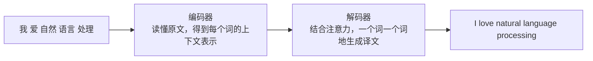
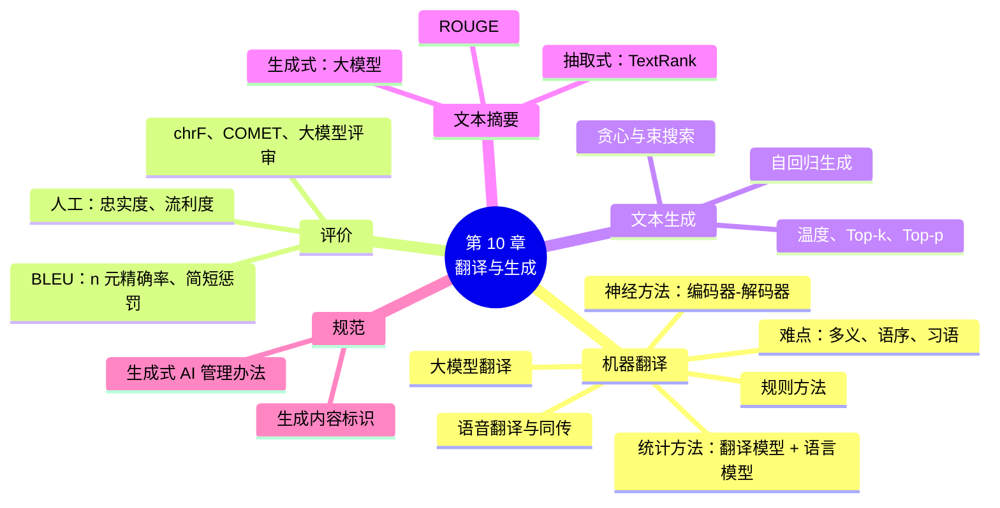

# 第 10 章 机器翻译与文本生成

!!! abstract "本章学时"
    理论 4 学时 · 实验 1 学时（本章共 3 个实验：2 个基础实验 ★，1 个拓展实验 ☆，教师可任选）

## 学习目标

学完本章，你应该能够：

1. **说出**机器翻译的主要难点，概述机器翻译从规则、统计、神经网络到大模型的发展历程；
2. **解释**统计机器翻译中翻译模型和语言模型的作用，以及神经机器翻译的编码器-解码器结构；
3. **比较**专用翻译模型和大模型翻译的优缺点，了解主流翻译产品；
4. **计算**并解读 BLEU 值，说明自动评价指标的局限；
5. **区分**抽取式摘要和生成式摘要，使用 TextRank 抽取摘要并用 ROUGE 评价；
6. **解释**贪心搜索、束搜索、温度、Top-k、Top-p 等解码策略对生成结果的影响；
7. **了解**生成式人工智能内容标识等管理要求，能在本地部署运行开源大模型。

## 情景导入

小李在一家跨境电商公司做运营，每天要把上百个商品标题和描述翻译成英语、西班牙语、阿拉伯语，还要回复来自世界各地的买家咨询。十年前，这样的工作需要一个多语种的翻译团队；今天，小李一个人借助翻译工具和大模型就能完成：先让大模型按照“地道、简洁、突出卖点”的要求翻译，再快速检查一遍关键信息。

出国旅行时，你可以戴上翻译耳机和当地人交谈；看外国视频时，平台会自动生成中文字幕；写工作周报时，大模型能帮你拟好初稿；读一篇长报告时，它能在几秒钟内给出摘要。这些都是**机器翻译**和**文本生成**技术的应用。

机器翻译是自然语言处理最古老的任务之一，也是推动 NLP 技术不断进步的重要力量：第 9 章的注意力机制和 Transformer，最初都是为机器翻译设计的。本章我们先学习机器翻译，再扩展到更一般的文本生成：计算机是怎样“写”出一段话的？怎样判断它写得好不好？

## 10.1 机器翻译概述

### 10.1.1 什么是机器翻译

**机器翻译**（Machine Translation，MT）是利用计算机把一种自然语言（**源语言**）自动转换为另一种自然语言（**目标语言**），并保持意思不变的技术。

机器翻译的应用非常广泛：

| 场景 | 应用 |
|---|---|
| 日常生活 | 网页翻译、拍照翻译、旅行中的语音翻译 |
| 跨境贸易 | 商品信息翻译、多语种客服、外贸邮件 |
| 学习科研 | 外文文献阅读、论文写作润色 |
| 文化传播 | 视频字幕翻译、网络文学出海 |
| 政务外事 | 国际会议同声传译辅助、涉外服务 |
| 企业办公 | 合同、说明书、技术文档的翻译 |

需要说明的是，机器翻译还不能完全取代人工翻译。在法律合同、医疗说明、正式出版物等要求严格的场合，通常采用“**机器翻译 + 人工译后编辑**”的方式：先由机器翻译出初稿，再由专业译员修改润色。这种模式已经成为翻译行业的主流工作方式，“译后编辑”也成了一项新的职业技能。

### 10.1.2 机器翻译为什么难

人们常说，翻译的最高标准是“信、达、雅”：准确、通顺、优美。对计算机来说，即使做到“信”和“达”也不容易。

**① 一词多义**

> 他走了。
> 
> 可能是“He left.”（离开了），也可能是“He passed away.”（去世了）

计算机必须根据上下文判断词义，有时上下文也不够，还需要常识。

**② 语序与结构差异**

中文和英文的语序有很多不同。中文的定语放在名词前面，英文的长定语往往放在后面：

> 我昨天在图书馆遇到的那个同学 → the classmate (whom) I met in the library yesterday

中文和日语、韩语的差别更大，日语的动词通常放在句末。语言之间的结构差异越大，翻译越难。

**③ 省略与指代**

中文经常省略主语，英文一般不能省略：

> 下雨了，带把伞吧。→ It's raining. Take an umbrella.

译文中要补出原文没有的“It”和隐含的“你”。

**④ 习语与文化差异**

> 他这个人刀子嘴豆腐心。
> 
> 直译：He has a knife mouth and a tofu heart.（外国人看不懂）
> 
> 意译：He has a sharp tongue but a kind heart.

成语、俗语、歇后语、网络流行语，都需要理解其背后的含义，再用目标语言中合适的方式表达。

**⑤ 专业术语与一致性**

在一份技术文档中，同一个术语必须始终用同一种译法。比如“模型”在机器学习文档中译作 model，不能有时译成 model、有时译成 pattern。机器翻译逐句翻译时，很容易出现前后不一致。

### 10.1.3 机器翻译的发展历程

| 阶段 | 时间 | 核心思想 | 代表 |
|---|---|---|---|
| **规则机器翻译** | 1950 年代起 | 语言学家编写词典和语法转换规则 | 1954 年乔治城大学与 IBM 的俄英翻译实验 |
| **统计机器翻译** | 1990 年代起 | 从大量双语对照文本中统计翻译规律 | IBM 翻译模型、基于短语的翻译；早期的谷歌翻译 |
| **神经机器翻译** | 2014 年起 | 用神经网络端到端地完成翻译 | Seq2Seq + 注意力；2016 年谷歌神经机器翻译系统；Transformer |
| **大模型翻译** | 2023 年起 | 通用大语言模型通过提示完成翻译 | GPT、Qwen、DeepSeek 等大模型；专门的翻译大模型 |

1954 年，乔治城大学和 IBM 公司合作，用计算机把 60 多个俄语句子翻译成了英语。这次演示引起了巨大轰动，研究者乐观地预测几年内就能解决机器翻译问题。但事实证明，语言远比想象的复杂。1966 年，美国的一份评估报告认为机器翻译进展缓慢、成本高昂，相关研究经费被大幅削减，机器翻译研究进入了低谷。

此后几十年的发展告诉我们：**靠人工写规则，永远写不完语言的复杂性；让机器从大量数据中学习，才是正确的方向。**

## 10.2 规则与统计机器翻译

### 10.2.1 规则机器翻译

规则机器翻译的基本过程是：**分析源语言 → 转换 → 生成目标语言**。

1. 对源语言句子进行分词、词性标注、句法分析（第 3、4 章的技术）；
2. 查双语词典，把每个词翻译过来；
3. 按照语法转换规则调整结构，比如“把中文的‘的’字结构转换成英文的后置定语”；
4. 按照目标语言的语法生成句子，处理时态、单复数等。

规则方法的优点是翻译结果可以预测和解释，对规范的、领域固定的文本（如天气预报、产品说明）效果不错。缺点是：规则需要大量语言专家编写，成本高；规则之间经常冲突，越写越难维护；对口语、新词和不规范表达几乎无能为力。

### 10.2.2 统计机器翻译

1990 年前后，IBM 的研究者提出了**统计机器翻译**（Statistical Machine Translation，SMT）。它的思想是：不再人工编写规则，而是从大量**双语平行语料**（一句原文对应一句译文的对照文本，比如联合国文件的多语言版本）中，自动统计出翻译规律。

统计机器翻译把翻译看作一个“挑选最佳译文”的问题。以中译英为例，对于中文句子 \(f\)，在所有可能的英文句子 \(e\) 中找出最好的那个。最好的译文要同时满足两个条件：

$$
\hat{e} = \arg\max_e P(f \mid e) \times P(e)
$$

- \(P(f \mid e)\) 是**翻译模型**：衡量译文和原文的意思是否对应，即**“信”**。它从双语语料中统计词语、短语之间的对应关系，比如“苹果”对应“apple”的概率；
- \(P(e)\) 是**语言模型**：衡量译文本身是否通顺，即**“达”**。它从大量英文文本中统计，比如“I eat an apple”比“I an apple eat”更像正常的英语。这就是第 3 章、第 9 章提到的语言模型。

把这两个模型结合起来，就能挑出既忠实又通顺的译文。

统计机器翻译的一个关键技术是**词对齐**：在双语句子中，找出哪个词和哪个词是对应的。

```text
我  爱  自然  语言  处理
|    |    |     |     |
I  love natural language processing
```

在几百万对句子中反复统计，就能发现“爱”和“love”经常一起出现，于是学到它们是对应的。后来，研究者把翻译单位从“词”扩展到“短语”（连续的几个词），提出了**基于短语的统计机器翻译**，效果进一步提升。2006 年上线的谷歌翻译最初就采用了这种方法。

统计机器翻译的问题在于：系统由翻译模型、语言模型、调序模型等很多模块拼接而成，每个模块单独优化，错误会层层累积；而且它主要依靠局部的短语，很难把握整句话的意思，翻译结果常常“每个词都对，连起来不像话”。

## 10.3 神经机器翻译

### 10.3.1 编码器-解码器结构

2014 年，研究者提出用神经网络端到端地完成翻译，这就是**神经机器翻译**（Neural Machine Translation，NMT）。它的基本结构是第 8、9 章介绍过的**编码器-解码器**：



- **编码器**读入原文，为每个词计算融合了上下文的向量表示；
- **解码器**从一个特殊的开始符号出发，每一步根据已生成的译文和编码器的输出（通过注意力机制“回头看”原文的相关部分），预测下一个词，直到生成结束符号。

与统计机器翻译相比，神经机器翻译有三大优势：

1. **端到端训练**：整个系统是一个神经网络，直接从“原文-译文”对中学习，不再需要人工设计多个模块；
2. **理解整句意思**：编码器读完整句话后再翻译，译文更连贯、更通顺；
3. **词向量的泛化能力**：意思相近的词有相近的向量，即使某个词在训练数据中很少出现，模型也能借助相近的词进行翻译。

2016 年，谷歌发布基于 LSTM 的神经机器翻译系统，在多个语言对上把翻译错误减少了一半以上；同一时期，百度、有道等国内翻译产品也相继升级为神经机器翻译。2017 年 Transformer 提出后，很快成为神经机器翻译的标准结构，翻译质量和速度又上了一个台阶。

### 10.3.2 神经机器翻译中的关键技术

**子词切分**：翻译模型的词表大小有限，遇到生僻词、新词、人名怎么办？第 3 章介绍的 **BPE** 等子词切分方法把罕见词拆成常见的片段，比如“unhappiness”拆成“un”“happi”“ness”，这样模型几乎不会遇到“不认识”的词。今天的翻译模型和大模型都使用子词切分。

**束搜索**：解码器生成译文时，每一步都有多个候选词。如果每一步只选概率最大的词（贪心搜索），可能前面选对了，后面却走进死胡同。**束搜索**（Beam Search）每一步同时保留概率最高的几个候选句子（比如 4 个，称为**束宽**），最后从中选出整体概率最高的一个。机器翻译中几乎都使用束搜索（10.6.3 节详细介绍）。

**回译**：双语平行语料获取成本高，单语语料却很丰富。**回译**（Back-Translation）先训练一个反方向的翻译模型，把大量目标语言的单语文本翻译回源语言，得到“伪双语数据”，再用来训练正方向的模型。这是一种常用的数据增强方法。

**多语言翻译模型**：早期每个语言对（中英、中日、英法……）都要单独训练一个模型。现在的做法是训练一个**多语言模型**，同时支持几十甚至上百种语言之间的互译。不同语言之间可以互相“借力”，对于数据很少的小语种帮助尤其大。例如，Meta 开源的 NLLB 项目支持 200 种语言的互译；赫尔辛基大学的 OPUS-MT 项目开源了上千个语言对的轻量翻译模型，实验 10-1 将使用其中的中英翻译模型。

### 10.3.3 语音翻译与同声传译

把**语音识别**、**机器翻译**和**语音合成**组合起来，就构成了**语音翻译**系统：先把说话人的语音转成文字，再翻译，最后用目标语言读出来。翻译机、翻译耳机、视频会议的实时字幕，都基于这个原理。新一代系统正在发展为**端到端的语音翻译**，直接把一种语言的语音转换为另一种语言的语音，延迟更低，还能保留说话人的音色和语气。

**同声传译**更具挑战：它要求说话人还没说完，翻译就要开始。这就需要模型学会“等多久再开口”：等得太久，延迟大；开口太早，可能理解错。在国际会议、展会等场景中，机器同传已经得到实际应用，但在重要场合仍需要人工同传把关。

## 10.4 大模型时代的机器翻译

### 10.4.1 大模型翻译的特点

ChatGPT 出现后，人们发现通用大语言模型虽然没有专门为翻译训练，翻译质量却非常出色，在很多语言对上不输甚至超过专用翻译系统。这是因为大模型在预训练中读过海量的多语言文本，已经掌握了多种语言及其对应关系。

和专用翻译模型相比，大模型翻译有一些独特的优势：

| 能力 | 说明 | 示例提示词 |
|---|---|---|
| **结合上下文** | 可以一次翻译整篇文档，前后的术语和指代保持一致 | “下面是一篇完整的说明书，请翻译全文” |
| **控制风格** | 可以指定正式、口语、营销、儿童读物等风格 | “请翻译成适合社交媒体发布的活泼风格” |
| **遵守术语表** | 可以在提示中给出术语对照表 | “‘大模型’统一译为 large model” |
| **处理习语** | 对成语、俗语、网络用语的理解更好 | “刀子嘴豆腐心” |
| **解释与改写** | 不仅翻译，还能解释译法、给出多种译文供选择 | “给出三种译法并说明区别” |

当然，大模型翻译也有不足：

- **漏译和增译**：可能跳过某些句子，或者加入原文没有的内容，长文档中尤其要注意；
- **不按要求输出**：有时会附带解释性文字，或者把要翻译的内容当作指令执行（第 12 章的“提示注入”）；
- **速度和成本**：大模型推理较慢，调用 API 需要付费；专用翻译模型体积小、速度快、可以离线运行；
- **数据安全**：把内部文件发送到外部的大模型服务，存在泄密风险。

在实际应用中，常见的做法是：对时效性要求高、数据量大的场景（如网页翻译、实时字幕）使用专用翻译模型；对质量要求高、需要控制风格的场景使用大模型；敏感文档使用本地部署的开源模型。

### 10.4.2 主流翻译产品

| 产品 | 开发者 | 特点 |
|---|---|---|
| 百度翻译 | 百度 | 支持语种多，提供文档翻译和开放 API |
| 有道翻译 | 网易有道 | 学生群体使用广泛，推出了翻译大模型和词典笔等硬件 |
| 腾讯翻译君 | 腾讯 | 提供同声传译等功能，集成在微信等产品中 |
| 讯飞翻译 | 科大讯飞 | 语音翻译见长，有翻译机等硬件产品 |
| 谷歌翻译、DeepL | 谷歌、DeepL 公司 | 国外常用的翻译工具，DeepL 以译文自然著称 |
| 通用大模型 | 各厂商 | DeepSeek、通义千问、豆包等都可以直接用于翻译 |

此外，浏览器插件（如“沉浸式翻译”）可以调用多种翻译引擎和大模型，在网页上实现中英文对照显示，是阅读外文资料的好帮手。

## 10.5 机器翻译的评价

### 10.5.1 人工评价

最可靠的评价方法是请懂两种语言的人来打分，常用两个维度：

- **忠实度**（Adequacy）：译文是否准确、完整地传达了原文的意思；
- **流利度**（Fluency）：译文本身是否通顺自然，符合目标语言的习惯。

人工评价准确，但成本高、速度慢，而且不同评价者的标准不完全一致。研究人员每改进一次模型就要评价一次，不可能每次都请人。因此需要**自动评价指标**。

### 10.5.2 BLEU

**BLEU**（Bilingual Evaluation Understudy）由 IBM 的研究者在 2002 年提出，是机器翻译领域使用最广泛的自动评价指标。它的思想很朴素：**机器译文和人工参考译文越相似，翻译质量就越好**。相似程度用 **n 元组**（连续 n 个词）的重合程度来衡量。

**第一步：计算修正的 n 元精确率**

统计机器译文中有多少个 n 元组出现在参考译文中。以实验 10-1 中的例子说明：

> 参考译文：artificial intelligence is changing the way we learn and work .
>
> 机器译文：artificial intelligence is changing how we learn and work .

- **1 元组**（单个词）：机器译文共 10 个词，每个词都出现在参考译文中（“how”出现在第二个参考译文中），精确率 10/10；
- **2 元组**（相邻两个词）：机器译文共 9 个，“changing how”“how we”不在第一个参考译文中，但“how we”在第二个参考译文中出现，命中 8 个，精确率 8/9；
- 依此类推计算 3 元组、4 元组。

“修正”的意思是：每个 n 元组被计为命中的次数，不能超过它在参考译文中出现的次数。否则，一个只包含“the the the the”的译文，1 元精确率就会是 100%。

1 元组的精确率反映**用词是否准确**（信），2 元组以上的精确率反映**语序和搭配是否正确**（达）。

**第二步：长度惩罚**

精确率有一个漏洞：译文越短，越容易“精确”。只译出“artificial intelligence is changing .”，每个词都对，但意思不完整。所以 BLEU 加入了**简短惩罚**（Brevity Penalty，BP）：译文长度 \(c\) 比参考译文长度 \(r\) 短时，打一个折扣：

$$
BP = \begin{cases} 1, & c > r \\ e^{1 - r/c}, & c \le r \end{cases}
$$

**第三步：综合**

把 1 到 4 元精确率 \(p_1, \dots, p_4\) 取几何平均，再乘以长度惩罚：

$$
\text{BLEU} = BP \times \exp\left(\frac{1}{4}\sum_{n=1}^{4} \log p_n\right)
$$

BLEU 的取值在 0 到 1 之间，论文和报告中也常乘以 100 表示。一般来说，BLEU 在 30 以上（即 0.3）的译文基本可以理解，40 以上质量较好。但不同语言对、不同测试集的 BLEU 不能直接比较。

### 10.5.3 BLEU 的局限与新的评价方法

BLEU 简单、快速、可重复，但它只看“字面上”的重合，有明显的局限：

- **不懂同义词和改写**：译文意思完全正确，但换了一种说法，BLEU 就会很低。实验 10-1 中会看到，一个完全正确的意译得分甚至低于一个词序全乱的句子；
- **依赖参考译文**：参考译文只有一两个，而正确的译法可能有很多种；
- **不评价意思是否正确**：漏掉一个“不”字，意思完全相反，BLEU 可能只降一点点；
- **句子级不稳定**：BLEU 设计用于评价整个测试集，单个句子的 BLEU 波动很大。

因此，研究者提出了更多评价方法：

| 指标 | 思路 |
|---|---|
| **chrF** | 按字符计算重合度，对词形变化多的语言和中文更友好 |
| **METEOR** | 考虑同义词、词干，兼顾精确率和召回率 |
| **COMET** 等 | 用预训练模型计算译文与原文、参考译文在语义上的相似度，与人工评价的一致性明显高于 BLEU |
| **大模型评价** | 让大模型扮演评审，从准确、流畅、术语等方面打分并给出理由，但要注意大模型评审自身的偏好和不稳定性 |

在实际工作中，通常是**自动指标用于快速比较，人工评价用于最终把关**。

## 10.6 文本生成

### 10.6.1 文本生成的任务

**文本生成**（Text Generation）是指让计算机自动产生自然语言文本。机器翻译可以看作文本生成的一种，以一种语言的文本为输入，生成另一种语言的文本。常见的文本生成任务还有：

| 任务 | 输入 → 输出 | 应用 |
|---|---|---|
| **文本摘要** | 长文本 → 短文本 | 新闻摘要、会议纪要、论文速读 |
| **对话生成** | 对话历史 → 回复 | 聊天机器人、智能客服 |
| **写作辅助** | 题目或要点 → 文章 | 公文、营销文案、邮件、周报 |
| **数据到文本** | 表格、数据 → 描述 | 财报解读、天气预报、体育赛事战报 |
| **改写与润色** | 文本 → 改写后的文本 | 语法纠错、风格转换、简化 |
| **代码生成** | 需求描述 → 程序代码 | 编程助手 |

在大模型出现之前，每类生成任务往往需要单独训练模型；今天，一个大语言模型通过不同的提示词，就能完成上面几乎所有任务。

### 10.6.2 语言模型如何“写”文章

第 9 章介绍过，GPT 类大模型的预训练任务是“根据前文预测下一个词”。生成文本时，模型就是**一个词一个词地往后写**：


这种“用自己生成的内容作为下一步的输入”的方式，称为**自回归生成**（Autoregressive Generation）。在大模型中，每一步预测的是一个 Token（第 3 章），可能是一个字、一个词或词的一部分。

这里的关键问题是：**模型给出了下一个词的概率分布，我们具体选哪个词？** 选词的方法称为**解码策略**，它对生成结果的影响非常大。

### 10.6.3 解码策略

**① 贪心搜索**

每一步都选概率最大的词。简单、确定，但有两个问题：一是“短视”，每步最优不等于整句最优；二是容易**陷入重复**，比如“味道不错，就是送餐员态度很快，味道不错，就是送餐员态度很快……”。实验 10-3 会亲眼看到这个现象。

**② 束搜索**

每一步保留概率最高的 \(k\) 个候选序列（\(k\) 为束宽），最后选出整体概率最高的序列。束搜索比贪心搜索更“有远见”，在机器翻译、摘要等**有标准答案**的任务中效果好。但在开放式写作中，束搜索倾向于生成平淡、保守、重复的文字。

**③ 随机采样与温度**

按照概率分布随机抽取下一个词：概率 0.35 的词有 35% 的机会被选中，概率 0.05 的词也有 5% 的机会。这样每次生成的结果都不同，更有创意，更像人写的文字。

**温度**（Temperature）用来调节概率分布的“尖锐”程度：先把模型给出的每个得分除以温度 \(T\)，再用 Softmax 计算概率：

$$
p_i = \frac{\exp(z_i / T)}{\sum_j \exp(z_j / T)}
$$

- \(T < 1\)：高概率的词更高，低概率的词更低，分布更“尖锐”，输出更保守、稳定；
- \(T = 1\)：保持模型原始的概率分布；
- \(T > 1\)：概率被“拉平”，低概率的词更容易被选中，输出更多样，但也更容易出现胡言乱语；
- \(T \to 0\)：相当于贪心搜索。很多大模型 API 允许把温度设为 0，以获得尽可能稳定的输出。

**④ Top-k 采样**

只在概率最高的 \(k\) 个词中随机抽取，排除那些概率很低、可能导致胡言乱语的词。问题是 \(k\) 是固定的：当模型很有把握时（比如“中华人民共和”后面几乎一定是“国”），\(k=50\) 会引入不必要的风险；当可选的词很多时，\(k=5\) 又限制了多样性。

**⑤ Top-p 采样（核采样）**

把词按概率从高到低排列，从最高的开始累加，直到累计概率达到 \(p\)（比如 0.9），只在这些词中抽取。这样，候选词的数量会随着模型的“把握程度”自动调整：有把握时只有一两个候选，没把握时候选多一些。Top-p 是目前大模型最常用的采样方法之一。

此外，还有**重复惩罚**（降低已经出现过的词的概率）、**最大长度**、**停止词**等参数，用来控制生成的质量和长度。

**参数设置建议**：

| 任务 | 建议设置 | 理由 |
|---|---|---|
| 翻译、信息抽取、分类、代码 | 温度 0–0.3 | 需要准确、稳定、可复现 |
| 问答、客服、摘要 | 温度 0.3–0.7 | 准确为主，表达可以略有变化 |
| 写作、头脑风暴、广告语 | 温度 0.7–1.0，Top-p 0.9 左右 | 需要创意和多样性 |

一般建议只调整温度和 Top-p 中的一个，不要同时大幅调整两者。

### 10.6.4 文本摘要

**文本摘要**（Text Summarization）是把一篇长文本浓缩为简短的摘要，保留主要信息。按照生成方式，可以分为两类：

| 类型 | 做法 | 优点 | 缺点 |
|---|---|---|---|
| **抽取式摘要** | 从原文中挑选最重要的几个句子，原样拼接 | 句子来自原文，不会编造事实；无需训练 | 句子之间可能不连贯；不能概括和改写；可能有冗余 |
| **生成式摘要** | 理解原文后，用自己的话重新组织表述 | 简洁流畅，能高度概括 | 可能编造原文没有的内容（幻觉）；需要大模型或专门训练 |

**TextRank 抽取式摘要**

**TextRank** 是 2004 年提出的经典抽取式方法，它借鉴了谷歌搜索的网页排名算法 **PageRank**。PageRank 的思想是：一个网页被越多重要的网页链接，它就越重要。TextRank 把这个思想用到句子上：

1. 把文章切分成句子，每个句子作为图中的一个**节点**；
2. 计算任意两个句子的相似度（比如共同词语的数量），作为两个节点之间**边的权重**；
3. 运行 PageRank 算法：一个句子和越多重要的句子相似，它就越重要，就像被越多人“投票推荐”；
4. 选出得分最高的几个句子，按原文顺序排列，作为摘要。

TextRank 不需要任何训练数据，对任何语言、任何领域的文章都能直接使用。同样的方法也可以用来提取**关键词**：把词作为节点，在同一窗口内共同出现的词之间连边。jieba 中就提供了 `jieba.analyse.textrank` 关键词提取函数。

**生成式摘要**

生成式摘要早期使用编码器-解码器模型（如 BART、T5、PEGASUS）在新闻摘要数据集上训练。今天，最方便的方法是直接让大模型生成摘要，并在提示词中提出明确的要求：字数限制、面向的读者、需要保留的要素（时间、数字、结论），以及输出格式（一句话、要点列表、表格）。

**ROUGE 评价**

摘要的自动评价指标是 **ROUGE**（Recall-Oriented Understudy for Gisting Evaluation），它和 BLEU 是“兄弟”：

- **BLEU** 侧重**精确率**：机器译文中的内容有多少在参考译文中，关注“说得对不对”；
- **ROUGE** 侧重**召回率**：参考摘要中的内容有多少被机器摘要覆盖了，关注“说得全不全”。

常用的有 ROUGE-1（单个字或词的重合）、ROUGE-2（相邻两个字或词的重合）和 ROUGE-L（最长公共子序列）。中文通常按字计算 ROUGE。和 BLEU 一样，ROUGE 也只看字面重合，无法判断摘要是否准确、是否通顺，需要结合人工评价。

## 10.7 生成式人工智能的管理

大模型能够生成以假乱真的文字、图片、音频和视频，在带来便利的同时，也带来了虚假信息、学术不端、侵犯版权等问题。我国对生成式人工智能实行“发展与安全并重”的管理思路，与本章内容关系密切的规定有：

- **《生成式人工智能服务管理暂行办法》**（2023 年 8 月 15 日起施行）：对面向公众提供生成式人工智能服务的企业提出了要求，包括训练数据合法、生成内容不得含有违法信息、对生成内容进行标识、建立投诉举报机制等；
- **《人工智能生成合成内容标识办法》**（2025 年 9 月 1 日起施行）：要求对人工智能生成的文本、图片、音频、视频等内容添加**标识**，包括让用户能直接看到的显式标识（如“本内容由 AI 生成”的提示）和写在文件元数据中的隐式标识，方便识别内容的来源。

作为未来的从业者，同学们在使用 AI 生成内容时要做到：**对内容负责**，发布前核实事实，不传播虚假信息；**如实说明**，在需要的场合标注 AI 生成或 AI 辅助；**遵守规范**，在课程作业、论文中遵守学校关于 AI 使用的规定。更多内容将在第 12 章讨论。

## 10.8 前沿视窗：更自然、更实时的生成

- **实时语音翻译**：端到端的语音大模型可以边听边译，并用接近原说话人的声音说出译文，延迟只有一两秒。在视频通话、直播、跨国会议中，“语言障碍”正在快速降低。
- **端侧翻译**：小型翻译模型可以完全运行在手机、翻译机、智能眼镜上，不需要联网，适合出国旅行和保密场景。
- **长文档翻译与智能体**：面对一整本书或一份几百页的技术手册，新的翻译系统会先提取术语表、理解全文结构，再分段翻译、交叉检查，保证术语前后一致，这其实是第 11 章“智能体”的思路。
- **多模态生成**：文本生成正在与图像、语音、视频生成融合。输入一段文字描述，就可以生成配图、配音甚至短视频，内容创作的方式正在被重塑。
- **本地部署**：借助 Ollama、LM Studio 等工具，普通电脑也能离线运行量化后的开源大模型，在保护隐私的前提下使用大模型能力（实验 10-3）。

## 本章实验

!!! abstract "实验总览"
    | 实验 | 类型 | 建议时长 | 内容 |
    |---|---|---|---|
    | 实验 10-1 | ★ 基础 | 45 分钟 | 读懂 BLEU，比较翻译模型与大模型翻译 |
    | 实验 10-2 | ★ 基础 | 40 分钟 | TextRank 抽取式摘要与大模型生成式摘要 |
    | 实验 10-3 | ☆ 拓展 | 60 分钟 | 解码策略实验与 Ollama 本地部署大模型 |

    实验代码见配套资源 `labs/ch10/` 目录。实验 10-1 第 1 部分、实验 10-2 第 1–3 部分、实验 10-3 第 1 部分可以完全离线运行。

### 实验 10-1 ★ 读懂 BLEU，比较翻译模型与大模型翻译

**实验目的**

1. 亲手计算 n 元精确率，理解 BLEU 的计算方法；
2. 通过精心设计的例子，认识 BLEU 的局限；
3. 使用 Transformers 运行开源的神经机器翻译模型；
4. 比较专用翻译模型与大模型的翻译效果。

**实验环境**：实验 1-1 的环境。第 2 部分需联网下载 `Helsinki-NLP/opus-mt-zh-en` 模型（约 300MB），第 3 部分需要大模型 API Key（见附录 D），另需安装 `pip install openai sentencepiece`。

**实验步骤与代码**

第 1 部分（`lab10_1_bleu.py`）：用一个中文句子、两个参考译文和编者构造的 4 个待评价译文，观察 BLEU 的计算过程。

```python
"""实验 10-1 第 1 部分：读懂 BLEU——机器翻译的自动评价"""
from collections import Counter
from nltk.translate.bleu_score import sentence_bleu, SmoothingFunction

source = "人工智能正在改变我们学习和工作的方式。"
references = [   # 两位译者给出的参考译文
    "artificial intelligence is changing the way we learn and work .".split(),
    "ai is transforming how we study and work .".split(),
]
candidates = {   # 编者构造的 4 个待评价译文
    "A 意思对、措辞接近": "artificial intelligence is changing how we learn and work .",
    "B 意思对、换了说法": "ai has been reshaping our ways of studying and working .",
    "C 词都对、顺序乱": "work and learn we way the changing is intelligence artificial .",
    "D 太短": "artificial intelligence is changing .",
}


def ngram_precision(cand, refs, n):
    """修正的 n 元精确率：候选译文中有多少个 n 元组出现在参考译文里"""
    cand_ngrams = Counter(tuple(cand[i:i + n]) for i in range(len(cand) - n + 1))
    max_ref = Counter()
    for ref in refs:
        ref_ngrams = Counter(tuple(ref[i:i + n]) for i in range(len(ref) - n + 1))
        for g in ref_ngrams:
            max_ref[g] = max(max_ref[g], ref_ngrams[g])
    hit = sum(min(c, max_ref[g]) for g, c in cand_ngrams.items())   # 每个 n 元组最多算参考中出现的次数
    return hit, sum(cand_ngrams.values())


smooth = SmoothingFunction().method1
print("原文：", source)
for name, text in candidates.items():
    cand = text.split()
    precisions = []
    for n in range(1, 5):
        hit, total = ngram_precision(cand, references, n)
        precisions.append(f"{hit}/{total}")
    bleu = sentence_bleu(references, cand, smoothing_function=smooth)
    print(f"{name:<12} 1~4 元精确率 {' '.join(precisions):<22} BLEU = {bleu:.3f}")
```

运行结果：

```text
原文： 人工智能正在改变我们学习和工作的方式。
A 意思对、措辞接近   1~4 元精确率 10/10 8/9 5/8 3/7      BLEU = 0.699
B 意思对、换了说法   1~4 元精确率 3/11 0/10 0/9 0/8      BLEU = 0.025
C 词都对、顺序乱    1~4 元精确率 11/11 0/10 0/9 0/8     BLEU = 0.034
D 太短         1~4 元精确率 5/5 3/4 2/3 1/2        BLEU = 0.318
```

**第 1 部分结果解读**

1. **译文 A 得分最高**（0.699）。它和第一个参考译文只差一处（“the way”换成了“how”），而“how”恰好出现在第二个参考译文中。这说明**多个参考译文**可以让评价更宽容。
2. **译文 B 意思完全正确，BLEU 却只有 0.025**。它用了“reshaping”“ways of studying and working”这些与参考译文不同但同样正确的说法，2 元组以上一个都没有命中。这就是 BLEU 最大的问题：**不懂同义改写**。
3. **译文 C 是一堆乱序的单词，BLEU（0.034）反而比 B 还高**。它的单词全部正确，1 元精确率 11/11，只是 2 元以上全部为 0。这说明 2、3、4 元精确率在检查语序方面起了作用，但单个句子的 BLEU 并不可靠。（代码中使用了平滑函数，避免某个精确率为 0 时 BLEU 直接变为 0。）
4. **译文 D 精确率很高但很短**：1 元到 4 元精确率分别是 100%、75%、67%、50%，几何平均约为 0.707；它只有 5 个词，与之长度最接近的参考译文有 9 个词，简短惩罚为 \(e^{1-9/5}\approx0.449\)，最终 BLEU 为 \(0.707\times0.449\approx0.318\)。你可以用计算器验算一下。
5. 结论：**BLEU 适合在大量句子上比较不同系统的整体水平，不适合评判单个句子的好坏**。

第 2、3 部分（`lab10_1_translate.py`）：用 5 个句子比较专用翻译模型和大模型。其中第 4、5 句包含习语“刀子嘴豆腐心”“八字还没一撇”。

```python
"""实验 10-1 第 2、3 部分：神经机器翻译模型 vs. 大模型翻译，并用 BLEU 评价
需要联网：第 2 部分下载 Helsinki-NLP/opus-mt-zh-en（约 300MB，国内先设置 HF_ENDPOINT=https://hf-mirror.com）；
第 3 部分需要大模型 API Key（见附录 D）。
"""
import os
from nltk.translate.bleu_score import corpus_bleu, SmoothingFunction
from transformers import pipeline
from openai import OpenAI

# 5 个中文句子及编者给出的参考译文
data = [
    ("人工智能正在改变我们学习和工作的方式。",
     "Artificial intelligence is changing the way we learn and work."),
    ("这家餐厅的菜味道不错，但是上菜太慢了。",
     "The food in this restaurant tastes good, but the service is too slow."),
    ("明天上午九点在三号教学楼举行期中考试。",
     "The midterm exam will be held in Teaching Building 3 at 9 a.m. tomorrow."),
    ("他这个人刀子嘴豆腐心，你别往心里去。",
     "He has a sharp tongue but a kind heart, so don't take it to heart."),
    ("这个项目八字还没一撇呢。",
     "This project hasn't even got off the ground yet."),
]


def tok(s):
    """简单的英文切分：转小写，标点前后加空格"""
    for p in ",.?!'":
        s = s.replace(p, f" {p} ")
    return s.lower().split()


# ===== 第 2 部分：专门的神经机器翻译模型 =====
mt = pipeline("translation", model="Helsinki-NLP/opus-mt-zh-en")
mt_out = [mt(src)[0]["translation_text"] for src, _ in data]

# ===== 第 3 部分：大模型翻译 =====
client = OpenAI(api_key=os.environ["DEEPSEEK_API_KEY"],
                base_url=os.environ.get("LLM_BASE_URL", "https://api.deepseek.com"))
MODEL = os.environ.get("LLM_MODEL", "deepseek-chat")


def llm_translate(text):
    resp = client.chat.completions.create(
        model=MODEL, temperature=0,
        messages=[{"role": "system", "content": "你是专业的中英翻译。把用户给出的中文翻译成地道的英文，只输出译文。"},
                  {"role": "user", "content": text}])
    return resp.choices[0].message.content.strip()


llm_out = [llm_translate(src) for src, _ in data]

for (src, ref), a, b in zip(data, mt_out, llm_out):
    print(f"原文：{src}\n参考：{ref}\nMT  ：{a}\nLLM ：{b}\n")

refs = [[tok(r)] for _, r in data]
smooth = SmoothingFunction().method1
print("opus-mt 的 BLEU：", round(corpus_bleu(refs, [tok(x) for x in mt_out], smoothing_function=smooth), 3))
print("大模型的 BLEU： ", round(corpus_bleu(refs, [tok(x) for x in llm_out], smoothing_function=smooth), 3))
```

!!! warning "待实测"
    第 2、3 部分需要下载模型和调用大模型 API，教材编写环境无法访问，因此没有给出运行结果。编者已在离线环境中验证了评价部分的代码（分词与 BLEU 计算）。请在联网环境中运行，把结果填入下表。

**实验记录表**

| 句子 | opus-mt 译文 | 大模型译文 | 你认为哪个更好？为什么？ |
|---|---|---|---|
| 1. 人工智能正在改变…… | | | |
| 2. 这家餐厅的菜…… | | | |
| 3. 明天上午九点…… | | | |
| 4. 刀子嘴豆腐心…… | | | |
| 5. 八字还没一撇…… | | | |
| BLEU（5 句整体） | | | |

**结果分析指引**：重点观察两种系统对第 4、5 句习语的处理；对比你的人工判断和 BLEU 的结论是否一致；如果不一致，结合第 1 部分的发现解释原因。

**常见问题排查**

| 现象 | 原因与解决办法 |
|---|---|
| `ValueError: ... requires the SentencePiece library` | 执行 `pip install sentencepiece` |
| `KeyError: 'DEEPSEEK_API_KEY'` | 没有设置 API Key 环境变量，见附录 D |
| BLEU 值为 0 或极小 | 检查译文和参考译文是否用同样的方式切分（大小写、标点） |

**思考与练习**

1. 自己构造一个译文，使它的 BLEU 高于 0.5，但意思与原文相反（提示：加一个 “not”）。这说明了什么？
2. 把第 3 部分的系统提示词改为“请翻译成简洁的、适合产品说明书的英文”，比较译文的变化。
3. 用“沉浸式翻译”等浏览器插件阅读一篇英文技术博客，比较不同翻译引擎的效果。

**实验报告要求**

提交第 1 部分运行结果及对 4 个译文得分的解释、实验记录表、思考题 1 的构造过程和结果。

### 实验 10-2 ★ TextRank 抽取式摘要与大模型生成式摘要

**实验目的**

1. 用 jieba 的 TextRank 提取关键词；
2. 用 networkx 自己实现 TextRank 抽取式摘要；
3. 实现按字计算的 ROUGE，评价摘要质量；
4. 比较抽取式摘要和大模型生成式摘要。

**实验环境**：实验 1-1 的环境，另需 `networkx`（第 7 章已安装）。第 4 部分需要大模型 API Key，没有 Key 时程序会自动跳过。

**实验数据**：`article.txt`，编者撰写的一篇介绍智能客服发展的短文（约 500 字，12 句）；`reference_summary.txt`，编者撰写的参考摘要；`cn_stopwords.txt`，第 2 章使用的停用词表。

**实验步骤与代码**

```python
"""实验 10-2：TextRank 抽取式摘要 vs. 大模型生成式摘要，并用 ROUGE 评价"""
import os
import math
import re
import jieba
import jieba.analyse
import networkx as nx

jieba.setLogLevel("WARN")
text = open("article.txt", encoding="utf-8").read().strip()
reference = open("reference_summary.txt", encoding="utf-8").read().strip()
stopwords = set(open("cn_stopwords.txt", encoding="utf-8").read().split())

# ===== 第 1 部分：TextRank 抽取关键词 =====
print("关键词：", jieba.analyse.textrank(text, topK=8, allowPOS=("n", "vn", "v")))

# ===== 第 2 部分：TextRank 抽取关键句 =====
sentences = [s for s in re.split(r"(?<=[。！？])", text) if s.strip()]
words = [set(w for w in jieba.lcut(s) if w not in stopwords and len(w) > 1) for s in sentences]


def similarity(a, b):
    """两句话的相似度：共同词的数量，除以两句长度的对数之和（TextRank 原论文的公式）"""
    if len(a) < 2 or len(b) < 2:
        return 0.0
    return len(a & b) / (math.log(len(a)) + math.log(len(b)))


G = nx.Graph()
for i in range(len(sentences)):
    for j in range(i + 1, len(sentences)):
        w = similarity(words[i], words[j])
        if w > 0:
            G.add_edge(i, j, weight=w)          # 句子是节点，相似度是边的权重
scores = nx.pagerank(G, weight="weight")        # 和网页排名一样：被越多重要句子“推荐”的句子越重要

print(f"\n共 {len(sentences)} 句，各句得分：")
for i, s in enumerate(sentences):
    print(f"  [{i:2d}] {scores.get(i, 0):.3f}  {s[:24]}…")
top = sorted(sorted(scores, key=scores.get, reverse=True)[:2])   # 取得分最高的 2 句，按原文顺序排列
textrank_summary = "".join(sentences[i] for i in top)
print("\nTextRank 摘要：", textrank_summary)


# ===== 第 3 部分：用 ROUGE 评价摘要 =====
def rouge_n(cand, ref, n):
    """按字计算 ROUGE-N 的召回率：参考摘要中的 n 元组，有多少出现在候选摘要中"""
    clean = lambda s: re.sub(r"[^一-鿿\w]", "", s)
    cand, ref = clean(cand), clean(ref)
    c = [cand[i:i + n] for i in range(len(cand) - n + 1)]
    r = [ref[i:i + n] for i in range(len(ref) - n + 1)]
    hit = sum(min(c.count(g), r.count(g)) for g in set(r))
    return hit / len(r)


def report(name, summary):
    print(f"{name}（{len(summary)} 字）ROUGE-1 = {rouge_n(summary, reference, 1):.3f}  "
          f"ROUGE-2 = {rouge_n(summary, reference, 2):.3f}")


print("\n参考摘要：", reference)
report("TextRank 摘要", textrank_summary)
report("首句摘要（基线）", sentences[0])

# ===== 第 4 部分：大模型生成式摘要（需要 API Key，见附录 D） =====
if os.environ.get("DEEPSEEK_API_KEY"):
    from openai import OpenAI
    client = OpenAI(api_key=os.environ["DEEPSEEK_API_KEY"],
                    base_url=os.environ.get("LLM_BASE_URL", "https://api.deepseek.com"))
    resp = client.chat.completions.create(
        model=os.environ.get("LLM_MODEL", "deepseek-chat"), temperature=0,
        messages=[{"role": "user", "content": f"用一句话（不超过 70 字）概括下面文章的主要内容：\n{text}"}])
    llm_summary = resp.choices[0].message.content.strip()
    print("\n大模型摘要：", llm_summary)
    report("大模型摘要", llm_summary)
else:
    print("\n未设置 DEEPSEEK_API_KEY，跳过第 4 部分")
```

运行结果（未设置 API Key）：

```text
关键词： ['客服', '智能', '人工', '用户', '企业', '系统', '退货', '回答']

共 12 句，各句得分：
  [ 0] 0.077  打开购物网站咨询退货，或者拨打银行的客服电话，最…
  [ 1] 0.081  智能客服是自然语言处理技术应用最广泛的领域之一。…
  [ 2] 0.102  早期的智能客服主要依靠关键词匹配，用户的问题中出…
  [ 3] 0.050  这种方式实现简单，但只要用户换一种说法，系统就可…
  [ 4] 0.082  随后，基于机器学习的意图识别技术被引入客服系统，…
  [ 5] 0.083  大语言模型出现以后，智能客服又迎来了一次升级。…
  [ 6] 0.087  新一代智能客服能够理解复杂的口语表达，记住多轮对…
  [ 7] 0.076  引入大模型后，客服机器人能够独立解决的问题比例有…
  [ 8] 0.082  不过，智能客服仍然面临不少挑战。…
  [ 9] 0.118  大模型有时会编造不存在的政策或优惠，给企业带来纠…
  [10] 0.055  对此，不少消费者呼吁企业保障用户随时选择人工服务…
  [11] 0.108  业内人士认为，智能客服的发展方向不是完全取代人工…

TextRank 摘要： 大模型有时会编造不存在的政策或优惠，给企业带来纠纷；遇到情绪激动的用户，机器的回应往往缺少温度；部分企业把智能客服设置得过于复杂，用户想转人工却找不到入口，引发投诉。业内人士认为，智能客服的发展方向不是完全取代人工，而是人机协作：简单、重复的问题交给机器，复杂、敏感的问题由人工处理，机器还可以为人工客服实时推荐回答、自动填写工单，提高整体服务效率。

参考摘要： 智能客服从关键词匹配、意图识别发展到基于大语言模型，理解能力不断提升，但仍存在编造信息、缺少温度、难转人工等问题，未来的方向是人机协作。
TextRank 摘要（175 字）ROUGE-1 = 0.607  ROUGE-2 = 0.300
首句摘要（基线）（43 字）ROUGE-1 = 0.131  ROUGE-2 = 0.050

未设置 DEEPSEEK_API_KEY，跳过第 4 部分
```

**结果解读**

1. **关键词**：TextRank 提取的“客服、智能、人工、用户、企业”准确反映了文章主题。但“智能客服”被拆成了“智能”和“客服”两个词，这是分词粒度导致的，可以把“智能客服”加入 jieba 的用户词典（第 3 章）。
2. **句子得分**：得分最高的是第 9 句（0.118，智能客服面临的三个挑战）和第 11 句（0.108，人机协作的发展方向），其次是第 2 句（0.102，早期的关键词匹配）。这几句包含了“智能客服”“用户”“人工”“系统”等全文反复出现的词，和很多句子都相似，因此获得了更多“推荐”。得分最低的是第 3 句和第 10 句，它们是承上启下的过渡句，信息量小。
3. **TextRank 摘要**由第 9、11 句组成，抓住了文章后半部分的“挑战”和“方向”，但**完全遗漏了前半部分的技术发展历程**（关键词匹配、意图识别、大模型）。这是抽取式摘要的典型问题：只能整句挑选，无法概括。
4. **ROUGE**：TextRank 摘要的 ROUGE-1 为 0.607，远高于只取第一句的基线（0.131）。不过要注意，TextRank 摘要有 175 字，是参考摘要的 2.5 倍，而 ROUGE 计算的是**召回率**，摘要越长越容易覆盖参考摘要中的字。所以比较 ROUGE 时，必须在相近的长度下进行。
5. 设置 API Key 后运行第 4 部分，观察大模型摘要是否兼顾了文章的前后两部分、长度是否符合要求，并比较它的 ROUGE 与 TextRank 的差别。

!!! warning "待实测"
    第 4 部分（大模型生成式摘要）需要调用大模型 API，教材编写环境无法访问，未给出运行结果。请在联网环境中实测并记录。

**常见问题排查**

| 现象 | 原因与解决办法 |
|---|---|
| `FileNotFoundError: cn_stopwords.txt` | 把第 2 章的停用词表复制到当前目录 |
| `PowerIterationFailedConvergence` | PageRank 未收敛，通常是图中没有边；检查句子切分和停用词表是否正确 |
| 摘要句子顺序混乱 | 选出句子后要按原文中的序号排序，代码中的外层 `sorted` 就是做这件事的 |

**思考与练习**

1. 把摘要的句子数从 2 改为 3，ROUGE 和摘要质量有什么变化？
2. 修改 `similarity` 函数，改用第 5 章的 TF-IDF 余弦相似度计算句子相似度，比较两种方法选出的句子。
3. 设计三种不同的摘要提示词（如“一句话概括”“列出三个要点”“给小学生讲”），比较大模型生成的摘要。

**实验报告要求**

提交运行截图、两种摘要方法的对比表（内容、长度、ROUGE、优缺点），以及思考题 3 的提示词和结果。

### 实验 10-3 ☆ 解码策略实验与 Ollama 本地部署大模型

**实验目的**

1. 用外卖评论训练一个简单的字级语言模型，理解“预测下一个字”的生成过程；
2. 比较贪心解码、温度采样、Top-k、Top-p 的生成效果；
3. 使用 Ollama 在本机部署开源大模型，通过 API 调用并调节温度和 Top-p。

**实验环境**：第 1 部分只需要实验 1-1 的环境和 `waimai_10k.csv`；第 2 部分需要安装 Ollama（ollama.com，支持 Windows、macOS、Linux），建议电脑内存 8GB 以上。

**实验步骤与代码**

第 1 部分（`lab10_3_decoding.py`）：我们用最简单的统计方法，即根据前两个字预测下一个字（三元字模型，原理与第 3 章的 N 元语法相同），来模拟大模型的生成过程。

```python
"""实验 10-3 第 1 部分：训练一个字级语言模型，体验贪心、温度、Top-k、Top-p 解码"""
from collections import Counter, defaultdict
import numpy as np
import pandas as pd

reviews = pd.read_csv("waimai_10k.csv")["review"].astype(str)

# ===== 第 1 步：统计“前两个字 → 下一个字”的次数（三元字模型） =====
BOS, EOS = "^", "$"                      # 句首、句尾标记
counts = defaultdict(Counter)
for r in reviews:
    s = BOS * 2 + r + EOS
    for i in range(len(s) - 2):
        counts[s[i:i + 2]][s[i + 2]] += 1
print("模型记住的“两字上下文”数量：", len(counts))


def next_char_probs(context, temperature=1.0):
    """根据前两个字，给出下一个字的概率分布；温度用来调节分布的“尖锐”程度"""
    c = counts[context[-2:]]
    chars = list(c)
    logits = np.log(np.array([c[ch] for ch in chars], dtype=float))
    p = np.exp(logits / temperature)
    return chars, p / p.sum()


# ===== 第 2 步：看看温度如何改变概率分布 =====
for T in [0.5, 1.0, 2.0]:
    chars, p = next_char_probs("味道", T)
    top = sorted(zip(chars, p), key=lambda t: -t[1])[:5]
    print(f"温度 {T}：“味道”后面最可能的字 " + "  ".join(f"{c}:{q:.2f}" for c, q in top))


# ===== 第 3 步：四种解码方法生成评论 =====
def generate(prefix, method="greedy", temperature=1.0, k=5, p_top=0.9, max_len=30, rng=None):
    text = BOS * 2 + prefix
    for _ in range(max_len):
        chars, p = next_char_probs(text, temperature)
        if method == "greedy":                       # 贪心：永远选概率最大的字
            ch = chars[int(np.argmax(p))]
        else:
            order = np.argsort(-p)
            if method == "top_k":                    # Top-k：只在概率最高的 k 个字里抽
                keep = order[:k]
            elif method == "top_p":                  # Top-p：在累计概率达到 p 的最小集合里抽
                cum = np.cumsum(p[order])
                keep = order[:np.searchsorted(cum, p_top) + 1]
            else:                                    # 纯随机采样：按概率在全部字里抽
                keep = order
            q = p[keep] / p[keep].sum()
            ch = chars[rng.choice(keep, p=q)]
        if ch == EOS:
            break
        text += ch
    return text[2:]


rng = np.random.default_rng(2026)
print("\n贪心解码：")
for prefix in ["送餐", "味道", "下次"]:
    print("  ", generate(prefix, "greedy"))
for name, kw in [("随机采样 温度0.7", dict(method="sample", temperature=0.7)),
                 ("随机采样 温度1.5", dict(method="sample", temperature=1.5)),
                 ("Top-k (k=5)", dict(method="top_k")),
                 ("Top-p (p=0.9)", dict(method="top_p"))]:
    print(f"\n{name}：")
    for _ in range(3):
        print("  ", generate("味道", rng=rng, **kw))
```

运行结果（采样结果与随机种子有关，你的结果可能不同）：

```text
模型记住的“两字上下文”数量： 49143
温度 0.5：“味道”后面最可能的字 不:0.41  还:0.23  一:0.12  很:0.10  也:0.08
温度 1.0：“味道”后面最可能的字 不:0.20  还:0.15  一:0.11  很:0.10  也:0.09
温度 2.0：“味道”后面最可能的字 不:0.07  还:0.06  一:0.05  很:0.05  也:0.04

贪心解码：
   送餐员态度很快，味道不错，就是送餐员态度很快，味道不错，就是送餐
   味道不错，就是送餐员态度很快，味道不错，就是送餐员态度很快，味道
   下次不会再来了，不过还是不是很好吃，送餐员态度很快，味道不错，就

随机采样 温度0.7：
   味道不错，送餐慢可以。
   味道差,味道一般
   味道还可以

随机采样 温度1.5：
   味道，跟在店里的青菜炒饭好硬
   味道也行，第三次根本不参与。不会很慢,卷饼都酸了
   味道好，温温的说，说远这边,所以说是卖家送餐当天体验

Top-k (k=5)：
   味道还可以
   味道还行
   味道也没有

Top-p (p=0.9)：
   味道
   味道也一般吧，哎。
   味道也不来了。根本没送到,真是醉了，味道也还可以
```

**第 1 部分结果解读**

1. **温度改变了概率分布**：“味道”后面最可能的字是“不”。温度为 1 时，“不”的概率是 0.20；温度降到 0.5，“不”升到 0.41，分布更集中；温度升到 2.0，“不”只有 0.07，前五个字的概率差别变得很小，分布被“拉平”。
2. **贪心解码陷入了死循环**：“味道不错，就是送餐员态度很快，味道不错，就是送餐员态度很快……”。因为每一步都选概率最大的字，一旦回到相同的两字上下文，就会无限重复，直到达到最大长度。这是贪心解码在开放式生成中的典型问题。大模型的上下文远长于两个字，但也会出现类似的重复，所以需要重复惩罚等机制。
3. **低温采样（0.7）**生成的句子短而通顺，比如“味道还可以”，但比较平淡。
4. **高温采样（1.5）**生成的句子更多样，但开始胡言乱语，比如“温温的说，说远这边”。
5. **Top-k 和 Top-p** 在多样性和通顺之间取得了平衡。注意 Top-p 生成的第三句“味道也不来了”，虽然每两个相邻的字都很常见，整句却不通顺。这说明只看前两个字的模型“目光太短”，这正是大模型要用 Transformer 看到长上下文的原因。
6. 这个三元字模型约有 4.9 万个“两字上下文”。与第 9 章的大模型相比，它的原理完全相同（预测下一个字），差别在于大模型能看到几千、几万个字的上下文，并且用神经网络而不是简单计数来计算概率。

第 2 部分（`lab10_3_ollama.py`）：用 Ollama 部署通义千问 Qwen3 的小尺寸模型。

**操作步骤**：

1. 从 ollama.com 下载并安装 Ollama。安装后它会在后台运行一个本地服务；
2. 打开命令行，执行 `ollama pull qwen3:1.7b` 下载模型（约 1.4GB，量化后的版本）；
3. 执行 `ollama run qwen3:1.7b`，在命令行中直接与模型对话，输入 `/bye` 退出；
4. 执行 `ollama list` 查看已下载的模型；
5. 运行下面的 Python 程序，通过 API 调用本地模型。

```python
"""实验 10-3 第 2 部分：用 Ollama 在本机运行开源大模型，观察温度和 Top-p 的影响
准备：安装 Ollama 后，在命令行执行  ollama pull qwen3:1.7b
"""
from openai import OpenAI

# Ollama 提供了与 OpenAI 兼容的接口，地址是本机的 11434 端口，API Key 可以随便填
client = OpenAI(base_url="http://localhost:11434/v1", api_key="ollama")
MODEL = "qwen3:1.7b"
prompt = "给一家新开的奶茶店写一句宣传语，不超过 20 个字。/no_think"   # /no_think 关闭 Qwen3 的思考过程

for temperature, top_p in [(0, 1.0), (0.7, 0.9), (1.5, 1.0)]:
    print(f"\n温度 = {temperature}，top_p = {top_p}")
    for i in range(3):          # 同样的设置生成 3 次，看看结果是否相同
        resp = client.chat.completions.create(
            model=MODEL, temperature=temperature, top_p=top_p,
            messages=[{"role": "user", "content": prompt}])
        print(f"  第 {i + 1} 次：{resp.choices[0].message.content.strip()}")
```

!!! warning "待实测"
    第 2 部分需要从 Ollama 官网下载软件和模型，教材编写环境无法访问，未给出运行结果。请在本机实测，并填写下表。

**实验记录表**

| 设置 | 第 1 次 | 第 2 次 | 第 3 次 | 三次是否相同？ |
|---|---|---|---|---|
| 温度 0 | | | | |
| 温度 0.7，Top-p 0.9 | | | | |
| 温度 1.5 | | | | |

**结果分析指引**：温度为 0 时，三次的结果应该相同或几乎相同；温度越高，三次结果的差别越大，创意越多，但出现病句、跑题的可能性也越大。结合第 1 部分的结果，说明温度在“稳定”和“创意”之间的权衡。观察模型运行时电脑的内存和 CPU 占用，体会本地部署的硬件要求。

**常见问题排查**

| 现象 | 原因与解决办法 |
|---|---|
| `Connection refused` | Ollama 服务没有运行，打开 Ollama 应用，或在命令行执行 `ollama serve` |
| 模型下载很慢 | 换一个时间段下载；或从魔搭社区下载 GGUF 格式的模型文件后导入 Ollama |
| 输出中包含 `<think></think>` | Qwen3 的思考标记，提示词中的 `/no_think` 会让思考内容为空，可以在程序中删去这对标记 |
| 回答速度很慢 | 换更小的模型（如 `qwen3:0.6b`），关闭其他占内存的程序 |

**思考与练习**

1. 在第 1 部分中，把三元字模型改为“根据前三个字预测下一个字”（四元字模型），生成的句子更通顺了吗？有没有新的问题？（提示：更多上下文从未在训练数据中出现过。）
2. 在第 1 部分的 `generate` 函数中加入简单的重复惩罚：如果一个字在已生成的文本中出现过，就把它的概率乘以 0.5。贪心解码还会陷入死循环吗？
3. 用 Ollama 再下载一个不同的模型（如 `deepseek-r1:1.5b`），用同样的问题测试，比较回答的质量和速度。

**实验报告要求**

提交第 1 部分的运行结果和对各种解码方法的分析、第 2 部分的实验记录表和本地运行截图，以及思考题的实验记录。

## 本章小结

- **机器翻译**的难点包括一词多义、语序差异、省略与指代、习语与文化差异、术语一致性；它经历了**规则、统计、神经网络、大模型**四个阶段。
- **统计机器翻译**用**翻译模型**保证“信”、用**语言模型**保证“达”，依靠**词对齐**从双语平行语料中学习。
- **神经机器翻译**采用**编码器-解码器 + 注意力**结构，今天以 Transformer 为主，结合子词切分、束搜索、回译、多语言模型等技术。
- **大模型翻译**能结合上下文、控制风格、遵守术语，但存在漏译增译、成本和数据安全等问题；实际中常将专用翻译模型、大模型和人工译后编辑结合使用。
- **BLEU** 用修正的 n 元精确率和简短惩罚评价译文，简单快速但不懂同义改写；COMET、大模型评价等新方法更接近人工判断。
- 大模型通过**自回归**方式逐个 Token 生成文本。**解码策略**包括贪心搜索、束搜索、随机采样；**温度**调节分布的尖锐程度，**Top-k**、**Top-p** 限制候选范围。
- **文本摘要**分为**抽取式**（如 TextRank，不会编造但不能概括）和**生成式**（如大模型，流畅但可能幻觉），常用 **ROUGE** 评价。
- 我国对生成式人工智能有明确的管理规定，AI 生成内容需要**标识**；使用 AI 生成内容时要核实事实、如实说明。



**拓展阅读**

- 肖桐、朱靖波，《机器翻译：基础与模型》，电子工业出版社。东北大学自然语言处理实验室编写，系统介绍统计与神经机器翻译，作者在网上公开了电子版。
- Papineni 等，“BLEU: a Method for Automatic Evaluation of Machine Translation”（2002），BLEU 的原始论文。
- Holtzman 等，“The Curious Case of Neural Text Degeneration”（2019），提出 Top-p（核采样）的论文，分析了贪心和束搜索导致文本重复的原因。
- 国家互联网信息办公室网站发布的《生成式人工智能服务管理暂行办法》《人工智能生成合成内容标识办法》全文。
- Ollama 官方文档（docs.ollama.com），了解模型下载、运行和 API 调用的方法。

## 课后练习

**一、选择题**

1. 在统计机器翻译中，负责衡量译文是否通顺的是（　　）。
   A. 翻译模型　B. 语言模型　C. 词对齐　D. 词典

2. 神经机器翻译最常用的基本结构是（　　）。
   A. 编码器-解码器　B. 决策树　C. 朴素贝叶斯　D. 隐马尔可夫模型

3. BLEU 中的简短惩罚是为了防止（　　）。
   A. 译文过长　B. 译文过短却获得高分　C. 词序错误　D. 参考译文太多

4. 把温度设为接近 0 时，大模型的输出（　　）。
   A. 更加多样　B. 更加稳定，接近贪心搜索　C. 更长　D. 完全随机

5. Top-p 采样中，参数 p 表示（　　）。
   A. 保留词的个数　B. 候选词的累计概率阈值　C. 温度　D. 束宽

6. 下列关于抽取式摘要的说法，正确的是（　　）。
   A. 会用自己的话改写原文　B. 摘要句子来自原文，不会编造事实　C. 一定比生成式摘要好　D. 必须使用大模型

**二、判断题**

1. BLEU 值越高，译文的意思一定越准确。（　　）
2. 束搜索每一步只保留一个概率最大的候选。（　　）
3. TextRank 需要大量标注数据进行训练。（　　）
4. ROUGE 主要关注召回率，BLEU 主要关注精确率。（　　）
5. 根据我国规定，人工智能生成的内容需要添加标识。（　　）

**三、填空题**

1. 一句原文对应一句译文的双语对照文本称为________语料。
2. 用自己生成的内容作为下一步输入、逐个生成 Token 的方式称为________生成。
3. 温度大于 1 时，概率分布变得更________（填“尖锐”或“平坦”）。
4. TextRank 借鉴了谷歌网页排名算法________的思想。

**四、简答题**

1. 举例说明机器翻译的三个难点。
2. 比较专用神经机器翻译模型和大模型翻译的优缺点，并说明各自适合的场景。
3. 说明贪心搜索、温度采样和 Top-p 采样的区别，以及写广告语和做翻译时应该如何设置温度。

**五、实践题**

选择一段 300 字左右的中文介绍（如你的家乡、学校或一种传统美食），分别用一种翻译产品（如百度翻译、有道翻译）和一个大模型翻译成英文。再请英语较好的同学或老师对两份译文按照“忠实度”和“流利度”各打 1–5 分，并统计你认为翻译不当的地方。最后写一份不少于 500 字的比较报告，说明两种工具各自的优缺点，并给出你在不同场景下的使用建议。

??? success "参考答案"
    **选择题：** 1. B　2. A　3. B　4. B　5. B　6. B

    **判断题：** 1. ×　2. ×（保留多个，即束宽个）　3. ×（无需训练）　4. √　5. √

    **填空题：** 1. 平行　2. 自回归　3. 平坦　4. PageRank

    **简答题第 1 题：** ① 一词多义：“他走了”可能是离开，也可能是去世；② 语序差异：中文定语前置，英文长定语后置，如“我昨天遇到的同学”译为 the classmate I met yesterday；③ 习语与文化：“刀子嘴豆腐心”不能直译，应意译为 a sharp tongue but a kind heart。（答出省略指代、术语一致性等也可。）

    **简答题第 2 题：** 专用神经机器翻译模型体积小、速度快、成本低、可离线运行，适合网页翻译、实时字幕等大批量、对时效要求高的场景，但难以控制风格、长文档一致性较差；大模型翻译能结合上下文、按要求控制风格和术语、处理习语更好，适合高质量文档、营销文案等场景，但速度慢、成本高，可能漏译增译，敏感数据存在泄露风险，敏感文档宜使用本地部署的开源模型。

    **简答题第 3 题：** 贪心搜索每步选概率最大的词，结果确定但容易重复、平淡；温度采样按概率随机抽取，温度越高越多样、越容易出错；Top-p 采样只在累计概率达到 p 的候选词中抽取，候选数量随模型把握程度自动调整，兼顾多样性和通顺。写广告语需要创意，温度可设为 0.7–1.0；做翻译需要准确稳定，温度应设为 0–0.3。
