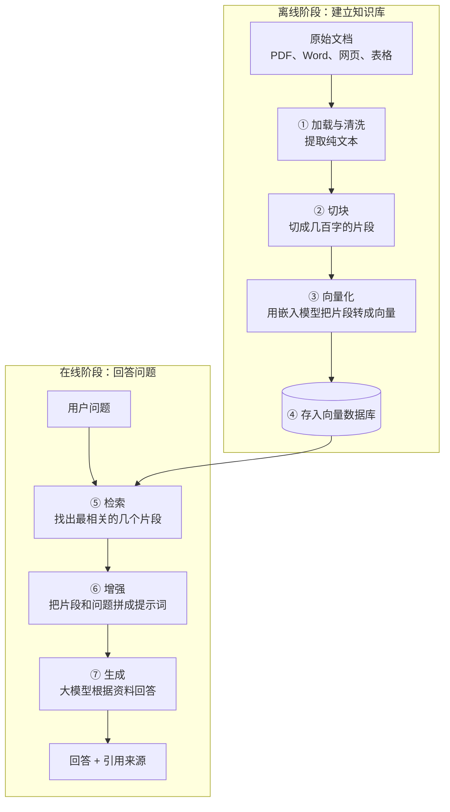
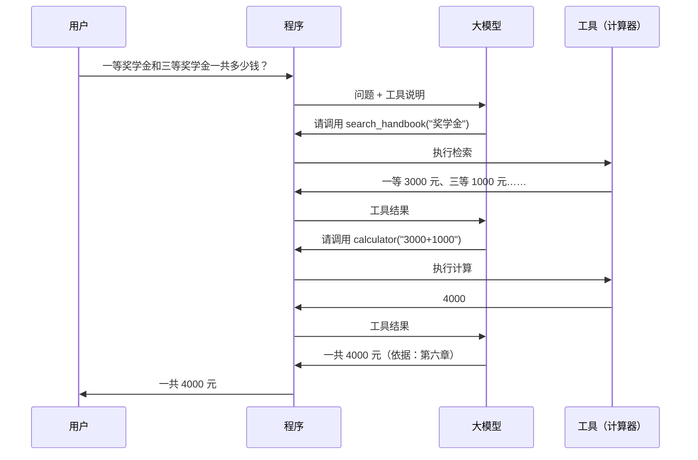
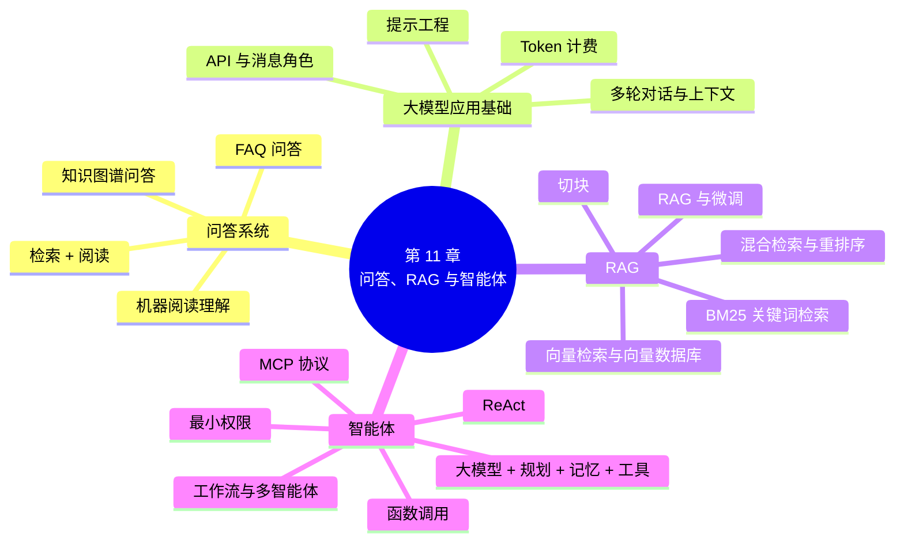

# 第 11 章 问答系统、RAG 与智能体

!!! abstract "本章学时"
    理论 7 学时 · 实验 1 学时（本章共 3 个实验：2 个基础实验 ★，1 个拓展实验 ☆，教师可任选）

## 学习目标

学完本章，你应该能够：

1. **说出**问答系统的主要类型，了解知识库问答、FAQ 检索、机器阅读理解等传统技术；
2. **使用**大模型 API 完成单轮、多轮对话，理解角色、温度、Token 计费等概念；
3. **运用**零样本、少样本、思维链、结构化输出等提示工程技巧，编写高质量提示词；
4. **解释**检索增强生成（RAG）解决的问题，描述“切块、向量化、检索、增强、生成”的完整流程；
5. **比较**关键词检索、向量检索和混合检索，能根据场景选择 RAG 或微调；
6. **说明**智能体的组成和工作方式，理解函数调用、ReAct 和 MCP 协议；
7. **搭建**一个基于学生手册的 RAG 问答系统，并使用低代码平台创建智能体。

!!! info "先修要求"
    学习本章前，你需要掌握：

    - TF-IDF、BM25、余弦相似度、文本嵌入和向量数据库（[5.4](../05-representation/index.md#54-tf-idf)、[5.5](../05-representation/index.md#55)、[5.7](../05-representation/index.md#57)），本章的检索全部建立在它们之上；
    - 知识图谱和三元组（[7.5 知识图谱](../07-ner/index.md#75)）；
    - 大模型的训练过程、幻觉、微调与 LoRA（[9.4](../09-transformer/index.md#94)、[9.5](../09-transformer/index.md#95)）；
    - 温度、Top-p 等生成参数（[10.6.3 解码策略](../10-generation/index.md#1063)）；
    - 用 Python 调用大模型 API、安全保存 API Key（[附录 D](../../appendix/d-llm-api.md)）。

??? abstract "本章概念清单（26 个，点击查看定义和例子）"
    1. [问答系统](../../appendix/e-glossary.md#g-问答系统)
    2. [FAQ 问答](../../appendix/e-glossary.md#g-FAQ-问答)
    3. [知识图谱问答](../../appendix/e-glossary.md#g-知识图谱问答)
    4. [机器阅读理解](../../appendix/e-glossary.md#g-机器阅读理解)
    5. [检索器 / 阅读器](../../appendix/e-glossary.md#g-检索器-阅读器)
    6. [应用程序编程接口](../../appendix/e-glossary.md#g-应用程序编程接口)
    7. [系统提示](../../appendix/e-glossary.md#g-系统提示)
    8. [上下文长度](../../appendix/e-glossary.md#g-上下文长度)
    9. [提示词 / 提示工程](../../appendix/e-glossary.md#g-提示词-提示工程)
    10. [零样本提示](../../appendix/e-glossary.md#g-零样本提示)
    11. [少样本提示](../../appendix/e-glossary.md#g-少样本提示)
    12. [思维链](../../appendix/e-glossary.md#g-思维链)
    13. [检索增强生成](../../appendix/e-glossary.md#g-检索增强生成)
    14. [切块](../../appendix/e-glossary.md#g-切块)
    15. [元数据](../../appendix/e-glossary.md#g-元数据)
    16. [向量检索](../../appendix/e-glossary.md#g-向量检索)
    17. [重排序](../../appendix/e-glossary.md#g-重排序)
    18. [智能体](../../appendix/e-glossary.md#g-智能体)
    19. [函数调用](../../appendix/e-glossary.md#g-函数调用)
    20. [ReAct](../../appendix/e-glossary.md#g-ReAct)
    21. [模型上下文协议](../../appendix/e-glossary.md#g-模型上下文协议)
    22. [工作流](../../appendix/e-glossary.md#g-工作流)
    23. [最小权限](../../appendix/e-glossary.md#g-最小权限)
    24. [BM25](../../appendix/e-glossary.md#g-BM25)
    25. [向量数据库](../../appendix/e-glossary.md#g-向量数据库)
    26. [混合检索](../../appendix/e-glossary.md#g-混合检索)

## 情景导入

九月开学，学生事务中心的电话响个不停：“图书馆几点关门？”“奖学金要什么条件？”“挂科了怎么办？”“宿舍能用电饭锅吗？”……这些问题的答案其实都写在《学生手册》里，可是手册有几十页，很少有同学会从头读到尾。

如果有一个“智能助手”，同学们用自己的话随便问，它就能从手册里找到对应的规定，用一两句话回答清楚，并且告诉你依据的是哪一条，那该多方便！

你可能会说：直接问 DeepSeek 或豆包不就行了？试试就知道，大模型并没有读过你们学校的手册，它要么回答“我不知道”，要么根据“一般学校的情况”编一个看似合理的答案，这就是第 9 章说的“幻觉”。

本章就来解决这个问题。我们先认识问答系统的发展，再学习怎样通过 API 和提示词“驾驭”大模型，然后学习当前大模型应用中最重要的技术之一：[**检索增强生成**](../../appendix/e-glossary.md#g-检索增强生成 "先检索相关资料，再让大模型基于资料生成回答的技术"){ .term }（RAG），让大模型“先查资料，再回答”。最后，我们更进一步，让大模型不仅能回答问题，还能使用工具、自主完成任务，这就是[**智能体**](../../appendix/e-glossary.md#g-智能体 "以大模型为核心、能规划步骤、调用工具、自主完成任务的系统"){ .term }。

## 11.1 问答系统概述

### 11.1.1 什么是问答系统

[**问答系统**](../../appendix/e-glossary.md#g-问答系统 "理解自然语言问题并直接给出答案的系统"){ .term }（Question Answering，QA）是指能够理解用户用自然语言提出的问题，并直接给出准确、简洁答案的系统。

问答系统和搜索引擎的区别在于：搜索引擎返回的是**一系列相关网页**，需要用户自己点进去找答案；问答系统直接返回**答案本身**。比如问“珠穆朗玛峰有多高”，搜索引擎给出十个网页链接，问答系统直接告诉你“8848.86 米”。今天的搜索引擎越来越像问答系统，经常在结果顶部直接显示答案，而 AI 搜索产品更是直接用大模型整理出答案并附上来源。

### 11.1.2 问答系统的类型

按照答案的来源，问答系统可以分为以下几类：

| 类型 | 知识来源 | 工作方式 | 典型应用 |
|---|---|---|---|
| [**FAQ 问答**](../../appendix/e-glossary.md#g-FAQ-问答 "找到与用户问题最相似的已有问题，返回其事先审核好的答案"){ .term } | 常见问题及标准答案 | 找到与用户问题最相似的已有问题，返回其答案 | 企业客服、政务热线知识库 |
| [**知识图谱问答**](../../appendix/e-glossary.md#g-知识图谱问答 "把问题转换为知识图谱查询来获取答案"){ .term } | 结构化的知识图谱 | 把问题转换为图谱查询语句 | 智能音箱的百科问答、医疗知识查询 |
| **阅读理解问答** | 一篇或几篇文档 | 从文档中找出答案所在的片段 | 文档助手、考试阅读理解 |
| **开放域问答** | 海量网页、百科 | 先检索相关文档，再从中找答案 | 搜索引擎答案框、AI 搜索 |
| **大模型问答** | 模型参数中的知识，加上检索到的资料 | 理解问题后生成答案 | ChatGPT、DeepSeek、豆包，以及各类 RAG 应用 |

按照问题的领域，还可以分为**开放域**（什么都能问）和**限定域**（只回答某个领域的问题，如医疗、法律、学校事务）。实际业务中，大部分问答系统是限定域的。

### 11.1.3 问答系统的发展

| 时间 | 事件 |
|---|---|
| 1960 年代 | BASEBALL 系统能回答关于美国棒球联赛的问题，如“红袜队 7 月份赢了几场”，是最早的问答系统之一 |
| 1970 年代 | LUNAR 系统帮助地质学家查询阿波罗登月带回的月球岩石数据 |
| 1999 年起 | 美国国家标准与技术研究院（NIST）主办的 TREC 评测设立问答任务，推动开放域问答研究 |
| 2011 年 | IBM 的 Watson 在美国智力竞赛节目《危险边缘》中战胜人类冠军 |
| 2014 年起 | 苹果 Siri、微软小冰、天猫精灵、小爱同学等智能助手和智能音箱普及 |
| 2016 年起 | SQuAD、DuReader 等阅读理解数据集发布，BERT 在阅读理解任务上超过人类基准 |
| 2022 年起 | ChatGPT 等大模型问世，RAG 成为企业问答系统的主流方案，智能体快速兴起 |

## 11.2 传统问答技术

在大模型出现之前，问答系统主要依靠以下几类技术。了解它们，有助于我们理解 RAG 的设计思路，而且在很多实际系统中，它们仍然与大模型配合使用。

### 11.2.1 FAQ 检索式问答

很多企业积累了大量“常见问题 - 标准答案”对，比如银行客服知识库中的“信用卡怎么还款”“忘记密码怎么办”。**FAQ 问答**的思路很直接：计算用户问题与库中每个问题的**相似度**，找到最相似的问题，返回它的标准答案。

难点在于**同一个意思有很多种问法**。“密码忘了怎么办”“登录不进去了”“怎么重置密码”说的是同一件事，可是字面上几乎没有重合。因此，FAQ 问答的效果很大程度上取决于语义相似度计算的质量：从早期的关键词匹配、TF-IDF，到词向量、句向量，再到今天的文本嵌入模型（第 5 章）。

FAQ 问答的优点是**答案可控**：每一个答案都是事先审核过的，不会出错，适合对准确性要求极高的金融、政务场景。缺点是只能回答库里已有的问题，维护工作量大。

### 11.2.2 知识图谱问答

第 7 章介绍了知识图谱，它用（实体，关系，实体）三元组存储知识。**知识图谱问答**（KBQA）把自然语言问题转换为对图谱的查询：

> 问题：星海科技的董事长是谁？
>
> ① 实体识别与链接：“星海科技” → 图谱中的实体“星海科技有限公司”
>
> ② 关系识别：“董事长是谁” → 关系“董事长”
>
> ③ 查询图谱：（？，董事长，星海科技有限公司）→ 李志远

知识图谱问答的答案精确、可解释，擅长回答事实类问题，特别是需要多步推理的问题，比如“星海科技董事长的母校在哪个城市”。缺点是构建和维护知识图谱成本很高，而且只能回答图谱中有的知识。

### 11.2.3 机器阅读理解

[**机器阅读理解**](../../appendix/e-glossary.md#g-机器阅读理解 "根据给定文章回答问题，抽取式阅读理解预测答案的起止位置"){ .term }（Machine Reading Comprehension，MRC）就像语文考试中的阅读理解题：给定一篇文章和一个问题，让模型从文章中找出答案。

最常见的是**抽取式阅读理解**：答案是文章中的一个连续片段，模型只需要预测答案在文章中的**起始位置和结束位置**。

> 文章：……考试不及格的学生可以参加下学期开学第 2 周的补考，补考成绩最高记为 60 分……
>
> 问题：补考安排在什么时候？
>
> 答案：下学期开学第 2 周（模型预测出这几个字在文章中的起止位置）

2016 年，斯坦福大学发布了包含 10 万多个问题的 **SQuAD** 数据集，<sup class="cite">[[1]](#ref11-1)</sup>此后中文领域也出现了 **CMRC 2018**、百度的 **DuReader** 等数据集。BERT 出现后，在 SQuAD 上的成绩首次超过了人类的基准水平。用 BERT 做阅读理解的方法很简单：把问题和文章拼在一起输入，为每个字预测“是答案开头”和“是答案结尾”的概率。在 Transformers 中，`pipeline("question-answering")` 就能完成这个任务。

### 11.2.4 “检索 + 阅读”两阶段框架

阅读理解只能处理给定的一篇文章，而真实的问题往往需要从成千上万篇文档中找答案。于是出现了**两阶段框架**：

1. [**检索器**](../../appendix/e-glossary.md#g-检索器-阅读器 "两阶段问答框架中，先从大量文档中找出相关段落，再从中定位答案"){ .term }（Retriever）：从大量文档中快速找出与问题最相关的几篇或几段；
2. **阅读器**（Reader）：在这几段文字中精确定位答案。

这个框架非常重要，因为今天的 RAG 就是在它的基础上，把“阅读器”换成了能够综合理解、组织语言的大模型。

## 11.3 大模型应用开发基础

### 11.3.1 通过 API 调用大模型

网页版和 App 版的大模型适合个人使用；要把大模型集成到自己的程序中，就需要调用 **API**（[应用程序编程接口](../../appendix/e-glossary.md#g-应用程序编程接口 "程序之间相互调用的约定；大模型 API 让程序通过网络调用模型"){ .term }）。大模型厂商在服务器上运行模型，我们的程序把问题通过网络发送过去，服务器返回模型生成的回答。

目前，绝大多数大模型服务都支持**与 OpenAI 兼容的接口格式**。<sup class="cite">[[9]](#ref11-9)</sup>这意味着，只要学会一种写法，换一家厂商通常只需要修改三个配置：**API 地址**（base_url）、**API 密钥**（api_key）和**模型名称**（model）。本书实验统一使用这种写法，附录 D 介绍了国内主要大模型平台的申请方法。

一次 API 调用的核心是一个**消息列表**（messages），每条消息有一个**角色**：

| 角色 | 含义 | 示例 |
|---|---|---|
| `system` | 系统提示，设定模型的身份、行为规则和回答风格，对整个对话生效 | “你是一名耐心的计算机老师，回答通俗易懂。” |
| `user` | 用户说的话 | “什么是自然语言处理？” |
| `assistant` | 模型之前的回答 | “自然语言处理是……” |
| `tool` | 工具调用的结果（11.5 节介绍） | “4000” |

**大模型本身没有记忆**。我们在网页上和大模型多轮聊天，它之所以“记得”前面说过的话，是因为每次提问时，程序都把**之前的全部对话**连同新问题一起发送了过去。实验 11-1 中会亲手实现这个过程。这也意味着，对话越长，每次发送的内容越多，消耗的 Token 越多，速度越慢，成本越高；超过模型的[**上下文长度**](../../appendix/e-glossary.md#g-上下文长度 "模型一次能处理的最大 Token 数"){ .term }上限后，就必须删减或压缩早期的对话。

常用的调用参数有：

| 参数 | 作用 |
|---|---|
| `temperature` | 温度，控制随机性（第 10 章） |
| `top_p` | 核采样的累计概率阈值 |
| `max_tokens` | 最多生成多少个 Token，防止回答过长 |
| `stream` | 是否流式输出，即生成一个字就返回一个字，网页上“打字机”效果就是这样实现的 |
| `response_format` | 指定输出格式，如 JSON 模式 |
| `tools` | 提供给模型使用的工具列表 |

**计费方式**：大模型 API 一般按 **Token 数量**计费，输入和输出分别计价，输出通常比输入贵。第 3 章的实验 3-3 已经练习过 Token 计数和费用估算。在开发中要养成习惯：查看每次调用的 Token 用量（返回结果中的 `usage` 字段），估算批量处理的成本。

### 11.3.2 提示工程

[**提示词**](../../appendix/e-glossary.md#g-提示词-提示工程 "给模型的指令和输入 / 设计和优化提示词的方法"){ .term }（Prompt）是我们给大模型的指令和输入。同一个模型，提示词写得好不好，效果可能天差地别。设计和优化提示词的方法，称为**提示工程**（Prompt Engineering）。

**写好提示词的基本原则**

可以把大模型想象成一位**能力很强、但对你的情况一无所知的新同事**。给他布置任务时，你说得越清楚，他做得越好。一个完整的提示词通常包括以下要素：

| 要素 | 说明 | 示例 |
|---|---|---|
| **角色** | 让模型以特定身份回答 | “你是一名有十年经验的电商客服主管” |
| **任务** | 清楚说明要做什么 | “请把下面的客户留言分类” |
| **背景** | 提供完成任务所需的信息 | “我们是一家卖家用电器的网店，主要客户是中老年人” |
| **要求** | 说明约束条件 | “只能从以下三个类别中选择；不确定时选‘其他’” |
| **格式** | 规定输出的形式 | “只输出类别名，不要解释” / “用表格输出” |
| **示例** | 给出输入和期望输出的样例 | “留言：快递还没到 → 物流” |

对比两个提示词：

> ❌ 写一篇关于垃圾分类的文章。
>
> ✅ 你是社区宣传委员。请为社区公告栏写一篇垃圾分类倡议书，读者主要是老年居民。要求：300 字左右；语言亲切、口语化；介绍四类垃圾的分类方法，每类举两个常见例子；最后提醒投放时间为每天 7:00—9:00 和 18:00—20:00。

第二个提示词明确了角色、读者、字数、风格、内容要点和具体信息，生成的结果可以直接使用，而第一个只能得到一篇泛泛而谈的文章。

**常用的提示技巧**

**① 零样本与少样本提示**

只描述任务、不给例子，称为[**零样本提示**](../../appendix/e-glossary.md#g-零样本提示 "只描述任务、不给任何示例的提示方法"){ .term }（Zero-shot）；在提示中给出几个“输入 → 输出”的例子，称为[**少样本提示**](../../appendix/e-glossary.md#g-少样本提示 "在提示中给出几个输入输出示例的方法"){ .term }（Few-shot）。例子能够帮助模型理解任务的边界和输出格式。比如要把客户留言分为“物流、售后、财务”三类，“想要开发票”应该归入哪类，不同的人有不同的理解，给出一个例子，模型就明白了你的标准。

**② 思维链提示**

对于需要计算或推理的问题，要求模型“**一步一步地思考**”，先写出推理过程，再给出答案，正确率往往会明显提高。这种方法称为[**思维链**](../../appendix/e-glossary.md#g-思维链 "让模型先写出推理步骤再给出答案的方法"){ .term }（Chain of Thought，CoT）提示。<sup class="cite">[[2]](#ref11-2)</sup>原因在于，大模型是逐个 Token 生成的，写出中间步骤，相当于给了它“打草稿”的空间。第 9 章介绍的推理模型，则是通过训练把这种能力内化到了模型中，不需要特别提示也会先思考。

**③ 使用分隔符**

当提示中包含需要处理的文本（如要总结的文章、要翻译的段落）时，用分隔符把它和指令分开，比如用三个引号、XML 标签或【】括起来。这样模型能清楚地区分哪些是指令、哪些是材料，也能在一定程度上防止材料中的文字被当作指令执行（第 12 章的提示注入）。

**④ 指定输出格式**

要求模型以 JSON、表格、Markdown 列表等格式输出，便于程序处理或直接使用。很多 API 支持 **JSON 模式**，保证输出是合法的 JSON（第 7 章已经使用过）。

**⑤ 让模型自我检查**

在提示中加上“回答完成后，请检查是否有遗漏或错误”，或者让模型先生成答案、再用另一个提示让它审核，都可以提高输出质量。

**⑥ 拆分复杂任务**

一个复杂任务（如“写一份市场调研报告”）可以拆成多个步骤：先列提纲，再逐节撰写，最后统一润色。每一步用一个提示，前一步的输出作为后一步的输入，这种方式称为**提示链**（Prompt Chaining）。

!!! tip "提示工程的“三不要”"
    - **不要指望一次写好**：提示词需要反复测试和修改，把失败的例子收集起来，有针对性地改进；
    - **不要堆砌无用的套话**：“你是世界上最聪明的 AI”之类的话通常没有作用，具体的要求和例子才有用；
    - **不要把它当成万能药**：模型本身不具备的知识（如你们学校的规定），提示写得再好也答不对，这就需要下面介绍的 RAG。

### 11.3.3 大模型应用的开发框架

开发复杂的大模型应用时，可以借助一些框架，避免重复编写底层代码：

| 框架 / 平台 | 类型 | 特点 |
|---|---|---|
| **LangChain** | 开发框架 | 生态最丰富，提供提示模板、RAG、智能体等大量组件 |
| **LlamaIndex** | 开发框架 | 专注于 RAG 和数据接入 |
| **Dify**<sup class="cite">[[10]](#ref11-10)</sup> | 低代码平台（开源） | 国内团队开发，可视化编排 RAG 和工作流，可私有化部署 |
| **扣子（Coze）** | 低代码平台 | 字节跳动推出，可以快速搭建智能体并发布到多个渠道 |
| **阿里云百炼、百度千帆、腾讯元器等** | 云平台 | 集成了大模型、知识库、智能体开发与部署 |

本章实验 11-1、11-2 不使用框架，直接用 Python 实现，帮助同学们理解原理；实验 11-3 使用低代码平台，体验实际工作中的开发方式。

## 11.4 检索增强生成

### 11.4.1 为什么需要 RAG

大模型知识丰富，但直接用它回答专业领域的问题，会遇到四个问题：

| 问题 | 说明 | 例子 |
|---|---|---|
| **不知道私有知识** | 模型没有读过企业内部资料、学校规章 | 不知道你们学校的奖学金评定标准 |
| **知识过时** | 模型的知识停留在训练数据的截止日期 | 不知道今年新出台的政策 |
| **幻觉** | 不知道时会编造看似合理的答案 | 编造一条“补考成绩按 80% 计入”的规定 |
| **无法溯源** | 回答没有出处，用户无法核实 | 不知道答案依据的是哪一条规定 |

**检索增强生成**（Retrieval-Augmented Generation，RAG）的思路非常直观：<sup class="cite">[[3]](#ref11-3)</sup><sup class="cite">[[4]](#ref11-4)</sup>**先根据问题检索相关资料，再把资料和问题一起交给大模型，让它根据资料回答**。这就像开卷考试：不要求你把所有内容都背下来，但要会查书，并根据查到的内容组织答案。

RAG 的优点是：

- 不需要重新训练模型，资料更新后，只要重新建立索引就能生效；
- 回答有据可查，可以给出引用来源，便于用户核实；
- 通过“只根据资料回答”的要求，可以显著减少幻觉；
- 私有资料不需要交给模型厂商训练，配合本地部署的模型，数据可以不出本单位。

正因为这些优点，RAG 成为企业知识库问答、智能客服、文档助手等应用最常用的技术方案。

### 11.4.2 RAG 的工作流程

RAG 系统分为**离线建索引**和**在线问答**两个阶段：



下面逐一介绍关键环节。

### 11.4.3 文档加载与切块

**加载与清洗**：企业的资料格式五花八门：PDF、Word、PPT、Excel、网页、扫描件。第一步要把它们转成纯文本，并清除页眉页脚、乱码等噪声（第 2 章的预处理技术）。表格和扫描件的处理难度较大，需要专门的文档解析工具，有时还要用到 OCR（光学字符识别）或多模态大模型。**文档解析的质量，往往决定了 RAG 系统效果的上限。**

[**切块**](../../appendix/e-glossary.md#g-切块 "把长文档切分为适合检索的片段"){ .term }（Chunking）：一份手册可能有几万字，不能整个塞进提示词（太长、太贵，而且无关内容会干扰模型），所以要切成较小的**片段**（chunk），检索时只取最相关的几个。

切块的大小需要权衡：

- **太大**：一个片段包含多个主题，检索不精确，浪费 Token；
- **太小**：一句话被切断，上下文不完整，模型看不懂。

常用的切块方法有：

| 方法 | 做法 | 适用场景 |
|---|---|---|
| 固定长度切块 | 每 300–500 字切一块，相邻块**重叠** 50–100 字，避免关键句被切断 | 结构不明显的长文本 |
| 按结构切块 | 按章、节、条款、段落切分 | 手册、法规、合同等结构清晰的文档 |
| 语义切块 | 根据句子之间的语义相似度，在话题转换处切分 | 话题多变的长文章 |

此外，每个片段最好附带[**元数据**](../../appendix/e-glossary.md#g-元数据 "附在片段上的文档名、章节、页码、更新日期等信息"){ .term }，如所属文档、章节标题、页码、更新日期，既能帮助检索，也便于在回答中注明出处。实验 11-2 的学生手册结构清晰，我们按章节切块，并把章节标题加在每个片段前面。

### 11.4.4 检索：关键词、向量与混合

检索是 RAG 中最关键的一环：**检索不到正确的资料，模型再强也答不对**。

**① 关键词检索**

根据问题和片段中**共同出现的词**来打分，最常用的算法是 **BM25**。它是第 5 章 TF-IDF 的改进版：

- 一个词在片段中出现的次数越多，得分越高，但增长会逐渐“饱和”，出现 10 次不会比出现 5 次重要一倍；
- 越罕见的词（IDF 越高）权重越大；
- 对过长的片段进行惩罚，避免长片段仅仅因为字数多而占便宜。

BM25 速度快、不需要训练，对专有名词、编号、型号等精确匹配的效果很好；缺点是**不理解同义词**。实验 11-2 中会看到：问“挂科了怎么办”，因为手册里写的是“不及格”，关键词检索一个相关片段也找不到。

**② 向量检索**

用第 5 章介绍的**文本嵌入模型**，把问题和每个片段都转换成向量，计算它们的**余弦相似度**，找出最相似的片段。嵌入模型理解语义，知道“挂科”和“不及格”、“寝室”和“宿舍”意思相近，能弥补关键词检索的不足。常用的中文嵌入模型有北京智源的 **BGE** 系列、阿里的 **GTE** 系列等，也可以调用大模型平台提供的嵌入 API。

当片段数量达到百万、千万级时，逐个计算相似度太慢，就需要**向量数据库**。它使用专门的索引算法，在毫秒级时间内找出最相似的向量。常用的有 **Milvus**（国内团队发起的开源向量数据库）、**Faiss**（Meta 开源的[向量检索](../../appendix/e-glossary.md#g-向量检索 "基于文本嵌入向量相似度的检索"){ .term }库）、**Chroma**（轻量级，适合入门），Elasticsearch、PostgreSQL 等传统数据库也提供了向量检索功能。

**③ 混合检索与重排序**

关键词检索和向量检索各有所长，实际系统中通常**两者结合**：分别检索出一批候选，再合并排序，这就是**混合检索**。

为了进一步提高精度，还可以增加一个[**重排序**](../../appendix/e-glossary.md#g-重排序 "用更精确的模型对初步检索结果重新排序"){ .term }（Rerank）步骤：先用较快的方法召回几十个候选片段，再用一个更精确（也更慢）的**重排序模型**，逐个判断“这个片段能不能回答这个问题”，重新排序后只取前几个交给大模型。这种“先粗筛、后精选”的策略在搜索和推荐系统中非常常见。

| 检索方式 | 优点 | 缺点 |
|---|---|---|
| 关键词检索（BM25） | 快、精确匹配专有名词和编号、可解释 | 不懂同义词和换一种说法 |
| 向量检索 | 理解语义、能匹配不同说法 | 对编号、型号等精确匹配不敏感；需要嵌入模型 |
| 混合检索 + 重排序 | 兼顾两者，效果最好 | 系统更复杂，速度稍慢 |

### 11.4.5 增强与生成

检索到相关片段后，要把它们和问题组装成提示词。一个典型的 RAG 提示词模板如下：

```text
你是××的助手。请只根据下面的【参考资料】回答问题。
如果参考资料中没有相关信息，就回答“没有找到相关规定”，不要编造。
回答要简洁，并在最后注明依据的章节。

【参考资料】
（检索到的片段 1）
（检索到的片段 2）

【问题】（用户的问题）
```

这个模板中有几个关键的设计：

1. **限定依据**：“只根据参考资料回答”，减少模型用自己的“常识”编造；
2. **允许拒答**：明确告诉模型资料不足时应该怎么说，否则模型倾向于“硬答”；
3. **要求引用**：注明依据的章节，既方便用户核实，也便于我们检查回答是否忠实于资料。

### 11.4.6 RAG 系统的评估与优化

评估 RAG 系统，要分别看检索和生成两个环节：

| 环节 | 评估问题 | 常用指标 |
|---|---|---|
| 检索 | 正确的片段有没有被找到？排在第几？ | 命中率（第 1 名命中、前 k 名命中） |
| 生成 | 回答是否忠实于资料？是否回答了问题？ | 忠实度、答案相关性、正确率 |

评估的第一步是准备一个**测试集**：收集真实用户可能问的问题，标注正确答案和答案所在的片段。实验 11-2 中我们就准备了 8 个测试问题，其中有意加入了“挂科”“寝室”这类口语化的问法。

当 RAG 系统回答错误时，要先判断错在哪个环节：

- **检索错了**（没找到正确片段）：改进切块方法、换更好的嵌入模型、使用混合检索、对问题进行改写或扩展；
- **检索对了但回答错了**：改进提示词、换更强的大模型、减少无关片段的干扰。

### 11.4.7 RAG 与微调的选择

第 9 章介绍了微调，它也可以让模型掌握新知识。两者如何选择？

| 对比项 | RAG | 微调 |
|---|---|---|
| 擅长解决 | 让模型**知道**新知识、私有资料 | 让模型**学会**新的行为、风格、格式 |
| 知识更新 | 更新文档即可，即时生效 | 需要重新训练 |
| 可溯源 | 可以给出引用来源 | 难以说明依据 |
| 幻觉控制 | 较好 | 一般 |
| 成本 | 不需要训练，但每次提问要多花检索和输入 Token | 训练有成本，推理时提示词更短 |
| 典型场景 | 企业知识库、规章制度问答、产品手册助手 | 特定写作风格、固定格式输出、行业术语用法 |

一个简单的判断方法是：**如果问题的答案写在某份文档里，用 RAG；如果要改变的是模型“怎么说话”，用微调**。两者也可以结合使用。

**RAG 的进阶方向**：**GraphRAG**<sup class="cite">[[5]](#ref11-5)</sup> 先从文档中抽取实体和关系构建知识图谱（第 7 章），再基于图谱检索，适合需要综合全局信息的问题；**智能体式 RAG**（Agentic RAG）让大模型自己决定要不要检索、检索什么、检索几次，适合需要多步查找的复杂问题。

## 11.5 智能体

### 11.5.1 从“会说”到“会做”

到目前为止，大模型能做的都是“说”：回答问题、写文章、翻译。但很多任务需要“做”：查询今天的天气、计算精确的数字、搜索最新的新闻、发送一封邮件、在系统里提交一份请假申请。

**智能体**（AI Agent）是以大模型为“大脑”，能够**理解目标、规划步骤、调用工具、根据结果调整行动**，自主完成任务的系统。如果说聊天机器人是一个“只会出主意的顾问”，智能体就是一个“能动手干活的助理”。

一个智能体通常包括四个组成部分：

| 组成 | 作用 | 类比 |
|---|---|---|
| **大模型** | 理解任务、推理、做决定 | 大脑 |
| **规划** | 把复杂目标拆成若干步骤，并根据进展调整计划 | 做事的计划 |
| **记忆** | 短期记忆是当前的对话和中间结果；长期记忆保存用户偏好、历史经验 | 记事本 |
| **工具** | 搜索引擎、计算器、数据库、代码执行器、各种软件的接口 | 双手和工具箱 |

### 11.5.2 函数调用：让大模型使用工具

大模型自己不能上网、不能运行程序，它是怎样“使用工具”的呢？答案是[**函数调用**](../../appendix/e-glossary.md#g-函数调用 "模型输出结构化的工具调用请求、由程序执行并返回结果的机制"){ .term }（Function Calling，也称工具调用）：

1. 开发者用 JSON 格式向大模型**描述**可用的工具：名称、功能、需要什么参数；
2. 大模型分析用户的问题，如果需要使用工具，就**输出一个“调用请求”**，说明要调用哪个工具、参数是什么。注意：**模型只是提出请求，并不亲自执行**；
3. 开发者的程序**真正执行**这个工具（比如运行计算器函数、查询数据库），把结果返回给模型；
4. 模型根据工具的结果，生成最终回答，或者继续调用其他工具。



函数调用让大模型的能力边界大大扩展：它不擅长精确计算，就交给计算器；它不知道最新信息，就交给搜索引擎；它不能操作业务系统，就交给系统的接口。

### 11.5.3 ReAct：边想边做

智能体如何决定下一步做什么？一种经典的方法是 [**ReAct**](../../appendix/e-glossary.md#g-ReAct "让模型循环进行“思考—行动—观察”的智能体方法"){ .term }（Reasoning + Acting，推理 + 行动），<sup class="cite">[[6]](#ref11-6)</sup>它让模型反复进行“**思考 → 行动 → 观察**”的循环：

> **问题**：今天星期几？图书馆今天几点关门？
>
> **思考**：我需要先知道今天是星期几，再查图书馆的开放时间。
>
> **行动**：调用 get_today()
>
> **观察**：2026-10-22，星期四
>
> **思考**：今天是星期四。接下来查图书馆的开放时间。
>
> **行动**：调用 search_handbook("图书馆开放时间")
>
> **观察**：图书馆周一至周日 8:00 开馆，22:00 闭馆……
>
> **思考**：星期四在“周一至周日”范围内，信息足够了。
>
> **回答**：今天是星期四，图书馆 22:00 闭馆。

这和人做事的方式很像：想一步、做一步、看看结果、再想下一步。实验 11-3 中的迷你智能体就是按照这个循环工作的。

### 11.5.4 MCP：给智能体的“万能接口”

每个工具都要单独写描述、写调用代码，工具一多就很麻烦。而且，同一个工具（比如“查询日历”）在不同的智能体应用中都要重新接入一遍。

2024 年 11 月，Anthropic 公司提出了[**模型上下文协议**](../../appendix/e-glossary.md#g-模型上下文协议 "大模型应用连接外部工具和数据源的开放标准接口"){ .term }（Model Context Protocol，MCP），<sup class="cite">[[7]](#ref11-7)</sup><sup class="cite">[[8]](#ref11-8)</sup>它规定了一套大模型应用与外部工具、数据源之间的**标准接口**。可以把它类比为电脑上的 **USB 接口**：只要设备支持 USB，插上就能用，不需要为每台电脑单独设计接口。工具开发者按照 MCP 标准把工具包装成“MCP 服务”，任何支持 MCP 的智能体应用都可以直接接入。MCP 推出后很快得到了国内外主要大模型厂商和开发平台的支持，已经有数以千计的 MCP 服务，涵盖地图、搜索、办公软件、数据库、开发工具等。

除了智能体与工具之间的协议，业界也在探索**智能体与智能体之间**通信协作的标准协议，让不同公司开发的智能体能够互相分工、配合完成任务。

### 11.5.5 多智能体与工作流

复杂的任务可以由**多个智能体分工协作**完成。例如，一个“市场调研”系统可以包括：负责搜索资料的“研究员”智能体、负责分析数据的“分析师”智能体、负责撰写报告的“写手”智能体，以及负责检查质量的“审核员”智能体。

在企业应用中，完全让大模型自由决策有时不够可控。因此，很多平台提供[**工作流**](../../appendix/e-glossary.md#g-工作流 "预先设计好的、由多个步骤组成的处理流程"){ .term }（Workflow）功能：由开发者用拖拽的方式事先设计好处理流程（比如“识别意图 → 检索知识库 → 生成回答 → 敏感词检查”），大模型只负责其中需要智能处理的环节。**工作流可控、稳定，智能体灵活、自主**，实际应用中常常结合使用。

### 11.5.6 智能体的应用与风险

智能体正在进入越来越多的场景：

| 场景 | 应用 |
|---|---|
| 办公 | 自动整理会议纪要并发送待办事项、根据邮件自动安排日程 |
| 编程 | 编程智能体能读懂整个代码仓库，自主修改代码、运行测试、修复错误 |
| 研究 | “深度研究”类产品能自主搜索几十上百个网页，整理成带引用的研究报告 |
| 客服 | 不仅回答问题，还能直接帮用户查订单、办退款 |
| 操作电脑和手机 | 看懂屏幕内容，像人一样点击、输入，完成订票、填表等操作 |

能力越大，风险也越大。智能体能“动手”，一旦出错，后果可能比说错一句话严重得多：

- **误操作**：误删文件、发错邮件、下错订单；
- **越权**：访问了不该访问的数据，执行了不该执行的操作；
- **提示注入**：网页或文档中暗藏恶意指令，诱导智能体泄露信息或执行危险操作（第 12 章）；
- **成本失控**：陷入循环，反复调用工具，消耗大量 Token。

因此，设计智能体时要遵循[**最小权限**](../../appendix/e-glossary.md#g-最小权限 "只给智能体完成任务所必需的工具和权限"){ .term }原则（只给完成任务所必需的工具和权限），对删除、支付、发送等**不可撤销的操作要求人工确认**，并记录完整的操作日志。

## 11.6 前沿视窗：从问答到“替你办事”

- **AI 搜索**：新一代搜索产品先用大模型理解问题，再检索网页，最后生成带引用来源的答案，国内的秘塔 AI 搜索以及各大模型 App 中的联网搜索功能都属于这一类。它本质上就是一个面向全网的 RAG 系统。
- **深度研究**：用户提出一个复杂的研究问题，智能体会自主制定研究计划，进行数十轮搜索和阅读，花几分钟到几十分钟，生成一份几千字、附有大量引用的研究报告。
- **手机与电脑操作智能体**：结合多模态大模型的“看屏幕”能力，智能体可以直接操作 App 和网页，帮用户完成点外卖、订票、填写表格等任务。手机厂商正在把这类能力集成到系统助手中。
- **编程智能体**：程序员用自然语言描述需求，智能体自主编写、运行和调试代码，软件开发的方式正在发生深刻变化。
- **数字员工**：在企业中，越来越多的重复性流程工作（如报销审核、合同初审、数据录入）由智能体完成，人负责制定规则、处理例外和最终把关。“懂业务 + 会用 AI”的复合型人才将越来越受欢迎。

## 本章实验

!!! abstract "实验总览"
    | 实验 | 类型 | 建议时长 | 内容 |
    |---|---|---|---|
    | 实验 11-1 | ★ 基础 | 45 分钟 | 大模型 API 调用与提示工程 |
    | 实验 11-2 | ★ 基础 | 60 分钟 | 从零搭建“学生手册问答”RAG 系统 |
    | 实验 11-3 | ☆ 拓展 | 60 分钟 | 用低代码平台搭建校园智能体（附函数调用代码） |

    实验代码见配套资源 `labs/ch11/` 目录。实验使用的《星海职业学院学生手册（节选）》`student_handbook.md` 为教材编写的虚构材料，共 12 章，与第 9 章实验 9-3 的问答数据一致。

### 实验 11-1 ★ 大模型 API 调用与提示工程

**实验目的**

1. 掌握用 OpenAI 兼容接口调用大模型的方法，理解消息角色和 Token 用量；
2. 实现多轮对话，理解大模型“记忆”的本质；
3. 比较零样本和少样本提示、直接回答和思维链提示的效果；
4. 使用 JSON 模式获得结构化输出。

**实验环境**：实验 1-1 的环境，另需安装 `pip install openai`。需要一个大模型 API Key，申请方法见附录 D。在命令行中设置环境变量后再运行程序：

```bash
# Windows（PowerShell）
$env:DEEPSEEK_API_KEY = "你的 API Key"
# macOS / Linux
export DEEPSEEK_API_KEY="你的 API Key"
```

如果使用其他平台（如阿里云百炼、智谱），同时设置 `LLM_BASE_URL` 和 `LLM_MODEL` 两个环境变量，代码不用修改。

!!! danger "保护好你的 API Key"
    API Key 相当于你账户的密码，泄露后别人可以用它消耗你的余额。**不要把 Key 直接写在代码里**，更不要上传到网盘、代码仓库或发到群里。本书的代码都从环境变量读取 Key。

**实验步骤与代码**

```python
"""实验 11-1：调用大模型 API 与提示工程
需要：pip install openai，并设置环境变量 DEEPSEEK_API_KEY（见附录 D）。
使用其他兼容 OpenAI 接口的大模型时，设置 LLM_BASE_URL 和 LLM_MODEL 即可。
"""
import json
import os
from openai import OpenAI

client = OpenAI(api_key=os.environ["DEEPSEEK_API_KEY"],
                base_url=os.environ.get("LLM_BASE_URL", "https://api.deepseek.com"))
MODEL = os.environ.get("LLM_MODEL", "deepseek-chat")


def ask(messages, **kwargs):
    resp = client.chat.completions.create(model=MODEL, messages=messages, **kwargs)
    return resp


# ===== 第 1 部分：第一次调用——角色与 Token 用量 =====
resp = ask([{"role": "system", "content": "你是一名耐心的高职院校计算机老师，回答通俗易懂，不超过 100 字。"},
            {"role": "user", "content": "什么是自然语言处理？"}], temperature=0.3)
print(resp.choices[0].message.content)
u = resp.usage
print(f"输入 {u.prompt_tokens} Token，输出 {u.completion_tokens} Token，合计 {u.total_tokens} Token")

# ===== 第 2 部分：多轮对话——模型的“记忆”是我们发给它的历史 =====
history = [{"role": "system", "content": "你是一个简洁的助手，每次回答不超过 50 字。"}]
for question in ["我叫小王，是人工智能专业的学生。", "推荐一本适合我的入门书。", "我叫什么名字？"]:
    history.append({"role": "user", "content": question})
    answer = ask(history, temperature=0.3).choices[0].message.content
    history.append({"role": "assistant", "content": answer})      # 把回答也加入历史
    print(f"\n用户：{question}\n助手：{answer}")

# ===== 第 3 部分：零样本 vs. 少样本——工单分类 =====
tickets = ["我的快递三天了还没更新物流", "发票抬头开错了，能重开吗", "收到的耳机左边没声音"]
zero_shot = "把客户留言分为【物流】【售后】【财务】三类之一，只输出类别名。\n留言：{}"
few_shot = """把客户留言分为【物流】【售后】【财务】三类之一，只输出类别名。
留言：包裹显示已签收但我没收到 → 物流
留言：想把订单改成公司报销用的专票 → 财务
留言：衣服洗了一次就掉色，要求退货 → 售后
留言：{} →"""
for t in tickets:
    a = ask([{"role": "user", "content": zero_shot.format(t)}], temperature=0).choices[0].message.content
    b = ask([{"role": "user", "content": few_shot.format(t)}], temperature=0).choices[0].message.content
    print(f"\n{t}\n  零样本：{a.strip()}  少样本：{b.strip()}")

# ===== 第 4 部分：思维链——让模型“一步一步想” =====
problem = ("食堂一份套餐原价 15 元，学生卡打八折，每月前 10 份再减 2 元。"
           "小明这个月吃了 25 份套餐，一共花了多少钱？")
for hint in ["直接给出最终答案，只输出数字。", "请一步一步列式计算，最后一行写“答案：xx 元”。"]:
    out = ask([{"role": "user", "content": problem + hint}], temperature=0).choices[0].message.content
    print(f"\n【{hint}】\n{out}")

# ===== 第 5 部分：结构化输出——JSON 模式 =====
review = "上周在你们店买的扫地机器人，吸力很强，但是噪音太大，APP 还老是断线，客服态度倒是挺好。"
resp = ask([{"role": "system", "content": "你是评论分析助手，以 JSON 格式输出。"},
            {"role": "user", "content": "分析下面评论中提到的产品方面及其情感（正面/负面），"
                                        "输出格式：{\"aspects\": [{\"aspect\": \"...\", \"sentiment\": \"...\"}]}\n"
                                        + review}],
           response_format={"type": "json_object"}, temperature=0)
data = json.loads(resp.choices[0].message.content)
for item in data["aspects"]:
    print(f"  {item['aspect']}：{item['sentiment']}")
```

!!! warning "待实测"
    本实验需要调用大模型 API，教材编写环境无法访问，因此没有给出运行结果。编者用一个模拟的 OpenAI 兼容接口服务在本地完整运行了全部 5 个部分，确认请求格式、多轮对话、JSON 解析等代码正确。请在联网环境中实测，并填写下面的记录表。

**实验记录表**

| 部分 | 观察内容 | 你的结果 |
|---|---|---|
| 1 | 一次调用的输入、输出 Token 数 | |
| 2 | 第 3 轮问“我叫什么名字？”，模型能否答对 | |
| 3 | 三条留言的零样本、少样本分类结果 | |
| 4 | 直接回答和思维链的答案，哪个正确 | |
| 5 | 抽取出的产品方面及情感 | |

**结果分析指引**

1. **Token 用量**：注意输入 Token 包括了 system 提示。估算一下，如果要处理 1 万条类似的问题，按你所用平台的价格需要多少钱。
2. **多轮对话**：模型能答出“小王”，是因为第 3 次调用时，`history` 中包含了前两轮的全部对话。试着打印 `history`，观察它的增长。如果在第 3 轮之前执行 `history = history[:1]`（只保留 system 消息），模型还能答对吗？
3. **少样本提示**：重点观察“发票抬头开错了”的分类。“发票”问题归“财务”还是“售后”，本来就有争议；少样本提示中的例子“专票 → 财务”给出了明确的标准。
4. **思维链**：这道题的正确答案是 280 元（前 10 份每份 \(15\times0.8-2=10\) 元，共 100 元；后 15 份每份 12 元，共 180 元）。比较两种提示的答案是否正确。较新的模型直接回答也可能答对，可以把题目改得更复杂一些再试。
5. **JSON 模式**：评论中提到了吸力（正面）、噪音（负面）、APP 连接（负面）、客服（正面）四个方面，检查模型是否全部找出。这种“方面级情感分析”是第 6 章情感分析的进阶形式。

**常见问题排查**

| 现象 | 原因与解决办法 |
|---|---|
| `KeyError: 'DEEPSEEK_API_KEY'` | 没有设置环境变量，或者设置后没有在**同一个**命令行窗口中运行程序 |
| `AuthenticationError` / 401 错误 | API Key 错误或已失效，检查是否复制完整 |
| `RateLimitError` / 429 错误 | 调用太频繁或余额不足，稍等再试，或检查账户余额 |
| `json.decoder.JSONDecodeError` | 模型输出的不是合法 JSON，确认使用了 `response_format` 参数，且提示词中包含“JSON”字样 |
| 连接超时 | 检查网络；确认 `LLM_BASE_URL` 地址正确 |

**思考与练习**

1. 把第 1 部分的 system 提示改为“你是一名幼儿园老师”，再问同样的问题，比较回答风格的变化。
2. 为你的专业设计一个“简历优化助手”的提示词，包含角色、任务、要求、格式、示例五个要素，用三份不同的简历测试，并记录修改提示词的过程。
3. 设计一个让模型容易出错的问题（如需要多步计算或包含陷阱的问题），比较普通模式和“深度思考”（推理模型）的回答。

**实验报告要求**

提交实验记录表、思考题 2 的提示词（初稿和最终稿）及测试结果，并总结你认为最有效的三条提示技巧。

### 实验 11-2 ★ 从零搭建“学生手册问答”RAG 系统

**实验目的**

1. 实现文档切块、BM25 关键词检索，理解检索的原理；
2. 用测试集评估检索效果，发现关键词检索的不足；
3. 构造 RAG 提示词，调用大模型生成有依据的回答；
4. 使用文本嵌入模型实现向量检索和混合检索，比较三种检索方式。

**实验环境**：实验 1-1 的环境。第 5 步需要 API Key；第 6 步需要安装 `pip install sentence-transformers` 并下载 BGE 嵌入模型（约 100MB）。第 1–4 步可以完全离线运行。

**实验数据**：`student_handbook.md`（虚构的学生手册节选，12 章）、`cn_stopwords.txt`（停用词表）。

**实验步骤与代码**

第 1–5 步（`lab11_2_rag.py`）：

```python
"""实验 11-2：从零搭建一个“学生手册问答”RAG 系统"""
import math
import os
import re
from collections import Counter
import jieba

jieba.setLogLevel("WARN")
stopwords = set(open("cn_stopwords.txt", encoding="utf-8").read().split())

# ===== 第 1 步：切块——按章节把手册切成知识片段 =====
doc = open("student_handbook.md", encoding="utf-8").read()
chunks = []
for part in re.split(r"\n## ", doc)[1:]:               # 跳过标题和说明
    title, body = part.split("\n", 1)
    chunks.append({"title": title.strip(), "text": body.strip()})


# ===== 第 2 步：建立 BM25 检索索引 =====
def tokenize(text):
    return [w for w in jieba.lcut(text) if w.strip() and w not in stopwords]


docs = [tokenize(c["title"] + c["text"]) for c in chunks]
avgdl = sum(len(d) for d in docs) / len(docs)
df = Counter(w for d in docs for w in set(d))
N = len(docs)


def bm25(query, k1=1.5, b=0.75):
    """BM25：TF-IDF 的改进版，对词频做了“饱和”处理，并考虑文档长度"""
    q = tokenize(query)
    scores = []
    for d in docs:
        tf = Counter(d)
        s = 0.0
        for w in q:
            if w not in tf:
                continue
            idf = math.log((N - df[w] + 0.5) / (df[w] + 0.5) + 1)
            s += idf * tf[w] * (k1 + 1) / (tf[w] + k1 * (1 - b + b * len(d) / avgdl))
        scores.append(s)
    return scores


def retrieve(query, top_k=3):
    scores = bm25(query)
    order = sorted(range(N), key=lambda i: -scores[i])[:top_k]
    return [(i, scores[i]) for i in order]


# ===== 第 3 步：检索效果评估 =====
tests = [   # (问题, 正确答案所在的章节)
    ("一次最多能借几本书？", "七、图书馆"),
    ("奖学金需要什么条件？", "六、奖学金与资助"),
    ("选修课最多可以选几门？", "三、选课"),
    ("宿舍几点关门？", "八、宿舍管理"),
    ("挂科了怎么办？", "四、考试与成绩"),
    ("寝室里能用电饭锅吗？", "八、宿舍管理"),
    ("上网的账号是什么？", "九、校园网络"),
    ("被处分了不服可以找谁？", "十二、违纪处分"),
]


# ===== 第 4 步：把检索结果拼进提示词 =====
def build_prompt(question, top_k=3):
    context = "\n\n".join(f"【{chunks[i]['title']}】{chunks[i]['text']}" for i, _ in retrieve(question, top_k))
    return f"""你是星海职业学院的学生事务助手。请只根据下面的【参考资料】回答问题。
如果参考资料中没有相关信息，就回答“手册中没有找到相关规定，请咨询辅导员”，不要编造。
回答要简洁，并在最后注明依据的章节。

【参考资料】
{context}

【问题】{question}"""


if __name__ == "__main__":
    print(f"共切分出 {len(chunks)} 个片段，平均 {sum(len(c['text']) for c in chunks) // len(chunks)} 字")
    hit1 = hit3 = 0
    print("\n问题                      检索到的前 3 个片段（得分）")
    for q, answer in tests:
        result = retrieve(q)
        titles = [chunks[i]["title"] for i, _ in result]
        hit1 += titles[0] == answer
        hit3 += answer in titles
        mark = "✔" if titles[0] == answer else ("△" if answer in titles else "✘")
        print(f"{mark} {q:<16}" + "  ".join(f"{t}({s:.1f})" for t, (_, s) in zip(titles, result)))
    print(f"\n第 1 名命中率 {hit1}/{len(tests)}，前 3 名命中率 {hit3}/{len(tests)}")

    question = "补考没过会怎样？"
    prompt = build_prompt(question, top_k=2)
    print("\n===== 发送给大模型的提示词 =====")
    print(prompt)

    # ===== 第 5 步：调用大模型生成回答（需要 API Key，见附录 D） =====
    if os.environ.get("DEEPSEEK_API_KEY"):
        from openai import OpenAI
        client = OpenAI(api_key=os.environ["DEEPSEEK_API_KEY"],
                        base_url=os.environ.get("LLM_BASE_URL", "https://api.deepseek.com"))
        for q in [question, "寝室里能用电饭锅吗？", "学院有没有游泳馆？"]:
            resp = client.chat.completions.create(
                model=os.environ.get("LLM_MODEL", "deepseek-chat"), temperature=0,
                messages=[{"role": "user", "content": build_prompt(q)}])
            print(f"\n问：{q}\n答：{resp.choices[0].message.content}")
    else:
        print("\n未设置 DEEPSEEK_API_KEY，跳过第 5 步")
```

运行结果（未设置 API Key）：

```text
共切分出 12 个片段，平均 128 字

问题                      检索到的前 3 个片段（得分）
✔ 一次最多能借几本书？      七、图书馆(2.3)  二、学分与毕业要求(1.7)  一、学籍管理(0.0)
✔ 奖学金需要什么条件？      六、奖学金与资助(4.4)  二、学分与毕业要求(3.2)  四、考试与成绩(1.1)
✔ 选修课最多可以选几门？     三、选课(2.5)  二、学分与毕业要求(1.7)  一、学籍管理(0.0)
✔ 宿舍几点关门？         八、宿舍管理(4.2)  一、学籍管理(0.0)  二、学分与毕业要求(0.0)
✘ 挂科了怎么办？         一、学籍管理(0.0)  二、学分与毕业要求(0.0)  三、选课(0.0)
✘ 寝室里能用电饭锅吗？      一、学籍管理(0.0)  二、学分与毕业要求(0.0)  三、选课(0.0)
✔ 上网的账号是什么？       九、校园网络(2.3)  一、学籍管理(0.0)  二、学分与毕业要求(0.0)
✔ 被处分了不服可以找谁？     十二、违纪处分(3.1)  五、请假制度(1.6)  一、学籍管理(0.0)

第 1 名命中率 6/8，前 3 名命中率 6/8

===== 发送给大模型的提示词 =====
你是星海职业学院的学生事务助手。请只根据下面的【参考资料】回答问题。
如果参考资料中没有相关信息，就回答“手册中没有找到相关规定，请咨询辅导员”，不要编造。
回答要简洁，并在最后注明依据的章节。

【参考资料】
【四、考试与成绩】课程考核分为考试和考查两种，成绩采用百分制，60 分为及格。考试不及格的学生可以参加下学期开学第 2 周的补考，补考成绩最高记为 60 分。补考仍不及格的，需要重修该课程。考试作弊的，该课程成绩记为零分，不得参加补考，并视情节给予纪律处分。

【一、学籍管理】新生应在规定的报到时间内持录取通知书和身份证到学院报到。因故不能按时报到的，应提前向招生办公室书面请假，请假时间一般不超过两周。未请假或请假逾期的，除不可抗力等正当理由外，视为放弃入学资格。学生证是学生身份的证明，丢失后应在学院 App 提交补办申请，3 个工作日后到学生处（行政楼 2 楼）领取。

【问题】补考没过会怎样？

未设置 DEEPSEEK_API_KEY，跳过第 5 步
```

**第 1–4 步结果解读**

1. **切块**：手册按章节切成 12 个片段，平均 128 字。手册结构清晰，每章讲一个主题，按章节切块是最自然的选择。
2. **检索效果**：8 个测试问题中，6 个的第 1 名就是正确章节，两个失败的问题是“挂科了怎么办”和“寝室里能用电饭锅吗”。观察它们的得分：**所有片段的得分都是 0**，排出来的前 3 名只是按原顺序排列的前 3 个章节。原因很清楚：手册中写的是“不及格”“宿舍”“大功率电器”，而同学们口语中说的是“挂科”“寝室”“电饭锅”，**字面上一个词都对不上**。这正是关键词检索最大的弱点。
3. **成功的问题也有隐患**：“一次最多能借几本书”排在第 2 名的是“学分与毕业要求”（1.7 分），因为两者都包含“最多”一词。好在第 1 名正确，但这说明一些常见词也会带来干扰。
4. **提示词**：“补考没过会怎样”检索到了“考试与成绩”，信息足以回答（补考仍不及格需要重修）。但第 2 个片段“学籍管理”与问题无关，是因为我们固定取前 2 个片段，没有设置得分门槛。无关片段会浪费 Token，有时还会干扰模型。改进方法是只保留得分高于某个阈值的片段（见思考题 1）。

第 5 步设置 API Key 后运行，会对 3 个问题生成回答。其中“学院有没有游泳馆”在手册中没有任何相关内容，用于测试模型能否按要求**拒答**。

第 6 步（`lab11_2_vector.py`）：用 BGE 嵌入模型实现向量检索，并与 BM25 组成混合检索。

```python
"""实验 11-2 第 6 步：用向量检索（文本嵌入）代替关键词检索，并做混合检索
需要：pip install sentence-transformers；首次运行下载 BAAI/bge-small-zh-v1.5（约 100MB），
国内请先设置 HF_ENDPOINT=https://hf-mirror.com
"""
import numpy as np
from sentence_transformers import SentenceTransformer
from lab11_2_rag import chunks, tests, bm25

model = SentenceTransformer("BAAI/bge-small-zh-v1.5")
chunk_vecs = model.encode([c["title"] + c["text"] for c in chunks], normalize_embeddings=True)


def vector_scores(query):
    # BGE 模型建议在查询前加上这句指令，检索效果更好
    q = model.encode("为这个句子生成表示以用于检索相关文章：" + query, normalize_embeddings=True)
    return chunk_vecs @ q                       # 向量已归一化，点积就是余弦相似度


def hybrid_scores(query, alpha=0.5):
    """混合检索：把两种得分各自缩放到 0~1 后加权相加"""
    def norm(x):
        x = np.asarray(x, dtype=float)
        return (x - x.min()) / (x.max() - x.min() + 1e-9)
    return alpha * norm(vector_scores(query)) + (1 - alpha) * norm(bm25(query))


for name, fn in [("向量检索", vector_scores), ("混合检索", hybrid_scores)]:
    hit1 = 0
    print(f"\n===== {name} =====")
    for q, answer in tests:
        top = chunks[int(np.argmax(fn(q)))]["title"]
        hit1 += top == answer
        print(f"{'✔' if top == answer else '✘'} {q:<16} -> {top}")
    print(f"第 1 名命中率 {hit1}/{len(tests)}")
```

!!! warning "待实测"
    第 5 步（大模型生成回答）和第 6 步（向量检索与混合检索）需要调用大模型 API 和下载嵌入模型，教材编写环境无法访问，未给出运行结果。请在联网环境中实测，并填写下表。

**实验记录表**

| 测试问题 | BM25 第 1 名 | 向量检索第 1 名 | 混合检索第 1 名 |
|---|---|---|---|
| 挂科了怎么办？ | 一、学籍管理（✘） | | |
| 寝室里能用电饭锅吗？ | 一、学籍管理（✘） | | |
| 8 个问题的第 1 名命中率 | 6/8 | | |

| 问题 | 大模型的回答 | 是否忠实于手册？是否注明章节？ |
|---|---|---|
| 补考没过会怎样？ | | |
| 寝室里能用电饭锅吗？ | | |
| 学院有没有游泳馆？ | | |

**结果分析指引**：重点观察向量检索能否解决“挂科”“寝室”这两个问题；混合检索是否兼顾了两者的优点。对于“寝室里能用电饭锅吗”，即使 BM25 没有检索到正确片段，大模型也可能凭“常识”回答“不能”，这时要检查它是否注明了依据，**答对了但没有依据，同样是 RAG 系统的失败**。

**常见问题排查**

| 现象 | 原因与解决办法 |
|---|---|
| 片段数量为 0 | 手册中的章节标题必须以 `## ` 开头（两个井号加一个空格） |
| 运行 `lab11_2_vector.py` 时又输出了 BM25 的结果 | 检查 `lab11_2_rag.py` 中的评估代码是否放在 `if __name__ == "__main__":` 下面 |
| 向量检索结果很差 | 确认使用了 `normalize_embeddings=True`，并在查询前加上了 BGE 的指令前缀 |

**思考与练习**

1. 修改 `retrieve` 函数，只返回得分大于 0 的片段。如果一个片段也没有，`build_prompt` 应该怎么处理？
2. 为 BM25 增加一个**同义词表**（如“挂科→不及格”“寝室→宿舍”），在检索前把问题中的口语词替换掉，命中率能提高到多少？这种方法有什么局限？
3. 再设计 5 个测试问题（包含 2 个手册中没有答案的问题），重新评估检索效果和回答的忠实度。
4. 把你们学校真实的学生手册（或某门课程的课程标准）做成知识库，搭建一个 RAG 问答系统。

**实验报告要求**

提交检索评估结果、实验记录表、思考题 1 和 2 的代码与结果，以及对“关键词检索与向量检索各自优缺点”的分析（不少于 300 字）。

### 实验 11-3 ☆ 用低代码平台搭建校园智能体

**实验目的**

1. 使用 Dify 或扣子等低代码平台，不写代码搭建一个带知识库的智能体；
2. 为智能体添加插件（工具），体验智能体自主调用工具的过程；
3. （选做）阅读并运行函数调用代码，理解智能体背后的工作原理。

**实验环境**：浏览器。从以下平台中任选一个注册账号：扣子（coze.cn）、Dify（dify.ai，也可以在本地或服务器上用 Docker 自行部署开源版本）、阿里云百炼、腾讯元器、文心智能体平台。第 2 部分需要实验 11-2 的环境和 API Key。

!!! note "说明"
    低代码平台的界面更新很快，菜单名称和位置可能与下面的描述不同，但基本流程是一致的。遇到找不到的功能，请查看平台的帮助文档。

**第 1 部分：搭建“星海小助手”智能体**

1. **创建智能体**：登录平台，新建一个智能体（或“应用”），名称填写“星海小助手”，选择一个大模型（如 DeepSeek、通义千问、豆包）。
2. **编写人设与回复逻辑**（即[系统提示](../../appendix/e-glossary.md#g-系统提示 "设定模型身份、规则和风格的消息，对整个对话生效"){ .term }词），例如：

    ```text
    # 角色
    你是星海职业学院的学生助手“小星”，热情、耐心、回答简洁。
    # 技能
    1. 回答学院规章制度问题：必须先检索知识库，根据知识库内容回答，并注明依据的章节；知识库中没有的，回答“手册中没有找到相关规定，请咨询辅导员”。
    2. 回答与日期、天气相关的问题：使用相应的插件获取实时信息。
    # 限制
    不回答与学习和校园生活无关的问题；不编造任何规定。
    ```

3. **创建知识库**：新建一个文本知识库，上传 `student_handbook.md`。在分段设置中，选择按自定义分隔符“## ”分段（或者使用自动分段，比较两者的效果），完成后查看切分出的片段。然后把知识库添加到智能体中。
4. **添加插件**：在插件（或“工具”）中添加一个天气查询插件和一个日期时间插件。
5. **调试**：在右侧的预览窗口中提问，观察智能体的回答，并展开调试信息，查看它**检索到了哪些片段、调用了哪些插件**。建议测试以下问题：

    | 问题 | 考察点 |
    |---|---|
    | 一次能借几本书？ | 知识库检索 |
    | 挂科了怎么办？ | 口语化问法的检索（平台通常使用向量检索或混合检索） |
    | 学院有没有游泳馆？ | 能否按要求拒答 |
    | 明天杭州会下雨吗？要不要带伞去图书馆？ | 调用天气插件 + 检索知识库 |
    | 帮我写一首关于秋天的诗 | 能否拒绝无关请求 |

6. **发布**：调试满意后，将智能体发布为网页链接（或发布到平台支持的其他渠道），分享给同学试用，收集至少 5 条反馈。

**第 2 部分（选做）：看看智能体背后的代码**

低代码平台帮我们隐藏了函数调用的细节。下面的程序用不到 100 行代码实现了一个迷你智能体，它有三个工具：检索学生手册（复用实验 11-2 的 BM25 检索）、计算器和获取日期。

```python
"""实验 11-3 第 2 部分（选做）：用函数调用（Function Calling）写一个迷你智能体
需要 DEEPSEEK_API_KEY（见附录 D），并与 lab11_2_rag.py、student_handbook.md 放在同一目录。
"""
import ast
import datetime
import json
import operator
import os
from openai import OpenAI
from lab11_2_rag import chunks, retrieve

client = OpenAI(api_key=os.environ["DEEPSEEK_API_KEY"],
                base_url=os.environ.get("LLM_BASE_URL", "https://api.deepseek.com"))
MODEL = os.environ.get("LLM_MODEL", "deepseek-chat")


# ===== 第 1 步：准备三个工具（就是普通的 Python 函数） =====
def search_handbook(query):
    """在学生手册中检索相关规定"""
    return "\n".join(f"【{chunks[i]['title']}】{chunks[i]['text']}" for i, _ in retrieve(query, 2))


def calculator(expression):
    """安全地计算四则运算表达式（不使用 eval，防止执行恶意代码）"""
    ops = {ast.Add: operator.add, ast.Sub: operator.sub, ast.Mult: operator.mul, ast.Div: operator.truediv}

    def calc(node):
        if isinstance(node, ast.Constant):
            return node.value
        if isinstance(node, ast.BinOp) and type(node.op) in ops:
            return ops[type(node.op)](calc(node.left), calc(node.right))
        raise ValueError("只支持加减乘除")
    return str(calc(ast.parse(expression, mode="eval").body))


def get_today():
    """获取今天的日期和星期"""
    d = datetime.date.today()
    return f"{d.isoformat()}，星期{'一二三四五六日'[d.weekday()]}"


TOOLS = {"search_handbook": search_handbook, "calculator": calculator, "get_today": get_today}

# ===== 第 2 步：用 JSON 格式向大模型“介绍”这些工具 =====
tool_specs = [
    {"type": "function", "function": {
        "name": "search_handbook", "description": "检索星海职业学院学生手册中的规章制度",
        "parameters": {"type": "object", "properties": {"query": {"type": "string", "description": "检索关键词"}},
                       "required": ["query"]}}},
    {"type": "function", "function": {
        "name": "calculator", "description": "计算加减乘除表达式，例如 3000*2+1000",
        "parameters": {"type": "object", "properties": {"expression": {"type": "string"}},
                       "required": ["expression"]}}},
    {"type": "function", "function": {
        "name": "get_today", "description": "获取今天的日期和星期",
        "parameters": {"type": "object", "properties": {}}}},
]


# ===== 第 3 步：智能体循环——思考、调用工具、观察结果，直到给出答案 =====
def run_agent(question, max_steps=5):
    messages = [{"role": "system", "content": "你是星海职业学院的学生助手。需要时调用工具获取信息，不要编造规定。"},
                {"role": "user", "content": question}]
    for step in range(1, max_steps + 1):
        msg = client.chat.completions.create(model=MODEL, messages=messages,
                                             tools=tool_specs, temperature=0).choices[0].message
        if not msg.tool_calls:                       # 模型认为信息已经足够，直接回答
            return msg.content
        messages.append(msg)                         # 记下模型“想调用工具”的这条消息
        for call in msg.tool_calls:
            args = json.loads(call.function.arguments or "{}")
            result = TOOLS[call.function.name](**args)
            print(f"  [第 {step} 步] 调用 {call.function.name}({args}) -> {result[:40]}…")
            messages.append({"role": "tool", "tool_call_id": call.id, "content": result})
    return "步骤太多，未能完成。"


for q in ["一等奖学金和三等奖学金加起来一共多少钱？",
          "今天星期几？图书馆今天几点关门？"]:
    print(f"\n问：{q}")
    print(f"答：{run_agent(q)}")
```

!!! warning "待实测"
    第 1 部分需要在线平台，第 2 部分需要调用大模型 API，教材编写环境均无法访问，因此没有给出运行结果。编者用模拟的大模型接口服务在本地运行了第 2 部分，确认工具描述、工具调用请求的解析、工具执行和结果回传的代码正确。请在联网环境中实测。

**代码要点**

1. **计算器不使用 `eval`**：Python 的 `eval` 能执行任意代码，如果模型（或者通过提示注入控制了模型的攻击者）传入 `__import__('os').system('...')` 这样的“表达式”，后果不堪设想。代码中用 `ast` 模块解析表达式，只允许数字和加减乘除。这是智能体开发中**最小权限**原则的一个体现。
2. **`messages.append(msg)`**：模型的“调用请求”也要放回对话历史，然后再追加 `role` 为 `tool` 的工具结果，并用 `tool_call_id` 对应起来。顺序错了，API 会报错。
3. **`max_steps` 限制**：防止智能体陷入无限循环，消耗大量 Token。

**实验记录表**

| 问题 | 智能体调用了哪些工具（按顺序） | 最终回答 | 是否正确 |
|---|---|---|---|
| 一等奖学金和三等奖学金加起来一共多少钱？ | | | |
| 今天星期几？图书馆今天几点关门？ | | | |

**结果分析指引**：第一个问题的正确答案是 4000 元，观察智能体是否先检索手册获得金额，再调用计算器；第二个问题观察它是否先获取日期，再检索图书馆的开放时间。如果模型没有检索就直接回答了金额，说明它在“凭印象”作答，可以修改系统提示词，强调“涉及规定必须先检索”。

**常见问题排查**

| 现象 | 原因与解决办法 |
|---|---|
| 平台上的智能体不使用知识库 | 检查知识库是否已添加到智能体中；在提示词中明确要求“先检索知识库” |
| 知识库检索不到内容 | 检查分段结果是否正常；调整检索方式（向量 / 全文 / 混合）和相似度阈值 |
| 代码报错 `Messages with role 'tool' must be a response to a preceding message with 'tool_calls'` | 追加工具结果之前，没有先把模型的调用请求 `msg` 加入 `messages` |
| 模型不调用工具 | 所用的模型不支持函数调用，换用支持的模型；检查工具描述是否清楚 |

**思考与练习**

1. 在平台上把同一个智能体的大模型换成另一家的模型，用同样的问题测试，比较效果差异。
2. 为第 2 部分的智能体增加一个新工具 `count_credits(required, elective, practice)`，根据三类学分判断是否满足毕业要求，并设计一个需要先检索、再调用该工具的问题进行测试。
3. 思考：如果为这个智能体增加“帮学生提交请假申请”的工具，应该采取哪些安全措施？

**实验报告要求**

提交智能体的提示词、知识库分段截图、5 个测试问题的调试截图（包含检索和插件调用信息）、同学的试用反馈，以及思考题 3 的回答。完成第 2 部分的同学另交实验记录表。

## 本章小结

- **问答系统**直接给出答案，按知识来源可分为 FAQ 问答、知识图谱问答、阅读理解问答、开放域问答和大模型问答。传统技术中的“**检索 + 阅读**”两阶段框架是 RAG 的前身。
- 通过 **API** 调用大模型时，使用 system、user、assistant、tool 等角色组织**消息列表**；大模型本身没有记忆，多轮对话靠每次发送完整历史实现；API 按 **Token** 计费。
- **提示工程**的要素包括角色、任务、背景、要求、格式、示例；常用技巧有**少样本提示、思维链、分隔符、结构化输出、自我检查、提示链**。
- **RAG**（检索增强生成）先检索资料、再让大模型根据资料回答，解决了私有知识、知识过时、幻觉和无法溯源的问题。流程包括**加载、切块、向量化、入库、检索、增强、生成**。
- 检索方式有**关键词检索**（BM25，精确但不懂同义词）、**向量检索**（理解语义）和**混合检索 + 重排序**；**检索不到，模型再强也答不对**。
- RAG 适合让模型“知道”新知识，**微调**适合让模型“学会”新行为。
- **智能体**以大模型为大脑，具备规划、记忆和工具使用能力；**函数调用**让模型提出工具调用请求、由程序执行；**ReAct** 按“思考、行动、观察”循环工作；**MCP** 为智能体连接工具提供了标准接口。
- 智能体能“动手”，必须遵循**最小权限**原则，对不可撤销的操作进行人工确认。



**下一章预告**

智能体能“动手”之后，风险也跟着放大：网页里藏着的一句恶意指令，可能让它泄露数据；训练数据里的偏见，可能让它歧视某些用户；用户的聊天记录，可能被不当收集。第 12 章是全书的最后一章，我们将讨论 NLP 与大模型的伦理、安全与法律问题，学习怎样做一个负责任的 AI 从业者。

## 参考文献

正文中的上标编号（如<sup class="cite">[[1]](#ref11-1)</sup>）对应下面的文献。带链接的可以直接打开；书籍可在图书馆或电子书平台查阅。

<div class="refs" markdown>

**问答与阅读理解**

- <span id="ref11-1"></span>[1] Rajpurkar P, Zhang J, Lopyrev K, Liang P. SQuAD: 100,000+ Questions for Machine Comprehension of Text[C]//Proceedings of EMNLP 2016: 2383-2392. <https://aclanthology.org/D16-1264/>
    <span class="ref-note">SQuAD 阅读理解数据集的论文，“预测答案起止位置”的抽取式阅读理解就从这里流行起来，对应 11.2.3 节。</span>

**提示工程与 RAG**

- <span id="ref11-2"></span>[2] Wei J, Wang X, Schuurmans D, et al. Chain-of-Thought Prompting Elicits Reasoning in Large Language Models[C]//Advances in Neural Information Processing Systems 35（NeurIPS 2022）. <https://arxiv.org/abs/2201.11903>
    <span class="ref-note">思维链提示的原始论文，展示了“给出推理步骤的例子”怎样让大模型的推理正确率大幅提高，对应 11.3.2 节。</span>
- <span id="ref11-3"></span>[3] Lewis P, Perez E, Piktus A, et al. Retrieval-Augmented Generation for Knowledge-Intensive NLP Tasks[C]//Advances in Neural Information Processing Systems 33（NeurIPS 2020）. <https://arxiv.org/abs/2005.11401>
    <span class="ref-note">首次提出 RAG 这一名称的论文，对应 11.4.1 节。</span>
- <span id="ref11-4"></span>[4] Gao Y, Xiong Y, Gao X, et al. Retrieval-Augmented Generation for Large Language Models: A Survey[EB/OL]. 2023. <https://arxiv.org/abs/2312.10997>
    <span class="ref-note">同济大学等团队写的 RAG 综述，系统梳理了切块、检索、重排序、生成和评估的各种方法，适合想深入 11.4 节的同学。</span>
- <span id="ref11-5"></span>[5] Edge D, Trinh H, Cheng N, et al. From Local to Global: A Graph RAG Approach to Query-Focused Summarization[EB/OL]. 2024. <https://arxiv.org/abs/2404.16130>
    <span class="ref-note">微软提出的 GraphRAG，先从文档中抽取知识图谱再检索，对应 11.4.7 节的进阶方向。</span>

**智能体**

- <span id="ref11-6"></span>[6] Yao S, Zhao J, Yu D, et al. ReAct: Synergizing Reasoning and Acting in Language Models[C]//ICLR 2023. <https://arxiv.org/abs/2210.03629>
    <span class="ref-note">ReAct 方法的原始论文，“思考—行动—观察”循环就来自这里，对应 11.5.3 节和实验 11-3。</span>
- <span id="ref11-7"></span>[7] Anthropic. Introducing the Model Context Protocol[EB/OL]. 2024-11-25. <https://www.anthropic.com/news/model-context-protocol>
    <span class="ref-note">模型上下文协议（MCP）的发布公告，对应 11.5.4 节。</span>
- <span id="ref11-8"></span>[8] Model Context Protocol 官方网站[EB/OL]. <https://modelcontextprotocol.io/>
    <span class="ref-note">MCP 的官方文档，介绍了它的架构、安全注意事项以及怎样开发 MCP 服务。</span>

**开发平台与文档**

- <span id="ref11-9"></span>[9] DeepSeek API 文档[EB/OL]. <https://api-docs.deepseek.com/zh-cn/>
    <span class="ref-note">国产大模型 API 文档的代表，说明了与 OpenAI 兼容的调用格式、参数和计费，对应 11.3.1 节和实验 11-1。</span>
- <span id="ref11-10"></span>[10] langgenius. Dify[EB/OL]. <https://github.com/langgenius/dify>
    <span class="ref-note">开源低代码大模型应用平台 Dify 的代码仓库和文档入口，可视化编排 RAG、工作流和智能体，对应 11.3.3 节和实验 11-3。</span>

</div>

## 课后练习

选择题和判断题可以直接点击选项作答，系统会马上告诉你对错，并展开答案与解析；填空、简答和实践题请先自己作答，再点开“答案与解析”核对。每道题的解析下方都有“回看”链接，做错了可以直接跳回正文复习。

**一、选择题**

<div class="quiz" data-answer="B" markdown>

**1.** 大模型能在多轮对话中“记住”前面的内容，是因为（　　）。

- A. 模型会自动保存对话
- B. 每次调用时发送了完整的对话历史
- C. 模型在对话中被重新训练
- D. 服务器保存了用户的记忆

</div>

??? tip "答案与解析"
    **答案：B**

    大模型本身没有记忆。每次调用时，程序把之前的全部对话连同新问题一起发送过去，模型才“记得”前面说过的话。所以对话越长，每次输入的 Token 越多、费用越高。

    考查：通过 API 调用大模型 · 认知层次：理解 · [回看 11.3.1](#1131-api)
    { .quiz-meta }

<div class="quiz" data-answer="B" markdown>

**2.** 在提示中给出几个“输入 → 输出”的例子，称为（　　）。

- A. 零样本提示
- B. 少样本提示
- C. 思维链
- D. 函数调用

</div>

??? tip "答案与解析"
    **答案：B**

    给出几个“输入 → 输出”的例子叫少样本提示；只描述任务、不给例子叫零样本提示；要求一步一步思考叫思维链。

    考查：提示技巧 · 认知层次：记忆 · [回看 11.3.2](#1132)
    { .quiz-meta }

<div class="quiz" data-answer="D" markdown>

**3.** 下列问题中，RAG 主要不是为了解决的是（　　）。

- A. 模型不知道企业的私有资料
- B. 模型知识过时
- C. 回答无法溯源
- D. 模型生成速度太慢

</div>

??? tip "答案与解析"
    **答案：D**

    RAG 解决的是不知道私有知识、知识过时、幻觉、无法溯源这几个问题。它要先检索再生成，反而会让回答稍慢一些。

    考查：为什么需要 RAG · 认知层次：理解 · [回看 11.4.1](#1141-rag)
    { .quiz-meta }

<div class="quiz" data-answer="A" markdown>

**4.** 用户问“挂科了怎么办”，手册中写的是“考试不及格”，最可能检索不到的方式是（　　）。

- A. BM25 关键词检索
- B. 向量检索
- C. 混合检索
- D. 人工查找

</div>

??? tip "答案与解析"
    **答案：A**

    BM25 只看字面上共同出现的词，“挂科”和“不及格”没有共同的词，就检索不到。向量检索理解语义，混合检索兼顾两者。

    考查：检索方式 · 认知层次：应用 · [回看 11.4.4](#1144)
    { .quiz-meta }

<div class="quiz" data-answer="B" markdown>

**5.** 在函数调用中，真正执行工具的是（　　）。

- A. 大模型
- B. 开发者的程序
- C. 用户
- D. 向量数据库

</div>

??? tip "答案与解析"
    **答案：B**

    模型只输出“调用哪个工具、参数是什么”的请求，并不亲自执行；真正执行工具的是开发者的程序，再把结果返回给模型。

    考查：函数调用 · 认知层次：理解 · [回看 11.5.2](#1152)
    { .quiz-meta }

<div class="quiz" data-answer="B" markdown>

**6.** MCP 协议的主要作用是（　　）。

- A. 压缩模型参数
- B. 为大模型应用连接外部工具和数据提供标准接口
- C. 加快模型训练
- D. 评价翻译质量

</div>

??? tip "答案与解析"
    **答案：B**

    MCP（模型上下文协议）规定了大模型应用与外部工具、数据源之间的标准接口，像 USB 接口一样，一个工具接入一次就能被不同应用使用。

    考查：MCP · 认知层次：记忆 · [回看 11.5.4](#1154-mcp)
    { .quiz-meta }

<div class="quiz" data-answer="C" markdown>

**7.** RAG 系统按固定长度切块时，让相邻的块重叠 50–100 字，主要目的是（　　）。

- A. 让片段数量变少
- B. 让检索速度更快
- C. 避免关键句正好被切断，导致上下文不完整
- D. 让每个片段包含多个主题

</div>

??? tip "答案与解析"
    **答案：C**

    如果一句关键规定正好落在两块的交界处，没有重叠就会被切成两半，两个片段都看不懂。重叠一部分内容可以避免这种情况。

    考查：切块 · 认知层次：理解 · [回看 11.4.3](#1143)
    { .quiz-meta }

<div class="quiz" data-answer="A" markdown>

**8.** RAG 提示词模板中写明“如果参考资料中没有相关信息，就回答‘没有找到相关规定’，不要编造”，这一设计的作用是（　　）。

- A. 允许模型拒答，减少资料不足时的编造
- B. 让回答更长
- C. 加快检索速度
- D. 让模型使用自己的常识补充答案

</div>

??? tip "答案与解析"
    **答案：A**

    不明确告诉模型资料不足时怎么说，它倾向于“硬答”，就容易编造。允许拒答和“只根据资料回答”、要求引用一起，是 RAG 提示词的三个关键设计。

    考查：增强与生成 · 认知层次：理解 · [回看 11.4.5](#1145)
    { .quiz-meta }

<div class="quiz" data-answer="D" markdown>

**9.** 评估时发现：检索结果中已经有正确的片段，但模型的回答仍然是错的。应该优先（　　）。

- A. 换一个嵌入模型
- B. 把切块改小
- C. 增加 BM25 检索
- D. 改进提示词或换更强的大模型，并减少无关片段的干扰

</div>

??? tip "答案与解析"
    **答案：D**

    先判断错在哪个环节。检索对了而回答错了，问题在生成环节，应改进提示词、换更强的模型、减少干扰片段。A、B、C 都是改进检索环节的办法。

    考查：RAG 的评估与优化 · 认知层次：分析 · [回看 11.4.6](#1146-rag)
    { .quiz-meta }

<div class="quiz" data-answer="C" markdown>

**10.** 某模型 API 输入价格为每百万 Token 2 元，输出为每百万 Token 8 元。一次调用输入 2000 个 Token、输出 500 个 Token，费用约为（　　）。

- A. 0.004 元
- B. 0.01 元
- C. 0.008 元
- D. 0.016 元

</div>

??? tip "答案与解析"
    **答案：C**

    输入：2000 ÷ 1000000 × 2 = 0.004 元；输出：500 ÷ 1000000 × 8 = 0.004 元；合计 0.008 元。输出单价通常比输入贵。

    考查：API 计费 · 认知层次：应用 · [回看 11.3.1](#1131-api)
    { .quiz-meta }

**二、判断题**

<div class="quiz quiz-judge" data-answer="×" markdown>

**1.** 只要提示词写得足够好，大模型就能准确回答它没有学过的学校内部规定。

- √ 正确
- × 错误

</div>

??? tip "答案与解析"
    **答案：×**

    模型本身不具备的知识（如学校内部规定），提示词写得再好也答不对，需要用 RAG 把资料检索出来交给模型。

    考查：提示工程的局限 · 认知层次：理解 · [回看 11.3.2](#1132)
    { .quiz-meta }

<div class="quiz quiz-judge" data-answer="×" markdown>

**2.** RAG 系统中，文档切块越小越好。

- √ 正确
- × 错误

</div>

??? tip "答案与解析"
    **答案：×**

    切块太小，一句话会被切断，上下文不完整，模型看不懂；太大则检索不精确、浪费 Token。需要根据文档结构权衡。

    考查：切块 · 认知层次：理解 · [回看 11.4.3](#1143)
    { .quiz-meta }

<div class="quiz quiz-judge" data-answer="√" markdown>

**3.** 如果资料更新频繁，RAG 通常比微调更合适。

- √ 正确
- × 错误

</div>

??? tip "答案与解析"
    **答案：√**

    RAG 只要更新文档、重建索引就能即时生效；微调则需要重新训练。答案写在文档里的问题用 RAG，改变模型说话方式用微调。

    考查：RAG 与微调 · 认知层次：理解 · [回看 11.4.7](#1147-rag)
    { .quiz-meta }

<div class="quiz quiz-judge" data-answer="√" markdown>

**4.** ReAct 方法让模型按照“思考、行动、观察”的循环完成任务。

- √ 正确
- × 错误

</div>

??? tip "答案与解析"
    **答案：√**

    ReAct 让模型反复进行“思考 → 行动 → 观察”的循环：想一步、做一步、看看结果、再想下一步。

    考查：ReAct · 认知层次：记忆 · [回看 11.5.3](#1153-react)
    { .quiz-meta }

<div class="quiz quiz-judge" data-answer="×" markdown>

**5.** 为了方便，可以把 API Key 直接写在代码中并上传到公开的代码仓库。

- √ 正确
- × 错误

</div>

??? tip "答案与解析"
    **答案：×**

    API Key 一旦泄露，别人就能用你的账户调用模型产生费用。应把它放在环境变量或不上传的配置文件中。

    考查：API Key 安全 · 认知层次：应用 · [回看 11.3.1](#1131-api)
    { .quiz-meta }

**三、填空题**

**1.** RAG 的英文全称是 Retrieval-Augmented ________。

??? tip "答案与解析"
    **答案：Generation**

    RAG 是 Retrieval-Augmented Generation，检索增强生成：先检索资料，再让大模型根据资料生成回答。

    考查：检索增强生成 · 认知层次：记忆 · [回看 11.4.1](#1141-rag)
    { .quiz-meta }

**2.** 要求模型“一步一步地思考”的提示方法称为________。

??? tip "答案与解析"
    **答案：思维链（Chain of Thought）**

    要求模型先写出推理过程再给答案，计算和推理题的正确率往往明显提高。

    考查：思维链 · 认知层次：记忆 · [回看 11.3.2](#1132)
    { .quiz-meta }

**3.** 常用的关键词检索算法 BM25 是________算法的改进版。

??? tip "答案与解析"
    **答案：TF-IDF**

    BM25 在 TF-IDF 的基础上加入了词频饱和与长度惩罚（第 5 章 5.4.4 节）。

    考查：BM25 · 认知层次：记忆 · [回看 11.4.4](#1144)
    { .quiz-meta }

**4.** 设计智能体时，只给它完成任务所必需的工具和权限，这称为________原则。

??? tip "答案与解析"
    **答案：最小权限**

    只给智能体完成任务所必需的工具和权限，对删除、支付、发送等不可撤销的操作还要求人工确认。

    考查：智能体的风险 · 认知层次：记忆 · [回看 11.5.6](#1156)
    { .quiz-meta }

**四、简答题**

**1.** 简述 RAG 系统的工作流程，并说明每个环节的作用。

??? tip "答案与解析"
    **参考答案：** **离线阶段**：

    1. 加载与清洗：把各种格式的文档转为纯文本；
    2. 切块：把长文档切成几百字的片段，便于精确检索；
    3. 向量化：用嵌入模型把片段转为向量；
    4. 存入向量数据库：便于快速检索。

    **在线阶段**：

    5. 检索：根据用户问题找出最相关的片段；
    6. 增强：把片段和问题按模板拼成提示词，并要求只根据资料回答；
    7. 生成：大模型根据资料生成回答并注明来源。

    **解析：** 要分清离线和在线两个阶段，每个环节说出作用。

    考查：RAG 的工作流程 · 认知层次：理解 · [回看 11.4.2](#1142-rag)
    { .quiz-meta }

**2.** 比较关键词检索和向量检索的优缺点，说明为什么实际系统中常使用混合检索。

??? tip "答案与解析"
    **参考答案：**

    - **关键词检索**（如 BM25）：速度快、可解释，对专有名词、编号、型号等精确匹配效果好；但不理解同义词和不同说法。
    - **向量检索**：用嵌入模型理解语义，能匹配“挂科”与“不及格”这样字面不同的表达；但对编号等精确匹配不敏感，且需要嵌入模型。
    - 两者优势互补，混合检索能同时兼顾精确匹配和语义匹配，再配合重排序可以进一步提高精度。

    **解析：** 优缺点要各举例说明，最后落到“互补”上。

    考查：检索方式 · 认知层次：分析 · [回看 11.4.4](#1144)
    { .quiz-meta }

**3.** 什么是智能体？结合一个具体例子，说明智能体通过函数调用完成任务的过程。

??? tip "答案与解析"
    **参考答案：** 智能体是以大模型为核心，能够理解目标、规划步骤、调用工具，并根据结果调整行动、自主完成任务的系统。

    例如用户问“一等和三等奖学金一共多少钱”：

    1. 程序把问题和工具说明发给模型；
    2. 模型请求调用“检索手册”工具，程序执行后返回“一等 3000 元、三等 1000 元”；
    3. 模型再请求调用“计算器”计算 3000 + 1000，程序返回 4000；
    4. 模型根据结果回答“一共 4000 元”，并注明依据。

    **解析：** 定义要说出“规划、调用工具、自主完成”；例子要体现“模型提出请求、程序执行、结果返回模型”的循环。

    考查：智能体与函数调用 · 认知层次：应用 · [回看 11.5.1](#1151) · [回看 11.5.2](#1152)
    { .quiz-meta }

**五、实践题**

选择一个你熟悉的场景（如某门课程的课程资料、一款家电的使用说明书、你所在社团的规章制度），收集不少于 3000 字的资料，使用 Dify、扣子或实验 11-2 的代码搭建一个 RAG 问答助手。设计 10 个测试问题（包括 3 个口语化问法、2 个资料中没有答案的问题），记录每个问题的检索结果和回答，统计检索命中率和回答正确率，分析错误原因并提出改进措施，写成不少于 800 字的项目报告。

??? tip "评分要点"
    1. **资料**：不少于 3000 字，来源清楚，不含个人隐私；说明切块方法和大小；
    2. **测试集**：10 个问题，其中 3 个口语化问法、2 个资料中没有答案的问题，每个问题标注正确答案和所在片段；
    3. **结果记录**：表格列出每个问题的检索结果是否命中、回答是否正确，计算检索命中率和回答正确率；
    4. **错误分析**：分清是检索错了还是生成错了，有针对性地提出改进措施（如混合检索、改提示词、允许拒答），最好实际改进一次并对比；
    5. **报告**：不少于 800 字，附关键截图或代码。

    考查：RAG 系统搭建与评估 · 认知层次：创造 · [回看 11.4.6](#1146-rag) · [回看 实验 11-2](#11-2-rag)
    { .quiz-meta }
