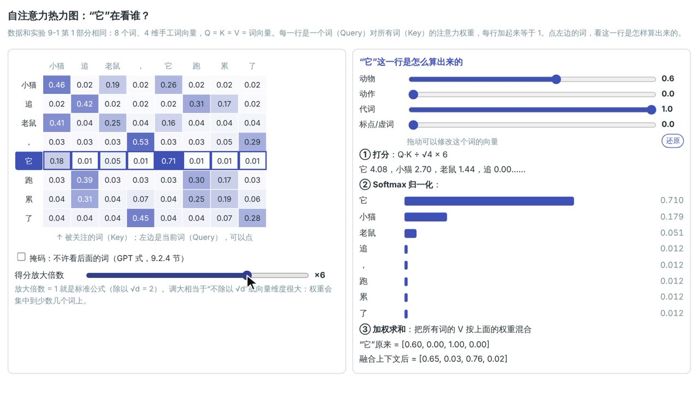
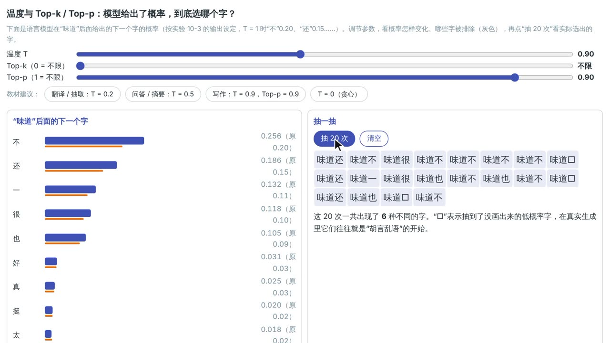
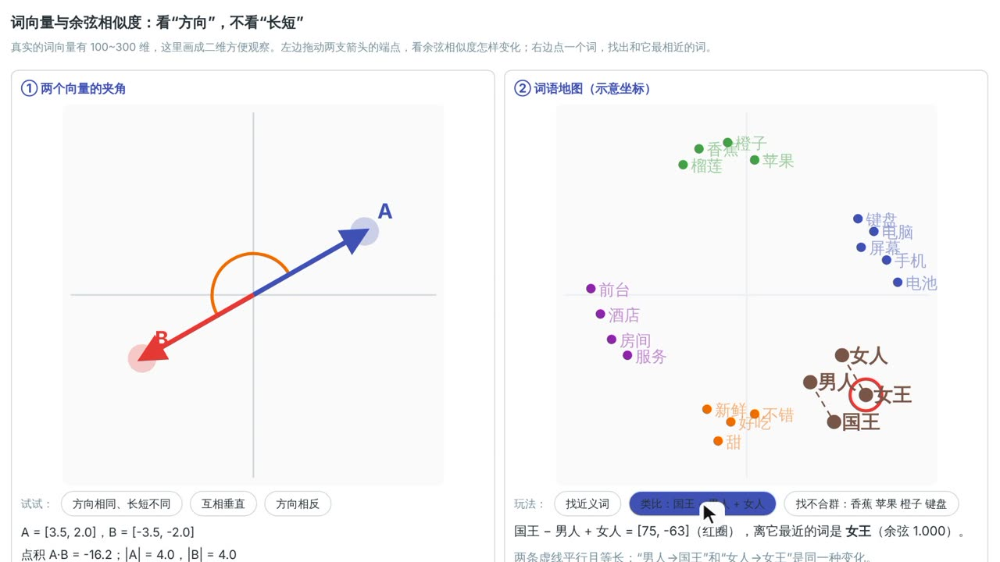
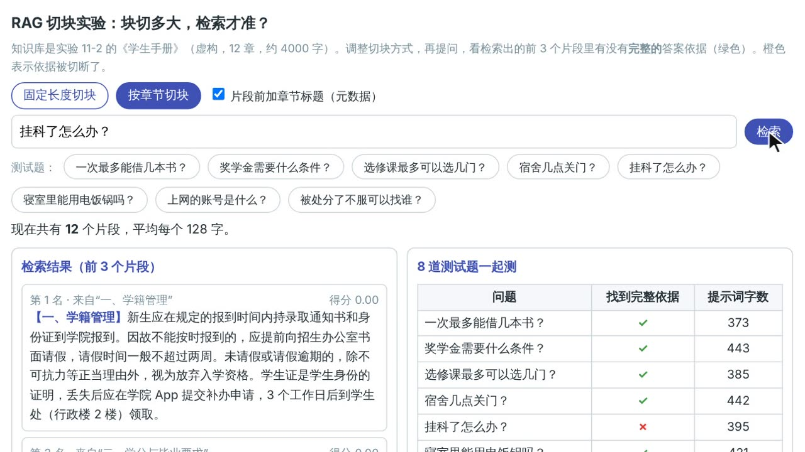
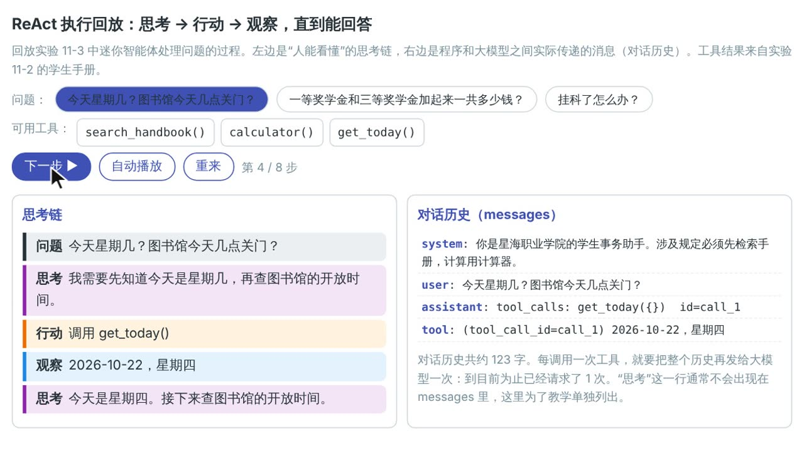

# 自然语言处理导论

**面向成人教育人工智能技术应用专业（专科）的自然语言处理入门教材**

<!-- 书名、课程信息框和“目录与实验”表由 python tools/course.py sync 根据 course.yml 生成；全书概览表由 python tools/book_stats.py 生成 -->

<!-- course:start -->
!!! abstract "课程信息"
    4 学分 · 72 学时（理论 60 学时 + 实验 12 学时） · 第 3 学期 · 12 章 · 36 个实验 · 期末开卷
<!-- course:end -->

<!-- showcase:start -->
## 先玩一玩

从分词到大模型，亲手拆开 AI 读写文字的过程

<ol class="sc-list">
<li data-sim="sims/self-attention/main.html" data-video="assets/showcase/self-attention" data-title="自注意力热力图" data-play="拖动权重，看“它”到底指小猫还是老鼠。">
大模型读一句话时，每个字在“看”谁？

<b>自注意力热力图</b>　拖动权重，看“它”到底指小猫还是老鼠。

<a href="sims/self-attention/main.html">打开动画</a>　<a class="sc-chap" href="chapters/09-transformer/" title="第 9 章 Transformer 与预训练大模型">去读第9章 →</a>
</li>
<li data-sim="sims/temperature-sampling/main.html" data-video="assets/showcase/temperature-sampling" data-title="温度与 Top-p 采样" data-play="调高温度，冷门的词也有机会被选中。">
同一个问题，为什么 AI 每次回答都不一样？

<b>温度与 Top-p 采样</b>　调高温度，冷门的词也有机会被选中。

<a href="sims/temperature-sampling/main.html">打开动画</a>　<a class="sc-chap" href="chapters/10-generation/" title="第 10 章 机器翻译与文本生成">去读第10章 →</a>
</li>
<li data-sim="sims/word-vectors/main.html" data-video="assets/showcase/word-vectors" data-title="词向量与余弦相似度" data-play="在词语地图上找一找，意思相近的词住得近。">
国王 − 男人 + 女人 = ？让词语变成坐标

<b>词向量与余弦相似度</b>　在词语地图上找一找，意思相近的词住得近。

<a href="sims/word-vectors/main.html">打开动画</a>　<a class="sc-chap" href="chapters/05-representation/" title="第 5 章 文本表示：从词袋到文本嵌入">去读第5章 →</a>
</li>
<li data-sim="sims/rag-chunking/main.html" data-video="assets/showcase/rag-chunking" data-title="RAG 切块实验" data-play="换一种切法，8 道题的命中数马上变。">
让大模型先翻资料再回答，资料切多大最准？

<b>RAG 切块实验</b>　换一种切法，8 道题的命中数马上变。

<a href="sims/rag-chunking/main.html">打开动画</a>　<a class="sc-chap" href="chapters/11-qa-rag-agent/" title="第 11 章 问答系统、RAG 与智能体">去读第11章 →</a>
</li>
<li data-sim="sims/react-replay/main.html" data-video="assets/showcase/react-replay" data-title="ReAct 执行回放" data-play="每按一次“下一步”，多一轮思考和工具调用。">
看智能体一步步思考、查资料、得出答案

<b>ReAct 执行回放</b>　每按一次“下一步”，多一轮思考和工具调用。

<a href="sims/react-replay/main.html">打开动画</a>　<a class="sc-chap" href="chapters/11-qa-rag-agent/" title="第 11 章 问答系统、RAG 与智能体">去读第11章 →</a>
</li>
</ol>

<!-- showcase:end -->

## 这本书讲什么

自然语言处理（NLP）研究怎样让计算机听懂人话、说出人话。从输入法、搜索引擎、机器翻译，到 DeepSeek、通义千问、豆包这样的大模型助手，背后都是 NLP 技术。

本书从文本预处理、分词、句法和语义分析讲起，经过文本表示、文本分类、情感分析、命名实体识别，再到神经网络、Transformer 和预训练大模型，最后落到机器翻译、文本生成、问答系统、RAG、智能体，以及 NLP 的伦理、隐私与法律问题。经典方法讲清原理，最新的技术和产品放在每章的“前沿视窗”中介绍，帮助大家把基础知识和今天的大模型联系起来。

## 本书的特点

- **通俗易懂**：用生活中的例子和“算一算”小计算讲清原理，公式只保留最必要的部分；
- **每章三个实验**：全书 36 个实验，★ 为基础实验，☆ 为拓展实验，教师可按课时选做，其余作为课后练习；
- **结果真实**：书中的运行结果都是编者实际运行得到的；需要联网下载模型或调用大模型 API、编写环境无法运行的部分标为“待实测”，并提供记录表供学生填写；
- **贴近工作**：大量使用外卖评论、客服问答、政务留言、简历解析等真实场景，并介绍 AI 训练师等相关岗位的工作内容；
- **工具主流**：使用 NLTK、spaCy、Transformers 三大工具库，以及 jieba、scikit-learn、PyTorch、gensim 和国产大模型 API。

## 全书概览

<!-- stats:start -->

| 章 | 正文字数 | 实验 | 课后练习 （可在线作答） | 术语 | 参考文献 | 交互动画 |
|---|---|---|---|---|---|---|
| [第 1 章](chapters/01-intro/index.md) | 1.2 万 | 3 | 23（15） | 7 | 10 | 1 |
| [第 2 章](chapters/02-preprocessing/index.md) | 0.9 万 | 3 | 26（15） | 13 | 10 | 1 |
| [第 3 章](chapters/03-lexical/index.md) | 1.2 万 | 3 | 24（15） | 15 | 9 | 2 |
| [第 4 章](chapters/04-syntax/index.md) | 1.1 万 | 3 | 23（15） | 16 | 11 | 1 |
| [第 5 章](chapters/05-representation/index.md) | 1.2 万 | 3 | 26（15） | 21 | 11 | 2 |
| [第 6 章](chapters/06-classification/index.md) | 1.2 万 | 3 | 24（15） | 27 | 10 | 2 |
| [第 7 章](chapters/07-ner/index.md) | 1.2 万 | 3 | 25（15） | 18 | 10 | 1 |
| [第 8 章](chapters/08-deep-learning/index.md) | 1.3 万 | 3 | 22（15） | 29 | 11 | 2 |
| [第 9 章](chapters/09-transformer/index.md) | 1.2 万 | 3 | 22（15） | 30 | 12 | 1 |
| [第 10 章](chapters/10-generation/index.md) | 1.2 万 | 3 | 22（15） | 22 | 11 | 3 |
| [第 11 章](chapters/11-qa-rag-agent/index.md) | 1.3 万 | 3 | 22（15） | 22 | 10 | 2 |
| [第 12 章](chapters/12-ethics/index.md) | 1.3 万 | 3 | 22（15） | 16 | 12 | 1 |
| **合计** | **14.3 万** | **36** | **281（180）** | **236** | **127** | **19** |

正文字数只统计汉字，不含代码和课后练习；单选、多选和判断题可以在网页上直接作答。配套学习资源：[交互动画](sims/index.md) 19 个 · [学习图谱](learning-graph/index.md) 176 个概念 · [常见问题](faq/index.md) 55 问 · [术语表](appendix/glossary.md) 236 条。

<!-- stats:end -->

## 目录与实验

<!-- toc:start -->
| 章节 | 实验 |
|---|---|
| [第 1 章 自然语言处理概述](chapters/01-intro/index.md) | 实验 1-1 ★ 搭建 NLP 实验环境 实验 1-2 ★ 三大工具库初体验 实验 1-3 ☆ 国产大模型横向测评 |
| [第 2 章 文本预处理](chapters/02-preprocessing/index.md) | 实验 2-1 ★ 正则表达式与编码处理 实验 2-2 ★ NLTK 英文预处理流水线 实验 2-3 ☆ 中文评论数据清洗（规则 + 大模型辅助） |
| [第 3 章 词法分析：分词、词性与大模型分词器](chapters/03-lexical/index.md) | 实验 3-1 ★ 动手实现最大匹配分词 实验 3-2 ★ jieba 与 spaCy 分词和词性标注 实验 3-3 ★ 大模型分词器体验 |
| [第 4 章 句法分析与语义分析](chapters/04-syntax/index.md) | 实验 4-1 ★ 编写上下文无关文法并画出句法树 实验 4-2 ★ 依存句法分析与“主谓宾”提取 实验 4-3 ☆ 传统句法分析工具与大模型对比 |
| [第 5 章 文本表示：从词袋到文本嵌入](chapters/05-representation/index.md) | 实验 5-1 ★ 词袋模型、TF-IDF 关键词提取与相似文章推荐 实验 5-2 ★ 训练 Word2Vec 词向量 实验 5-3 ★ 用嵌入模型做语义搜索 |
| [第 6 章 文本分类与情感分析](chapters/06-classification/index.md) | 实验 6-1 ★ 基于情感词典的情感分析 实验 6-2 ★ 电商评论情感分类与模型评估 实验 6-3 ☆ 大模型零样本分类与网页小工具 |
| [第 7 章 命名实体识别与信息抽取](chapters/07-ner/index.md) | 实验 7-1 ★ BIO 标注实践与规则抽取 实验 7-2 ★ spaCy 与 Transformers 命名实体识别 实验 7-3 ★ 大模型结构化抽取与知识图谱 |
| [第 8 章 深度学习基础：神经网络、RNN 与 LSTM](chapters/08-deep-learning/index.md) | 实验 8-1 ★ 用 NumPy 从零实现感知机与两层神经网络 实验 8-2 ★ 用 PyTorch 搭建 LSTM 情感分类器 实验 8-3 ☆ RNN、LSTM、GRU 对比与“记忆力测试” |
| [第 9 章 Transformer 与预训练大模型](chapters/09-transformer/index.md) | 实验 9-1 ★ 手算自注意力，并搭建小型 Transformer 分类器 实验 9-2 ★ 用 Transformers 体验预训练模型，并微调中文 BERT 实验 9-3 ☆ 用 LoRA 微调小型开源大模型，打造“校园助手” |
| [第 10 章 机器翻译与文本生成](chapters/10-generation/index.md) | 实验 10-1 ★ 读懂 BLEU，比较翻译模型与大模型翻译 实验 10-2 ★ TextRank 抽取式摘要与大模型生成式摘要 实验 10-3 ☆ 解码策略实验与 Ollama 本地部署大模型 |
| [第 11 章 问答系统、RAG 与智能体](chapters/11-qa-rag-agent/index.md) | 实验 11-1 ★ 大模型 API 调用与提示工程 实验 11-2 ★ 从零搭建“学生手册问答”RAG 系统 实验 11-3 ☆ 用低代码平台搭建校园智能体 |
| [第 12 章 NLP 的伦理、安全与法律](chapters/12-ethics/index.md) | 实验 12-1 ★ 个人信息识别与脱敏工具 实验 12-2 ★ 发现并缓解情感分类模型中的性别偏见 实验 12-3 ★ 提示注入攻击与防御 |

附录：[A Python 速查](appendix/a-python.md) · [B NLP 工具库接口速查](appendix/b-libraries.md) · [C 实验环境、模型与数据说明](appendix/c-environment.md) · [D 国产大模型 API 申请与使用指南](appendix/d-llm-api.md) · [E 术语表](appendix/glossary.md)
<!-- toc:end -->

## 怎样使用本书

1. **学生**：先读第 1 章“1.7 怎样学好这门课”，按附录 C 搭建实验环境。每个实验先照着代码运行，再逐行理解，最后动手修改；
2. **教师**：附录 C 给出了需要联网的实验清单和课时安排建议。建议开课前把书中用到的预训练模型下载好、分发给学生，并完成“待实测”部分的实测；
3. **配套资源**：`labs/` 目录中按章存放了全部实验代码和数据，`labs/requirements.txt` 列出了编写时实测通过的库版本，`labs/data/README.md` 说明了各数据集的来源和用途。
